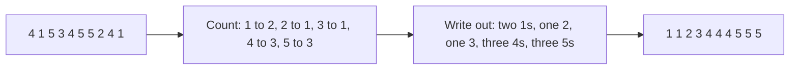
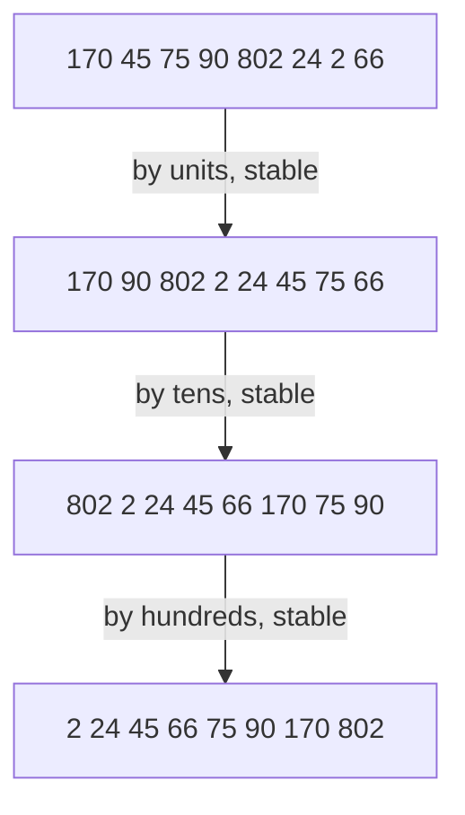
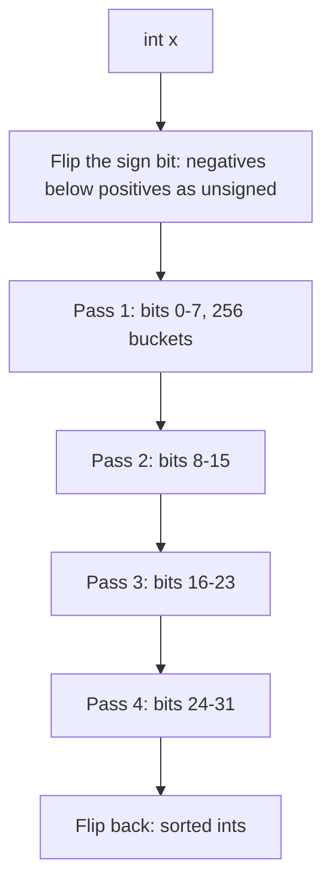

# new

## explanation

### Sorting without comparing

Every sort so far compared items with each other, and comparison sorts can't beat O(n log n). But when the values are small whole numbers, there's a shortcut: **count** them.

### Counting sort

Suppose you have a thousand star ratings, each from 1 to 5. Make a table of 5 counters. Go through the ratings once, adding one to the right counter. Then write out the sorted list: as many 1s as the first counter says, then the 2s, and so on.

No item is ever compared with another. The work is one pass over the n items plus one pass over the k possible values: **O(n + k)**. When k is small, that's linear time.

### When it fits

Counting sort needs:

- whole-number keys,
- in a **small range**: ages, marks out of 100, star ratings, letters.

If the values can be anything up to a billion, the counting table would need a billion counters. Then it's the wrong tool.

### Radix sort, the idea

What about bigger numbers? **Radix sort** sorts them one digit at a time, using counting sort on each digit, which only has 10 possible values. It starts from the **last** digit and works towards the first. The trick that makes it work: each digit's sort must keep ties in the order the previous pass left them. The building level shows how.

### Bucket sort, the idea

For decimals spread evenly between 0 and 1, **bucket sort** drops each value into one of n buckets by its first digits (like 0.1x, 0.2x, …), sorts each nearly empty bucket, and joins them. With evenly spread data, it's O(n) on average.

### The trade-off

These sorts are fast because they use something extra about the keys. They need memory for the counts or buckets, and they only apply when the keys have that shape.

## diagram



## example

```cpp
#include <iostream>
#include <vector>

int main() {
    std::vector<int> ratings = {4, 1, 5, 3, 4, 5, 5, 2, 4, 1};  // star ratings from 1 to 5
    std::vector<int> count(6, 0);  // count[r] = how many ratings equal r
    for (int r : ratings) count[r]++;
    for (int r = 1; r <= 5; r++) std::cout << r << ":" << count[r] << ' ';
    std::cout << '\n';

    std::vector<int> sorted;
    for (int r = 1; r <= 5; r++)
        for (int c = 0; c < count[r]; c++) sorted.push_back(r);
    for (int x : sorted) std::cout << x << ' ';
    std::cout << '\n';
}
```

```text
1:2 2:1 3:1 4:3 5:3
1 1 2 3 4 4 4 5 5 5
```

1. The table has 6 counters so that `count[5]` exists; `count[0]` is simply unused.
2. One pass over the ratings fills the table: two 1s, one 2, one 3, three 4s and three 5s.
3. Walking the table from 1 to 5 and writing each value as many times as it was counted gives the sorted list.
4. Not a single comparison between ratings was made: 10 items and 5 counters, so O(n + k).

## mistakes

- **Using it on a huge range.** Values up to 10⁹ need a billion counters. Counting sort only fits when the range k is small, roughly no bigger than n.
- **Forgetting negative values.** `count[-3]` is out of bounds. Shift every value by the minimum first: use `count[x - minValue]`.
- **Sizing the table one short.** For values 0 to k you need k + 1 counters.
- **Sorting records by rewriting just the keys.** Writing out "two 31s" loses whose ages they were. To sort records, place the records themselves using positions: the building level shows the stable version.
- **Using it on decimals.** 2.5 can't index a table. Counting sort needs whole-number keys.

## check

```cpp
#include <iostream>
#include <vector>

int main() {
    std::vector<int> v = {3, 0, 3, 2, 0, 3};
    std::vector<int> count(4, 0);
    for (int x : v) count[x]++;
    int pos = 0;
    for (int value = 0; value < 4; value++)
        while (count[value]-- > 0) v[pos++] = value;
    std::cout << v[1] << v[2] << v[5] << ' ' << count[1] << '\n';
}
```

```text
023 -1
```

The counts are two 0s, no 1s, one 2 and three 3s, so the sorted list is 0 0 2 3 3 3: positions 1, 2 and 5 hold 0, 2 and 3. `count[value]--` decreases the counter even when the test fails, so the counter for 1, which was 0, ends at -1. The counters are used up while writing.

# building

## explanation

### A quick recap

Counting sort tallies small whole-number keys and writes them out in order, in O(n + k) with no comparisons. Radix sort applies it digit by digit, and bucket sort spreads evenly distributed values into buckets.

### Stable counting sort for records

To sort records, like people by age, you must move the **records**, not rewrite keys. Use the counts to work out where each key's block **starts**:

1. Count each key, storing the count for key `a` in `start[a + 1]`.
2. Turn the counts into running totals: `start[a] += start[a − 1]`. Now `start[a]` is how many records have a smaller key, which is exactly where key `a`'s block begins.
3. Go through the records **in their original order** and place each at `start[key]`, then move that position on.

Records with the same key are placed in the order they arrived, so the sort is **stable**. It's still O(n + k).

### Radix sort, least significant digit first

Radix sort sorts numbers by their **last** digit, then by the tens, then the hundreds, using stable counting sort on each digit. Why does it work? After sorting by the tens, numbers with the same tens digit keep the order from the previous pass, which was by the units. So after each pass, the list is sorted by all the digits seen so far.

With d digits and base b (10 here), radix sort costs O(d × (n + b)). For numbers with a fixed number of digits, that's linear in n.

### Step by step: choosing

1. Small whole-number keys? Stable counting sort.
2. Whole numbers with a fixed number of digits, and lots of them? Radix sort.
3. Decimals spread evenly over a known range? Bucket sort.
4. Anything else? A comparison sort like `std::sort`.

## diagram



## example

```cpp
#include <algorithm>
#include <iostream>
#include <string>
#include <vector>

struct Person {
    std::string name;
    int age;
};

// Stable counting sort by a small key: count each age, then each age's first slot is the count of younger people.
std::vector<Person> byAge(const std::vector<Person>& people, int maxAge) {
    std::vector<int> count(maxAge + 1, 0), firstSlot(maxAge + 1, 0);
    for (const auto& p : people) count[p.age]++;
    for (int a = 1; a <= maxAge; a++) firstSlot[a] = firstSlot[a - 1] + count[a - 1];
    std::vector<Person> sorted(people.size());
    for (const auto& p : people) sorted[firstSlot[p.age]++] = p;  // input order, so ties keep their order
    return sorted;
}

// LSD radix sort: deal the numbers into ten buckets by one digit, in order, then collect them; units first.
void radixSort(std::vector<int>& v) {
    int biggest = *std::max_element(v.begin(), v.end());
    for (long long place = 1; biggest / place > 0; place *= 10) {
        std::vector<std::vector<int>> bucket(10);
        for (int x : v) bucket[x / place % 10].push_back(x);  // appending keeps equal digits in order
        v.clear();
        for (const auto& b : bucket) v.insert(v.end(), b.begin(), b.end());
    }
}

int main() {
    std::vector<Person> people = {{"Ira", 31}, {"Om", 25}, {"Zia", 31}, {"Ben", 19}, {"Ana", 25}};
    for (const auto& p : byAge(people, 40)) std::cout << p.name << p.age << ' ';
    std::cout << '\n';
    std::vector<int> v = {170, 45, 75, 90, 802, 24, 2, 66};
    radixSort(v);
    for (int x : v) std::cout << x << ' ';
    std::cout << '\n';
}
```

```text
Ben19 Om25 Ana25 Ira31 Zia31
2 24 45 66 75 90 170 802
```

1. `byAge` counts each age, then turns the counts into starting positions: age 19 starts at 0, age 25 at 1, age 31 at 3.
2. Placing people in their original order puts Om before Ana and Ira before Zia: equal ages keep their order, so the sort is stable.
3. `radixSort` makes three passes, for units, tens and hundreds, because the biggest number, 802, has three digits.
4. Each pass deals the numbers into ten buckets by one digit and collects them bucket by bucket. Appending keeps numbers with the same digit in their previous order, so each pass is stable, and after the last one the numbers are sorted by all three digits.

## mistakes

- **An unstable sort for the digit passes.** Radix sort depends on each pass keeping the previous order among ties. An unstable pass scrambles the lower digits' order.
- **Starting from the first digit with the same method.** Sorting by the most significant digit first needs a different, recursive approach. The simple loop must go from the last digit to the first.
- **Negative numbers in radix sort.** `x / place % 10` is negative for negative `x`, which indexes outside the table. Handle negatives separately, or shift the values.
- **Overflowing `place`.** `place *= 10` passes the `int` limit for numbers near 2 billion. Use `long long`, or loop a fixed number of times.
- **Counting sort with a huge maximum.** `byAge(people, 1000000000)` allocates a billion counters. Check the key range first.

## check

```cpp
#include <iostream>
#include <vector>

int main() {
    std::vector<int> keys = {2, 0, 2, 1, 0};
    std::vector<int> start(4, 0);
    for (int k : keys) start[k + 1]++;
    for (int i = 1; i < 4; i++) start[i] += start[i - 1];
    std::cout << start[0] << start[1] << start[2] << start[3] << '\n';
}
```

```text
0235
```

The counts land one place to the right: two 0s in `start[1]`, one 1 in `start[2]` and two 2s in `start[3]`. Running totals turn 0, 2, 1, 2 into 0, 2, 3, 5: key 0 starts at position 0, key 1 at 2, key 2 at 3, and 5 is the total.

# strong

## explanation

### How they escape the lower bound

Comparison sorts need Ω(n log n) comparisons because each comparison gives one bit of information. Counting and radix sort never compare items: they use each key **as an index**, getting many bits of information per step. That's why they can be linear, and why they only work when keys are integers, or can be turned into them.

### Costs in detail

- **Counting sort**: O(n + k) time and O(n + k) extra space. Worth it when k is about n or smaller.
- **Radix sort**: d passes of counting sort with base b: O(d(n + b)) time, O(n + b) space. For 32-bit integers, base 256 needs 4 passes of 256 buckets, much better than 10 passes of base 10. Radix sort often beats `std::sort` for millions of integers, though it reads memory less sequentially, which costs on cache.
- **Bucket sort**: with n buckets and evenly spread keys, the expected bucket size is constant, so the expected time is O(n). Skewed data piles into a few buckets and degrades to the cost of sorting those buckets.

### Negative numbers and other keys

Signed integers don't sort correctly as raw unsigned bit patterns, because negatives have the top bit set. **Flip the sign bit** before sorting (`x ^ 0x80000000`) and flip it back afterwards: −1 becomes the largest value below 0's key, and the order works out. Floats can be handled with a similar bit trick. Strings can be sorted with **MSD** (most significant digit first) radix sort, which recurses into each bucket.

### Stability is the engine

LSD radix sort only works because each pass is stable. More generally, a stable sort on key 2 followed by a stable sort on key 1 sorts by (key 1, key 2): a useful technique beyond radix sort.

## diagram



## example

```cpp
#include <algorithm>
#include <cstdint>
#include <iostream>
#include <vector>

// LSD radix sort on 32-bit ints, one byte per pass: 4 passes of 256 buckets.
// Flipping the sign bit makes negatives sort before positives as unsigned values.
void radixSort32(std::vector<int>& v) {
    std::vector<std::uint32_t> keys(v.size()), out(v.size());
    for (std::size_t i = 0; i < v.size(); i++) keys[i] = static_cast<std::uint32_t>(v[i]) ^ 0x80000000u;
    for (int shift = 0; shift < 32; shift += 8) {
        std::vector<std::size_t> start(257, 0);
        for (auto k : keys) start[((k >> shift) & 0xFF) + 1]++;
        for (int b = 1; b <= 256; b++) start[b] += start[b - 1];
        for (auto k : keys) out[start[(k >> shift) & 0xFF]++] = k;
        keys.swap(out);
    }
    for (std::size_t i = 0; i < v.size(); i++) v[i] = static_cast<int>(keys[i] ^ 0x80000000u);
}

// Bucket sort for values spread evenly over [0, 1): n buckets, each nearly empty.
void bucketSort(std::vector<double>& v) {
    std::vector<std::vector<double>> buckets(v.size());
    for (double x : v) buckets[static_cast<std::size_t>(x * v.size())].push_back(x);
    v.clear();
    for (auto& b : buckets) {
        std::sort(b.begin(), b.end());  // tiny on average
        v.insert(v.end(), b.begin(), b.end());
    }
}

int main() {
    std::vector<int> v = {-5, 300000, 0, -70000, 42, 7, -1, 2000000000};
    radixSort32(v);
    for (int x : v) std::cout << x << ' ';
    std::cout << '\n';
    std::vector<double> d = {0.78, 0.17, 0.39, 0.26, 0.72, 0.94, 0.21, 0.12};
    bucketSort(d);
    for (double x : d) std::cout << x << ' ';
    std::cout << '\n';
}
```

```text
-70000 -5 -1 0 7 42 300000 2000000000
0.12 0.17 0.21 0.26 0.39 0.72 0.78 0.94
```

1. Flipping the sign bit maps the most negative `int` to 0 and the largest to 4,294,967,295, so the unsigned order is the signed order.
2. Each of the four passes is a stable counting sort on one byte. The buffers are swapped instead of copied.
3. After the last pass, flipping the sign bit back recovers the original values, now in order, negatives first.
4. With 8 values, bucket `i` covers [i/8, (i+1)/8); each value lands in its own or a nearly empty bucket, and joining the buckets in order gives the sorted list.

## mistakes

- **Radix-sorting signed values as raw bits.** Negatives have the top bit set and would come out after the positives. Flip the sign bit, or offset the values.
- **A small base for large keys.** Base 10 on 32-bit integers needs 10 passes. Base 256 needs 4. Pick the base to balance passes against table size.
- **Bucket sort on skewed data.** If most values fall into a few buckets, those buckets dominate and the cost approaches that of a comparison sort. It relies on an even spread.
- **A value equal to the top of the range.** In bucket sort, x = 1.0 gives index n, one past the last bucket. Make sure keys stay inside [0, 1), or clamp the index.
- **Ignoring memory.** Counting and radix sort need O(n + k) or O(n + b) extra space, while `std::sort` works in place. For small inputs, `std::sort` is usually as fast and simpler.

## check

```cpp
#include <iostream>

int main() {
    long long n = 1'000'000, digits = 4, base = 256;
    long long radixWork = digits * (n + base);
    long long countingMemory = 1'000'000'000LL;  // a counting array for keys up to 10^9
    unsigned flipped = static_cast<unsigned>(-1) ^ 0x80000000u;
    std::cout << radixWork << ' ' << (countingMemory > 100 * n) << ' ' << flipped << '\n';
}
```

```text
4001024 1 2147483647
```

Radix sort on a million 32-bit keys with base 256 does 4 × (1,000,000 + 256) = 4,001,024 bucket steps: linear in n. A counting table for keys up to 10⁹ would be over 100 times bigger than the input, so counting sort doesn't fit there. −1 is all ones; with the sign bit flipped it becomes 2,147,483,647, just below 0's key, 2,147,483,648, so −1 still sorts right before 0.
