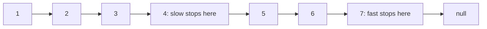
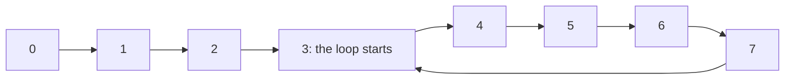
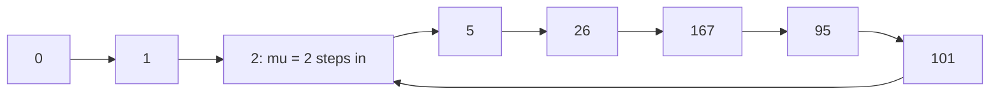

# new

## explanation

### Two walkers on one list

A singly linked list can only be walked forwards, and you don't know its length without walking it all. Many questions still have neat one-pass answers if you send **two pointers** along the list at the same time, either at **different speeds** or with a **fixed gap** between them.

### Finding the middle: slow and fast

Move `slow` one node per step and `fast` two nodes per step. When `fast` reaches the end, `slow` has gone exactly half as far: it's at the middle. One pass, no counting first.

```cpp
while (fast && fast->next) {
    slow = slow->next;
    fast = fast->next->next;
}
```

The loop checks both `fast` and `fast->next`, so the double step never follows a `nullptr`. With an even number of nodes, `slow` stops at the second of the two middle nodes.

### The k-th node from the end: a fixed gap

Start a `lead` pointer k nodes ahead of a `trail` pointer, then move both one step at a time. When `lead` falls off the end, `trail` is k nodes behind it: the k-th from the end. Again one pass.

### Why these tricks matter

They answer position questions in O(n) time with O(1) extra memory, without counting the length first or copying the list into an array. The same slow-and-fast idea also detects loops in a list, which the building level covers.

### Safety first

Before every `->next`, make sure the pointer isn't `nullptr`. For the k-th from the end, check that the list has at least k nodes, or `lead` runs off before the gap is set up.

## diagram



## example

```cpp
#include <iostream>

struct Node { int value; Node* next; };

int main() {
    Node* head = nullptr;
    for (int v = 7; v >= 1; v--) head = new Node{v, head};  // 1 -> 2 -> ... -> 7

    // Middle: fast moves two steps for every one step of slow.
    Node* slow = head;
    Node* fast = head;
    while (fast && fast->next) {
        slow = slow->next;
        fast = fast->next->next;
    }
    std::cout << "middle: " << slow->value << '\n';

    // k-th from the end: start `lead` k steps ahead, then move both until lead falls off.
    int k = 2;
    Node* lead = head;
    Node* trail = head;
    for (int i = 0; i < k; i++) lead = lead->next;
    while (lead) { lead = lead->next; trail = trail->next; }
    std::cout << k << "nd from the end: " << trail->value << '\n';

    while (head) { Node* next = head->next; delete head; head = next; }
}
```

```text
middle: 4
2nd from the end: 6
```

1. The list holds 1 to 7. After three steps, `fast` is on 7, which has no next node, so the loop stops with `slow` on 4: the middle.
2. `lead` starts 2 nodes ahead, on 3. Both move until `lead` passes 7, by which time `trail` is on 6, the 2nd node from the end.
3. Both answers took a single walk; the list's length was never computed.
4. The last loop frees every node.

## mistakes

- **`fast->next->next` without checking.** If `fast` or `fast->next` is `nullptr`, this crashes. Test `fast && fast->next` in the loop condition.
- **Expecting the first middle on even lists.** For 1 2 3 4, this loop stops at 3. If you need 2, start `fast` at `head->next`.
- **k larger than the list.** Moving `lead` k steps then follows a `nullptr`. Check the length, or stop if `lead` runs out early.
- **Off-by-one in the gap.** A gap of k puts `trail` on the k-th from the end, counting the last node as 1st. A gap of k + 1 puts it just before, which is what you need to delete the k-th.
- **Counting the length first by habit.** It works, but it's two passes. The gap trick does it in one.

## check

```cpp
#include <iostream>

struct Node { int value; Node* next; };

int main() {
    Node n6{6, nullptr}, n5{5, &n6}, n4{4, &n5}, n3{3, &n4}, n2{2, &n3}, n1{1, &n2};
    Node* slow = &n1;
    Node* fast = &n1;
    int steps = 0;
    while (fast && fast->next) { slow = slow->next; fast = fast->next->next; steps++; }
    std::cout << slow->value << ' ' << steps << '\n';
}
```

```text
4 3
```

With six nodes, `fast` visits 1, 3, 5, then steps past 6 to `nullptr`, which takes 3 steps. `slow` moves 1, 2, 3, 4. On an even-length list it ends on the second middle node, 4.

# building

## explanation

### A quick recap

Two pointers walking one list answer position questions in one pass: a slow and a fast one find the middle; a fixed gap finds the k-th from the end. Check every `->next` for `nullptr`.

### Detecting a loop (Floyd's algorithm)

A bug or a deliberate design can make a list's last node point back into the list, so walking it never ends. To detect this without extra memory, run slow (one step) and fast (two steps) together:

- If there's no loop, `fast` reaches `nullptr`.
- If there is one, both pointers end up inside it, and `fast` gains one node on `slow` per step, so it must eventually land on the same node. They meet.

### Where the loop starts

After they meet, put one pointer back at the head and leave the other at the meeting point. Now move **both one step at a time**. They meet again exactly at the loop's first node. (The strong level shows why.)

Once you have that node, the loop's length is one walk around it, counting until you're back.

### Where two lists join

Two lists may merge into one shared tail, like a Y. Walk pointer `p` through list A and then list B, and `q` through list B and then list A. Both travel the same total distance, so if the lists share a tail, `p` and `q` arrive at the joining node at the same time; if not, both reach `nullptr` together.

### Compare nodes, not values

Loops and joins are about **the same node**, so compare pointers (`p == q`), never values: two different nodes can hold the same number.

## diagram



## example

```cpp
#include <iostream>
#include <vector>

struct Node { int value; Node* next; };

// Floyd: if there's a loop, hare catches up with tortoise inside it.
Node* loopStart(Node* head) {
    Node* tortoise = head;
    Node* hare = head;
    while (hare && hare->next) {
        tortoise = tortoise->next;
        hare = hare->next->next;
        if (tortoise == hare) {  // they met inside the loop
            Node* a = head;
            while (a != tortoise) { a = a->next; tortoise = tortoise->next; }  // same speed: they meet at the entrance
            return a;
        }
    }
    return nullptr;  // hare reached the end: no loop
}
// Where two lists join: each pointer walks its own list, then the other; both cover the same distance.
Node* meetingPoint(Node* a, Node* b) {
    Node* p = a;
    Node* q = b;
    while (p != q) {
        p = p ? p->next : b;
        q = q ? q->next : a;
    }
    return p;  // nullptr if they never join
}
int main() {
    std::vector<Node> n(8);  // nodes in a vector: nothing to free
    for (int i = 0; i < 8; i++) n[i] = {i, i + 1 < 8 ? &n[i + 1] : nullptr};
    std::cout << "loop? " << (loopStart(&n[0]) != nullptr) << '\n';
    n[7].next = &n[3];  // 0 -> ... -> 7 -> back to 3
    Node* start = loopStart(&n[0]);
    int length = 0;
    Node* walker = start;
    do walker = walker->next, length++;
    while (walker != start);
    std::cout << "loop starts at " << start->value << ", length " << length << '\n';

    n[7].next = nullptr;              // remove the loop again
    Node x{100, &n[5]}, y{200, &x};  // a second list 200 -> 100 that joins at node 5
    std::cout << "lists join at " << meetingPoint(&n[0], &y)->value << '\n';
}
```

```text
loop? 0
loop starts at 3, length 5
lists join at 5
```

1. Without a loop, `hare` reaches the end and `loopStart` returns `nullptr`.
2. After `n[7]` is pointed back at node 3, the tortoise and the hare meet somewhere in the loop; restarting one from the head and walking both one step at a time brings them together at node 3.
3. Walking from node 3 until returning to it counts 3, 4, 5, 6, 7: length 5.
4. The second list, 200 → 100, joins the first at node 5. `p` walks all of list A and then the start of list B; `q` walks list B and then the start of list A. Having covered the same distance, they reach node 5 at the same moment.

## mistakes

- **Comparing values to detect meetings.** Two different nodes can hold equal values. Compare the pointers themselves.
- **Checking `slow == fast` before moving.** Both start at the head, so the test is true immediately. Move first, then compare.
- **Marking visited nodes by changing them.** Setting a flag or a value on each node detects loops too, but corrupts the list. Floyd changes nothing.
- **A hash set of visited nodes when memory matters.** It works in O(n), but uses O(n) memory. Floyd uses O(1).
- **Forgetting the no-join case.** If two lists never meet, `p` and `q` both become `nullptr` after walking both lists; handle that result.

## check

```cpp
#include <iostream>

struct Node { int value; Node* next; };

int main() {
    Node n[5];
    for (int i = 0; i < 5; i++) n[i] = {i * 10, &n[(i + 1) % 5]};  // a full circle
    Node* tortoise = &n[0];
    Node* hare = &n[0];
    int steps = 0;
    do { tortoise = tortoise->next; hare = hare->next->next; steps++; } while (tortoise != hare);
    std::cout << steps << ' ' << tortoise->value << '\n';
}
```

```text
5 0
```

The five nodes form a circle. Each step, fast gains one node on slow; starting together, it has to gain a whole lap of 5 to meet slow again. After 5 steps, slow has gone round once and fast twice, so they meet back at node 0.

# strong

## explanation

### Why the meeting point leads to the entrance

Let the loop start μ steps from the head and have length λ. When slow has taken t steps, fast has taken 2t, and they meet when fast is a whole number of laps ahead: t is a multiple of λ, with slow inside the loop. From the meeting point, moving μ more steps puts slow at position t + μ, a multiple of λ past the entrance, which is the entrance itself. A pointer starting at the head reaches the entrance after exactly μ steps too, so they meet there.

### Loops in sequences, not just lists

Floyd works on any process where each value determines the next: x, f(x), f(f(x)), … over a finite set of values must eventually repeat, forming the shape of the letter ρ. Pseudo-random generators, hash chains and "keep applying this rule" puzzles all have this shape. Floyd finds μ and λ with O(1) memory, without storing the sequence. (Brent's variant uses fewer calls to f.) Pollard's rho factoring method uses exactly this.

### Changing the list in place, then putting it back

Some questions are easy with backward access, like "is the list a palindrome?". With O(1) memory:

1. Find the middle with slow and fast.
2. Reverse the second half in place.
3. Compare the first half with the reversed second half.
4. **Reverse the second half again**, so the caller gets its list back unchanged.

The same steps support reordering a list as first, last, second, second-to-last, and so on.

### Costs

All of these are O(n) time and O(1) memory, but each pointer step can be a cache miss. On a few hundred nodes, copying the values into a vector first can be simpler and just as fast. The pointer techniques matter when memory is tight, when the list is huge, or when the structure can't be copied.

## diagram



## example

```cpp
#include <iostream>

struct Node { int value; Node* next; };

// Any sequence x, f(x), f(f(x)), ... over a finite set must loop. Floyd finds where it enters (mu)
// and how long the loop is (lam), with O(1) memory.
int f(int x) { return (x * x + 1) % 255; }

Node* reverse(Node* h) {
    Node* prev = nullptr;
    while (h) { Node* next = h->next; h->next = prev; prev = h; h = next; }
    return prev;
}
// Palindrome in O(1) extra memory: reverse the second half, compare, then reverse it back.
bool isPalindrome(Node* head) {
    Node *slow = head, *fast = head;
    while (fast && fast->next) { slow = slow->next; fast = fast->next->next; }
    Node* second = reverse(slow);
    bool same = true;
    for (Node *a = head, *b = second; b; a = a->next, b = b->next) if (a->value != b->value) same = false;
    reverse(second);  // put the list back as the caller gave it
    return same;
}

int main() {
    int slow = f(0), fast = f(f(0));
    while (slow != fast) { slow = f(slow); fast = f(f(fast)); }
    int mu = 0;
    for (slow = 0; slow != fast; mu++) { slow = f(slow); fast = f(fast); }
    int lam = 1;
    for (fast = f(slow); fast != slow; fast = f(fast)) lam++;
    std::cout << "from 0: loop entered after " << mu << " steps, loop length " << lam << '\n';
    for (int x = 0, i = 0; i < mu + lam + 1; i++, x = f(x)) std::cout << x << ' ';
    std::cout << '\n';

    Node a[5] = {{1, &a[1]}, {2, &a[2]}, {3, &a[3]}, {2, &a[4]}, {1, nullptr}};
    Node b[4] = {{1, &b[1]}, {2, &b[2]}, {2, &b[3]}, {3, nullptr}};
    std::cout << isPalindrome(a) << isPalindrome(b) << " | restored:";
    for (Node* n = a; n; n = n->next) std::cout << ' ' << n->value;
    std::cout << '\n';
}
```

```text
from 0: loop entered after 2 steps, loop length 6
0 1 2 5 26 167 95 101 2
10 | restored: 1 2 3 2 1
```

1. Floyd runs on the numbers themselves: `slow` applies f once per step, `fast` twice. Once they meet, restarting `slow` from 0 and moving both one step at a time finds the entrance after μ = 2 steps.
2. One walk around from the entrance counts the loop: 2, 5, 26, 167, 95 and 101, so λ = 6. Printing the sequence shows 2 coming back after 101.
3. `isPalindrome` reverses the half from the middle on, compares it with the front half, and reverses it back. 1 2 3 2 1 is a palindrome; 1 2 2 3 isn't.
4. Printing the first list afterwards shows it in its original order.

## mistakes

- **Leaving a list modified.** If a function reverses half a list to inspect it, it must restore it before returning; callers don't expect their data changed by a question.
- **Assuming every sequence loops back to its start.** In general, the loop starts after a lead-in (μ > 0), as with 0 and 1 here. Find μ explicitly.
- **Moving before testing in the entrance search.** When μ = 0, the two pointers already meet at the start. Test before moving, as the `for` loop above does, or that case is missed.
- **Unbounded sequences.** Floyd needs a finite set of possible values. Over all integers a sequence may never repeat, so the loop never ends.
- **Overkill on small lists.** For a short list, copying values into a vector and using indexes is simpler and less error-prone.

## check

```cpp
#include <iostream>

int main() {
    auto f = [](int x) { return (3 * x + 1) % 10; };
    int slow = f(4), fast = f(f(4)), steps = 1;
    while (slow != fast) { slow = f(slow); fast = f(f(fast)); steps++; }
    int lam = 1;
    for (int p = f(slow); p != slow; p = f(p)) lam++;
    std::cout << steps << ' ' << lam << '\n';
}
```

```text
4 4
```

From 4, the sequence is 4, 3, 0, 1, 4, …: f maps each value to 3x + 1 modulo 10, and 4 comes back after four steps, so the loop has length 4 with no lead-in. Slow and fast first coincide after 4 steps, when fast has gained a full lap.
