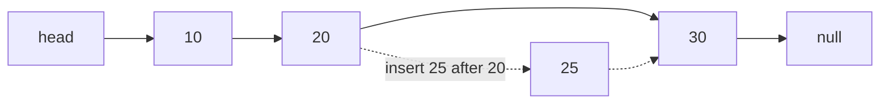
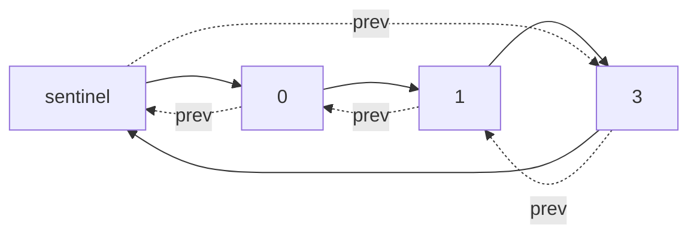

# new

## explanation

### A chain of nodes

A vector keeps its items side by side in memory. A **linked list** keeps each item in its own **node**, and each node holds a pointer to the next one:

```cpp
struct Node {
    int value;
    Node* next;
};
```

The list is reached through a pointer to its first node, the **head**. The last node's `next` is `nullptr`, which marks the end.

### Walking the list

There's no `list[3]`. To reach the fourth item, start at the head and follow `next` three times. Visiting every node is a simple loop:

```cpp
for (Node* n = head; n != nullptr; n = n->next) { ... }
```

### Inserting and deleting

This is where linked lists shine. Once you're at a node, adding a new node after it, or removing the one after it, only changes a couple of pointers: O(1), however long the list. A vector would have to shift every later item.

- **Insert at the front**: `head = new Node{value, head};`.
- **Insert after node `at`**: `at->next = new Node{value, at->next};`.
- **Delete the front**: save the old head, move `head` on, then `delete` the old one.

### The trade-off

| | Vector | Linked list |
|---|---|---|
| Reach item i | O(1) | O(i) |
| Insert or delete at a known position | O(n) | O(1) |
| Memory | one block | one allocation per node, plus a pointer each |

### Cleaning up

Every node made with `new` must be freed with `delete`. Walk the list and free each node, saving its `next` pointer **before** deleting it.

## diagram



## example

```cpp
#include <iostream>

struct Node {
    int value;
    Node* next;
};

void print(const Node* head) {
    for (const Node* n = head; n != nullptr; n = n->next) std::cout << n->value << " -> ";
    std::cout << "null\n";
}

int main() {
    // Build 10 -> 20 -> 30 by adding at the front, last value first.
    Node* head = nullptr;
    for (int v : {30, 20, 10}) head = new Node{v, head};
    print(head);

    // Insert 25 after the node holding 20: O(1) once you're there.
    Node* at = head->next;
    at->next = new Node{25, at->next};
    print(head);

    // Delete the first node: move head on, then free the old one.
    Node* old = head;
    head = head->next;
    delete old;
    print(head);

    // Free every node before the program ends.
    while (head != nullptr) {
        Node* next = head->next;
        delete head;
        head = next;
    }
}
```

```text
10 -> 20 -> 30 -> null
10 -> 20 -> 25 -> 30 -> null
20 -> 25 -> 30 -> null
```

1. Adding at the front puts each new node before the old head, so adding 30, then 20, then 10 builds 10 → 20 → 30.
2. To insert 25 after 20, the new node takes over 20's `next` (the 30), and 20 now points to the new node. Two pointer changes.
3. Deleting the first node moves `head` to 20 first, so the rest of the list is never lost, and only then frees the old node.
4. The final loop saves each node's `next` before deleting the node, so it can keep walking.

## mistakes

- **Overwriting `next` too early.** `at->next = new Node{25, nullptr};` throws away the rest of the list. Give the new node the old `next` first.
- **Using a node after `delete`.** `delete head; head = head->next;` reads freed memory. Save `next` before deleting.
- **Forgetting to free the nodes.** Each `new` needs a `delete`, or the memory leaks.
- **Following `next` on an empty list.** `head->next` when `head` is `nullptr` crashes. Check for an empty list first.
- **Expecting fast indexing.** Reaching the i-th node takes i steps. If you mostly read by position, a vector is the better choice.

## check

```cpp
#include <iostream>

struct Node { int value; Node* next; };

int main() {
    Node* head = nullptr;
    for (int v : {1, 2, 3, 4}) head = new Node{v, head};
    int sum = 0, count = 0;
    for (Node* n = head; n; n = n->next) { sum += n->value * (count % 2 == 0); count++; }
    std::cout << head->value << ' ' << sum << ' ' << count << '\n';
    while (head) { Node* next = head->next; delete head; head = next; }
}
```

```text
4 6 4
```

Adding 1, 2, 3, 4 at the front builds 4 → 3 → 2 → 1, so the head holds 4. The walk adds the values at positions 0 and 2, which are 4 and 2: 6. There are 4 nodes, and the last line frees them all.

# building

## explanation

### A quick recap

A linked list is a chain of nodes, each pointing to the next, reached from the head. Inserting or deleting next to a node you're at is O(1); reaching position i is O(i). Every node must be freed.

### A dummy head removes special cases

Many list operations treat the first node differently, because there's no node before it. A **dummy** node placed before the real head fixes that: every real node now has a predecessor, so one rule covers all of them. At the end, the real list starts at `dummy.next`. The dummy can live on the stack; it's never freed.

### Appending with a tail pointer

Walking to the end to append costs O(n) each time. Keep a pointer to the last node, the **tail**, and appending is O(1): link the new node after `tail`, then move `tail` to it.

### Reversing

Reverse by turning every arrow around, one node at a time. Keep three pointers:

1. `prev`: the part already reversed (starts as `nullptr`);
2. the current node;
3. `next`: the rest of the list, saved **before** the current node's arrow is turned.

Point the current node at `prev`, move `prev` to it, and continue from `next`. When the current node is `nullptr`, `prev` is the new head. O(n) time, O(1) extra memory.

### Merging two sorted lists

Like merging arrays, but instead of copying values, relink the nodes: repeatedly take the smaller front node and attach it after the tail. When one list runs out, attach the rest of the other in one step. No new nodes are created.

### Doubly linked lists

Each node can also point back to the previous one (`prev`). That costs one pointer per node, but lets you walk backwards and delete a node knowing only that node. `std::list` is doubly linked; `std::forward_list` is singly linked.

## diagram


## example

```cpp
#include <initializer_list>
#include <iostream>
struct Node { int value; Node* next; };
// Append through a tail pointer, O(1) per node; the dummy head means the first node is no special case.
Node* build(std::initializer_list<int> values) {
    Node dummy{0, nullptr}, *tail = &dummy;
    for (int v : values) tail = tail->next = new Node{v, nullptr};
    return dummy.next;
}
void printAndFree(Node* n) {
    for (Node* next; n; n = next) { std::cout << n->value << ' '; next = n->next; delete n; }
    std::cout << '\n';
}
Node* reverse(Node* head) {
    Node* prev = nullptr;
    while (head) {
        Node* next = head->next;  // remember the rest before turning this arrow
        head->next = prev;
        prev = head;
        head = next;
    }
    return prev;
}
// Put every node below pivot before the rest, keeping both groups in their order: no new nodes, O(1) memory.
Node* partition(Node* head, int pivot) {
    Node lowDummy{0, nullptr}, highDummy{0, nullptr};
    Node *low = &lowDummy, *high = &highDummy;
    for (; head; head = head->next) {
        if (head->value < pivot) low = low->next = head;
        else high = high->next = head;
    }
    high->next = nullptr;  // the last high node may still point into the low group
    low->next = highDummy.next;
    return lowDummy.next;
}
int main() {
    printAndFree(reverse(build({1, 2, 3, 4})));
    printAndFree(partition(build({7, 2, 9, 4, 3, 8}), 5));
}
```

```text
4 3 2 1
2 4 3 7 9 8
```

1. `build` appends each value after the tail, so the list keeps the order given, with no walk to the end.
2. `reverse` saves `next`, points the current node backwards, and steps on. After four steps, `prev` holds 4, the new head.
3. `partition` walks the list once and hangs each node after one of two tails: 2, 4 and 3 go to the low list, 7, 9 and 8 to the high one. Both dummies make the first node of each group no special case.
4. The last high node, 8, still pointed at its old successor, so `high->next = nullptr` ends the list before the low tail is joined to the high group. Forgetting that line can leave a cycle.

## mistakes

- **Losing the rest of the list while reversing.** Save `next` before changing the current node's arrow; after that, nothing points to the rest.
- **Leaving the last node pointing into the list.** When nodes are moved to a new list, the final one still holds its old `next`. End the new list with `nullptr`, or a walk can run into the other group, or loop forever.
- **Returning the dummy instead of `dummy.next`.** The dummy isn't part of the list, and it lives on the stack.
- **Changing `head` inside a function that took it by value.** The caller's head doesn't change. Return the new head, or take `Node*&`.
- **Merging by creating new nodes.** It works, but doubles the memory and leaks unless the old nodes are freed. Relink the existing ones.

## check

```cpp
#include <iostream>

struct Node { int value; Node* next; };

int main() {
    Node c{3, nullptr}, b{2, &c}, a{1, &b};  // a -> b -> c, on the stack: nothing to free
    Node** link = &a.next;  // remove b by redirecting the link that points at it
    *link = (*link)->next;
    int sum = 0;
    for (Node* n = &a; n; n = n->next) sum = sum * 10 + n->value;
    std::cout << sum << ' ' << (a.next == &c) << '\n';
}
```

```text
13 1
```

`link` points at `a.next`, the pointer that leads to `b`. Setting it to `b`'s `next` makes `a` point straight at `c`, so `b` is skipped. Reading the values in order as digits gives 1 then 3: 13. Working with a pointer to the link means even the head could be removed the same way.

# strong

## explanation

### What a node really costs

Each node is a separate heap allocation: the value, one or two pointers, and the allocator's own bookkeeping, often 16 bytes or more. Walking a list jumps around memory, so nearly every step can miss the cache. For a list of integers, a vector is typically many times faster to walk and several times smaller. In practice, a vector wins most comparisons, even for inserting in the middle of moderately sized data, because shifting contiguous memory is so fast.

### When lists win

- **O(1) splicing**: moving a run of nodes from one list to another changes a few pointers, whatever the run's length.
- **Stable positions**: inserting or erasing never moves other nodes, so pointers and iterators to them stay valid. That's why an LRU cache pairs a list with a hash map of iterators.
- **Unknown sizes with no reallocation**: nodes are never copied or moved.

### Sentinels: no ends at all

A **circular doubly linked list with a sentinel** joins both ends to one dummy node. Every real node then has a real `prev` and `next`, so insert and erase are four pointer changes with no `if`s for "first" or "last". The list is empty when the sentinel points to itself. `std::list` is built this way.

### Ownership

With raw pointers, the list must free its nodes in a destructor, and copying it needs care. Holding `next` as `std::unique_ptr<Node>` frees nodes automatically, but the default destructor then recurses once per node, which can overflow the stack on a list of a million nodes. Free long chains in a loop.

### The standard containers

`std::list` (doubly linked) offers `splice`, `remove_if`, `sort` and `merge` as members, all relinking nodes rather than copying values. `std::forward_list` (singly linked) is smaller and inserts **after** a position, since it can't go back.

## diagram



## example

```cpp
#include <iostream>
#include <iterator>
#include <list>

// A circular doubly linked list with a sentinel: every real node has both neighbours,
// so insert and erase never need special cases for the ends.
struct DNode { int value; DNode* prev; DNode* next; };
struct Ring {
    DNode sentinel{0, &sentinel, &sentinel};
    void insertBefore(DNode* at, int v) {
        DNode* n = new DNode{v, at->prev, at};
        at->prev->next = n;
        at->prev = n;
    }
    void erase(DNode* n) {
        n->prev->next = n->next;
        n->next->prev = n->prev;
        delete n;
    }
    ~Ring() { while (sentinel.next != &sentinel) erase(sentinel.next); }
};

int main() {
    Ring r;
    for (int v : {1, 2, 3}) r.insertBefore(&r.sentinel, v);  // push back
    r.insertBefore(r.sentinel.next, 0);                        // push front
    r.erase(r.sentinel.next->next->next);                      // erase the 2
    for (DNode* n = r.sentinel.next; n != &r.sentinel; n = n->next) std::cout << n->value << ' ';
    std::cout << "| backwards:";
    for (DNode* n = r.sentinel.prev; n != &r.sentinel; n = n->prev) std::cout << ' ' << n->value;
    std::cout << '\n';

    // std::list: splice moves nodes between lists in O(1); iterators to moved nodes stay valid.
    std::list<int> a = {1, 2, 3}, b = {10, 20};
    auto it = std::next(a.begin());  // points at 2
    a.splice(a.end(), b);            // b's nodes move to the end of a, nothing copied
    a.erase(a.begin());
    std::cout << *it << " still valid; a:";
    for (int x : a) std::cout << ' ' << x;
    std::cout << " | b size " << b.size() << '\n';
}
```

```text
0 1 3 | backwards: 3 1 0
2 still valid; a: 2 3 10 20 | b size 0
```

1. Inserting before the sentinel appends; inserting before the first real node prepends. The same four-pointer function does both.
2. Erasing a node joins its neighbours to each other, with no check for being first or last.
3. Walking `next` from the sentinel goes forwards; walking `prev` goes backwards, and both stop when they return to the sentinel.
4. `splice` moves b's two nodes into a without copying, leaving b empty. Erasing a's first node doesn't affect `it`, which still points at 2.

## mistakes

- **Choosing a list for speed by default.** Scattered nodes are slow to walk and costly to allocate. Measure against a vector before choosing a list.
- **Copying a struct that owns raw nodes.** The default copy shares the nodes, and both destructors delete them. Forbid copying, or write it properly.
- **Recursive destruction of long chains.** A `unique_ptr` chain of a million nodes destroys itself recursively and can overflow the stack. Release nodes in a loop.
- **Forgetting both directions in a doubly linked list.** Updating `next` but not `prev` leaves the list half broken; backward walks then go wrong.
- **Using `std::sort` on a `std::list`.** It needs random access. Call `list.sort()`, which relinks nodes.

## check

```cpp
#include <iostream>
#include <iterator>
#include <list>

int main() {
    std::list<char> l = {'a', 'b', 'c', 'd'};
    auto c = std::next(l.begin(), 2);
    l.splice(l.begin(), l, c);      // move 'c' to the front
    l.erase(std::next(l.begin()));  // erase the second node
    for (char x : l) std::cout << x;
    std::cout << ' ' << *c << ' ' << l.size() << '\n';
}
```

```text
cbd c 3
```

Splicing 'c' to the front relinks it without moving any value: c a b d. Erasing the second node removes 'a', leaving c b d. The iterator `c` still points at the same node, now first, so it still reads 'c'; three nodes remain.
