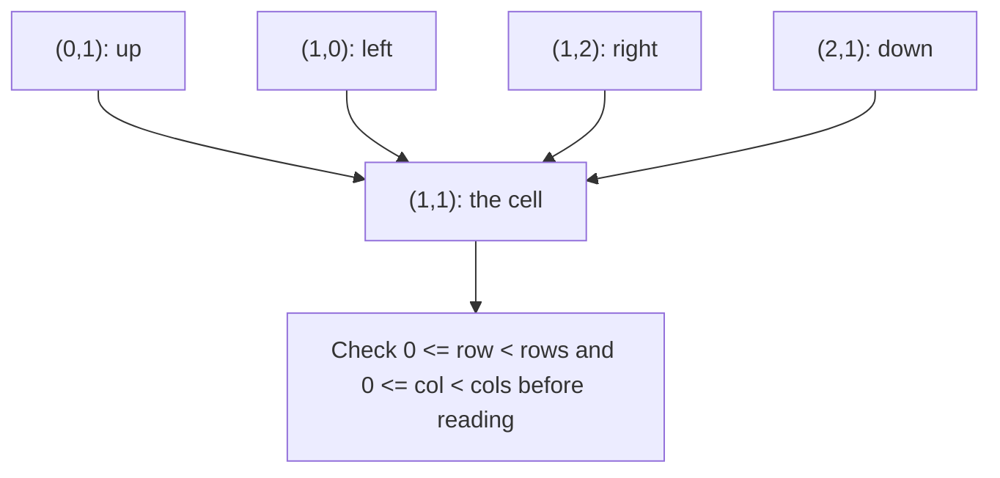
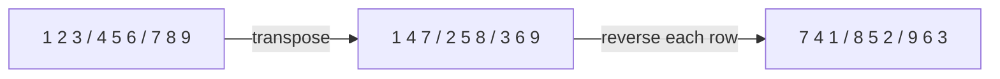
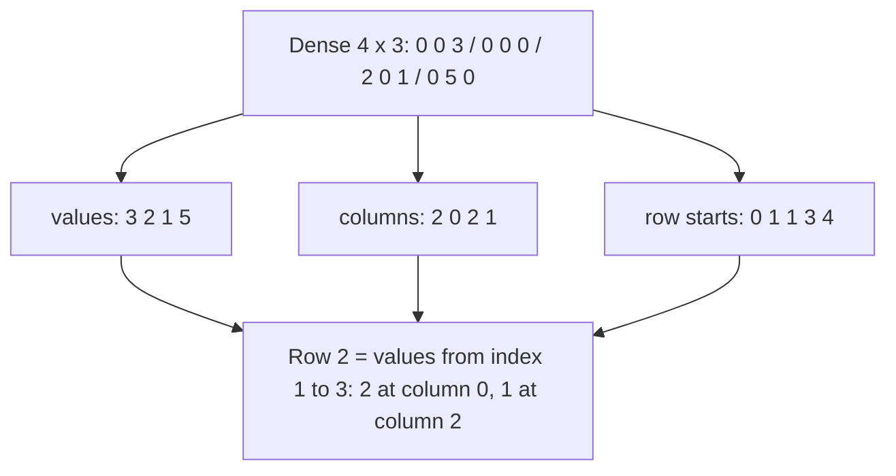

# new

## explanation

### Data in rows and columns

Marks of several students in several subjects, seats in a hall, pixels in an image, cells of a game board: this is **2D data**, a grid of rows and columns. In C++ the usual way to hold it is a vector of rows, each row a vector:

```cpp
std::vector<std::vector<int>> marks = {{70, 85, 90}, {60, 75, 80}, {88, 92, 79}};
```

`marks[r][c]` is row `r`, column `c`. The number of rows is `marks.size()`, and the number of columns is `marks[0].size()`.

### Walking the grid

- **Row by row**: the outer loop over rows, the inner over columns. Totals per row (each student's total) come out naturally.
- **Column by column**: the outer loop over columns, the inner over rows. That gives totals per column (each subject's best mark).

Both visit every cell once: O(rows × columns).

### Neighbours

Many grid problems look at a cell's neighbours: up, down, left and right. Instead of four copies of the same code, keep the four moves in two small arrays and loop over them:

```cpp
int dr[4] = {-1, 1, 0, 0}, dc[4] = {0, 0, -1, 1};
```

A neighbour is at `(r + dr[d], c + dc[d])`. Cells on the edge have fewer neighbours, so check the new row and column are inside the grid **before** reading it.

### Transpose

Swapping rows and columns turns an R × C grid into a C × R grid: `t[c][r] = g[r][c]`. Turning "students by subjects" into "subjects by students" is a transpose.

## diagram



## example

```cpp
#include <algorithm>
#include <iostream>
#include <vector>

int main() {
    std::vector<std::vector<int>> marks = {{70, 85, 90}, {60, 75, 80}, {88, 92, 79}};  // 3 students x 3 subjects
    int rows = marks.size(), cols = marks[0].size();
    for (int r = 0; r < rows; r++) {
        int total = 0;
        for (int c = 0; c < cols; c++) total += marks[r][c];
        std::cout << "student " << r << " total " << total << '\n';
    }
    for (int c = 0; c < cols; c++) {
        int best = 0;
        for (int r = 0; r < rows; r++) best = std::max(best, marks[r][c]);
        std::cout << "subject " << c << " top " << best << '\n';
    }
    // Neighbours of cell (1, 1): up, down, left, right.
    int dr[4] = {-1, 1, 0, 0}, dc[4] = {0, 0, -1, 1};
    int r = 1, c = 1, sum = 0;
    for (int d = 0; d < 4; d++) {
        int nr = r + dr[d], nc = c + dc[d];
        if (nr >= 0 && nr < rows && nc >= 0 && nc < cols) sum += marks[nr][nc];
    }
    std::cout << "neighbours of (1,1) sum to " << sum << '\n';
}
```

```text
student 0 total 245
student 1 total 215
student 2 total 259
subject 0 top 88
subject 1 top 92
subject 2 top 90
neighbours of (1,1) sum to 317
```

1. Rows first: each student's three marks are added along the row.
2. Columns first: for each subject, the inner loop goes down the column to find the best mark.
3. The four moves reach 85 above, 92 below, 60 to the left and 80 to the right of the centre cell, which add up to 317.
4. The bounds check would skip any neighbour outside the grid, which matters for edge cells.

## mistakes

- **Mixing up rows and columns.** `marks[r][c]` is row first. Writing `marks[c][r]` happens to work on square grids and breaks on others.
- **Reading a neighbour before checking it.** `marks[nr][nc]` with `nr = -1` reads outside the grid. Check the bounds first; `&&` stops at the first false part.
- **Taking `marks[0].size()` of an empty grid.** If there are no rows, `marks[0]` doesn't exist. Check `marks.empty()` first.
- **Assuming all rows have the same length.** A vector of vectors can be ragged. If rows may differ, use `marks[r].size()` for each row.
- **Building a transpose with the wrong shape.** An R × C grid's transpose has C rows of R values. Allocate it that way before filling it.

## check

```cpp
#include <iostream>
#include <vector>

int main() {
    std::vector<std::vector<int>> g = {{1, 2, 3}, {4, 5, 6}};
    std::vector<std::vector<int>> t(3, std::vector<int>(2));
    for (int r = 0; r < 2; r++)
        for (int c = 0; c < 3; c++) t[c][r] = g[r][c];
    std::cout << t.size() << 'x' << t[0].size() << ' ' << t[2][0] << t[2][1] << '\n';
}
```

```text
3x2 36
```

The 2 × 3 grid becomes a 3 × 2 grid: each column of `g` becomes a row of `t`. The last column of `g`, 3 and 6, becomes the last row of `t`.

# building

## explanation

### A quick recap

A grid is a vector of rows; `g[r][c]` is row r, column c. Walking it is O(rows × columns), and neighbours come from small arrays of row and column moves, always bounds-checked.

### Spiral order

To read a grid in a spiral, keep four boundaries: `top`, `bottom`, `left` and `right`. Read the top row left to right, then move `top` down. Read the right column top to bottom, then move `right` in. Then the bottom row right to left and the left column bottom to top, each only if that boundary still has cells. Repeat until the boundaries cross. Each cell is read exactly once.

### Rotating 90° clockwise, in place

Two simple steps rotate a square grid without a second grid:

1. **Transpose**: swap `g[r][c]` with `g[c][r]` for every pair above the diagonal.
2. **Reverse each row.**

The first row of the result is the first column read from the bottom up, exactly what a clockwise turn gives. (Reversing the order of the rows instead gives an anticlockwise turn.)

### Diagonals

Cells on the same top-left to bottom-right diagonal share `r − c`; cells on the same anti-diagonal share `r + c`. That gives each diagonal a simple number, useful for grouping cells or checking a chessboard.

### Searching a sorted grid

If every row and every column is sorted in increasing order, start at the **top-right** corner. If the value there is too big, nothing below it in that column can match, so move left. If it's too small, nothing to its left in that row can match, so move down. Each step removes a whole row or column: O(rows + columns).

## diagram



## example

```cpp
#include <algorithm>
#include <iostream>
#include <vector>

using Grid = std::vector<std::vector<int>>;

// Spiral: walk the outer ring, then move the boundaries in and repeat.
std::vector<int> spiral(const Grid& g) {
    std::vector<int> out;
    int top = 0, bottom = g.size() - 1, left = 0, right = g[0].size() - 1;
    while (top <= bottom && left <= right) {
        for (int c = left; c <= right; c++) out.push_back(g[top][c]);
        top++;
        for (int r = top; r <= bottom; r++) out.push_back(g[r][right]);
        right--;
        if (top <= bottom) { for (int c = right; c >= left; c--) out.push_back(g[bottom][c]); bottom--; }
        if (left <= right) { for (int r = bottom; r >= top; r--) out.push_back(g[r][left]); left++; }
    }
    return out;
}

// Rotate a square grid 90 degrees clockwise in place: transpose, then reverse each row.
void rotate(Grid& g) {
    int n = g.size();
    for (int r = 0; r < n; r++)
        for (int c = r + 1; c < n; c++) std::swap(g[r][c], g[c][r]);
    for (auto& row : g) std::reverse(row.begin(), row.end());
}

int main() {
    Grid g = {{1, 2, 3}, {4, 5, 6}, {7, 8, 9}};
    for (int x : spiral(g)) std::cout << x << ' ';
    std::cout << '\n';
    rotate(g);
    for (const auto& row : g) {
        for (int x : row) std::cout << x << ' ';
        std::cout << "| ";
    }
    std::cout << '\n';
}
```

```text
1 2 3 6 9 8 7 4 5
7 4 1 | 8 5 2 | 9 6 3 |
```

1. The spiral reads the top row 1 2 3, the right column 6 9, the bottom row backwards 8 7, and the left column upwards 4. The boundaries then close in on the centre, 5.
2. The `if` checks before the bottom row and left column stop a single remaining row or column from being read twice.
3. `rotate` transposes by swapping each pair across the diagonal once, then reverses each row.
4. The old first column, 1 4 7, read from the bottom, is the new first row: 7 4 1.

## mistakes

- **Reading the last row or column twice in a spiral.** After `top++` and `right--`, the remaining rectangle may be a single row or column. Check `top <= bottom` and `left <= right` again before the backward passes.
- **Transposing by swapping every pair.** Looping `c` from 0 swaps each pair twice, which undoes the transpose. Only swap pairs above the diagonal: `c` from `r + 1`.
- **Rotating the wrong way.** Transpose then reverse rows turns clockwise; transpose then reverse the order of rows turns anticlockwise. Test on a small grid.
- **Rotating a non-square grid in place.** An R × C grid rotates into C × R, which can't fit in the same shape. Build a new grid for it.
- **Starting the sorted-grid search at the top-left.** From there, both moves increase the value, so there's no way to decide. Start at the top-right or bottom-left.

## check

```cpp
#include <iostream>
#include <vector>

int main() {
    std::vector<std::vector<int>> g = {{1, 4, 7, 11}, {2, 5, 8, 12}, {3, 6, 9, 16}, {10, 13, 14, 17}};
    int target = 9, r = 0, c = 3, steps = 0;
    while (r < 4 && c >= 0 && g[r][c] != target) {
        if (g[r][c] > target) c--; else r++;
        steps++;
    }
    std::cout << r << ',' << c << ' ' << steps << '\n';
}
```

```text
2,2 3
```

The search starts at 11, top-right. 11 > 9, so it moves left to 7. 7 < 9, so it moves down to 8, then down again to 9, found at row 2, column 2. Three moves, each ruling out a whole column or row.

# strong

## explanation

### How grids sit in memory

A `std::vector<std::vector<int>>` allocates each row separately, so rows are scattered on the heap, and every access follows a pointer to the row first. A **flat** vector of R × C values, indexed `r * C + c`, keeps the whole grid in one block. It's faster to walk, quicker to allocate, and passes to functions as one object. Going back from an index to a cell is `r = i / C`, `c = i % C`.

Either way, walk **row by row**: memory is laid out row after row, so the cache fetches the next values for free. Walking column by column on a large grid jumps a whole row's width at each step and can be several times slower.

### Matrix multiplication and loop order

Multiplying an n × m matrix by an m × p one is O(n × m × p). The textbook i-j-k loop order reads `b[k][j]` down a column, which is cache-unfriendly. Swapping to **i-k-j** makes the innermost loop walk along rows of both `b` and `c`; it does exactly the same arithmetic, often several times faster. (Asymptotically faster methods exist, but for typical sizes, loop order and memory layout matter more.)

### Sparse matrices

Many large matrices are mostly zeros: links between web pages, user ratings, road networks. Storing every zero wastes memory and time. **Compressed sparse row (CSR)** form keeps three arrays:

- the non-zero values, row by row;
- the column of each value;
- for each row, where its values start (plus one final entry for the end).

Multiplying a CSR matrix by a vector touches only the non-zeros: O(non-zeros) instead of O(rows × columns). A matrix with a million rows and ten values per row becomes ten million operations instead of a trillion.

### Grids as graphs

A grid where each cell connects to its neighbours is a graph with R × C vertices and up to 4 edges each. The graph lessons' breadth-first and depth-first searches run on grids directly, using the same neighbour arrays.

## diagram



## example

```cpp
#include <iostream>
#include <vector>

// A sparse matrix in compressed rows (CSR): only the non-zero values are stored.
struct Sparse {
    std::vector<int> rowStart;  // row r's values are at [rowStart[r], rowStart[r + 1])
    std::vector<int> col;
    std::vector<double> value;
};
Sparse compress(const std::vector<std::vector<double>>& dense) {
    Sparse s;
    s.rowStart.push_back(0);
    for (const auto& row : dense) {
        for (std::size_t c = 0; c < row.size(); c++)
            if (row[c] != 0) { s.col.push_back(static_cast<int>(c)); s.value.push_back(row[c]); }
        s.rowStart.push_back(static_cast<int>(s.value.size()));
    }
    return s;
}
// Matrix times vector, touching only stored values: O(non-zeros) instead of O(rows * cols).
std::vector<double> times(const Sparse& s, const std::vector<double>& x) {
    std::vector<double> y(s.rowStart.size() - 1, 0.0);
    for (std::size_t r = 0; r + 1 < s.rowStart.size(); r++)
        for (int k = s.rowStart[r]; k < s.rowStart[r + 1]; k++) y[r] += s.value[k] * x[s.col[k]];
    return y;
}
// Dense multiply in i-k-j order: the inner loop walks along rows of b and c, in memory order.
std::vector<std::vector<long long>> multiply(const std::vector<std::vector<long long>>& a, const std::vector<std::vector<long long>>& b) {
    std::size_t n = a.size(), m = b.size(), p = b[0].size();
    std::vector<std::vector<long long>> c(n, std::vector<long long>(p, 0));
    for (std::size_t i = 0; i < n; i++)
        for (std::size_t k = 0; k < m; k++)
            for (std::size_t j = 0; j < p; j++) c[i][j] += a[i][k] * b[k][j];
    return c;
}

int main() {
    Sparse s = compress({{0, 0, 3}, {0, 0, 0}, {2, 0, 1}, {0, 5, 0}});
    std::cout << s.value.size() << " stored of 12; ";
    for (double y : times(s, {1, 2, 3})) std::cout << y << ' ';
    std::cout << '\n';
    auto c = multiply({{1, 2}, {3, 4}}, {{5, 6}, {7, 8}});
    std::cout << c[0][0] << ' ' << c[0][1] << ' ' << c[1][0] << ' ' << c[1][1] << '\n';
}
```

```text
4 stored of 12; 9 0 5 10
19 22 43 50
```

1. `compress` keeps only the 4 non-zero values out of 12 cells, with their columns, and records where each row's values start. The empty row 1 starts and ends at the same place.
2. `times` multiplies by the vector (1, 2, 3) using only the stored values: row 0 gives 3 × 3 = 9, row 1 nothing, row 2 gives 2 × 1 + 1 × 3 = 5, row 3 gives 5 × 2 = 10.
3. `multiply` runs i-k-j: for each `a[i][k]`, it adds that value times row k of `b` into row i of `c`, walking both rows in memory order.
4. The 2 × 2 product is 19 22 / 43 50, the same as with any loop order.

## mistakes

- **Vectors of vectors in hot loops on big grids.** Every row is a separate allocation and an extra pointer hop. Use one flat vector with `r * C + c`.
- **Column-first loops over large grids.** They jump through memory and miss the cache. Put the row loop outside.
- **Textbook i-j-k multiplication for large matrices.** It reads one matrix down its columns. i-k-j does the same work in memory order.
- **Dense storage for mostly-empty data.** A 100,000 × 100,000 matrix of `double` is 80 GB. If it's sparse, CSR stores only what's there.
- **Off-by-one in CSR row starts.** The row-start array needs one more entry than there are rows, so that the last row's end is defined.

## check

```cpp
#include <iostream>
#include <vector>

int main() {
    int rows = 3, cols = 4;
    std::vector<int> flat(rows * cols);
    for (int i = 0; i < rows * cols; i++) flat[i] = i;
    int r = 2, c = 1;
    int idx = r * cols + c;
    std::cout << flat[idx] << ' ' << idx / cols << ',' << idx % cols << ' ' << flat[(rows - 1) * cols + cols - 1] << '\n';
}
```

```text
9 2,1 11
```

Row 2, column 1 sits at index 2 × 4 + 1 = 9, which holds 9. Dividing the index by the row width gives the row back, 2, and the remainder gives the column, 1. The bottom-right cell is the last index, (3 − 1) × 4 + 3 = 11.
