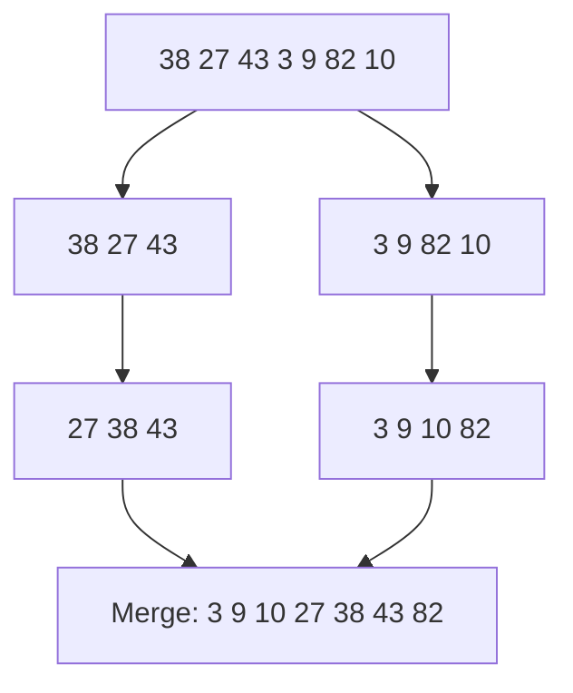
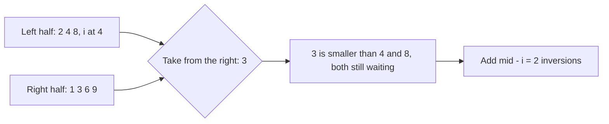
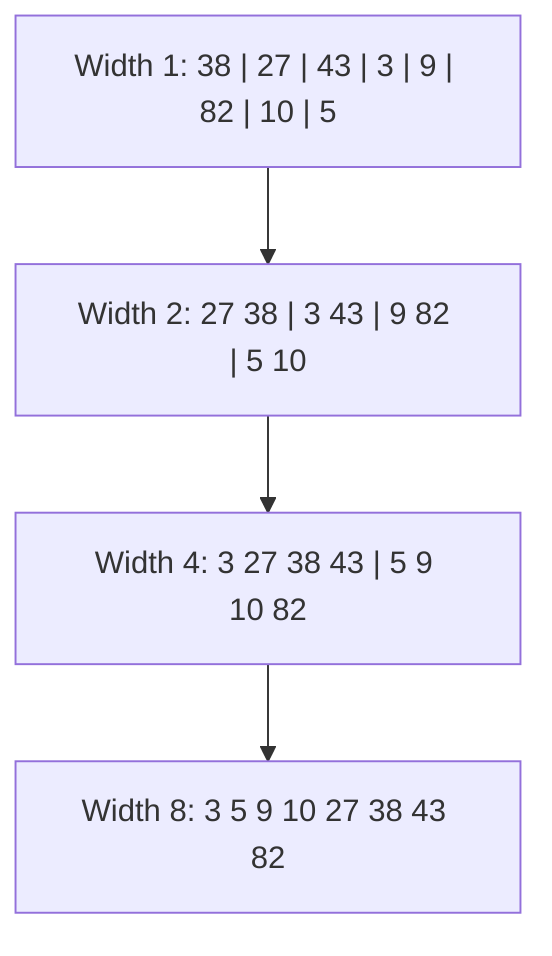

# new

## explanation

### Merging two sorted lists

Imagine two piles of exam papers, each already sorted by roll number. To combine them into one sorted pile, look at the top paper of each pile, take the smaller one, and repeat. When one pile runs out, put the rest of the other pile on the end. That's a **merge**. It looks at each paper once, so merging lists with n items in total takes O(n).

### Merge sort: divide and conquer

**Merge sort** turns merging into a full sorting method:

1. **Split** the list into two halves.
2. **Sort** each half, by calling merge sort on it (recursion).
3. **Merge** the two sorted halves.

The base case is a list of 0 or 1 items: it's already sorted.

### Why it's fast

Splitting in halves gives about log₂ n levels: 8 items split into 4, 2 and 1, three levels. On each level, all the merges together touch every item once, which is n work. So the total is **n × log n**: O(n log n). For a million items that's about 20 million steps, instead of the half a trillion an O(n²) sort could need.

Unlike many sorts, merge sort is O(n log n) in **every** case: sorted, reversed or random input make no difference.

### What it costs in memory

Merging needs somewhere to put the result, so merge sort uses O(n) extra memory. That's its main drawback.

### Stable

When the two front items are equal, taking the one from the **left** half first keeps equal items in their original order. So merge sort is stable. `std::stable_sort` is usually a merge sort.

## diagram



## example

```cpp
#include <iostream>
#include <vector>

// Merge two sorted lists: repeatedly take the smaller front item.
std::vector<int> mergeLists(const std::vector<int>& a, const std::vector<int>& b) {
    std::vector<int> out;
    std::size_t i = 0, j = 0;
    while (i < a.size() && j < b.size()) {
        if (a[i] <= b[j]) out.push_back(a[i++]);
        else out.push_back(b[j++]);
    }
    while (i < a.size()) out.push_back(a[i++]);  // whatever is left
    while (j < b.size()) out.push_back(b[j++]);
    return out;
}

// Merge sort: split in half, sort each half, merge the two sorted halves.
std::vector<int> mergeSort(const std::vector<int>& v) {
    if (v.size() <= 1) return v;  // one item is already sorted
    std::size_t mid = v.size() / 2;
    std::vector<int> left(v.begin(), v.begin() + mid);
    std::vector<int> right(v.begin() + mid, v.end());
    return mergeLists(mergeSort(left), mergeSort(right));
}

void print(const std::vector<int>& v) {
    for (int x : v) std::cout << x << ' ';
    std::cout << '\n';
}

int main() {
    print(mergeLists({3, 9, 14}, {1, 10, 11, 20}));
    print(mergeSort({38, 27, 43, 3, 9, 82, 10}));
}
```

```text
1 3 9 10 11 14 20
3 9 10 27 38 43 82
```

1. `mergeLists` compares the front items, 3 and 1, and takes 1; then 3 against 10, and so on. When the first list runs out after 14, the rest of the second list, 20, is added.
2. `mergeSort` splits the 7 numbers into 3 and 4, and keeps splitting until every piece has one item.
3. On the way back up, each pair of sorted pieces is merged, until the two halves 27 38 43 and 3 9 10 82 are merged into the final list.
4. This simple version copies each half into a new vector, which is easy to read but slow; the building level fixes that.

## mistakes

- **Forgetting the leftovers.** When one list runs out, the other still has items. Without the two final loops, they're lost.
- **No base case for small lists.** Splitting a 1-item list gives an empty half and the same 1-item list again, forever. Stop at size 1 or less.
- **Using `<` in the merge.** `a[i] < b[j]` takes the right item first on a tie, which breaks stability. Use `<=`.
- **Expecting it to sort in place.** Merge sort needs O(n) extra memory to merge into. If memory is very tight, other sorts suit better.
- **Thinking merge sort is slow because of recursion.** The recursion is only log n deep, and the work is O(n log n) whatever the input. The real cost in this simple version is copying vectors in every call.

## check

```cpp
#include <iostream>
#include <vector>

int main() {
    std::vector<int> a = {2, 7, 7}, b = {4, 7, 9};
    std::vector<int> out;
    std::size_t i = 0, j = 0;
    int fromA = 0;
    while (i < a.size() && j < b.size()) {
        if (a[i] <= b[j]) { out.push_back(a[i++]); fromA++; }
        else out.push_back(b[j++]);
    }
    while (j < b.size()) out.push_back(b[j++]);
    std::cout << out.size() << ' ' << fromA << ' ' << out[3] << '\n';
}
```

```text
6 3 7
```

The merge takes 2 from `a`, then 4 from `b`. Then both fronts are 7, and `<=` takes from `a` on a tie, twice, which empties `a`. All three items of `a` were taken inside the loop, and the leftovers of `b`, 7 and 9, are added after it. The result is 2 4 7 7 7 9, so `out[3]` is 7.

# building

## explanation

### A quick recap

Merge sort splits the list in half, sorts each half recursively, and merges them in O(n). With log n levels, that's O(n log n) for every input. It's stable and needs O(n) extra memory.

### Sorting without copying

Creating new vectors for every half allocates memory about 2n times and copies everything at each level. Instead:

- Sort a **range** `v[lo, hi)` of the original vector, passing `lo` and `hi`.
- Allocate **one** buffer of size n at the start, and merge into it.
- Copy the merged range back into `v`.

The algorithm is the same; only the bookkeeping changes.

### Counting inversions while merging

An **inversion** is a pair of positions `i < j` with `v[i] > v[j]`. It measures how unsorted a list is: 0 for sorted, n(n − 1)/2 for reversed. Counting every pair directly is O(n²), but merge sort can count them for free:

During a merge, both halves are sorted. When the right half's front item is taken before the left half's front item, it's smaller than **every item still waiting in the left half**. Each of those is an inversion with it. So add `mid − i`, the number of items left in the left half, each time you take from the right.

The total is the inversions inside the left half, plus those inside the right half (from the recursive calls), plus those across the halves (counted in the merge): O(n log n) in all.

### Ties matter

On equal values, take from the left. Equal values aren't an inversion, and taking from the left keeps the sort stable.

### The standard library

- `std::merge(a, b, out)` merges two sorted ranges.
- `std::inplace_merge(first, middle, last)` merges two adjacent sorted runs.
- `std::stable_sort` is a ready-made merge sort.

## diagram



## example

```cpp
#include <iostream>
#include <vector>

// Sorts arr[from, to), merging through the shared scratch list. Returns how many inversions it removed.
long long sortCount(std::vector<int>& arr, std::vector<int>& scratch, std::size_t from, std::size_t to) {
    if (to - from <= 1) return 0;
    std::size_t half = from + (to - from) / 2;
    long long count = sortCount(arr, scratch, from, half) + sortCount(arr, scratch, half, to);
    std::size_t i = from, j = half, k = from;
    while (i < half && j < to) {
        if (arr[i] <= arr[j]) {
            scratch[k++] = arr[i++];
        } else {
            count += half - i;  // arr[j] is smaller than every item left in the left half
            scratch[k++] = arr[j++];
        }
    }
    while (i < half) scratch[k++] = arr[i++];
    while (j < to) scratch[k++] = arr[j++];
    for (std::size_t t = from; t < to; t++) arr[t] = scratch[t];
    return count;
}

int main() {
    std::vector<int> arr = {8, 4, 2, 1, 9, 6, 3};
    std::vector<int> scratch(arr.size());
    long long inversions = sortCount(arr, scratch, 0, arr.size());
    for (int x : arr) std::cout << x << ' ';
    std::cout << "\ninversions: " << inversions << '\n';
}
```

```text
1 2 3 4 6 8 9
inversions: 12
```

1. `sortCount` works on the range `arr[from, to)` and one shared buffer, `scratch`, so no vector is created after the start.
2. Each call sorts and counts its two halves, then merges them. Whenever the right half's item wins, it jumps ahead of every left item still waiting, and those are counted as inversions.
3. The merged range is copied back from `scratch`, so the caller sees its range sorted.
4. Checking by hand: 8 is ahead of five smaller numbers, 4 of three, 2 of one, 9 of two and 6 of one: 12 inversions.

## mistakes

- **Allocating vectors in every call.** It works, but allocating and copying at every level makes it several times slower. Use one buffer and index ranges.
- **Forgetting to copy back.** The merge writes into `buf`. Unless the range is copied back into `v`, the caller's data isn't sorted.
- **Counting inversions in an `int`.** A reversed list of 100,000 items has about 5 × 10⁹ inversions, more than an `int` holds. Use `long long`.
- **Taking from the right on ties.** It counts equal pairs as inversions and breaks stability. Take from the left when equal.
- **Mixing range conventions.** This code uses half-open ranges: `[lo, mid)` and `[mid, hi)`. With inclusive ranges, `mid − i` becomes `mid − i + 1`. Pick one style and stick to it.

## check

```cpp
#include <algorithm>
#include <iostream>
#include <vector>

int main() {
    std::vector<int> a = {1, 4, 6}, b = {2, 3, 7};
    std::vector<int> out(6);
    std::merge(a.begin(), a.end(), b.begin(), b.end(), out.begin());
    std::vector<int> arr = {5, 9, 1, 4};  // two sorted halves: 5 9 | 1 4
    std::inplace_merge(arr.begin(), arr.begin() + 2, arr.end());
    std::cout << out[2] << out[3] << ' ' << arr[0] << arr[3] << '\n';
}
```

```text
34 19
```

`std::merge` combines the two sorted lists into 1 2 3 4 6 7, so positions 2 and 3 hold 3 and 4. `std::inplace_merge` merges the sorted runs 5 9 and 1 4 inside `v`, giving 1 4 5 9: first 1, last 9.

# strong

## explanation

### Guarantees and costs

Merge sort makes at most about n log₂ n comparisons in every case: there is no bad input. It's stable, and it reads and writes memory in order, which caches handle well. The price is the O(n) buffer. Making a merge sort fully in-place with O(n log n) time is possible but complex and slow in practice; `std::inplace_merge` uses a buffer when it can get one and a slower method when it can't.

### Bottom-up merge sort

Recursion isn't needed. Treat every single item as a sorted run of width 1, merge neighbouring runs into width 2, then 4, then 8, until one run covers the list. That's ⌈log₂ n⌉ passes, each a simple loop over the array. Alternating between the array and the buffer avoids copying back after each pass.

### Natural runs

Real data is often partly sorted. A **natural** merge sort first finds the runs that are already in order and merges those, so a list with k sorted runs costs about O(n log k). Timsort, used by Python and Java's object sort, builds on this idea.

### Linked lists and external data

- Merging linked lists only changes pointers, so merge sort sorts a linked list with O(1) extra memory. It's the standard way to sort them.
- When data is too large for memory, **external sorting** sorts chunks that fit, writes them to disk as sorted runs, then does a **k-way merge**: a min-heap holds the front item of each run, and repeatedly taking the smallest gives the whole merged output in O(N log k).

### The lower bound

Any comparison sort needs Ω(n log n) comparisons in the worst case, so merge sort's bound is optimal up to a constant. Faster sorting needs extra information about the keys, such as counting sort on small integers.

### Divide and conquer, generally

Merge sort is the model for a whole family: split into independent parts, solve each, combine in linear time, giving O(n log n). Inversion counting, the closest pair of points, and many "count pairs where…" problems follow the same shape.

## diagram



## example

```cpp
#include <algorithm>
#include <iostream>
#include <vector>

// Bottom-up merge sort: merge runs of width 1, then 2, 4, ... No recursion at all.
int bottomUp(std::vector<int>& v) {
    std::vector<int> buf(v.size());
    int passes = 0;
    for (std::size_t width = 1; width < v.size(); width *= 2, passes++) {
        for (std::size_t lo = 0; lo < v.size(); lo += 2 * width) {
            std::size_t mid = std::min(lo + width, v.size()), hi = std::min(lo + 2 * width, v.size());
            std::size_t i = lo, j = mid, k = lo;
            while (i < mid && j < hi) buf[k++] = v[i] <= v[j] ? v[i++] : v[j++];
            while (i < mid) buf[k++] = v[i++];
            while (j < hi) buf[k++] = v[j++];
        }
        v.swap(buf);  // the merged pass becomes the input of the next one
    }
    return passes;
}

int main() {
    std::vector<int> a = {38, 27, 43, 3, 9, 82, 10, 5};
    std::vector<int> b = {6, 1, 8, 2, 7, 3, 5, 4, 0};
    int pa = bottomUp(a), pb = bottomUp(b);
    for (int x : a) std::cout << x << ' ';
    std::cout << "| passes " << pa << '\n';
    for (int x : b) std::cout << x << ' ';
    std::cout << "| passes " << pb << '\n';
}
```

```text
3 5 9 10 27 38 43 82 | passes 3
0 1 2 3 4 5 6 7 8 | passes 4
```

1. Each pass merges neighbouring runs of the current width into runs twice as long, writing into `buf`.
2. `std::min` clips the last pair of runs, so lengths that aren't powers of two work: in the 9-item list, the ninth item waits alone until the final pass.
3. `v.swap(buf)` makes the merged result the input of the next pass in O(1), instead of copying it back.
4. 8 items need widths 1, 2 and 4: three passes. 9 items need a fourth pass at width 8, to bring in the last item: ⌈log₂ 9⌉ = 4.

## mistakes

- **Expecting a bottom-up pass to cover the tail.** If the last run has no partner, it must still be copied into the buffer, or it's lost when the buffers swap. Here `mid` clipped to `v.size()` makes the right run empty, and the copy loops handle it.
- **Trying in-place merging to save memory.** Simple in-place merges are O(n²). If memory is that tight, use heap sort or quick sort.
- **Using array merge sort on a linked list.** Splitting a list by index costs O(n) per step. Split by walking with slow and fast pointers, and merge by relinking nodes.
- **Forgetting stability in the k-way merge.** A heap doesn't keep ties in run order. Add the run's number to the heap key when stability matters.
- **Recursing down to single items.** Library sorts switch to insertion sort for small ranges, around 16 to 32 items, which is faster than merging tiny pieces.

## check

```cpp
#include <functional>
#include <iostream>
#include <queue>
#include <utility>
#include <vector>
int main() {
    std::vector<std::vector<int>> lists = {{4, 9}, {1, 8, 10}, {2, 3}};
    using Item = std::pair<int, std::pair<int, int>>;  // value, (list, position)
    std::priority_queue<Item, std::vector<Item>, std::greater<Item>> heap;
    for (int l = 0; l < 3; l++) heap.push({lists[l][0], {l, 0}});
    int taken = 0, fifth = 0;
    while (!heap.empty()) {
        auto [value, where] = heap.top();
        heap.pop();
        if (++taken == 5) fifth = value;
        if (auto [l, p] = where; p + 1 < static_cast<int>(lists[l].size())) heap.push({lists[l][p + 1], {l, p + 1}});
    }
    std::cout << taken << ' ' << fifth << '\n';
}
```

```text
7 8
```

This is a 3-way merge with a min-heap holding the front item of each list. It takes items in order, 1, 2, 3, 4, 8, 9, 10, and each time pushes the next item from the same list. All 7 items are taken, and the fifth is 8.
