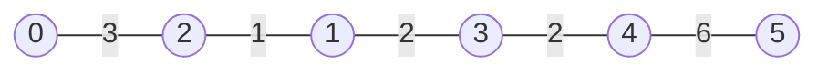
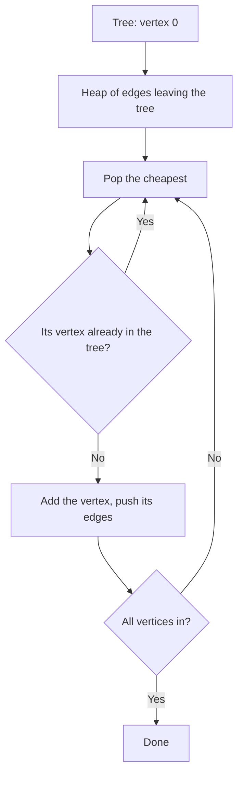
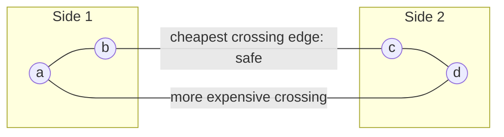

# new

## explanation

### Connecting everything as cheaply as possible

Six villages need cables so that every village can reach every other, directly or through others. Each possible cable has a cost. Cables that close a loop are wasted money: the villages they join are already connected. What you want is a **minimum spanning tree** (MST): a set of edges that

- connects every vertex (it **spans** the graph);
- has no cycles (it's a **tree**), so with n vertices it has exactly n − 1 edges;
- has the smallest possible total weight.

Networks, road plans and circuit wiring all ask this question.

### Kruskal's algorithm

1. Sort the edges from cheapest to most expensive.
2. Go through them in that order. If an edge joins two vertices that **aren't connected yet**, take it. If they already are, skip it, since it would close a loop.
3. Stop once n − 1 edges are taken.

"Are they connected yet?" is exactly what a **disjoint set union** answers: check `find(u) != find(v)`, then `unite` when taking the edge.

### Cost

Sorting takes O(E log E), and the DSU work is almost O(1) per edge, so Kruskal's algorithm is **O(E log E)**.

### Why greedy works here

Taking the cheapest safe edge every time sounds too simple, but it's provably right. Any MST that skipped a cheap safe edge could swap it in for a more expensive edge on the loop it would close, and get cheaper. That would contradict it being minimal.

### Only for connected graphs

If the graph is in several pieces, no spanning tree exists. Kruskal's algorithm then ends with fewer than n − 1 edges: a **minimum spanning forest**, one tree per piece.

## diagram



## example

```cpp
#include <algorithm>
#include <iostream>
#include <vector>

struct Edge { int u, v, cost; };

std::vector<int> group;  // group[x]: who x points to; a village pointing to itself leads its group
int leader(int x) {
    while (group[x] != x) x = group[x] = group[group[x]];  // path halving: each step skips a level
    return x;
}

int main() {
    // Villages, and the cost of laying a cable between pairs of them.
    const int n = 6;
    std::vector<Edge> edges = {{0, 1, 4}, {0, 2, 3}, {1, 2, 1}, {1, 3, 2}, {2, 3, 4}, {3, 4, 2}, {4, 5, 6}, {3, 5, 7}};
    // Kruskal: cheapest cables first, skipping any that would close a loop. Equal costs keep input order.
    std::stable_sort(edges.begin(), edges.end(), [](const Edge& a, const Edge& b) { return a.cost < b.cost; });
    group.resize(n);
    for (int v = 0; v < n; v++) group[v] = v;
    int total = 0, used = 0;
    for (const Edge& e : edges) {
        int a = leader(e.u), b = leader(e.v);
        if (a == b) { std::cout << "skip " << e.u << '-' << e.v << " (" << e.cost << "): would close a loop\n"; continue; }
        group[a] = b;
        total += e.cost;
        used++;
        std::cout << "take " << e.u << '-' << e.v << " (" << e.cost << ")\n";
    }
    std::cout << "cables: " << used << ", total cost: " << total << '\n';
}
```

```text
take 1-2 (1)
take 1-3 (2)
take 3-4 (2)
take 0-2 (3)
skip 0-1 (4): would close a loop
skip 2-3 (4): would close a loop
take 4-5 (6)
skip 3-5 (7): would close a loop
cables: 5, total cost: 14
```

1. The four cheapest cables all join new villages, so they're taken.
2. 0-1 is skipped: 0 already reaches 1 through 2. 2-3 is skipped the same way, through 1.
3. 4-5 costs 6 but is the cheapest way to reach 5, so it's taken, and 3-5 would then close a loop.
4. Six villages need exactly 5 cables, costing 14 in total. The loop could stop as soon as the 5th was taken.

## mistakes

- **Sorting by the wrong field, or not at all.** Kruskal's argument depends on cheapest-first order.
- **Checking the vertices instead of their groups.** Two vertices can be different yet already connected; compare `find(u)` with `find(v)`.
- **Taking an edge without merging the groups.** After taking it, `unite` the two groups, or later edges will close loops unnoticed.
- **Assuming the graph is connected.** If fewer than n − 1 edges are taken, there's no spanning tree; report that instead of a total.
- **Confusing an MST with shortest paths.** An MST minimises the total cost of the network. It doesn't give the shortest route between two particular vertices.

## check

```cpp
#include <algorithm>
#include <array>
#include <iostream>
#include <vector>

int main() {
    std::vector<std::array<int, 3>> edges = {{5, 0, 1}, {1, 1, 2}, {3, 0, 2}, {2, 2, 3}, {4, 1, 3}};  // cost, u, v
    std::sort(edges.begin(), edges.end());
    std::vector<int> group = {0, 1, 2, 3};  // a simple label per vertex, in place of a DSU
    int total = 0;
    for (auto [cost, u, v] : edges) {
        if (group[u] == group[v]) continue;
        int old = group[u];
        for (int& g : group) if (g == old) g = group[v];
        total += cost;
    }
    std::cout << total << ' ' << (group[0] == group[3]) << '\n';
}
```

```text
6 1
```

In cost order, the edges are 1-2 (1), 2-3 (2), 0-2 (3), 1-3 (4) and 0-1 (5). The first three join new vertices, for a total of 6, and leave everything in one group. 1-3 and 0-1 would close loops. Relabelling a whole group is O(n) per merge, so a DSU does this faster on big graphs.

# building

## explanation

### A quick recap

An MST connects all vertices with n − 1 edges of the smallest total weight. Kruskal's algorithm takes the edges in order of weight, keeping each one that joins two different groups, as checked by a DSU.

### Prim's algorithm: grow one tree

Instead of joining many small groups, Prim's algorithm grows a **single tree** from any starting vertex:

1. Start with one vertex in the tree.
2. Of all the edges leaving the tree, take the **cheapest** one, and add the vertex it reaches.
3. Repeat until every vertex is in.

It's the same greedy idea: the cheapest edge leaving the tree is always safe to take.

### With a heap

Push every edge leaving a newly added vertex into a min-heap of (cost, vertex). Pop the cheapest. If its vertex is already in the tree, the entry is outdated, so skip it. Otherwise add the vertex and push its edges. This takes **O(E log E)**, about the same as Kruskal's algorithm, and it looks almost exactly like Dijkstra's algorithm. The only difference is the key: an edge's own cost, not a distance from the start.

### The dense version

When nearly every pair of vertices has an edge (E close to V²), keep an array `best[v]` with the cheapest edge from the tree to v. Each step scans the array for the smallest unadded vertex in O(V), then updates `best` from the new vertex in O(V). That's **O(V²)** with no heap and no edge list. It beats the heap versions on complete graphs, such as "connect these 5000 points".

### Which to choose

- Edges given as a list, or a sparse graph: Kruskal's algorithm is short and fast.
- Adjacency lists already built: Prim's algorithm with a heap.
- Dense or complete graphs: Prim's algorithm in O(V²).

## diagram



## example

```cpp
#include <array>
#include <functional>
#include <iostream>
#include <queue>
#include <utility>
#include <vector>

int main() {
    const int n = 6;
    int cables[][3] = {{0, 1, 4}, {0, 2, 3}, {1, 2, 1}, {1, 3, 2}, {2, 3, 4}, {3, 4, 2}, {4, 5, 6}, {3, 5, 7}};
    std::vector<std::vector<std::pair<int, int>>> adj(n);  // (neighbour, cost)
    for (auto& c : cables) { adj[c[0]].push_back({c[1], c[2]}); adj[c[1]].push_back({c[0], c[2]}); }

    // Prim: grow one tree from vertex 0, always adding the cheapest edge that reaches a new vertex.
    std::vector<bool> inTree(n, false);
    std::priority_queue<std::array<int, 3>, std::vector<std::array<int, 3>>, std::greater<>> pq;  // (cost, vertex, from)
    pq.push({0, 0, -1});
    int total = 0;
    while (!pq.empty()) {
        auto [cost, v, from] = pq.top();
        pq.pop();
        if (inTree[v]) continue;  // already joined through a cheaper edge
        inTree[v] = true;
        total += cost;
        if (from >= 0) std::cout << "add " << v << " via " << from << '-' << v << " (" << cost << ")\n";
        for (auto [w, c] : adj[v]) if (!inTree[w]) pq.push({c, w, v});
    }
    std::cout << "total cost: " << total << '\n';
}
```

```text
add 2 via 0-2 (3)
add 1 via 2-1 (1)
add 3 via 1-3 (2)
add 4 via 3-4 (2)
add 5 via 4-5 (6)
total cost: 14
```

1. From 0, the cheapest way out is the cable to 2, which costs 3.
2. With 2 in the tree, the cable 2-1 (1) is now the cheapest edge leaving it, cheaper than 0-1 (4).
3. The old heap entries for 0-1 and 2-3 pop later and are skipped, because 1 and 3 are already in.
4. The tree is built in a different order from Kruskal's algorithm, from the same village graph, and costs the same 14.

## mistakes

- **Not skipping vertices already in the tree.** Old heap entries would add a vertex twice and double-count its cost.
- **Using the distance from the start as the key.** That's Dijkstra's algorithm, which builds a shortest-path tree. Prim's key is the cost of the single edge.
- **Pushing only the cheapest edge per vertex.** Push them all; the heap decides, and outdated ones are skipped.
- **Heap-based Prim on a complete graph.** With V² edges, the O(V²) array version is simpler and faster.
- **Expecting the same edges as Kruskal's algorithm.** With equal weights, there can be several MSTs; only the total must match.

## check

```cpp
#include <iostream>
#include <vector>

int main() {
    const int n = 4, INF = 1000;
    int w[n][n] = {{0, 6, 2, 9}, {6, 0, 8, 1}, {2, 8, 0, 3}, {9, 1, 3, 0}};
    std::vector<int> best = {0, INF, INF, INF};  // cheapest edge from the tree to each vertex
    std::vector<bool> in(n, false);
    int total = 0;
    for (int step = 0; step < n; step++) {
        int v = -1;
        for (int u = 0; u < n; u++) if (!in[u] && (v < 0 || best[u] < best[v])) v = u;
        in[v] = true;
        total += best[v];
        std::cout << v << ' ';
        for (int u = 0; u < n; u++) if (!in[u] && w[v][u] < best[u]) best[u] = w[v][u];
    }
    std::cout << total << '\n';
}
```

```text
0 2 3 1 6
```

This is the O(V²) Prim. From 0, the cheapest edge reaches 2 (cost 2). 2 makes 3 reachable for 3, cheaper than 9. Then 3 makes 1 reachable for 1, cheaper than 6. The edges taken cost 2 + 3 + 1 = 6.

# strong

## explanation

### Why the greedy choices are safe

**Cut property.** Split the vertices into any two sides. The cheapest edge crossing between them belongs to some MST. If an MST didn't use it, adding it would close a loop that crosses the split somewhere else, at a cost at least as high. Swapping the two can't make the tree more expensive. Kruskal's algorithm and Prim's algorithm both only ever take such an edge.

**Cycle property.** The most expensive edge on any cycle (if it's strictly the most expensive) is in no MST, because removing it keeps everything connected at a lower cost.

When all weights are **distinct**, the MST is unique.

### More than the total

- **Bottleneck.** An MST also makes the *largest* edge as small as possible. Between any two vertices, the path in the MST has the smallest possible maximum edge of any path.
- **Maximum spanning tree.** Sort descending, and the same algorithm keeps the widest links, as for the most reliable network or the widest roads.
- **Clustering.** Run Kruskal's algorithm but stop when k groups remain. The groups are the k clusters whose closest pair from different clusters is as far apart as possible: the **spacing**. That's the next edge Kruskal's algorithm would have taken. This is called single-linkage clustering.

### Points instead of edges

For n points on a map, every pair is a potential edge: n(n − 1)/2 of them. For a few thousand points, generating and sorting all pairs is fine. For many more, the O(V²) Prim needs no edge list at all, and special geometric methods go further.

### Changes to the graph

Lowering an edge's weight, or adding an edge u–v, can improve the MST: the new edge goes in, and the most expensive edge on the tree path between u and v comes out, if it costs more. Everything else stays.

## diagram



## example

```cpp
#include <algorithm>
#include <array>
#include <iostream>
#include <numeric>
#include <vector>

std::vector<int> parent;
int find(int x) { return parent[x] == x ? x : parent[x] = find(parent[x]); }

int main() {
    // Points on a map, grouped into k clusters that are as far apart as possible.
    std::vector<std::array<int, 2>> p = {{1, 1}, {2, 1}, {1, 3}, {8, 8}, {9, 7}, {8, 6}, {15, 1}, {14, 2}};
    const int n = (int)p.size(), k = 3;
    std::vector<std::array<int, 3>> edges;  // (squared distance, a, b) for every pair: a complete graph
    for (int a = 0; a < n; a++)
        for (int b = a + 1; b < n; b++) {
            int dx = p[a][0] - p[b][0], dy = p[a][1] - p[b][1];
            edges.push_back({dx * dx + dy * dy, a, b});
        }
    std::sort(edges.begin(), edges.end());
    parent.resize(n);
    std::iota(parent.begin(), parent.end(), 0);
    int groups = n;
    for (auto [d, a, b] : edges) {
        int ra = find(a), rb = find(b);
        if (ra == rb) continue;
        if (groups == k) { std::cout << "spacing: squared distance " << d << " between points " << a << " and " << b << '\n'; break; }
        parent[ra] = rb;  // Kruskal, stopped early
        groups--;
    }
    for (int r = 0; r < n; r++) {
        if (find(r) != r) continue;
        std::cout << "cluster:";
        for (int i = 0; i < n; i++) if (find(i) == r) std::cout << " (" << p[i][0] << ',' << p[i][1] << ')';
        std::cout << '\n';
    }
}
```

```text
spacing: squared distance 50 between points 4 and 7
cluster: (1,1) (2,1) (1,3)
cluster: (8,8) (9,7) (8,6)
cluster: (15,1) (14,2)
```

1. All 28 pairs of points become edges, weighted by squared distance. That keeps everything in integers and doesn't change the order.
2. Kruskal's algorithm merges the closest pairs first. After 5 merges, 8 points have become 3 groups, and it stops.
3. The next edge it would have taken, 4–7 with a squared distance of 50 (about 7.1), is the spacing: no two points in different clusters are closer.
4. Merging further would join two of the visible groups, which is why stopping at k gives clusters as far apart as possible.

## mistakes

- **Stopping at the wrong time.** Stop when exactly k groups remain, before taking the edge that would make k − 1.
- **Square roots for comparisons.** Squared distances sort the same way and stay exact in integers. Take the root only for display.
- **Overflow in squared distances.** Coordinates up to 10⁵ give squares up to about 4 · 10¹⁰; use `long long`.
- **Assuming the MST is unique.** With repeated weights, several trees can have the same total. Only distinct weights make it unique.
- **Sorting ascending for a maximum spanning tree.** For the widest tree, sort descending; the rest of the algorithm is unchanged.

## check

```cpp
#include <algorithm>
#include <array>
#include <functional>
#include <iostream>
#include <vector>

int main() {
    std::vector<std::array<int, 3>> links = {{5, 0, 1}, {9, 1, 2}, {2, 0, 2}, {7, 2, 3}, {4, 1, 3}};  // bandwidth, u, v
    std::sort(links.begin(), links.end(), std::greater<>());
    std::vector<int> group = {0, 1, 2, 3};
    int total = 0, narrowest = 1000;
    for (auto [w, u, v] : links) {
        if (group[u] == group[v]) continue;
        int old = group[u];
        for (int& g : group) if (g == old) g = group[v];
        total += w, narrowest = std::min(narrowest, w);
    }
    std::cout << total << ' ' << narrowest << '\n';
}
```

```text
21 5
```

Sorted from widest to narrowest, Kruskal's algorithm builds a maximum spanning tree. It takes 9 (1-2), 7 (2-3) and 5 (0-1), then skips 4 and 2, which would close loops. The tree's total is 21, and its narrowest link, 5, is the widest bottleneck any spanning tree can have.
