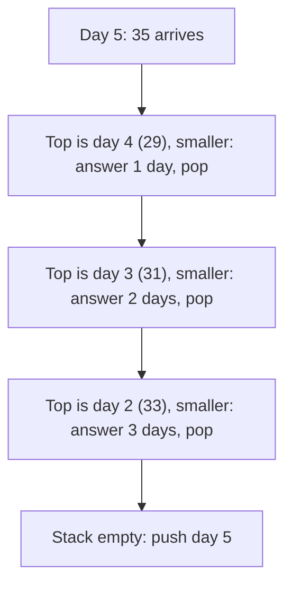
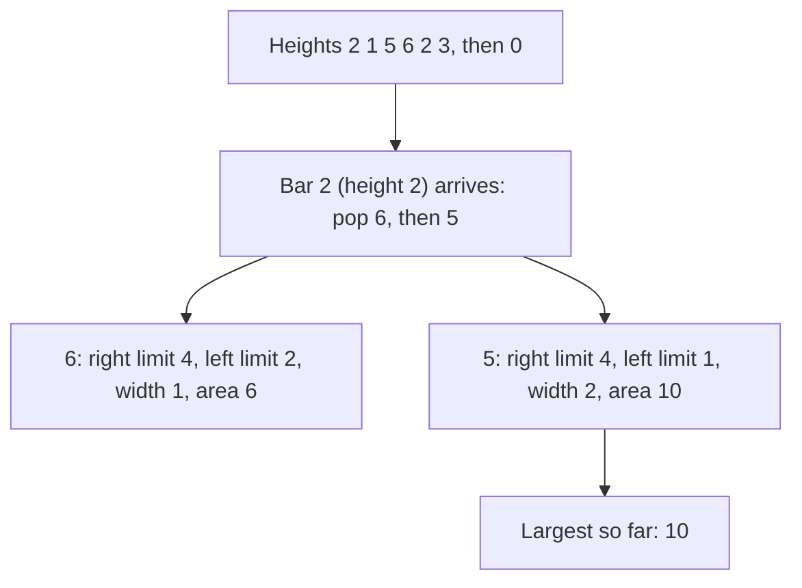
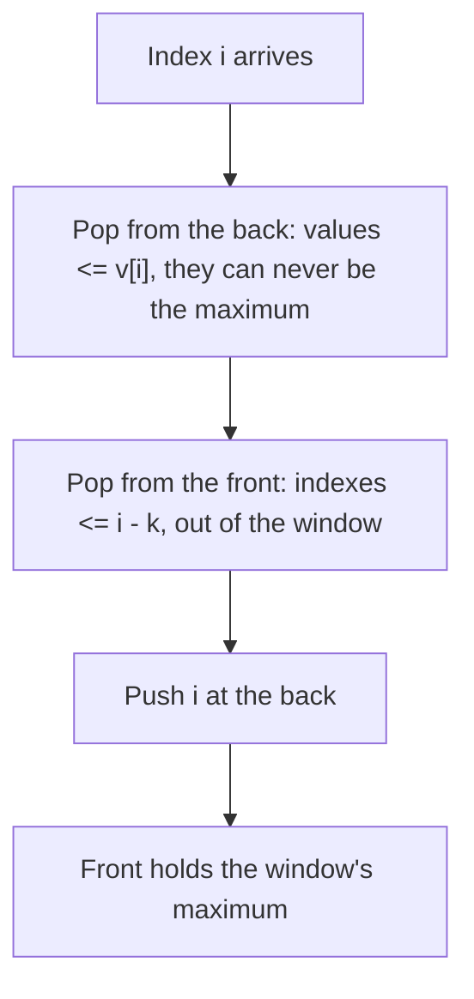

# new

## explanation

### "When does something bigger come along?"

For each day's temperature, how many days until a warmer one? For each number in a list, what's the next bigger number? The obvious way checks every later item for every item: O(n²). A **monotonic stack** answers all of them in one pass, O(n).

### The idea: a waiting room

Walk through the list once. Keep a stack of the **positions still waiting** for their answer. Because of how the stack is maintained, their values are in decreasing order from bottom to top.

When a new item arrives:

1. While the item on top of the stack is **smaller** than the new one, the new one is its answer: record it, and pop that position.
2. Then push the new position: it now waits for its own answer.

Items that are never popped have no bigger item after them, so they keep a default answer (0 days, or −1).

### Why it's O(n)

The `while` inside the `for` looks like nested loops, but every position is pushed exactly once and popped at most once. So the total work across the whole pass is at most 2n stack operations.

### Store positions, not values

Push **indexes**, not values. With an index you can read the value (`temps[i]`), compute distances (`day - i`), and write the answer into the right slot.

### The family of questions

Change the comparison and direction, and the same pattern answers related questions:

- next **greater** or next **smaller** item;
- **previous** greater or smaller (scan from left, but look at what's left on the stack);
- how far away each of those is.

## diagram



## example

```cpp
#include <iostream>
#include <stack>
#include <vector>

int main() {
    std::vector<int> temps = {30, 28, 33, 31, 29, 35, 27};
    std::vector<int> wait(temps.size(), 0);  // days until a warmer day (0: never)
    std::stack<int> waiting;                 // days still looking for a warmer one
    for (int day = 0; day < static_cast<int>(temps.size()); day++) {
        while (!waiting.empty() && temps[waiting.top()] < temps[day]) {
            wait[waiting.top()] = day - waiting.top();  // today answers that day
            waiting.pop();
        }
        waiting.push(day);
    }
    for (int w : wait) std::cout << w << ' ';
    std::cout << '\n';
}
```

```text
2 1 3 2 1 0 0
```

1. Day 1 (28) waits on top of day 0 (30). On day 2 (33), both are answered: day 1 after 1 day, day 0 after 2.
2. Days 3 (31) and 4 (29) are cooler than day 2, so they join the waiting stack in decreasing order: 33, 31, 29.
3. Day 5 (35) answers all three at once, popping them from the top: 1, 2 and 3 days.
4. Days 5 and 6 are never followed by anything warmer, so they keep 0.

## mistakes

- **Pushing values instead of indexes.** You then can't compute distances or know whose answer you're writing. Push positions.
- **The wrong comparison.** For "warmer", pop while the waiting temperature is **less than** today's. Using `<=` would also pop equal days, giving "not colder" instead of "warmer".
- **Nested loops by habit.** Checking every later day for every day is O(n²). The stack does it in O(n).
- **Forgetting the default.** Positions left on the stack have no answer; give the result array a sensible default, like 0 or −1.
- **Popping an empty stack.** Check `!waiting.empty()` before every `top()`.

## check

```cpp
#include <iostream>
#include <stack>
#include <vector>

int main() {
    std::vector<int> v = {4, 5, 2, 10, 8};
    std::vector<int> next(v.size(), -1);
    std::stack<int> st;
    for (int i = 0; i < static_cast<int>(v.size()); i++) {
        while (!st.empty() && v[st.top()] < v[i]) { next[st.top()] = v[i]; st.pop(); }
        st.push(i);
    }
    for (int x : next) std::cout << x << ' ';
    std::cout << '\n';
}
```

```text
5 10 10 -1 -1
```

This records the next greater value itself. 5 answers 4; 2 waits on top of 5; then 10 answers both 2 and 5. 8 is smaller than 10, so it waits, and neither 10 nor 8 ever gets an answer: −1.

# building

## explanation

### A quick recap

A monotonic stack keeps positions waiting for an answer, with values in sorted order on the stack. Each new item pops the ones it answers, then waits itself. Each position is pushed and popped at most once: O(n) in total.

### Looking backwards: the stack's top is the answer

Sometimes the answer is what's **left** on the stack, not what's popped. For "previous smaller value", pop everything that isn't smaller than the new item; the top that remains, if any, is the nearest smaller value to the left. Then push the new item.

The **stock span** problem works this way: how many days in a row, ending today, was the price at most today's price? Pop days with a price at most today's; the top that remains is the last higher price, and the span is the distance to it (or all days so far, if none is left).

### The largest rectangle under a histogram

Given bar heights, what is the biggest rectangle that fits under them? For each bar, the widest rectangle of its height stretches left and right until a **shorter** bar. Keep a stack of bars with increasing heights. When a shorter bar arrives, each taller bar popped has found its right limit (the new bar), and its left limit is the bar now below it on the stack. Its rectangle is height × (right − left − 1).

A final bar of height 0 pops everything that remains, so every bar gets its turn.

### Equal values

Decide deliberately what happens on ties. For the span, a day with an equal price is included (`<=` pops it). For the histogram, popping on `>=` is fine, because an equal bar later gives the same or a wider rectangle.

## diagram



## example

```cpp
#include <algorithm>
#include <iostream>
#include <stack>
#include <vector>

int main() {
    // Stock span: how many days in a row, ending today, the price was at most today's.
    std::vector<int> price = {100, 80, 60, 70, 60, 75, 85};
    std::stack<int> higher;  // earlier days with a higher price, in decreasing price order
    for (int i = 0; i < static_cast<int>(price.size()); i++) {
        while (!higher.empty() && price[higher.top()] <= price[i]) higher.pop();
        std::cout << (higher.empty() ? i + 1 : i - higher.top()) << ' ';
        higher.push(i);
    }
    std::cout << '\n';

    // Largest rectangle under a histogram: when a bar is popped, the bar that popped it is its right
    // limit and the bar below it on the stack is its left limit.
    std::vector<int> h = {2, 1, 5, 6, 2, 3};
    h.push_back(0);  // a final zero pops every bar
    std::stack<int> st;
    long long best = 0;
    for (int i = 0; i < static_cast<int>(h.size()); i++) {
        while (!st.empty() && h[st.top()] >= h[i]) {
            long long height = h[st.top()];
            st.pop();
            int left = st.empty() ? -1 : st.top();
            best = std::max(best, height * (i - left - 1));
        }
        st.push(i);
    }
    std::cout << "largest rectangle: " << best << '\n';
}
```

```text
1 1 1 2 1 4 6
largest rectangle: 10
```

1. On the day priced 70, the 60 before it is popped and the 80 stays on top, so the span is 2. On 75, the 60 and the 70 are popped: span 4. On 85, everything back to the 100 is popped: span 6.
2. In the histogram, bars of heights 5 and 6 wait until the bar of height 2 arrives.
3. Popping 6: its rectangle spans only itself, area 6. Popping 5: the bar below it on the stack has height 1, so 5 stretches over two bars, area 10.
4. The final 0 pops the rest, but none beats 10.

## mistakes

- **Reading the popped item when the answer is the one left.** For previous smaller or larger values, the answer is the stack's top **after** popping.
- **Forgetting the final sentinel.** Without the extra 0, bars still on the stack at the end are never measured.
- **Off-by-one in the width.** With the left limit and right limit both exclusive, the width is `right − left − 1`. Writing `right − left` overcounts by one.
- **Overflow in areas.** Heights up to 10⁹ times widths up to 10⁵ pass the `int` limit. Use `long long`.
- **Ignoring ties.** `<` versus `<=` decides whether equal values block or pass. Check what the question means for equal values.

## check

```cpp
#include <iostream>
#include <stack>
#include <vector>

int main() {
    std::vector<int> v = {3, 7, 1, 7, 8, 4};
    std::stack<int> st;
    std::vector<int> prevSmaller;
    for (int x : v) {
        while (!st.empty() && st.top() >= x) st.pop();
        prevSmaller.push_back(st.empty() ? -1 : st.top());
        st.push(x);
    }
    for (int p : prevSmaller) std::cout << p << ' ';
    std::cout << '\n';
}
```

```text
-1 3 -1 1 7 1
```

Each value pops everything not smaller than itself; what's left on top is its previous smaller value. 3 and 1 find nothing smaller before them. The second 7 finds 1, 8 finds 7, and 4 pops 8 and 7 to find 1.

# strong

## explanation

### Monotonic deques for window extremes

The maximum of every window of size k can't be kept with additions and subtractions. Keep a **deque of indexes** whose values decrease from front to back:

- before adding index i, pop from the back every index whose value is at most v[i]: it's older **and** no bigger, so it can never again be a window's maximum;
- pop from the front any index that has slid out of the window;
- the front is the current window's maximum.

Each index enters and leaves once: O(n) for all windows, versus O(n × k) by scanning each one.

### Counting by contribution

Some totals over **all** subarrays become easy if you ask what each element contributes. For the sum of every subarray's minimum: v[i] is the minimum of exactly the subarrays that start after its previous smaller value and end before its next smaller value, which is (i − left) × (right − i) of them. Two monotonic passes find all the left and right limits, and the total is O(n), instead of O(n²) subarrays.

**Ties** need care: with equal values, a subarray must be credited to exactly one of them. Make one side strict and the other non-strict, here "previous ≤" and "next <", so each subarray is counted once.

### Why it's always amortised O(n)

Every algorithm in this family pushes each index once and pops it at most once, so the total stack or deque work is at most 2n, even though a single step can pop many items.

### Where it leads

Monotonic deques also speed up some dynamic programming, where each state takes the best value from a sliding range of earlier states, turning O(n × k) into O(n).

## diagram



## example

```cpp
#include <deque>
#include <iostream>
#include <stack>
#include <vector>

// Maximum of every window of size k: the deque holds indexes whose values decrease from front to back.
std::vector<int> windowMax(const std::vector<int>& v, int k) {
    std::deque<int> dq;
    std::vector<int> out;
    for (int i = 0; i < static_cast<int>(v.size()); i++) {
        if (!dq.empty() && dq.front() <= i - k) dq.pop_front();     // it fell out of the window
        while (!dq.empty() && v[dq.back()] <= v[i]) dq.pop_back();  // it can never be a maximum again
        dq.push_back(i);
        if (i >= k - 1) out.push_back(v[dq.front()]);
    }
    return out;
}

// Sum of the minimum of every subarray: v[i] is the minimum of (i - left) * (right - i) subarrays,
// where left and right are the nearest smaller values. Ties: non-strict on the left, strict on the right.
long long sumOfMinimums(const std::vector<int>& v) {
    int n = v.size();
    std::vector<int> left(n), right(n);
    std::stack<int> st;
    for (int i = 0; i < n; i++) {
        while (!st.empty() && v[st.top()] > v[i]) st.pop();
        left[i] = st.empty() ? -1 : st.top();
        st.push(i);
    }
    st = {};
    for (int i = n - 1; i >= 0; i--) {
        while (!st.empty() && v[st.top()] >= v[i]) st.pop();
        right[i] = st.empty() ? n : st.top();
        st.push(i);
    }
    long long total = 0;
    for (int i = 0; i < n; i++) total += 1LL * v[i] * (i - left[i]) * (right[i] - i);
    return total;
}

int main() {
    for (int m : windowMax({1, 3, -1, -3, 5, 3, 6, 7}, 3)) std::cout << m << ' ';
    std::cout << '\n' << sumOfMinimums({3, 1, 2, 4}) << ' ' << sumOfMinimums({2, 2, 2}) << '\n';
}
```

```text
3 3 5 5 6 7
17 12
```

1. In the first window, 1 is popped by 3 and −1 waits behind it, so the maximum is 3. When 5 arrives it pops everything, and stays the maximum for two windows.
2. Each index is pushed and popped at most once, so all six windows cost O(n), not O(n × k).
3. In {3, 1, 2, 4}, the 1 is the minimum of 2 × 3 = 6 subarrays, so it contributes 6; adding every element's contribution gives 17.
4. In {2, 2, 2}, the tie rule credits each of the 6 subarrays to exactly one of the 2s: 3, 2 and 1 subarrays respectively, total 12.

## mistakes

- **Popping the front only by value.** The window's front can hold an index that's now out of range even if its value is big. Check positions, not just values.
- **Using `<` instead of `<=` when popping the back for maxima.** Keeping equal older values works but makes the deque longer; popping them is safe, because the newer equal value lives longer.
- **Strict comparisons on both sides in contribution counting.** With equal values, subarrays are then counted twice or not at all. Make exactly one side strict.
- **Overflow in contributions.** `v[i] × count × count` can exceed `int` quickly. Multiply in `long long`.
- **Recomputing a window from scratch after each slide.** That's the O(n × k) the deque avoids. Update incrementally.

## check

```cpp
#include <deque>
#include <iostream>
#include <vector>

int main() {
    std::vector<int> v = {4, 2, 12, 3, 8, 1};
    int k = 2;
    std::deque<int> dq;  // indexes, values increasing front to back: the window's minimum at the front
    for (int i = 0; i < static_cast<int>(v.size()); i++) {
        if (!dq.empty() && dq.front() <= i - k) dq.pop_front();
        while (!dq.empty() && v[dq.back()] >= v[i]) dq.pop_back();
        dq.push_back(i);
        if (i >= k - 1) std::cout << v[dq.front()] << ' ';
    }
    std::cout << '\n';
}
```

```text
2 2 3 3 1
```

This is the same deque turned around for minimums: values increase from front to back. The windows are (4, 2), (2, 12), (12, 3), (3, 8) and (8, 1), and their minimums are 2, 2, 3, 3 and 1.
