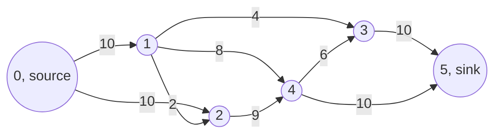
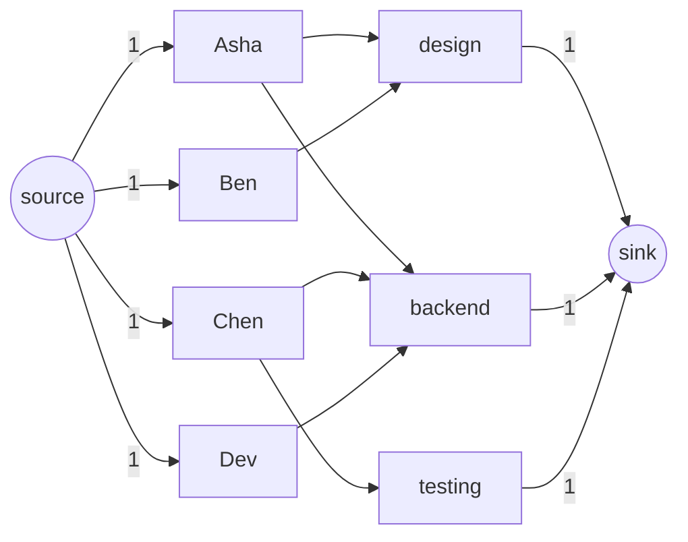

# new

## explanation

### How much can get through?

Water flows through pipes from a reservoir to a city; data flows through links from a server to a user; goods flow along roads from a factory to a port. Each pipe, link or road has a **capacity**, the most it can carry. The question: what's the most that can flow from the **source** s to the **sink** t at once?

A **flow** gives each directed edge an amount such that:

- no edge carries more than its capacity;
- at every vertex other than s and t, what flows in equals what flows out (**conservation**).

Its value is the total leaving s. We want the **maximum flow**.

### Augmenting paths

Find any path from s to t where every edge still has spare capacity. Push as much as the tightest edge on it allows, its **bottleneck**. Repeat until no such path exists.

### Why reverse edges are needed

Choosing paths greedily can get stuck. An early path may use an edge that a better solution would leave empty. The fix is to allow **undoing**. When x units flow along u → v, add x units of capacity to the reverse edge v → u. Sending flow "backwards" along it later means taking back some of the earlier flow and sending it another way.

The edges with spare capacity, including these reverse edges, form the **residual graph**. The method:

1. find any path from s to t in the residual graph;
2. push its bottleneck, lowering the forward capacities and raising the reverse ones;
3. stop when t is unreachable. The flow is then maximum.

This is the **Ford–Fulkerson method**. With whole-number capacities, each path adds at least 1, so it always finishes.

## diagram



## example

```cpp
#include <algorithm>
#include <iostream>
#include <vector>

const int n = 6;
int cap[n][n];  // spare capacity of every edge: the residual graph
bool seen[n];
std::vector<int> path;

// Find any path from u to the sink with spare capacity everywhere; return what it can carry (0: none).
int augment(int u, int sink, int limit) {
    if (u == sink) return limit;
    seen[u] = true;
    for (int v = 0; v < n; v++)
        if (!seen[v] && cap[u][v] > 0)
            if (int pushed = augment(v, sink, std::min(limit, cap[u][v]))) {
                cap[u][v] -= pushed;
                cap[v][u] += pushed;  // the reverse edge: this flow can be undone later
                path.push_back(v);
                return pushed;
            }
    return 0;
}

int main() {
    int pipes[][3] = {{0, 1, 10}, {0, 2, 10}, {1, 2, 2}, {1, 3, 4}, {1, 4, 8}, {2, 4, 9}, {3, 5, 10}, {4, 3, 6}, {4, 5, 10}};
    for (auto& p : pipes) cap[p[0]][p[1]] = p[2];
    int total = 0;
    while (true) {
        std::fill(seen, seen + n, false);
        path.clear();
        int pushed = augment(0, 5, 1000000);
        if (pushed == 0) break;
        total += pushed;
        std::cout << "path 0";
        for (auto it = path.rbegin(); it != path.rend(); ++it) std::cout << ' ' << *it;
        std::cout << ": +" << pushed << '\n';
    }
    std::cout << "maximum flow: " << total << '\n';
}
```

```text
path 0 1 2 4 3 5: +2
path 0 1 3 4 5: +2
path 0 1 3 5: +2
path 0 1 4 3 5: +4
path 0 2 1 4 3 5: +2
path 0 2 4 5: +7
maximum flow: 19
```

1. The first path happens to squeeze through the small pipe 1 → 2 and the pipe 4 → 3, carrying only 2.
2. The second path, 0 1 3 4 5, goes from 3 to 4 along a **reverse** edge. It cancels the first path's 2 units on 4 → 3 and sends them straight from 4 to 5 instead.
3. The fifth path, 0 2 1 4 3 5, uses the reverse edge 2 → 1 in the same way, undoing the first path's use of 1 → 2.
4. When no path is left, the total is the maximum flow: 19. Nothing more can pass, because the pipes 0→1 (10) and 2→4 (9) are full, and every route from 0 to 5 uses one of them.

## mistakes

- **No reverse edges.** Without them, an unlucky first path can block the true maximum. Always add the pushed amount to `cap[v][u]`.
- **Changing only one side.** Each push lowers the forward capacity *and* raises the reverse one by the same amount.
- **Resetting the visited marks only once.** Every new search for a path needs fresh marks.
- **Counting flow into the sink twice.** The flow value is the total of the pushes, or the total leaving the source, not both added together.
- **Real-number capacities with plain DFS.** With irrational capacities Ford–Fulkerson may never stop. Use whole numbers, or choose paths with BFS.

## check

```cpp
#include <algorithm>
#include <iostream>

int main() {
    int cap[4][4] = {};
    cap[0][1] = 5, cap[1][2] = 3, cap[2][3] = 7;  // one path 0 -> 1 -> 2 -> 3
    int bottleneck = std::min({cap[0][1], cap[1][2], cap[2][3]});
    for (int v = 0; v < 3; v++) cap[v][v + 1] -= bottleneck, cap[v + 1][v] += bottleneck;
    std::cout << bottleneck << ' ' << cap[0][1] << ' ' << cap[1][2] << ' ' << cap[2][1] << '\n';
}
```

```text
3 2 0 3
```

The path can carry only as much as its tightest edge, 1 → 2 with capacity 3. After pushing 3, edge 0 → 1 has 2 spare, edge 1 → 2 is full, and its reverse edge 2 → 1 now has 3, the amount that could be undone later.

# building

## explanation

### A quick recap

Ford–Fulkerson repeatedly finds a path from s to t in the residual graph (spare forward capacity plus reverse edges for undoing) and pushes its bottleneck, until t can't be reached.

### Choose paths with BFS: Edmonds–Karp

With depth-first search, the number of rounds can depend on the capacities. A bad graph with capacities of a million can take a million rounds of +1 each. **Edmonds–Karp** always uses a **shortest** augmenting path (fewest edges), found by BFS. That bounds the number of rounds by O(V · E) whatever the capacities, for O(V · E²) in total. It's simple and fast enough for graphs of a few hundred vertices.

### Cuts

Split the vertices into two sides, S containing s and T containing t. The **capacity of the cut** is the total capacity of edges going from S to T. Every unit of flow must cross from S to T somewhere, so **any flow ≤ any cut's capacity**.

### Max-flow min-cut theorem

The maximum flow **equals** the minimum cut capacity. When Ford–Fulkerson stops, let S be the vertices still reachable from s in the residual graph:

- every edge from S to T is full, or it would be in the residual graph;
- every edge from T to S carries nothing, or its reverse would be.

So the flow equals that cut's capacity, and both are optimal. This turns "the fewest links to cut so that s can't reach t" and "the cheapest way to separate two groups" into flow problems.

### Finding the cut

After the last round, run one more search from s over residual edges. The edges from a reached vertex to an unreached one, in the original graph, are a minimum cut.

## diagram


## example

```cpp
#include <algorithm>
#include <iostream>
#include <utility>
#include <vector>
// The residual graph as edge lists: each pipe and its way back are stored side by side, at e and e ^ 1.
struct Network {
    struct Pipe { int to, room, size; };  // size: the pipe's capacity (0 for a way back)
    std::vector<Pipe> pipes;
    std::vector<std::vector<int>> out;  // for each vertex, the indexes of the pipes leaving it
    std::vector<int> via;               // the pipe that first reached each vertex in the latest search
    explicit Network(int n) : out(n) {}
    void addPipe(int a, int b, int room) {
        out[a].push_back((int)pipes.size()), pipes.push_back({b, room, room});
        out[b].push_back((int)pipes.size()), pipes.push_back({a, 0, 0});  // the way back starts empty
    }
    // Edmonds-Karp: augment along a path with the fewest pipes, found by BFS. Returns (flow, rounds).
    std::pair<int, int> maxFlow(int s, int t) {
        int total = 0, rounds = 0;
        for (;;) {
            via.assign(out.size(), -1);
            std::vector<int> line = {s};  // the BFS queue: vertices are read in the order they were added
            for (std::size_t i = 0; i < line.size() && via[t] == -1; i++)
                for (int e : out[line[i]])
                    if (pipes[e].room > 0 && pipes[e].to != s && via[pipes[e].to] == -1) via[pipes[e].to] = e, line.push_back(pipes[e].to);
            if (via[t] == -1) return {total, rounds};  // t is unreachable: the flow is maximum
            int amount = 1 << 30;
            for (int x = t; x != s; x = pipes[via[x] ^ 1].to) amount = std::min(amount, pipes[via[x]].room);
            for (int x = t; x != s; x = pipes[via[x] ^ 1].to) pipes[via[x]].room -= amount, pipes[via[x] ^ 1].room += amount;
            total += amount, rounds++;
        }
    }
};
int main() {
    Network net(6);
    int list[][3] = {{0, 1, 10}, {0, 2, 10}, {1, 2, 2}, {1, 3, 4}, {1, 4, 8}, {2, 4, 9}, {3, 5, 10}, {4, 3, 6}, {4, 5, 10}};
    for (auto& p : list) net.addPipe(p[0], p[1], p[2]);
    auto [flow, rounds] = net.maxFlow(0, 5);
    auto sourceSide = [&](int v) { return v == 0 || net.via[v] != -1; };  // what the last search, which missed 5, reached
    std::cout << "maximum flow " << flow << " in " << rounds << " augmentations\nminimum cut:";
    for (int at = 0; at < 6; at++)
        for (int e : net.out[at])
            if (e % 2 == 0 && sourceSide(at) && !sourceSide(net.pipes[e].to)) std::cout << ' ' << at << "->" << net.pipes[e].to << " (" << net.pipes[e].size << ')';
    std::cout << '\n';
}
```

```text
maximum flow 19 in 4 augmentations
minimum cut: 0->1 (10) 2->4 (9)
```

1. Each round, BFS finds a path with the fewest edges among those with spare capacity. That needs only 4 rounds here, against 6 for the depth-first version on the same network.
2. The last round's search can't reach 5, and over the residual graph it reaches only 0 and 2. That is the search the cut needs, so `via` keeps what it reached.
3. The original edges from {0, 2} to the rest are 0 → 1 (10) and 2 → 4 (9). Their total, 19, equals the maximum flow, so this is a minimum cut: no flow can do better.
4. Each pipe's way back sits right next to it, at index `e ^ 1`, so sending flow along a pipe and opening room on its way back are two updates to neighbouring entries. That keeps memory at O(E), where a matrix needs O(V²).

## mistakes

- **Stopping BFS too late, or not at all.** Once t is reached, the path is known; stopping saves work but doesn't change the answer.
- **Reading the cut from the original graph's reachability.** The cut comes from the **residual** graph after the flow is maximum.
- **Listing reverse edges as cut edges.** Report only edges that exist in the original graph, with their original capacities.
- **An adjacency matrix for big graphs.** It costs O(V²) memory and makes each BFS O(V²). For thousands of vertices, use adjacency lists with paired reverse edges.
- **Parallel edges overwriting each other.** If the input repeats an edge, add the capacities together.

## check

```cpp
#include <algorithm>
#include <iostream>

int main() {
    int cap[4][4] = {{0, 3, 2, 0}, {0, 0, 5, 2}, {0, 0, 0, 3}, {0, 0, 0, 0}};  // source 0, sink 3
    int best = 1 << 30;
    for (int mask = 0; mask < 4; mask++) {  // which of 1 and 2 join the source's side
        bool inS[4] = {true, (mask & 1) != 0, (mask & 2) != 0, false};
        int c = 0;
        for (int u = 0; u < 4; u++) for (int v = 0; v < 4; v++) if (inS[u] && !inS[v]) c += cap[u][v];
        best = std::min(best, c);
    }
    std::cout << best << '\n';
}
```

```text
5
```

The four cuts cost 5 ({0}), 9 ({0, 1}), 6 ({0, 2}) and 5 ({0, 1, 2}). The smallest is 5, so by max-flow min-cut the maximum flow is 5: 3 along 0 → 1 (2 to the sink, 1 on to 2) and 2 along 0 → 2, with 3 reaching the sink from 2.

# strong

## explanation

### Matching

In a **bipartite** graph (workers on one side, jobs on the other, an edge when a worker can do a job), a **matching** pairs workers with jobs, each at most once. The **maximum matching** pairs as many as possible. It's a flow problem:

- an edge from a new source to every worker, capacity 1;
- each worker–job edge, capacity 1;
- an edge from every job to a new sink, capacity 1.

The maximum flow is the maximum matching. With whole-number capacities, the flow on each edge comes out whole, 0 or 1 here.

### Kuhn's algorithm

The flow view, written directly, gives a short algorithm. For each worker in turn, try to find a job:

- if the job is free, take it;
- if it's taken, ask its current holder to move to another of *their* possible jobs, recursively.

A successful chain of moves is an augmenting path. Each attempt is a DFS, O(E), and there are V attempts: O(V · E). **Hopcroft–Karp** finds many augmenting paths per round and runs in O(E √V).

### Theorems worth knowing

- **Hall's theorem**: every worker can be matched exactly when every group of k workers can do at least k different jobs between them.
- **König's theorem**: in a bipartite graph, the maximum matching equals the minimum number of vertices that touch every edge (a vertex cover).

### Faster flows and other uses

For general flow, **Dinic's algorithm** (BFS levels plus blocking flows) is the usual choice, at O(V² · E) and much faster in practice. Problems that reduce to flow or cuts:

- the most edge-disjoint paths between two vertices (unit capacities);
- assigning tasks with limits per person (capacities above 1);
- choosing projects with prerequisites to maximise profit (a minimum cut).

## diagram



## example

```cpp
#include <iostream>
#include <string>
#include <vector>

std::vector<std::vector<int>> canDo;  // canDo[p]: the jobs person p can do
std::vector<int> heldBy;              // heldBy[task]: the person holding that job, or -1
std::vector<bool> visited;            // jobs already looked at while placing this person

// Kuhn's algorithm: find p a job, moving other people to other jobs if needed (an augmenting path).
bool place(int p) {
    bool placed = false;
    for (std::size_t k = 0; k < canDo[p].size() && !placed; k++) {
        int task = canDo[p][k];
        if (visited[task]) continue;
        visited[task] = true;
        int holder = heldBy[task];
        if (holder < 0 || place(holder)) heldBy[task] = p, placed = true;  // free, or its holder can move on
    }
    return placed;
}

int main() {
    std::vector<std::string> worker = {"Asha", "Ben", "Chen", "Dev"};
    std::vector<std::string> job = {"design", "backend", "testing", "docs"};
    canDo = {{0, 1}, {0}, {1, 2}, {1}};
    heldBy.assign(4, -1);
    int matched = 0;
    for (int p = 0; p < 4; p++) {
        visited.assign(4, false);
        if (place(p)) matched++;
    }
    std::cout << "matched " << matched << " of 4\n";
    for (int j = 0; j < 4; j++) std::cout << job[j] << ": " << (heldBy[j] < 0 ? std::string("nobody") : worker[heldBy[j]]) << '\n';
}
```

```text
matched 3 of 4
design: Ben
backend: Asha
testing: Chen
docs: nobody
```

1. Asha takes design, the first job she can do.
2. Ben can only do design. It's taken, so Asha is asked to move; she can do backend, so she moves there and Ben gets design. That chain is an augmenting path.
3. Chen wants backend, but Asha can't move again (design is held by Ben, who has nowhere else to go), so Chen takes testing.
4. Dev can only do backend, and no chain of moves frees it. Asha, Ben and Dev can do only design and backend between them, so by Hall's theorem at most 2 of them can be matched. Nobody can do docs.

## mistakes

- **Not resetting `visited` for each new person.** Each attempt is a fresh search; leftover marks block valid moves.
- **Marking a job as tried after recursing.** Mark it before asking the owner to move, or the recursion can loop on the same job.
- **Greedy matching without moves.** Giving each worker their first free job can leave people out who a rearrangement could place.
- **Using matching for weighted assignment.** Kuhn's algorithm maximises the *number* of pairs. For costs or preferences, use min-cost flow or the Hungarian algorithm.
- **Matching in a non-bipartite graph.** Augmenting paths of this simple kind only work when the two sides are separate; general graphs need Edmonds' blossom algorithm.

## check

```cpp
#include <algorithm>
#include <iostream>
#include <vector>

int main() {
    int can[3][3] = {{1, 1, 0}, {1, 1, 0}, {1, 1, 0}};  // can[w][j]: worker w can do job j
    std::vector<int> perm = {0, 1, 2};
    int best = 0;
    do {  // try every way of giving the 3 workers one job each
        int ok = 0;
        for (int w = 0; w < 3; w++) ok += can[w][perm[w]];
        best = std::max(best, ok);
    } while (std::next_permutation(perm.begin(), perm.end()));
    std::cout << best << '\n';
}
```

```text
2
```

All three workers can do only jobs 0 and 1, so the three of them have just two jobs between them. By Hall's theorem, they can't all be matched: the best assignment gives jobs to 2 of them, and nobody can do job 2.
