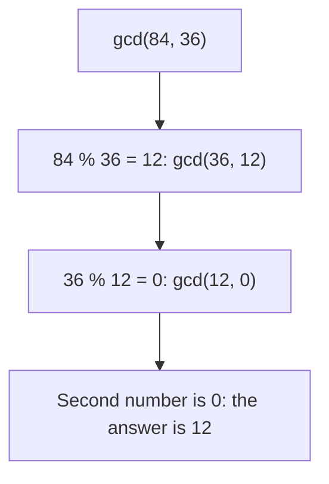
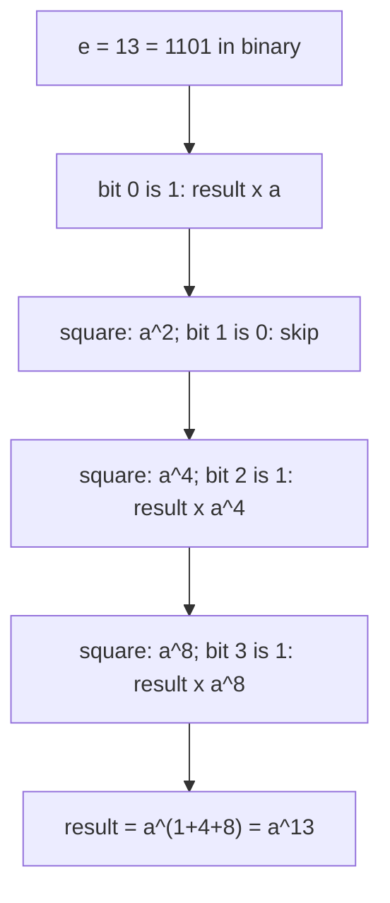
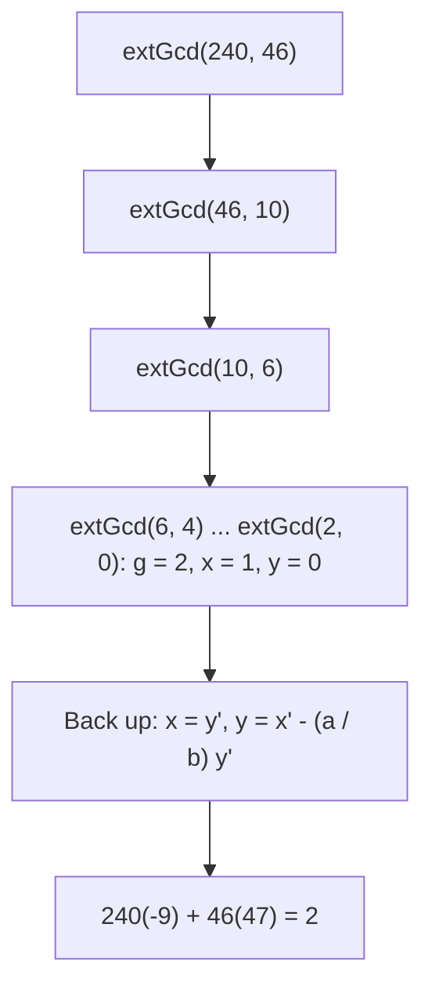

# new

## explanation

### Arithmetic algorithms lean on

Many problems hide some whole-number arithmetic: splitting things into equal groups, repeating cycles, primes, huge counts that must be reported "modulo 10⁹ + 7". **Number theory** gives the tools.

### The greatest common divisor

`gcd(a, b)` is the largest number that divides both. Euclid's algorithm, over 2,000 years old, finds it quickly:

> gcd(a, b) = gcd(b, a % b), and gcd(a, 0) = a.

Each step replaces the pair with a smaller one, and the numbers shrink at least as fast as Fibonacci numbers grow, so it takes O(log min(a, b)) steps. Even for numbers near 10¹⁸ that's under 100 steps.

### The least common multiple

`lcm(a, b)` is the smallest number both divide: when two cycles line up again. It comes from the gcd:

> lcm(a, b) = a / gcd(a, b) × b

Divide **before** multiplying, so the intermediate value stays small and doesn't overflow.

C++17 has both ready-made: `std::gcd` and `std::lcm` in `<numeric>`.

### Is it prime?

A prime has no divisors except 1 and itself. To test n, try dividing by every d from 2 while d × d ≤ n. If n had a divisor bigger than √n, it would also have one smaller than √n, so checking up to √n is enough: O(√n). For n = 10¹² that's a million checks, fast enough for one number.

### Small facts that keep code correct

- 0 and 1 are not prime; 2 is the only even prime.
- `n % d == 0` means d divides n.
- In C++, `%` of a negative number is negative or zero, so be careful with negatives.

## diagram



## example

```cpp
#include <iostream>
#include <numeric>

// Euclid: gcd(a, b) = gcd(b, a % b), and gcd(a, 0) = a.
long long gcd(long long a, long long b) {
    while (b != 0) {
        long long r = a % b;
        a = b;
        b = r;
    }
    return a;
}

bool isPrime(long long n) {
    if (n < 2) return false;
    for (long long d = 2; d * d <= n; d++)
        if (n % d == 0) return false;
    return true;
}

int main() {
    std::cout << "gcd(84, 36) = " << gcd(84, 36) << '\n';
    long long a = 12, b = 18;
    std::cout << "lcm(12, 18) = " << a / gcd(a, b) * b << '\n';  // divide first: no overflow
    std::cout << "std::gcd: " << std::gcd(84, 36) << ", std::lcm: " << std::lcm(12, 18) << '\n';
    for (long long n : {29LL, 91LL, 97LL}) std::cout << n << (isPrime(n) ? " prime" : " not prime") << '\n';
}
```

```text
gcd(84, 36) = 12
lcm(12, 18) = 36
std::gcd: 12, std::lcm: 36
29 prime
91 not prime
97 prime
```

1. Euclid's loop turns (84, 36) into (36, 12), then (12, 0): the gcd is 12.
2. The lcm of 12 and 18 is 12 / 6 × 18 = 36: two cycles of 12 and 18 days line up every 36 days.
3. The library functions give the same answers.
4. 91 looks prime but is 7 × 13; the loop finds the divisor 7, well before √91 ≈ 9.5. 29 and 97 have no divisor up to their square roots.

## mistakes

- **Checking divisors all the way to n.** Up to √n is enough, which is the difference between 10¹² and 10⁶ steps.
- **`d * d <= n` overflowing.** For n near the `long long` limit, `d * d` can overflow. Compare `d <= n / d` instead.
- **Treating 1 as prime.** It isn't. Most prime-based formulas break if you include it.
- **Computing lcm as `a * b / gcd`.** The product can overflow even when the lcm fits. Divide first.
- **Using `%` with negative numbers without thinking.** −7 % 3 is −1 in C++. Normalise with `((x % m) + m) % m` when you need a value from 0 to m − 1.

## check

```cpp
#include <iostream>

int main() {
    long long a = 48, b = 180, steps = 0;
    while (b != 0) { long long r = a % b; a = b; b = r; steps++; }
    std::cout << a << ' ' << steps << '\n';
}
```

```text
12 4
```

The pairs go (48, 180), then (180, 48), because the first step just swaps them, then (48, 36), (36, 12) and (12, 0). Four steps, and the gcd is 12.

# building

## explanation

### A quick recap

Euclid's algorithm gives the gcd in O(log n), the lcm comes from the gcd, and trial division up to √n tests or factorises one number.

### Many primes at once: the sieve

To list every prime up to n, the **sieve of Eratosthenes** starts with all numbers marked prime, then, for each prime p, crosses out its multiples. Two details make it fast:

- start crossing out at p × p, because smaller multiples were crossed out by smaller primes;
- stop once p × p > n.

It runs in O(n log log n), almost linear: all primes up to 10⁷ take a fraction of a second.

### Factorising

Trial division also **factorises**: divide n by d while it divides, counting how many times, for each d up to √n. Whatever is left above 1 at the end is a prime itself. From the prime factorisation p₁^e₁ × p₂^e₂ × …, the number of divisors is (e₁ + 1)(e₂ + 1)…, since each divisor picks an exponent from 0 to eᵢ for each prime.

### Modular arithmetic

When answers are huge, problems ask for them "modulo m", usually m = 10⁹ + 7, a prime. The rules:

- (a + b) mod m = ((a mod m) + (b mod m)) mod m;
- (a × b) mod m = ((a mod m) × (b mod m)) mod m;
- for subtraction, add m before taking the remainder, so the result isn't negative.

Take the remainder after **every** operation. With values below about 10⁹, a product fits in a `long long` (up to about 9.2 × 10¹⁸).

### Fast exponentiation

aᵉ by multiplying e times is O(e). **Binary exponentiation** looks at e's bits: square the base at each step, and multiply it into the result when the current bit of e is 1. That's O(log e) multiplications: 3²⁰⁰ takes 8 squarings, not 199 multiplications.

## diagram



## example

```cpp
#include <iostream>
#include <vector>

const long long MOD = 1'000'000'007;

// Sieve of Eratosthenes: cross out multiples of each prime, starting at p * p.
std::vector<bool> sieve(int n) {
    std::vector<bool> prime(n + 1, true);
    prime[0] = prime[1] = false;
    for (int p = 2; p * p <= n; p++)
        if (prime[p])
            for (int m = p * p; m <= n; m += p) prime[m] = false;
    return prime;
}

// Fast power: square the base, halve the exponent. O(log e) multiplications.
long long power(long long base, long long e, long long mod) {
    long long result = 1;
    base %= mod;
    while (e > 0) {
        if (e & 1) result = result * base % mod;  // this bit of e is set: include the current square
        base = base * base % mod;
        e >>= 1;
    }
    return result;
}

int main() {
    std::vector<bool> prime = sieve(50);
    int count = 0;
    for (int i = 0; i <= 50; i++) count += prime[i];
    std::cout << count << " primes up to 50:";
    for (int i = 0; i <= 50; i++) if (prime[i]) std::cout << ' ' << i;
    std::cout << '\n';
    std::cout << "2^10 = " << power(2, 10, MOD) << ", 3^200 mod 1e9+7 = " << power(3, 200, MOD) << '\n';
    std::cout << "(a + b) mod m: " << (999'999'999 + 999'999'999LL) % MOD << ", (a * b) mod m: " << 999'999'999LL * 999'999'999 % MOD << '\n';
}
```

```text
15 primes up to 50: 2 3 5 7 11 13 17 19 23 29 31 37 41 43 47
2^10 = 1024, 3^200 mod 1e9+7 = 136318165
(a + b) mod m: 999999991, (a * b) mod m: 64
```

1. The sieve only needs primes up to 7 to finish, because 8 × 8 > 50; every composite up to 50 has a factor of 7 or less.
2. `power` takes the remainder after every multiplication, so the numbers never grow past about 10¹⁸, even for 3²⁰⁰.
3. 999,999,999 is 8 less than the modulus, so the sum of two of them is 2 × (−8) = −16 ≡ 999,999,991, and their product is (−8)² = 64. Taking the remainder early keeps everything in range.

## mistakes

- **Starting the sieve's crossing-out at 2p.** It works, but repeats work smaller primes already did. Start at p × p.
- **Taking the remainder only at the end.** Intermediate results overflow long before the end. Reduce after every addition and multiplication.
- **Multiplying two numbers already near 10¹⁸.** Even with remainders, a modulus above about 3 × 10⁹ makes products overflow `long long`. Use a modulus below that, or 128-bit multiplication.
- **Negative results after subtraction.** `(a - b) % m` can be negative. Write `((a - b) % m + m) % m`.
- **Forgetting the leftover factor.** After trial division up to √n, any n left above 1 is a prime factor too; skipping it loses the largest prime of numbers like 2 × 97.

## check

```cpp
#include <iostream>

int main() {
    long long n = 360, divisors = 1;
    for (long long d = 2; d * d <= n; d++) {
        int e = 0;
        while (n % d == 0) { n /= d; e++; }
        divisors *= e + 1;
    }
    if (n > 1) divisors *= 2;
    std::cout << divisors << '\n';
}
```

```text
24
```

360 is 2³ × 3² × 5. The loop divides out three 2s (×4), then two 3s (×3), leaving 5; the loop stops because 4 × 4 > 5. The leftover 5 is a prime with exponent 1 (×2). So 360 has 4 × 3 × 2 = 24 divisors.

# strong

## explanation

### Extended Euclid

Euclid's algorithm can also find whole numbers x and y with a·x + b·y = gcd(a, b) (Bézout's identity). Recursively: if `gcd(b, a % b)` gives x′ and y′, then x = y′ and y = x′ − (a / b)·y′. This is the key to modular inverses for any modulus.

### Modular inverse: division under a modulus

Dividing by a modulo m means multiplying by its **inverse**, a number a⁻¹ with a·a⁻¹ ≡ 1. It exists exactly when gcd(a, m) = 1.

- If m is prime, Fermat's little theorem gives a⁻¹ = aᵐ⁻² mod m, by fast power.
- For any m, extended Euclid on (a, m) gives x with a·x ≡ 1; normalise x into 0..m − 1.

Inverses are what make formulas with division, such as n! / (k! (n − k)!), work modulo a prime.

### Many factorisations: smallest prime factor

A sieve variant stores, for every number up to N, its **smallest prime factor**. Factorising any n ≤ N is then repeated division by `spf[n]`: O(log n) per number, after an O(N log log N) sieve. Use it when you must factorise many numbers.

### Euler's totient

φ(n) counts the numbers from 1 to n that share no factor with n. From the factorisation, φ(n) = n × ∏(1 − 1/p) over its distinct primes p, computed as "for each p, subtract φ/p". It generalises Fermat: a^φ(m) ≡ 1 (mod m) when gcd(a, m) = 1, which reduces huge exponents.

### Beyond trial division

For one huge number (up to 10¹⁸), trial division is too slow. Miller-Rabin tests primality in O(log³ n), and Pollard's rho factorises in roughly O(n^(1/4)); both need 128-bit multiplication to avoid overflow.

## diagram



## example

```cpp
#include <iostream>
#include <tuple>
#include <vector>

// Extended Euclid: returns g = gcd(a, b) and x, y with a*x + b*y = g.
std::tuple<long long, long long, long long> extGcd(long long a, long long b) {
    if (b == 0) return {a, 1, 0};
    auto [g, x, y] = extGcd(b, a % b);
    return {g, y, x - (a / b) * y};
}

long long power(long long b, long long e, long long m) {
    long long r = 1;
    for (b %= m; e > 0; e >>= 1, b = b * b % m) if (e & 1) r = r * b % m;
    return r;
}

int main() {
    auto [g, x, y] = extGcd(240, 46);
    std::cout << "gcd " << g << " = 240*" << x << " + 46*" << y << '\n';

    // Inverse of 3 mod 11: Fermat (11 is prime) gives 3^(11-2); extended Euclid works for any coprime modulus.
    long long viaFermat = power(3, 9, 11);
    long long viaEuclid = std::get<1>(extGcd(3, 11));
    std::cout << "inverse of 3 mod 11: " << viaFermat << ' ' << (viaEuclid % 11 + 11) % 11 << '\n';

    // Smallest-prime-factor sieve: then any number up to N factorises in O(log n) steps.
    const int N = 100;
    std::vector<int> spf(N + 1, 0);
    for (int i = 2; i <= N; i++)
        if (spf[i] == 0)
            for (int m = i; m <= N; m += i) if (spf[m] == 0) spf[m] = i;
    for (int n = 84; n > 1; n /= spf[n]) std::cout << spf[n] << ' ';
    std::cout << '\n';

    // Euler's totient: how many of 1..n share no factor with n. Remove a 1/p share for each prime p.
    int n = 36, phi = n;
    for (int m = n; m > 1;) {
        int p = spf[m];
        phi -= phi / p;
        while (m % p == 0) m /= p;
    }
    std::cout << "phi(36) = " << phi << '\n';
}
```

```text
gcd 2 = 240*-9 + 46*47
inverse of 3 mod 11: 4 4
2 2 3 7
phi(36) = 12
```

1. Extended Euclid finds 240 × (−9) + 46 × 47 = −2160 + 2162 = 2, the gcd.
2. Both methods give 4 as the inverse of 3 modulo 11: 3 × 4 = 12 ≡ 1.
3. With the smallest-prime-factor table, 84 factorises as 2, 2, 3, 7 by repeated division, with no trial division at all.
4. 36 = 2² × 3², so φ(36) = 36 × (1 − 1/2) × (1 − 1/3) = 12: the numbers 1, 5, 7, 11, 13, 17, 19, 23, 25, 29, 31 and 35.

## mistakes

- **Fermat's inverse with a non-prime modulus.** aᵐ⁻² is only the inverse when m is prime. For other moduli, use extended Euclid, and check that gcd(a, m) = 1.
- **Forgetting to normalise extended Euclid's x.** It can be negative, as −9 was. Bring it into 0..m − 1 before using it.
- **Dividing under a modulus with `/`.** (a / b) mod m isn't (a mod m) / (b mod m). Multiply by the modular inverse instead.
- **An SPF table for numbers you don't need.** It costs O(N) memory. For a few large numbers, trial division up to √n is better.
- **Assuming φ(n) = n − 1.** That's only for primes. For composite n, compute it from the factorisation.

## check

```cpp
#include <iostream>

int main() {
    long long a = 7, m = 13, inv = 1;
    for (long long e = m - 2, b = a; e > 0; e >>= 1, b = b * b % m) if (e & 1) inv = inv * b % m;
    std::cout << inv << ' ' << a * inv % m << '\n';
}
```

```text
2 1
```

13 is prime, so the inverse of 7 is 7¹¹ mod 13, computed by fast power: 2. Checking: 7 × 2 = 14, which is 1 more than 13, so 7 × 2 ≡ 1 (mod 13).
