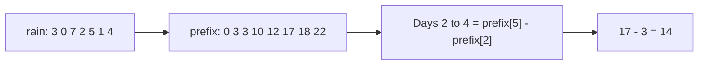
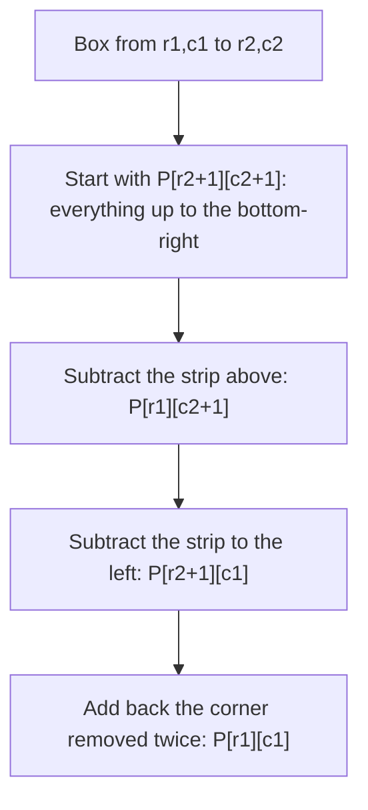
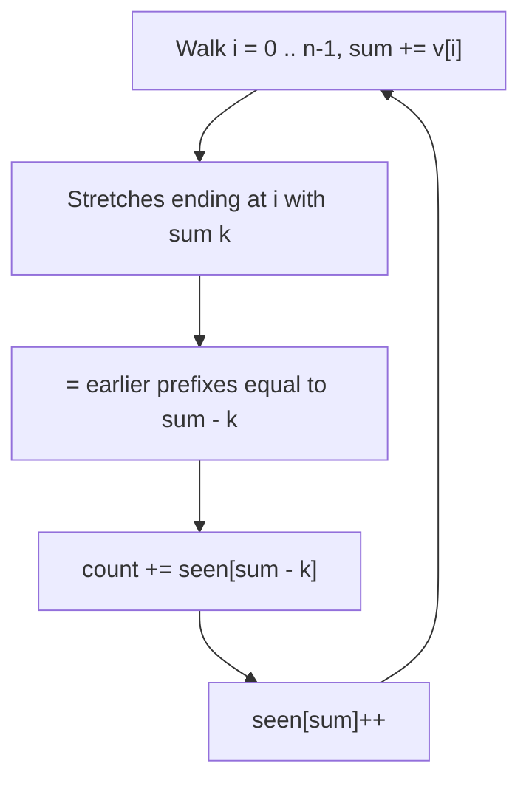

# new

## explanation

### Many questions about ranges

Suppose you have a week of rainfall readings and someone keeps asking: "how much rain from Tuesday to Thursday?", "from Monday to Sunday?", "on Saturday alone?". Adding up the days for every question costs up to n steps each. With many questions on a long list, that's slow.

### The prefix sum

Build, once, a second list where each entry is the total **so far**:

- `prefix[0] = 0` (nothing added yet)
- `prefix[1]` = day 0
- `prefix[2]` = day 0 + day 1
- … and `prefix[i]` = the sum of the first `i` days.

Each entry is the previous one plus one more day, so building it takes one pass: O(n).

### Answering any range in one step

The total from day `l` to day `r` (both included) is "everything up to `r`" minus "everything before `l`":

```cpp
total = prefix[r + 1] - prefix[l];
```

That's one subtraction per question, O(1), however long the range.

### Why the extra zero?

`prefix` has n + 1 entries, starting with 0. That makes a range that starts at day 0 work with the same formula (`prefix[r + 1] - prefix[0]`), with no special case.

### Where it's used

Range totals of sales, scores, steps or rainfall; averages over any window; and as a building block in many faster algorithms, as later lessons show.

### The limit

The prefix list is a snapshot. If a reading changes, every later prefix entry changes too, and rebuilding costs O(n). For data that changes often, a Fenwick tree (a later skill) handles both updates and range sums quickly.

## diagram



## example

```cpp
#include <iostream>
#include <vector>

int main() {
    std::vector<int> rain = {3, 0, 7, 2, 5, 1, 4};  // millimetres, day 0 to day 6
    // prefix[i] = total rain on the first i days (days 0 to i-1).
    std::vector<int> prefix(rain.size() + 1, 0);
    for (std::size_t i = 0; i < rain.size(); i++) prefix[i + 1] = prefix[i] + rain[i];

    for (int x : prefix) std::cout << x << ' ';
    std::cout << '\n';

    // Total from day l to day r, both included = prefix[r + 1] - prefix[l].
    int queries[3][2] = {{0, 6}, {2, 4}, {5, 5}};
    for (auto& q : queries) {
        int l = q[0], r = q[1];
        std::cout << "days " << l << "-" << r << ": " << prefix[r + 1] - prefix[l] << '\n';
    }
}
```

```text
0 3 3 10 12 17 18 22
days 0-6: 22
days 2-4: 14
days 5-5: 1
```

1. The prefix list starts at 0, and each entry adds one more day: 3, 3, 10, 12, 17, 18, 22.
2. The whole week is `prefix[7] - prefix[0]` = 22.
3. Days 2 to 4 are `prefix[5] - prefix[2]` = 17 − 3 = 14, which is 7 + 2 + 5.
4. A single day works too: day 5 is `prefix[6] - prefix[5]` = 1. Every answer took one subtraction.

## mistakes

- **A prefix list of size n.** It needs n + 1 entries, with `prefix[0] = 0`, or ranges starting at day 0 need a special case and `prefix[n]` doesn't exist.
- **Off-by-one in the formula.** With `prefix[i]` meaning "the first i items", the inclusive range l..r is `prefix[r + 1] - prefix[l]`. Writing `prefix[r] - prefix[l]` drops day r.
- **Overflow.** Totals grow with n. A million values near a billion add up to about 10¹⁵, so use `long long` for the prefix list.
- **Summing in a loop for every question.** That's O(n) per question. Build the prefix list once, then answer each in O(1).
- **Forgetting to rebuild after a change.** If a value changes, all later prefix entries are wrong until you rebuild.

## check

```cpp
#include <iostream>
#include <vector>

int main() {
    std::vector<int> v = {5, -2, 4, 1};
    std::vector<int> p(5, 0);
    for (int i = 0; i < 4; i++) p[i + 1] = p[i] + v[i];
    std::cout << p[4] << ' ' << p[3] - p[1] << ' ' << p[2] - p[0] << '\n';
}
```

```text
8 2 3
```

The prefix list is 0, 5, 3, 7, 8, so the total of everything is `p[4]` = 8. `p[3] - p[1]` is the sum of items 1 and 2: −2 + 4 = 2. `p[2] - p[0]` is the first two items: 5 − 2 = 3. Negative values work just the same.

# building

## explanation

### A quick recap

`prefix[i]` is the sum of the first `i` values, built in O(n). Any range sum is then one subtraction: `prefix[r + 1] - prefix[l]`.

### Prefix sums in two dimensions

For a grid, let `P[r][c]` be the sum of the rectangle from the top-left corner to cell (r − 1, c − 1). Each entry is built from three neighbours:

```cpp
P[r + 1][c + 1] = g[r][c] + P[r][c + 1] + P[r + 1][c] - P[r][c];
```

The two neighbours overlap in the top-left block, so it's subtracted once. A rectangle's sum, from (r1, c1) to (r2, c2), takes the big box, cuts the strip above and the strip to the left, and adds back the corner that was cut twice:

```cpp
P[r2+1][c2+1] - P[r1][c2+1] - P[r2+1][c1] + P[r1][c1]
```

Every rectangle sum is O(1) after an O(rows × columns) build.

### Difference arrays: the reverse trick

Now the opposite problem: many updates like "add 20 to every day from 2 to 5", then one read of the final values at the end. Updating each day costs O(length) per update.

Instead keep a **difference array** `diff`, all zeros, with n + 1 entries. For "add x from l to r":

```cpp
diff[l] += x;
diff[r + 1] -= x;
```

Then a single running total over `diff` rebuilds the real values: `+x` switches on at `l` and the `−x` switches it off after `r`. Each update is O(1), and the final pass is O(n).

### Choosing

- Many **reads** of range sums, data fixed: prefix sums.
- Many **range updates**, then read at the end: difference array.
- Both mixed, interleaved: a Fenwick or segment tree (later skills).

## diagram



## example

```cpp
#include <iostream>
#include <vector>

int main() {
    // 2D prefix sums: P[r][c] = sum of the rectangle from (0,0) to (r-1, c-1).
    std::vector<std::vector<int>> g = {{1, 2, 3}, {4, 5, 6}, {7, 8, 9}};
    int R = 3, C = 3;
    std::vector<std::vector<int>> P(R + 1, std::vector<int>(C + 1, 0));
    for (int r = 0; r < R; r++)
        for (int c = 0; c < C; c++)
            P[r + 1][c + 1] = g[r][c] + P[r][c + 1] + P[r + 1][c] - P[r][c];
    // Rows r1..r2 and columns c1..c2, inclusive: big box, minus two strips, plus the corner.
    auto box = [&](int r1, int c1, int r2, int c2) {
        return P[r2 + 1][c2 + 1] - P[r1][c2 + 1] - P[r2 + 1][c1] + P[r1][c1];
    };
    std::cout << box(0, 0, 2, 2) << ' ' << box(1, 1, 2, 2) << ' ' << box(0, 1, 1, 2) << '\n';

    // Difference array: add x to a whole range in O(1), rebuild once at the end.
    int days = 8;
    std::vector<int> diff(days + 1, 0);
    int bookings[3][3] = {{1, 3, 10}, {2, 5, 20}, {5, 7, 5}};  // from day, to day (inclusive), seats
    for (auto& b : bookings) {
        diff[b[0]] += b[2];
        diff[b[1] + 1] -= b[2];
    }
    int seats = 0;
    for (int d = 0; d < days; d++) {
        seats += diff[d];
        std::cout << seats << ' ';
    }
    std::cout << '\n';
}
```

```text
45 28 16
0 10 30 30 20 25 5 5
```

1. The whole grid sums to 45. The bottom-right 2 × 2 block, 5 + 6 + 8 + 9, is 28; the top-right block, 2 + 3 + 5 + 6, is 16. Each took four lookups.
2. Each booking touches only two entries of `diff`, however many days it covers.
3. The running total turns the differences into seats per day: day 2 has both of the first two bookings (30), day 4 only the second (20), day 5 the second and third (25).

## mistakes

- **Wrong signs in 2D.** It's plus the big box, minus two strips, **plus** the corner. Forgetting the corner subtracts it twice.
- **A difference array without the extra slot.** An update ending on the last day writes to `diff[r + 1]`, one past the end. Give it n + 1 entries.
- **Reading `diff` directly.** Its entries are changes, not values. Run the running total first.
- **Interleaving updates and reads.** A difference array is rebuilt in O(n) each time you read. If reads and updates alternate, use a Fenwick tree.
- **Mixing 0-based and 1-based indexes.** The prefix grid is shifted by one row and column. Decide which index each formula expects, and keep to it.

## check

```cpp
#include <iostream>
#include <vector>

int main() {
    std::vector<int> diff(6, 0);
    diff[1] += 3; diff[4] -= 3;  // +3 on positions 1..3
    diff[0] += 1; diff[2] -= 1;  // +1 on positions 0..1
    int run = 0;
    for (int i = 0; i < 5; i++) { run += diff[i]; std::cout << run; }
    std::cout << '\n';
}
```

```text
14330
```

`diff` holds 1, 3, −1, 0, −3. The running total gives position 0: 1, position 1: 1 + 3 = 4 (both updates), position 2: 4 − 1 = 3 (the +1 has ended), position 3: still 3, and position 4: 0 (the +3 has ended too).

# strong

## explanation

### Turning range questions into pair questions

A stretch from position j + 1 to i has sum `prefix[i] − prefix[j]`. So a question about stretches becomes a question about **pairs of prefix values**, which can often be answered in one pass with a hash map or a running minimum.

### Counting stretches with a given sum

"How many stretches sum to k?" means: for each i, how many earlier j have `prefix[j] = prefix[i] − k`? Walk once, keeping a hash map of how many times each prefix value has appeared, starting with prefix 0 seen once. Each step adds the count for `sum − k`, then records `sum`. That's O(n) on average, and unlike a sliding window it works with negative numbers.

### The best stretch

The largest stretch sum ending at i is `prefix[i]` minus the **smallest** earlier prefix. Keeping a running minimum gives the best stretch in O(n), the same answer as Kadane's algorithm, seen from the prefix side.

### Remainders

A stretch's sum is divisible by m exactly when its two prefix values leave the same remainder mod m. Count prefixes by remainder; every pair with equal remainders is one such stretch. Watch out: `%` of a negative number is negative in C++, so normalise with `((s % m) + m) % m`.

### Other operations

The idea works for any operation that can be undone: XOR (`px[r + 1] ^ px[l]`, since x ^ x = 0) and, with care, products of non-zero values modulo a prime. It does **not** work for min or max, which can't be undone; those need sparse tables or segment trees.

## diagram



## example

```cpp
#include <algorithm>
#include <iostream>
#include <unordered_map>
#include <vector>

int main() {
    std::vector<int> v = {3, 4, -7, 3, 1, 3, 1, -4, -2, -2};
    // Count stretches summing to k: the stretch after j up to i works when prefix[i] - prefix[j] == k.
    int k = 7;
    std::unordered_map<long long, int> seen{{0, 1}};  // prefix sum -> how many times seen
    long long sum = 0, count = 0;
    for (int x : v) {
        sum += x;
        if (auto it = seen.find(sum - k); it != seen.end()) count += it->second;
        seen[sum]++;
    }
    std::cout << "stretches summing to 7: " << count << '\n';

    // Best stretch sum: the running prefix minus the smallest prefix before it.
    long long best = v[0], run = 0, smallest = 0;
    for (int x : v) {
        run += x;
        best = std::max(best, run - smallest);
        smallest = std::min(smallest, run);
    }
    std::cout << "best stretch sum: " << best << '\n';

    // Two prefixes with the same remainder mod 5 enclose a stretch whose sum is a multiple of 5.
    std::vector<long long> rem(5, 0);
    rem[0] = 1;
    long long s = 0, divisible = 0;
    for (int x : v) {
        s = ((s + x) % 5 + 5) % 5;  // stays in 0..4 even for negative sums
        divisible += rem[s]++;
    }
    std::cout << "stretches divisible by 5: " << divisible << '\n';
}
```

```text
stretches summing to 7: 3
best stretch sum: 8
stretches divisible by 5: 10
```

1. The prefixes are 3, 7, 0, 3, 4, 7, 8, 4, 2, 0. The prefix 7 appears twice; the first time, one earlier prefix (the starting 0) is 7 below it, and the second time two are (0 at the start, 0 after the −7). Three stretches: 3 4, then 3 1 3, and the first six values.
2. The running prefix reaches 8 while the smallest earlier prefix is 0, so the best stretch sum is 8, for example 3 1 3 1.
3. Each prefix remainder is counted as it's seen; every earlier prefix with the same remainder pairs with it to make a stretch divisible by 5. There are 10 such pairs.

## mistakes

- **Forgetting the starting prefix 0.** Without `seen[0] = 1`, stretches that start at position 0 are never counted.
- **Recording before looking up.** Adding `sum` to the map before checking `sum − k` counts an empty stretch when k is 0. Look up first, then record.
- **Using a sliding window for negative numbers.** Windows rely on sums growing as the window grows. With negative values, use prefix sums with a hash map.
- **Negative remainders.** In C++, −3 % 5 is −3. Normalise to 0..m − 1 before using a remainder as an index.
- **Expecting prefix minimums to answer range minimums.** `min` can't be undone, so there's no subtraction trick. Use a sparse table or a segment tree.

## check

```cpp
#include <iostream>
#include <vector>

int main() {
    std::vector<int> v = {5, 1, 7, 2};
    std::vector<int> px(5, 0);
    for (int i = 0; i < 4; i++) px[i + 1] = px[i] ^ v[i];
    std::cout << (px[3] ^ px[1]) << ' ' << px[4] << '\n';
}
```

```text
6 1
```

The prefix XORs are 0, 5, 4, 3, 1. `px[3] ^ px[1]` cancels the shared first item and leaves 1 ^ 7, which is 6: the XOR of items 1 and 2. XOR undoes itself, which is what makes this work. The XOR of everything is `px[4]` = 1.
