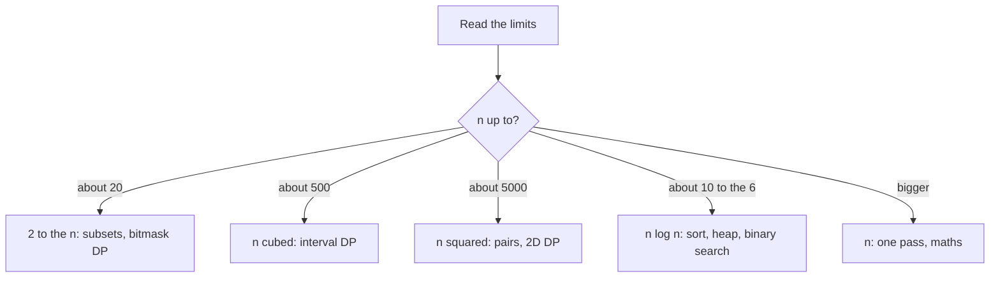
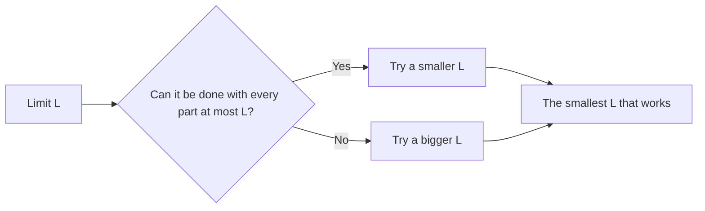
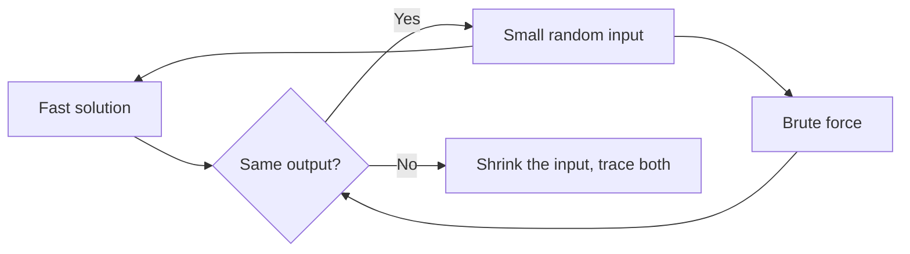

# new

## explanation

### Start with the limits

A problem statement usually ends with limits such as "1 ≤ n ≤ 2 · 10⁵" and "values up to 10⁹". They aren't decoration: they tell you how fast the solution must be, and so which ideas are worth trying.

A typical computer runs roughly **10⁸ simple steps per second**. Put n into each running time and see what fits:

| Largest n | Running times that fit | Typical techniques |
|---|---|---|
| about 10 | O(n!) | trying every order |
| about 20 | O(2ⁿ) | every subset, bitmask DP |
| about 500 | O(n³) | interval DP, Floyd–Warshall |
| about 5000 | O(n²) | DP over pairs, all pairs |
| about 10⁶ | O(n log n) | sorting, heaps, binary search |
| 10⁸ or more | O(n) or O(log n) | one pass, formulas |

So "n ≤ 2 · 10⁵" rules out checking every pair (4 · 10¹⁰ steps) and points to sorting, a hash table, two pointers or a sweep.

### The other limits

- **Values**: sums of 2 · 10⁵ values up to 10⁹ reach 2 · 10¹⁴, so use `long long`.
- **Memory**: 256 MB holds about 6 · 10⁷ `int`s. A 10⁵ × 10⁵ table is out of the question.
- **Special cases in the limits**: "k ≤ 20" next to "n ≤ 10⁵" suggests that something exponential in k is fine.

### A routine

1. Read the statement twice, and work out a small example by hand.
2. Read the limits and decide the time budget.
3. Write the simplest correct solution first, even if it's slow; it's useful for checking.
4. Find the idea that meets the budget, then test it against the simple one.

## diagram



## example

```cpp
#include <cmath>
#include <iostream>
#include <string>
#include <vector>

int main() {
    // About 10^8 simple steps run in a second. For each input size, what is the slowest running time that fits?
    const double budget = 1e8;
    struct Cost { std::string name; double (*steps)(double); };
    std::vector<Cost> costs = {  // slowest first
        {"n!", [](double n) { return std::tgamma(n + 1); }},
        {"2^n", [](double n) { return std::pow(2.0, n); }},
        {"n^3", [](double n) { return n * n * n; }},
        {"n^2", [](double n) { return n * n; }},
        {"n log n", [](double n) { return n * std::log2(n); }},
        {"n", [](double n) { return n; }},
    };
    for (double n : {10.0, 20.0, 400.0, 5000.0, 200000.0, 10000000.0})
        for (const Cost& c : costs)
            if (c.steps(n) <= budget) {
                std::cout << "n = " << (long long)n << ": " << c.name << " (" << (long long)c.steps(n) << " steps)\n";
                break;
            }
}
```

```text
n = 10: n! (3628800 steps)
n = 20: 2^n (1048576 steps)
n = 400: n^3 (64000000 steps)
n = 5000: n^2 (25000000 steps)
n = 200000: n log n (3521928 steps)
n = 10000000: n (10000000 steps)
```

1. For 10 items, even trying all 3.6 million orders fits in the budget.
2. At 20, orders are far too many, but 2²⁰ ≈ 10⁶ subsets are fine.
3. At 5000, n³ would be 1.25 · 10¹¹ steps, but n² is 2.5 · 10⁷.
4. At 2 · 10⁵, n² is 4 · 10¹⁰, so the solution needs about n log n. At 10⁷, only a single pass fits.

## mistakes

- **Starting to code before reading the limits.** The limits often decide the approach before any code is written.
- **Ignoring the constant factor.** 10⁸ is a rough guide; heavy operations (hash maps, recursion, `std::map`) can be 10 times slower than plain array steps.
- **`int` for sums and products.** Check the largest value an answer can reach, not just the input values.
- **Several test cases in one input.** "t ≤ 10⁴ test cases" with "the sum of n ≤ 2 · 10⁵" means the total work matters, not each case alone.
- **Skipping the slow solution.** A brute force is the quickest way to find bugs in the fast one.

## check

```cpp
#include <iostream>

int main() {
    long long n = 200000;
    long long pairs = n * (n - 1) / 2;  // checking every pair once
    std::cout << pairs << ' ' << (pairs <= 100000000 ? "fits" : "too slow") << '\n';
}
```

```text
19999900000 too slow
```

With 2 · 10⁵ items there are about 2 · 10¹⁰ pairs, roughly 200 times the budget of 10⁸ steps for a second. A solution for these limits must avoid looking at every pair, for example by sorting first or using a hash table.

# building

## explanation

### A quick recap

The limits set a budget of about 10⁸ steps, and the budget suggests a running time: n ≈ 2 · 10⁵ calls for O(n log n), n ≈ 5000 allows O(n²), and so on.

### Words that point to techniques

Certain phrasings come up again and again:

- "**minimise the maximum**" or "**maximise the minimum**": binary search on the answer, with a greedy or BFS check;
- "**contiguous subarray**" or "**window**": prefix sums, a sliding window or two pointers;
- "**how many ways**" or "**the best way**", with choices that affect each other: dynamic programming;
- "**the fewest steps**" with equal costs: BFS; with weights: Dijkstra;
- "**must come before**": topological sort;
- "**the k largest**" or "**the next smallest**": a heap;
- "**intervals**" or "**meetings**": sort by an endpoint, then sweep;
- "**connected**" while edges are added: disjoint set union.

These are starting points, not rules. Check each guess against the limits and a small example.

### Binary search on the answer

Many "minimise the largest …" problems have a hidden **yes/no** version that is easier: "can it be done with every part at most L?" If yes for L, it's also yes for any bigger L. When the answer is **monotone** like this, binary search for the smallest L that works. The cost is O(check · log(range)).

For "split an array into k consecutive parts with the smallest possible largest sum", the check is greedy. Fill each part until adding the next number would pass L, then start a new part, and see whether at most k parts were needed.

### Test before trusting

Write a simple solution, such as a brute force over every split. Run both on many small random inputs and compare. Any difference is a bug in one of them, and the failing input is small enough to trace by hand.

## diagram



## example

```cpp
#include <algorithm>
#include <climits>
#include <iostream>
#include <numeric>
#include <random>
#include <vector>

// Split a into k consecutive parts so that the largest part sum is as small as possible.
bool fits(const std::vector<int>& a, int k, long long limit) {  // greedy: is limit enough?
    int parts = 1;
    long long sum = 0;
    for (int x : a) {
        if (sum + x > limit) parts++, sum = 0;
        sum += x;
    }
    return parts <= k;
}
long long fast(const std::vector<int>& a, int k) {  // a bigger limit never hurts: binary search it
    long long lo = *std::max_element(a.begin(), a.end()), hi = std::accumulate(a.begin(), a.end(), 0LL);
    while (lo < hi) { long long mid = (lo + hi) / 2; if (fits(a, k, mid)) hi = mid; else lo = mid + 1; }
    return lo;
}
long long slow(const std::vector<int>& a, std::size_t from, int k) {  // try every end for the first part
    if (k == 1) return std::accumulate(a.begin() + from, a.end(), 0LL);
    long long best = LLONG_MAX, sum = 0;
    for (std::size_t end = from; end + k <= a.size(); end++) {  // leave one item for each later part
        sum += a[end];
        best = std::min(best, std::max(sum, slow(a, end + 1, k - 1)));
    }
    return best;
}

int main() {
    std::cout << "4 9 3 6 2 8 in 3 parts: " << fast({4, 9, 3, 6, 2, 8}, 3) << '\n';
    std::mt19937 rng(8);
    int wrong = 0;
    for (int t = 0; t < 300; t++) {
        std::vector<int> v(1 + rng() % 10);
        for (int& x : v) x = int(rng() % 20);
        int k = 1 + int(rng() % v.size());
        if (fast(v, k) != slow(v, 0, k)) wrong++;
    }
    std::cout << "300 random cases against trying every split: " << wrong << " wrong\n";
}
```

```text
4 9 3 6 2 8 in 3 parts: 13
300 random cases against trying every split: 0 wrong
```

1. With a limit of 12, the greedy check needs 4 parts (4 | 9 3 | 6 2 | 8), too many. With 13 it needs 3 (4 9 | 3 6 2 | 8), so the answer is 13.
2. The search starts at the largest item, since no part can be smaller, and ends at the total. It runs the O(n) check about log₂(sum) times, instead of trying every split.
3. The slow version tries every place for each cut. It's exponential, but on 300 small random inputs it agrees with the fast one every time.

## mistakes

- **Binary searching a check that isn't monotone.** If "yes for L" doesn't imply "yes for every bigger L", the search can skip the answer.
- **A wrong search range.** The answer here lies between the largest single item and the total; start `lo` and `hi` so the true answer is inside.
- **A greedy check that's subtly wrong.** For example, forgetting that one item alone can exceed the limit. Test it against brute force.
- **Matching keywords without thinking.** "Subarray" doesn't always mean a sliding window; with negative numbers, prefix sums are needed instead.
- **Random tests that are too big.** Keep them small enough that the slow solution runs quickly and a failing case can be traced.

## check

```cpp
#include <iostream>
#include <vector>

int main() {
    std::vector<int> a = {3, 7, 11, 20};  // the smallest d with ceil(3/d) + ceil(7/d) + ... at most 8
    auto total = [&](int d) { int s = 0; for (int x : a) s += (x + d - 1) / d; return s; };
    int lo = 1, hi = 20;
    while (lo < hi) {
        int mid = (lo + hi) / 2;
        if (total(mid) <= 8) hi = mid; else lo = mid + 1;
    }
    std::cout << lo << ' ' << total(lo) << ' ' << total(lo - 1) << '\n';
}
```

```text
7 7 9
```

A bigger divisor never makes the total bigger, so the smallest good d can be binary searched. With d = 7 the parts are 1 + 1 + 2 + 3 = 7, within 8. With d = 6 they are 1 + 2 + 2 + 4 = 9, too many, so 7 is the answer.

# strong

## explanation

### Combining techniques

Harder problems rarely match one technique. Usually one idea turns the problem into a simpler one, and a second idea solves that:

- **binary search on the answer + BFS or greedy**: "the smallest effort that makes a route possible" becomes "is there a route with effort at most L?";
- **a state graph + Dijkstra**: "the cheapest trip with one free ticket" becomes a shortest path over (city, ticket used?);
- **prefix sums + hashing**: "subarrays with sum k, with negative numbers allowed" becomes "earlier prefix sums equal to the current one minus k";
- **sorting + two pointers or a heap**: once items are in order, a sweep often replaces a search;
- **topological order + DP**: dependencies give an order in which a DP can be filled.

Ask: "what would make this easy?" If knowing the answer's size would make it easy, binary search it. If an order would make it easy, sort. If it's about routes with extra conditions, add them to the state.

### Stress testing

For any solution you aren't sure about:

1. write a brute force that is obviously correct;
2. generate many small random inputs;
3. compare the outputs, and stop at the first difference;
4. shrink that input by hand and trace both solutions.

This finds most wrong greedy ideas, off-by-one errors and missed edge cases within seconds.

### Edge cases to try every time

The empty input or one element; all elements equal; all negative; the largest values (for overflow); already sorted and reverse sorted; disconnected graphs; a target that can't be reached.

## diagram



## example

```cpp
#include <cstdlib>
#include <iostream>
#include <queue>
#include <random>
#include <utility>
#include <vector>

using Grid = std::vector<std::vector<int>>;
// Can we walk from the top-left to the bottom-right if no step may climb or drop by more than limit?
bool reachable(const Grid& h, int limit) {
    const int R = h.size(), C = h[0].size(), dr[] = {-1, 1, 0, 0}, dc[] = {0, 0, -1, 1};
    std::vector<std::vector<bool>> seen(R, std::vector<bool>(C, false));
    std::queue<std::pair<int, int>> q;
    q.push({0, 0});
    seen[0][0] = true;
    while (!q.empty()) {
        auto [r, c] = q.front(); q.pop();
        for (int k = 0; k < 4; k++) {
            int nr = r + dr[k], nc = c + dc[k];
            if (nr < 0 || nr >= R || nc < 0 || nc >= C || seen[nr][nc] || std::abs(h[nr][nc] - h[r][c]) > limit) continue;
            seen[nr][nc] = true, q.push({nr, nc});
        }
    }
    return seen[R - 1][C - 1];
}
int leastEffort(const Grid& h) {  // a bigger limit never hurts, so binary search it
    int lo = 0, hi = 1000000;
    while (lo < hi) { int mid = (lo + hi) / 2; if (reachable(h, mid)) hi = mid; else lo = mid + 1; }
    return lo;
}
int main() {
    Grid hills = {{1, 9, 2, 3}, {2, 8, 7, 3}, {4, 4, 9, 2}, {7, 5, 4, 1}};
    std::cout << "least effort: " << leastEffort(hills) << '\n';
    std::mt19937 rng(6);
    int wrong = 0;
    for (int t = 0; t < 100; t++) {  // stress test: try every limit from 0 upwards
        Grid h(5, std::vector<int>(5));
        for (auto& row : h) for (int& x : row) x = int(rng() % 30);
        int brute = 0;
        while (!reachable(h, brute)) brute++;
        if (brute != leastEffort(h)) wrong++;
    }
    std::cout << "100 random grids against trying every limit: " << wrong << " wrong\n";
}
```

```text
least effort: 3
100 random grids against trying every limit: 0 wrong
```

1. The question "the route with the smallest largest step" is turned into "is there a route using only steps up to L?", which one BFS answers. Here the right-hand column can only be entered by a step of 7 or more, so the route goes along the bottom, where the last step, from 4 down to 1, is 3.
2. A larger L allows every route a smaller one does, so the yes/no answers are monotone, and binary search finds the smallest L in about 20 BFS runs.
3. The stress test compares against the obvious method of trying L = 0, 1, 2, … on 100 random grids, and the two agree every time.

## mistakes

- **Reaching for a new algorithm before a reduction.** Many hard problems are an easy check plus a binary search, or a known algorithm on a bigger state.
- **A brute force that shares the fast solution's bug.** Here both use the same BFS, so the stress test checks only the binary search. Ideally, keep the brute force independent.
- **Random inputs that never hit the edge cases.** Add hand-made cases: one cell, all equal, the largest values.
- **Stopping at the first passing sample.** The given examples are small and friendly; the hidden tests include worst cases and corner cases.
- **Unbounded searches.** Set `hi` to a value that is certainly enough, such as the largest height difference, or the loop may miss the answer.

## check

```cpp
#include <iostream>
#include <unordered_map>
#include <vector>

int main() {
    std::vector<int> a = {1, 2, -1, 4, -2, 1, 3};  // how many subarrays add up to exactly 3?
    std::unordered_map<long long, int> seen = {{0, 1}};  // how often each prefix sum has appeared
    long long prefix = 0, count = 0;
    for (int x : a) {
        prefix += x;
        if (auto it = seen.find(prefix - 3); it != seen.end()) count += it->second;
        seen[prefix]++;
    }
    std::cout << count << '\n';
}
```

```text
5
```

A subarray adds up to 3 exactly when the current prefix sum minus an earlier one is 3. Counting earlier prefix sums in a hash map finds all 5: 1 2, −1 4, 2 −1 4 −2, 4 −2 1 and 3. With negative numbers, a sliding window couldn't do this.
