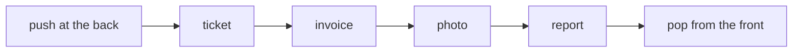
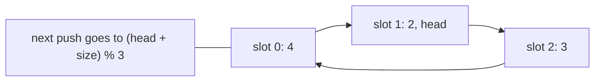
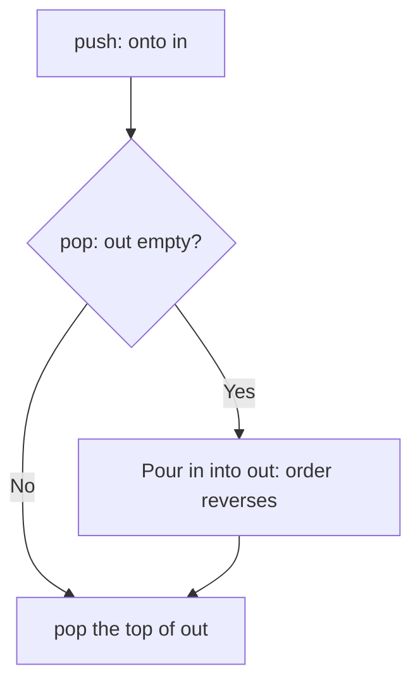

# new

## explanation

### First in, first out

A **queue** works like a line at a counter: people join at the **back** and are served from the **front**. The first to arrive is the first to leave (FIFO). That's the opposite of a stack.

- **push**: join at the back;
- **pop**: leave from the front;
- **front** and **back**: look at either end;
- **empty**: is anyone waiting?

### Where queues appear

Whenever things must be handled fairly, in the order they arrived: print jobs, customer requests, messages between programs, tasks waiting for a processor. They're also the engine of breadth-first search, which explores things in order of distance.

### `std::queue`

C++ gives you `std::queue` from `<queue>`, with exactly these operations, all O(1).

### Why not just a vector?

Adding at a vector's back is O(1), but removing from its **front** with `erase(v.begin())` shifts every remaining item: O(n) per removal, O(n²) to empty the queue. A simple fix is to never erase: keep an index `head` to the current front and move it forward. Serving is then O(1). The used slots at the start are wasted, but for a one-off pass that's fine.

### Rules to remember

- Check `empty()` before `front()` or `pop()`.
- `pop()` returns nothing: read `front()` first.
- In a queue, `front()` is the oldest item and `back()` the newest.

## diagram



## example

```cpp
#include <iostream>
#include <queue>
#include <string>
#include <vector>

int main() {
    // A print queue: jobs are served in the order they arrive.
    std::queue<std::string> jobs;
    for (std::string j : {"report", "photo", "invoice"}) jobs.push(j);
    jobs.push("ticket");
    while (!jobs.empty()) {
        std::cout << "printing " << jobs.front() << '\n';
        jobs.pop();
    }

    // A queue on a vector: instead of erasing the front (O(n)), move a head index forward (O(1)).
    std::vector<int> line = {101, 102, 103};
    std::size_t head = 0;
    line.push_back(104);        // join at the back
    int served = line[head++];  // serve the front
    served = line[head++];
    std::cout << "last served " << served << ", waiting " << line.size() - head << ", next " << line[head] << '\n';
}
```

```text
printing report
printing photo
printing invoice
printing ticket
last served 102, waiting 2, next 103
```

1. The jobs come out exactly in arrival order, including "ticket", which joined last.
2. The loop reads `front()` before every `pop()`, and stops when the queue is empty.
3. In the vector version, serving just moves `head` on: 101 and then 102 are served without shifting anything.
4. Two people are still waiting, from `head` to the end, and the next to be served is 103.

## mistakes

- **Erasing a vector's front in a loop.** Each `erase(v.begin())` shifts everything after it. Use `std::queue`, `std::deque` or a head index.
- **Reading an empty queue.** `front()` on an empty queue has no defined result. Check `empty()` first.
- **Mixing up front and back.** `front()` is the next to leave; `back()` is the one who just joined.
- **A stack where fairness matters.** A stack serves the newest first, so early arrivals can wait forever. Use a queue for first-come, first-served.
- **A head index that never resets.** In a long-running program, the used slots keep growing. Use a real queue, or reset the vector when it empties.

## check

```cpp
#include <iostream>
#include <queue>

int main() {
    std::queue<int> q;
    for (int i = 1; i <= 4; i++) q.push(i * i);
    q.pop();
    q.push(q.front() + q.back());
    q.pop();
    std::cout << q.front() << ' ' << q.back() << ' ' << q.size() << '\n';
}
```

```text
9 20 3
```

The queue holds 1, 4, 9, 16. The first pop removes 1. Then `front() + back()` is 4 + 16 = 20, which joins at the back. The second pop removes 4, leaving 9, 16, 20: front 9, back 20, three items.

# building

## explanation

### A quick recap

A queue serves items in arrival order: push at the back, pop at the front, both O(1) with `std::queue`. Never erase a vector's front in a loop.

### Circular buffers

When a queue has a known maximum size, a **circular buffer** (ring buffer) uses one fixed array and two numbers: where the front is (`head`) and how many items there are (`size`). The back slot is `(head + size) % capacity`. Pushing writes there; popping reads at `head` and moves it on with `head = (head + 1) % capacity`. The `%` makes positions wrap from the end of the array back to the start, so no item ever moves and no memory is allocated after creation.

Keeping `size` (rather than only two indexes) makes "full" and "empty" easy to tell apart: full is `size == capacity`, empty is `size == 0`. Ring buffers are common for streams of data such as audio, logs, and network packets.

### Deques: both ends

A **deque** (double-ended queue, `std::deque`) adds and removes at **both** ends in O(1): `push_front`, `push_back`, `pop_front`, `pop_back`. It also supports `d[i]`. Use it when items join or leave at either end, for example "undo the most recent" plus "drop the oldest".

### Processing in rounds

Queues naturally model taking turns. In **round-robin** scheduling, each task runs for a fixed time slice; if it isn't finished, it goes to the back of the queue. Every task gets a fair share, and none waits forever.

## diagram



## example

```cpp
#include <algorithm>
#include <iostream>
#include <queue>
#include <string>
#include <utility>
#include <vector>

// A circular buffer: fixed slots; head and size wrap around with %, so no item ever moves.
class Ring {
public:
    explicit Ring(std::size_t capacity) : slots_(capacity) {}
    bool push(int x) {
        if (size_ == slots_.size()) return false;  // full
        slots_[(head_ + size_++) % slots_.size()] = x;
        return true;
    }
    int pop() { int x = slots_[head_]; head_ = (head_ + 1) % slots_.size(); size_--; return x; }
private:
    std::vector<int> slots_;
    std::size_t head_ = 0, size_ = 0;
};

int main() {
    Ring r(3);
    r.push(1); r.push(2); r.push(3);
    std::cout << "full? " << !r.push(4) << ", popped " << r.pop() << '\n';
    r.push(4);  // reuses the slot that 1 left
    std::cout << r.pop() << r.pop() << r.pop() << '\n';

    // Round robin: each task runs for up to 3 units, then goes to the back if unfinished.
    std::queue<std::pair<std::string, int>> tasks;
    for (auto t : {std::pair<std::string, int>{"A", 5}, {"B", 2}, {"C", 4}}) tasks.push(t);
    int clock = 0;
    while (!tasks.empty()) {
        auto [name, left] = tasks.front();
        tasks.pop();
        int run = std::min(left, 3);
        clock += run;
        if (left > run) tasks.push({name, left - run});
        else std::cout << name << " done at " << clock << ' ';
    }
    std::cout << '\n';
}
```

```text
full? 1, popped 1
234
B done at 5 A done at 10 C done at 11
```

1. The ring holds three items; a fourth push is refused. Popping frees slot 0.
2. Pushing 4 wraps around into slot 0, and the next three pops return 2, 3, 4 in order, even though 4 sits at the start of the array.
3. In the round robin, A runs 3 units and goes back with 2 left; B finishes at time 5; C runs 3 units with 1 left; A finishes at 10; C at 11.
4. Short tasks finish early instead of waiting behind long ones, which is the point of time slices.

## mistakes

- **Telling full from empty with indexes alone.** If head and tail are equal in both cases, you can't distinguish them. Track `size`, or leave one slot unused.
- **Forgetting to wrap.** Without `% capacity`, the next index runs off the end of the array.
- **Popping an empty ring buffer.** This `pop` doesn't check; real code must, or it returns stale data and makes `size` wrap around.
- **Re-queuing finished tasks.** Only tasks with time left go back; otherwise the loop never ends.
- **A deque where a stack or queue would do.** A deque allows both ends, which hides the intended access pattern. Use the narrowest container that fits.

## check

```cpp
#include <deque>
#include <iostream>

int main() {
    std::deque<int> d;
    d.push_back(1);
    d.push_back(2);
    d.push_front(0);
    d.push_front(-1);
    d.pop_back();
    std::cout << d.front() << ' ' << d.back() << ' ' << d[1] << ' ' << d.size() << '\n';
}
```

```text
-1 1 0 3
```

Pushing 1 and 2 at the back and 0 and −1 at the front gives −1 0 1 2. `pop_back` removes the 2. Now the front is −1, the back is 1, position 1 holds 0, and three items remain.

# strong

## explanation

### How `std::deque` works

A deque keeps its items in fixed-size blocks, with a small index of pointers to the blocks. Adding at either end fills or adds a block, never moving existing items, so pointers and references to them stay valid (iterators don't). Indexing is O(1): find the block, then the slot. It's slightly slower than a vector to index and to walk, because of the extra step and the scattered blocks. `std::queue` and `std::stack` use a deque underneath by default.

### A queue from two stacks

Push onto an `in` stack. To pop, take from an `out` stack; when `out` is empty, pour everything from `in` into it, which reverses the order so the oldest is on top. A single pop can move many items, but each item moves only once, so the cost is **O(1) amortised** per operation. The same idea gives queues on top of other stack-like structures, including ones that also track their minimum.

### Queues spread outwards

Start with some items at distance 0 in a queue. Repeatedly take the front item and add its unvisited neighbours at distance + 1. Because the queue serves items in order, everything at distance d is processed before anything at distance d + 1, so the first time an item is reached is along a shortest route. This is **breadth-first search**; with several starting points it computes, for every item, the distance to its nearest start in one pass.

### Bounded queues between workers

Between a producer and a consumer running at different speeds, a **bounded** queue, usually a ring buffer, stops the producer when it's full instead of letting memory grow without limit. That back-pressure is how streaming systems stay stable.

## diagram



## example

```cpp
#include <iostream>
#include <queue>
#include <stack>
#include <vector>

// A queue from two stacks: push onto `in`; when `out` is empty, pour `in` into it, reversing the order.
// Each item moves at most once, so every operation is O(1) amortised.
class TwoStackQueue {
public:
    void push(int x) { in_.push(x); }
    int pop() {
        if (out_.empty())
            while (!in_.empty()) { out_.push(in_.top()); in_.pop(); moves++; }
        int x = out_.top();
        out_.pop();
        return x;
    }
    int moves = 0;
private:
    std::stack<int> in_, out_;
};

int main() {
    TwoStackQueue q;
    for (int i = 1; i <= 4; i++) q.push(i);
    std::cout << q.pop() << q.pop();
    q.push(5);
    std::cout << q.pop() << q.pop() << q.pop() << " | moves " << q.moves << '\n';

    // A queue spreads outwards in order of distance: days for news to reach each house on a street.
    std::vector<int> day(10, -1);
    std::queue<int> frontier;
    for (int start : {2, 7}) { day[start] = 0; frontier.push(start); }
    while (!frontier.empty()) {
        int h = frontier.front();
        frontier.pop();
        for (int next : {h - 1, h + 1})
            if (next >= 0 && next < 10 && day[next] == -1) { day[next] = day[h] + 1; frontier.push(next); }
    }
    for (int d : day) std::cout << d << ' ';
    std::cout << '\n';
}
```

```text
12345 | moves 5
2 1 0 1 2 2 1 0 1 2
```

1. The first pop pours 1 to 4 into `out`, reversed so 1 is on top. The next pops come straight from `out`.
2. 5 waits on `in` until `out` empties, then is moved over on its own: five moves for five items, one each.
3. News starts at houses 2 and 7 on day 0. The queue processes all day-1 houses before any day-2 house, so each house gets the day of its nearest starting point.
4. House 4 is two days from house 2 and three from house 7, so it hears on day 2.

## mistakes

- **Expecting deque iterators to survive growth.** References to items stay valid when a deque grows at either end, but iterators don't. Re-fetch iterators after `push_front` or `push_back`.
- **Quoting amortised cost as worst case.** A two-stack queue's pop can move every item at once. If each operation must be fast, not just the average, use a ring buffer.
- **Marking items visited when they're popped.** In a spreading search, mark them when they're **pushed**, or the same item can enter the queue many times.
- **Unbounded queues between fast and slow parts.** If the producer outpaces the consumer, memory grows until the program fails. Bound the queue and make the producer wait.
- **A deque for heavy indexed access.** Indexing a deque is O(1) but slower than a vector's, and walking it is less cache-friendly. If you mostly read by position, use a vector.

## check

```cpp
#include <deque>
#include <iostream>

int main() {
    std::deque<int> d = {3, 1, 4, 1, 5};
    int ops = 0;
    while (d.size() > 1) {
        int a = d.front(); d.pop_front();
        int b = d.back(); d.pop_back();
        d.push_back(a + b);
        ops++;
    }
    std::cout << d.front() << ' ' << ops << '\n';
}
```

```text
14 4
```

Each round takes one item from each end and puts their sum at the back: 3 + 5, then 1 + 8, then 4 + 9, then 1 + 13. Every round removes one item in total, so five items take four rounds, and the sum of all items, 14, never changes.
