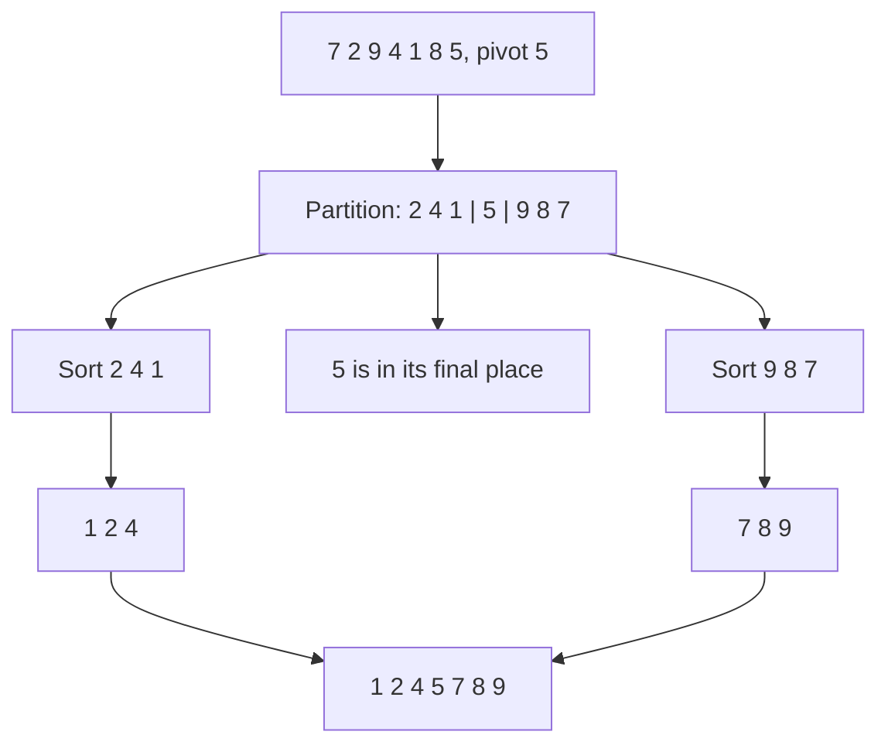
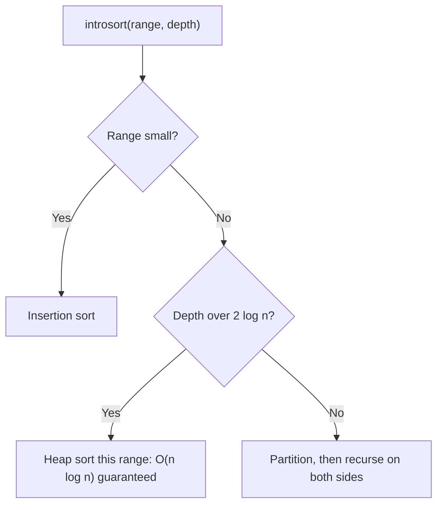

# new

## explanation

### Partitioning

Pick one item, the **pivot**. Rearrange the list so that everything smaller than the pivot is on its left and everything else on its right. This is called **partitioning**. Afterwards, the pivot is in exactly the place it will have in the sorted list, and it never needs to move again.

### Quick sort

**Quick sort** partitions the list, then sorts the left part and the right part the same way, recursively. A part with 0 or 1 items is already sorted. Unlike merge sort, there's nothing to combine at the end: once both sides are sorted, the whole list is.

### One way to partition

A simple method (the **Lomuto** partition) uses the last item as the pivot and keeps a marker, `store`, for where the next small item goes:

1. Walk through the items before the pivot.
2. Each time one is smaller than the pivot, swap it to `store` and move `store` right.
3. Finally, swap the pivot into `store`.

Everything left of `store` is now smaller than the pivot, and everything right of it is not.

### How fast is it?

If each pivot splits the list roughly in half, there are about log₂ n levels with n work each: O(n log n), and in practice quick sort is one of the fastest sorts, because it works in place and walks memory in order.

But the pivot matters. If it's always the smallest or largest item, each partition removes only one item, giving n levels: O(n²). With "last item as pivot", that happens on a list that is **already sorted**, which is common in real data. Picking the pivot at random (building level) makes that bad luck extremely unlikely.

### Other properties

Quick sort sorts in place, needing only the recursion's stack. It is **not stable**: partitioning swaps items over long distances, past equal ones.

## diagram



## example

```cpp
#include <iostream>
#include <utility>
#include <vector>

void print(const std::vector<int>& v) {
    for (int x : v) std::cout << x << ' ';
    std::cout << '\n';
}

// Lomuto partition of v[lo..hi] around the last item: smaller items to its left, the rest to its right.
int partition(std::vector<int>& v, int lo, int hi) {
    int pivot = v[hi];
    int store = lo;  // next place for an item smaller than the pivot
    for (int i = lo; i < hi; i++) {
        if (v[i] < pivot) std::swap(v[i], v[store++]);
    }
    std::swap(v[store], v[hi]);  // the pivot lands in its final place
    return store;
}

void quickSort(std::vector<int>& v, int lo, int hi) {
    if (lo >= hi) return;
    int p = partition(v, lo, hi);
    quickSort(v, lo, p - 1);
    quickSort(v, p + 1, hi);
}

int main() {
    std::vector<int> v = {7, 2, 9, 4, 1, 8, 5};
    int p = partition(v, 0, 6);
    std::cout << "pivot 5 placed at " << p << ": ";
    print(v);
    quickSort(v, 0, 6);
    print(v);
}
```

```text
pivot 5 placed at 3: 2 4 1 5 9 8 7
1 2 4 5 7 8 9
```

1. The pivot is the last item, 5. Walking from the left, 2, 4 and 1 are smaller, so each is swapped to the next `store` position: 0, 1, then 2.
2. The pivot is swapped into position 3. Now 2 4 1 sit on its left and 9 8 7 on its right; neither side is sorted yet, but 5 is already where it belongs.
3. `quickSort` then sorts the two sides recursively, excluding the pivot itself, and the whole list ends up sorted.

## mistakes

- **Including the pivot in a recursive call.** After partitioning, sort `lo..p-1` and `p+1..hi`. Including `p` again can make a part that never shrinks.
- **Ignoring the worst case.** With the last item as pivot, an already sorted list makes every partition remove just one item: O(n²) time and n levels of recursion. Choose the pivot at random.
- **Expecting quick sort to be stable.** Long-distance swaps reorder equal items. Use `std::stable_sort` when ties must keep their order.
- **`<=` against the pivot in Lomuto.** It still sorts, but with many equal values it sends them all to one side, which also leads to O(n²). The building level handles duplicates properly.
- **Off-by-one bounds.** This version uses inclusive ranges, `lo..hi`, so the first call is `quickSort(v, 0, size - 1)`.

## check

```cpp
#include <iostream>
#include <utility>
#include <vector>

int main() {
    std::vector<int> v = {6, 3, 8, 1, 5};
    int pivot = v[4], store = 0;
    for (int i = 0; i < 4; i++)
        if (v[i] < pivot) std::swap(v[i], v[store++]);
    std::swap(v[store], v[4]);
    for (int x : v) std::cout << x << ' ';
    std::cout << "| " << store << '\n';
}
```

```text
3 1 5 6 8 | 2
```

The pivot is 5. 6 is skipped; 3 is smaller, so it's swapped to position 0; 8 is skipped; 1 is smaller, so it's swapped to position 1, which moves 6 to position 3. Finally the pivot is swapped into position 2. The left side, 3 1, isn't sorted yet, but everything left of the pivot is smaller and everything right of it is bigger.

# building

## explanation

### A quick recap

Quick sort partitions around a pivot, which lands in its final place, then sorts each side recursively. It's O(n log n) when pivots split well and O(n²) when they don't. It sorts in place and isn't stable.

### Random pivots

Choose the pivot at a random position. No input is then bad for every run: getting a terrible split again and again is astronomically unlikely, and the **expected** running time is O(n log n) for every input. Use a seeded generator such as `std::mt19937`. In tests, a fixed seed makes runs repeatable.

### Many equal values: three-way partitioning

If the list has many copies of the same value, a two-way partition keeps putting the copies on one side, and with all items equal it degrades to O(n²). A **three-way partition** splits into three blocks: smaller than the pivot, **equal** to it, and larger. It walks with three markers, `lt`, `i` and `gt`:

- `v[i] < pivot`: swap it to `lt`, move both on.
- `v[i] > pivot`: swap it to `gt`, move `gt` back; don't move `i`, because the swapped-in item is new.
- equal: just move `i` on.

The whole equal block is now in its final place, and only the smaller and larger blocks need sorting. A list of all-equal items finishes after one pass.

### Quickselect: the k-th smallest without sorting

To find the median, or the k-th smallest item, you don't need everything sorted. Partition once: if position `k` is inside the equal block, you've found it; if it's left of the block, continue only on the left part, otherwise only on the right. Going into **one** side each time makes the expected cost n + n/2 + n/4 + … ≈ 2n: O(n). `std::nth_element` does exactly this.

### Keeping the stack small

Recursing on both sides can go n levels deep after bad splits. Recurse into the **smaller** side and loop over the larger one, and the stack never grows beyond log₂ n levels.

## diagram


## example

```cpp
#include <iostream>
#include <random>
#include <utility>
#include <vector>

std::mt19937 rng(2024);  // fixed seed: the same "random" pivots on every run
// Three-way partition around a random pivot into < pivot | == pivot | > pivot; returns the equal block.
std::pair<int, int> partition3(std::vector<int>& v, int lo, int hi) {
    int pivot = v[lo + static_cast<int>(rng() % (hi - lo + 1))];
    int lt = lo, i = lo, gt = hi;
    while (i <= gt) {
        if (v[i] < pivot) std::swap(v[lt++], v[i++]);
        else if (v[i] > pivot) std::swap(v[i], v[gt--]);
        else i++;
    }
    return {lt, gt};
}

void quickSort(std::vector<int>& v, int lo, int hi) {
    if (lo >= hi) return;
    auto [lt, gt] = partition3(v, lo, hi);
    quickSort(v, lo, lt - 1);  // the equal block is already in place
    quickSort(v, gt + 1, hi);
}

// Quickselect: the k-th smallest (0-based), going into one side only.
int kthSmallest(std::vector<int> v, int k) {
    int lo = 0, hi = static_cast<int>(v.size()) - 1;
    while (true) {
        auto [lt, gt] = partition3(v, lo, hi);
        if (k < lt) hi = lt - 1;
        else if (k > gt) lo = gt + 1;
        else return v[k];
    }
}

int main() {
    std::vector<int> v = {4, 9, 4, 1, 4, 7, 9, 2, 4};
    std::cout << "median: " << kthSmallest(v, 4) << ", 2nd smallest: " << kthSmallest(v, 1) << '\n';
    quickSort(v, 0, static_cast<int>(v.size()) - 1);
    for (int x : v) std::cout << x << ' ';
    std::cout << '\n';
}
```

```text
median: 4, 2nd smallest: 2
1 2 4 4 4 4 7 9 9
```

1. `partition3` picks a random pivot position and splits the range into three blocks, returning where the equal block starts and ends.
2. `kthSmallest` takes its own copy of `v` and keeps narrowing to the side that contains position `k`, until `k` falls inside an equal block. Among 9 items, the median is position 4: the value 4.
3. `quickSort` skips the equal block when recursing, so the four 4s are placed in one partition step, not sorted again and again.
4. Whatever pivots the generator picks, the answers are the same; only the amount of work varies.

## mistakes

- **`rand() % n` for pivots.** `rand()` is weak, and on some systems its range is small. Use `std::mt19937`.
- **Two-way partitions on data with many duplicates.** They can go quadratic. Use three-way partitioning, or a library sort.
- **Moving `i` after swapping with `gt`.** The item that arrives from `gt` hasn't been checked yet. Only move `gt` back.
- **Forgetting that quickselect reorders the list.** It partitions in place. Pass a copy, as `kthSmallest` does, if the caller needs the original order.
- **Mixing up 0-based and 1-based k.** "The 2nd smallest" is position 1. Say which you mean in the function's name or comment.

## check

```cpp
#include <algorithm>
#include <iostream>
#include <vector>

int main() {
    std::vector<int> v = {50, 20, 80, 10, 70, 30, 60, 40};
    std::nth_element(v.begin(), v.begin() + 3, v.end());
    int fourth = v[3];
    bool leftOk = std::all_of(v.begin(), v.begin() + 3, [&](int x) { return x <= fourth; });
    bool rightOk = std::all_of(v.begin() + 4, v.end(), [&](int x) { return x >= fourth; });
    std::cout << fourth << ' ' << leftOk << rightOk << '\n';
}
```

```text
40 11
```

`std::nth_element` puts the item that belongs at position 3 there: the 4th smallest, 40. It also guarantees everything before it is no larger and everything after it no smaller, though neither side is sorted. That's quickselect's partitioning, done for you.

# strong

## explanation

### Expected cost

With random pivots, quick sort makes about 2n ln n ≈ 1.39 n log₂ n comparisons on average, a little more than merge sort's n log₂ n. It still usually wins, because its inner loop is tiny, it works in place, and it reads memory sequentially. The O(n²) worst case still exists, but with random pivots its probability falls exponentially with n.

### Pivot strategies

- **Median of three**: use the median of the first, middle and last items. Cheap, and it handles sorted and reversed input well.
- **Random**: makes the expected time independent of the input, which also defends against inputs crafted to be slow ("killer" sequences exist for any fixed rule).
- **Median of medians**: guarantees a good split, giving quickselect an O(n) **worst** case, but its constant is large, so it's rarely used in practice.

### Bounding the stack

Even with bad splits, recursing only into the smaller part and looping on the larger keeps the stack at O(log n): each recursive call is on at most half the current range.

### Introsort

`std::sort` must be O(n log n) in the worst case, so standard libraries use **introsort**: quick sort, but if the recursion depth passes about 2 log₂ n, the current range switches to heap sort, which never degrades. Small ranges are finished with insertion sort. This combines quick sort's speed with a guaranteed bound.

### Hoare's partition

The original partition scheme moves two indexes towards each other from both ends, swapping pairs that are on the wrong side. It does about three times fewer swaps than Lomuto's on average and handles equal values better, at the cost of trickier boundaries: the pivot doesn't necessarily end in its final place, so the recursion splits at the meeting point instead.

## diagram



## example

```cpp
#include <algorithm>
#include <iostream>
#include <random>
#include <utility>
#include <vector>

long long comparisons = 0;
int deepest = 0;
std::mt19937 rng(7);  // fixed seed: the same "random" pivots on every run

// Lomuto partition around vals[hi], after optionally swapping a random item there.
int partition(std::vector<int>& vals, int lo, int hi, bool randomPivot) {
    if (randomPivot) std::swap(vals[lo + static_cast<int>(rng() % (hi - lo + 1))], vals[hi]);
    int store = lo;
    for (int idx = lo; idx < hi; idx++) {
        comparisons++;
        if (vals[idx] < vals[hi]) std::swap(vals[idx], vals[store++]);
    }
    std::swap(vals[store], vals[hi]);
    return store;
}

// Recurse into the smaller side, loop on the larger: the stack stays O(log n) deep.
void quickSort(std::vector<int>& vals, int lo, int hi, bool randomPivot, int depth) {
    deepest = std::max(deepest, depth);
    while (lo < hi) {
        int p = partition(vals, lo, hi, randomPivot);
        if (p - lo < hi - p) { quickSort(vals, lo, p - 1, randomPivot, depth + 1); lo = p + 1; }
        else { quickSort(vals, p + 1, hi, randomPivot, depth + 1); hi = p - 1; }
    }
}

int main() {
    for (bool randomPivot : {false, true}) {
        std::vector<int> vals(3000);
        for (int idx = 0; idx < 3000; idx++) vals[idx] = idx;  // already sorted: the worst case for a last-item pivot
        comparisons = 0;
        deepest = 0;
        quickSort(vals, 0, 2999, randomPivot, 0);
        std::cout << (randomPivot ? "random pivot: " : "last pivot: ") << comparisons << " comparisons, stack depth " << deepest
                  << ", sorted " << std::is_sorted(vals.begin(), vals.end()) << '\n';
    }
}
```

```text
last pivot: 4498500 comparisons, stack depth 1, sorted 1
random pivot: 37184 comparisons, stack depth 8, sorted 1
```

1. On sorted input with the last item as pivot, every partition peels off a single item: 2999 + 2998 + … + 1 = 4,498,500 comparisons, the full n(n − 1)/2.
2. Even so, the stack stays at depth 1: the smaller side is always empty, so the recursion into it returns at once, and the large side is handled by the loop.
3. With a random pivot, the same input takes 37,184 comparisons, about 120 times fewer, in line with the expected 2n ln n minus smaller terms.
4. Random splits are uneven but rarely terrible, and recursing into the smaller side keeps the stack at 8 levels, well under log₂ 3000 ≈ 11.6.

## mistakes

- **A fixed pivot rule on untrusted input.** First, last or middle can all be attacked with crafted input. Randomise, or use introsort's depth limit.
- **Believing quick sort is always fastest.** On nearly sorted data, insertion sort or a natural merge sort may win; when stability matters, it's the wrong tool; and for a guaranteed bound you need introsort or heap sort.
- **Recursing into both sides.** It works on average, but a bad run of pivots can make the stack n deep and crash. Recurse into the smaller side only.
- **Quoting quickselect's O(n) as a guarantee.** With random pivots it's the expected cost; only median of medians guarantees it, and `std::nth_element` uses introselect for the same reason.
- **Hoare partition with Lomuto's recursion.** In Hoare's scheme the pivot isn't fixed in place, so recursing on `lo..p-1` and `p+1..hi` loses items. Recurse on `lo..p` and `p+1..hi`.

## check

```cpp
#include <algorithm>
#include <iostream>
#include <vector>

int main() {
    long long n = 1000, worst = n * (n - 1) / 2;
    int a = 31, b = 5, c = 17;
    int median3 = std::max(std::min(a, b), std::min(std::max(a, b), c));
    std::vector<int> vals = {5, 1, 4, 1, 5, 9, 2, 6};
    std::nth_element(vals.begin(), vals.begin() + 5, vals.end());
    std::cout << worst << ' ' << median3 << ' ' << vals[5] << '\n';
}
```

```text
499500 17 5
```

The worst case for 1000 items with a fixed pivot is 999 + 998 + … + 1 = 499,500 comparisons. The median-of-three formula takes the larger of min(31, 5) = 5 and min(max(31, 5), 17) = 17, giving 17, the middle value. Sorted, the list is 1 1 2 4 5 5 6 9, so position 5 holds 5.
