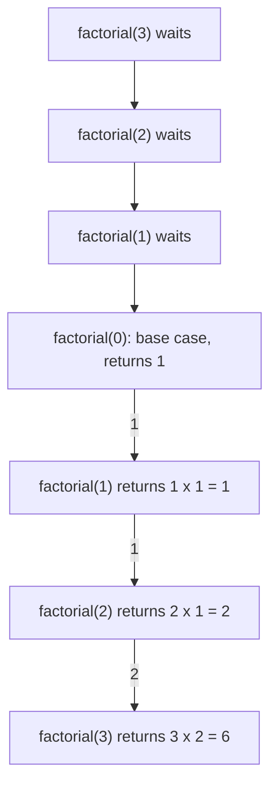
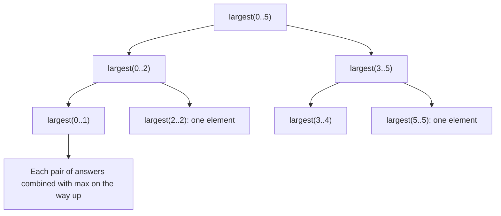
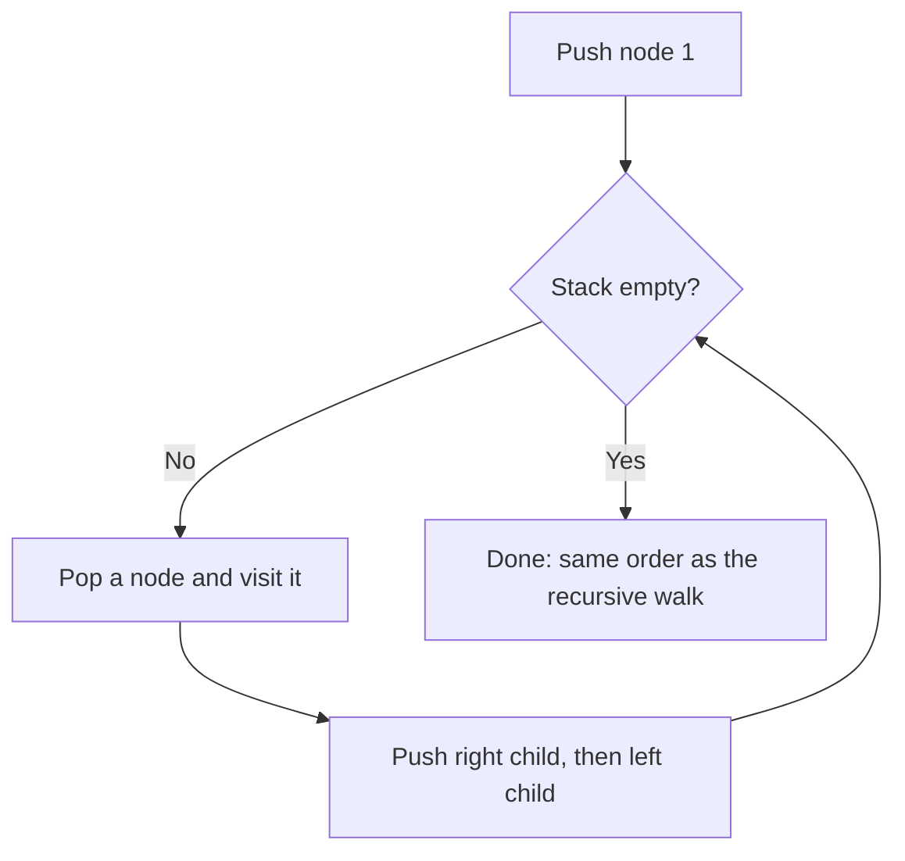

# new

## explanation

### A function that calls itself

Some problems contain smaller copies of themselves. 5! (five factorial) is 5 × 4 × 3 × 2 × 1, which is 5 × 4!. And 4! is 4 × 3!, and so on. A **recursive** function solves a problem by calling itself on a smaller version of it:

```cpp
long long factorial(int n) {
    if (n == 0) return 1;
    return n * factorial(n - 1);
}
```

### The two parts every recursion needs

1. A **base case**: an input small enough to answer directly, with no further call. Here, `factorial(0)` is 1.
2. A **recursive case**: the answer built from a call on a **smaller** input. Here, `n * factorial(n - 1)`.

Each call must move closer to the base case. If it doesn't, the calls never stop.

### What happens when it runs

`factorial(3)` can't finish until it knows `factorial(2)`, which waits for `factorial(1)`, which waits for `factorial(0)`. That one returns 1 straight away. Then the waiting calls finish one by one, in reverse: 1 × 1 = 1, then 2 × 1 = 2, then 3 × 2 = 6.

The computer keeps track of the waiting calls on the **call stack**. Each call gets its own copy of its parameters and local variables, stacked on top of the caller's. When a call returns, its copy is removed and the caller carries on from where it stopped.

### Work before or after the call

Code written **before** the recursive call runs on the way down, in the order the calls are made. Code written **after** it runs on the way back up, in reverse order. Moving one print statement from before to after the call reverses the output.

### When to use it

Recursion is natural when the data is itself made of smaller pieces of the same kind: trees, nested folders, splitting a list in halves. For a simple count from 1 to n, a loop is clearer and uses no extra stack.

## diagram



## example

```cpp
#include <iostream>
#include <string>

// factorial(n) = n x factorial(n - 1), and factorial(0) = 1.
long long factorial(int n) {
    if (n == 0) return 1;         // base case: answer known, no more calls
    return n * factorial(n - 1);  // recursive case: a smaller copy of the problem
}

// Shows the call stack: each call waits for the one it made.
void dive(int depth) {
    std::string indent((depth - 1) * 2, ' ');
    std::cout << indent << "enter " << depth << '\n';
    if (depth < 3) dive(depth + 1);
    std::cout << indent << "leave " << depth << '\n';
}

int main() {
    std::cout << "5! = " << factorial(5) << '\n';
    dive(1);
}
```

```text
5! = 120
enter 1
  enter 2
    enter 3
    leave 3
  leave 2
leave 1
```

1. `factorial(5)` calls itself on 4, 3, 2, 1 and 0. The base case returns 1, and the waiting calls multiply on the way back: 120.
2. `dive(1)` prints "enter 1" and calls `dive(2)`, which calls `dive(3)`. Depth 3 is the base case: it makes no call.
3. Each "leave" line comes after its recursive call returns, so they print in reverse: the deepest call finishes first.
4. The indentation shows how deep each call is on the call stack.

## mistakes

- **No base case.** Without one, the function calls itself until the call stack runs out of room and the program crashes (a stack overflow).
- **Not getting smaller.** `return n * factorial(n + 1);` moves away from the base case and never stops. Every call must bring the input closer to it.
- **Forgetting `return`.** Writing `factorial(n - 1);` alone throws the result away. The recursive case must use and return what the call gives back.
- **A base case that misses some inputs.** `if (n == 0)` never stops a call with a negative `n`. Make sure every input reaches a base case, for example with `n <= 0`.
- **Recursing very deep.** Each waiting call uses some stack memory. A recursion a million levels deep can crash even when it's correct. Use a loop for long, simple chains.

## check

```cpp
#include <iostream>

int f(int n) {
    if (n <= 1) return 1;
    return f(n - 1) + n;
}

void show(int n) {
    if (n == 0) return;
    show(n - 1);
    std::cout << n << ' ';
}

int main() {
    std::cout << f(4) << '\n';
    show(3);
    std::cout << '\n';
}
```

```text
10
1 2 3
```

`f(4)` is `f(3) + 4`, which is `f(2) + 3 + 4`, which is `f(1) + 2 + 3 + 4`, and `f(1)` is 1: 10 in total. In `show`, the print comes **after** the recursive call, so `show(3)` first lets `show(2)` and `show(1)` finish printing. The numbers come out in increasing order even though the calls start from 3.

# building

## explanation

### A quick recap

A recursive function has a base case it answers directly and a recursive case that calls itself on a smaller input. The calls wait on the call stack, and work after the call runs on the way back up.

### Designing a recursive function

1. **Say exactly what the function returns** for any input. "`sumFrom(v, i)` is the sum of `v[i]` to the end."
2. **Find the smallest inputs** and answer them directly: an empty range, a single element, zero.
3. **Express the answer through a smaller input**: the sum from `i` is `v[i]` plus the sum from `i + 1`.
4. **Trust the recursive call.** Don't trace the whole chain in your head. If the function is correct for smaller inputs, and the step is correct, the whole thing is correct. This is the same reasoning as proof by induction.

### Recursion on a part of an array or string

Don't create a new, smaller vector or string for each call: `substr` and copying cost O(n) per call, turning an O(n) idea into O(n²). Pass the whole thing by `const` reference, plus the indexes of the part you're working on.

### Splitting in halves

Instead of peeling off one element at a time, you can split the range in half and combine the two answers, like the largest element of a range being the larger of its halves' largest elements. The recursion is then only log₂ n calls deep, instead of n. This **divide and conquer** pattern underlies merge sort, quick sort and binary search.

### Work before or after the call, on purpose

To print a number's binary digits, the highest digit must come first, but `n % 2` gives the **lowest**. Call first for `n / 2`, which prints the higher digits, then print `n % 2`. Deciding where the work goes relative to the call is a design tool.

### Recursion or a loop?

If each call makes one recursive call and does a little work, a loop is usually simpler. Recursion shines when a call makes **several** calls, as with splitting in halves, exploring choices or walking trees.

## diagram



## example

```cpp
#include <algorithm>
#include <iostream>
#include <string>
#include <vector>

// Sum of v[from] to the end: the first element plus the sum of the rest.
int sumFrom(const std::vector<int>& v, std::size_t from) {
    if (from == v.size()) return 0;  // empty range
    return v[from] + sumFrom(v, from + 1);
}

// Largest in v[lo..hi]: the larger of the two halves' answers. Depth log n.
int largest(const std::vector<int>& v, int lo, int hi) {
    if (lo == hi) return v[lo];
    int mid = lo + (hi - lo) / 2;
    return std::max(largest(v, lo, mid), largest(v, mid + 1, hi));
}

// Binary digits: print the higher digits first (the call), then the last one.
void binary(int n) {
    if (n >= 2) binary(n / 2);
    std::cout << n % 2;
}

// Is s[lo..hi] a palindrome? Compare the ends, recurse on the middle.
bool mirror(const std::string& s, int lo, int hi) {
    if (lo >= hi) return true;
    return s[lo] == s[hi] && mirror(s, lo + 1, hi - 1);
}

int main() {
    std::vector<int> v = {4, 8, 15, 16, 23, 42};
    std::cout << sumFrom(v, 0) << ' ' << largest(v, 0, 5) << ' ';
    binary(13);
    std::cout << ' ' << mirror("racecar", 0, 6) << mirror("rotator", 0, 6) << mirror("radar!", 0, 5) << '\n';
}
```

```text
108 42 1101 110
```

1. `sumFrom` passes the vector by `const` reference and moves an index along, so no call copies anything.
2. `largest` splits 0..5 into 0..2 and 3..5, and so on down to single elements, then combines answers with `std::max`. The recursion is only about log₂ 6 levels deep.
3. `binary(13)` calls `binary(6)`, `binary(3)` and `binary(1)` before any printing, so the digits come out highest first: 1101.
4. `mirror` compares the two ends and recurses inward. It stops early on the first mismatch: in "radar!", `r` and `!` differ, so the answer is 0.

## mistakes

- **Copying the input in every call.** `sum(std::vector<int>(v.begin() + 1, v.end()))` or `s.substr(1)` builds a new copy each call: O(n²) time and memory. Pass indexes instead.
- **A base case that misses the empty range.** `largest` with `lo > hi` would read outside the array. Decide what an empty range means and handle it, or make sure it can never be called.
- **Mixing inclusive and exclusive ends.** Halves `lo..mid` and `mid+1..hi` work for inclusive ranges; `lo..mid` and `mid..hi` suit half-open ones. Mixing the two styles loses or repeats elements.
- **Putting the work on the wrong side of the call.** Printing before the call in `binary` gives the digits backwards. Ask whether each piece of work belongs on the way down or on the way back up.
- **Calls that repeat each other's work.** A function that calls itself twice on nearly the same input, like naive Fibonacci, makes an exponential number of calls. Store answers you've already computed: that's dynamic programming.

## check

```cpp
#include <iostream>
#include <string>

std::string rev(const std::string& s, std::size_t i) {
    if (i == s.size()) return "";
    return rev(s, i + 1) + s[i];
}

int digits(int n) { return n < 10 ? 1 : 1 + digits(n / 10); }

int main() {
    std::cout << rev("stack", 0) << ' ' << digits(40507) << '\n';
}
```

```text
kcats 5
```

`rev(s, i)` returns the reverse of everything from index `i` on: it reverses the rest first, then appends `s[i]` at the end. So the first character ends up last: "kcats". `digits` drops the last digit until a single digit is left: 40507, 4050, 405, 40, 4. That's five numbers, so 5 digits.

# strong

## explanation

### The cost of recursion

A recursive algorithm costs **(number of calls) × (work per call)**, plus O(depth) stack memory. Draw the **recursion tree**, with one node per call: its size gives the call count and its height gives the depth. One call per level on n − 1 means n calls and depth n. Two calls on halves means about 2n calls but depth only log n. Two calls on n − 1 and n − 2 means an exponentially growing tree.

### How deep can you go?

Each call's frame holds its parameters, locals and return address, usually tens to a few hundred bytes. The default stack on Linux is about 8 MB, so simple functions manage hundreds of thousands of levels, but a frame with a big local array runs out far sooner. Recursing once per element over a million-element list is a real risk; recursing over a balanced tree's height is never one.

### No guaranteed tail calls

When the recursive call is the very last thing a function does (a **tail call**), compilers often turn it into a loop at `-O2`. But C++ doesn't guarantee it, debug builds don't do it, and a call followed by any work (`n * f(n - 1)`) isn't a tail call at all. Don't rely on it for deep recursion.

### Turning recursion into a loop with your own stack

Any recursion can be rewritten with an explicit `std::stack` of pending work: push the starting state; repeatedly pop one, process it, and push the states it would have recursed into. Because a stack is last-in first-out, push the children in **reverse** of the order you want them visited. The explicit stack lives on the heap, so depth is limited only by memory.

### Mutual recursion

Two functions can call each other: `isEven(n)` asks `isOdd(n − 1)`, which asks `isEven(n − 2)`. Declare one before defining the other. Parsers for nested expressions are often built this way.

### Side effects and recursion

Changing shared state (a global counter, a vector being built) is fine as long as each call either keeps its changes or undoes them before returning. Backtracking depends on undoing; forgetting it leaves one branch's changes visible to the next.

## diagram



## example

```cpp
#include <iostream>
#include <stack>
#include <vector>

// An implicit binary tree: node k has children 2k and 2k+1, up to a limit.
void visitRecursive(int k, int limit, std::vector<int>& order) {
    if (k > limit) return;
    order.push_back(k);
    visitRecursive(2 * k, limit, order);
    visitRecursive(2 * k + 1, limit, order);
}

// The same walk with an explicit stack: depth limited only by memory.
std::vector<int> visitIterative(int limit) {
    std::vector<int> order;
    std::stack<int> todo;
    todo.push(1);
    while (!todo.empty()) {
        int k = todo.top();
        todo.pop();
        if (k > limit) continue;
        order.push_back(k);
        todo.push(2 * k + 1);  // pushed first, so visited second
        todo.push(2 * k);
    }
    return order;
}

// Mutual recursion: two functions calling each other.
bool isEven(int n);
bool isOdd(int n) { return n == 0 ? false : isEven(n - 1); }
bool isEven(int n) { return n == 0 ? true : isOdd(n - 1); }

int deep(int n) { return n == 0 ? 0 : 1 + deep(n - 1); }

int main() {
    std::vector<int> a;
    visitRecursive(1, 7, a);
    for (int k : a) std::cout << k << ' ';
    std::cout << "| same: " << (a == visitIterative(7)) << '\n';
    std::cout << isEven(10) << isOdd(7) << '\n';
    std::cout << deep(100000) << '\n';
}
```

```text
1 2 4 5 3 6 7 | same: 1
11
100000
```

1. The recursive walk visits a node, then its whole left subtree, then its right subtree: 1, 2, 4, 5, 3, 6, 7.
2. The iterative walk pushes the right child before the left one, so the left one is popped first, and the order matches exactly.
3. `isEven(10)` and `isOdd(7)` bounce between the two functions, each step reducing `n` by one, until `n` is 0.
4. `deep(100000)` is a hundred thousand nested calls with tiny frames: well within an 8 MB stack. With a large local array in each frame, the same depth could crash.

## mistakes

- **Recursing once per element over huge inputs.** A linked list or path of a million nodes can overflow the stack. Use a loop, or an explicit stack.
- **Counting on tail-call optimisation.** It may happen at `-O2`, but it's not guaranteed and never happens in debug builds. Write a loop when depth can be large.
- **Wrong push order with an explicit stack.** Pushing children in visiting order makes the stack visit them backwards. Push them in reverse.
- **Big locals in recursive functions.** `int buffer[10000];` inside a recursive function multiplies by the depth. Allocate once outside, or use a vector passed by reference.
- **Changing shared state without undoing it.** When calls try alternatives, each must restore what it changed before returning, or the next alternative starts from a corrupted state.

## check

```cpp
#include <iostream>

int calls = 0;
int g(int n) {
    calls++;
    if (n < 3) return 1;
    return g(n - 1) + g(n - 3);
}

int main() {
    int v = g(6);
    std::cout << v << ' ' << calls << '\n';
}
```

```text
6 11
```

The values build up as g(0) = g(1) = g(2) = 1, then g(3) = 2, g(4) = 3, g(5) = 4 and g(6) = g(5) + g(3) = 6. The calls follow the same shape plus one for the call itself: C(n) = 1 for n < 3, then C(3) = 3, C(4) = 5, C(5) = 7 and C(6) = 1 + 7 + 3 = 11. The value is read only after `g(6)` has finished, so `calls` is complete.
