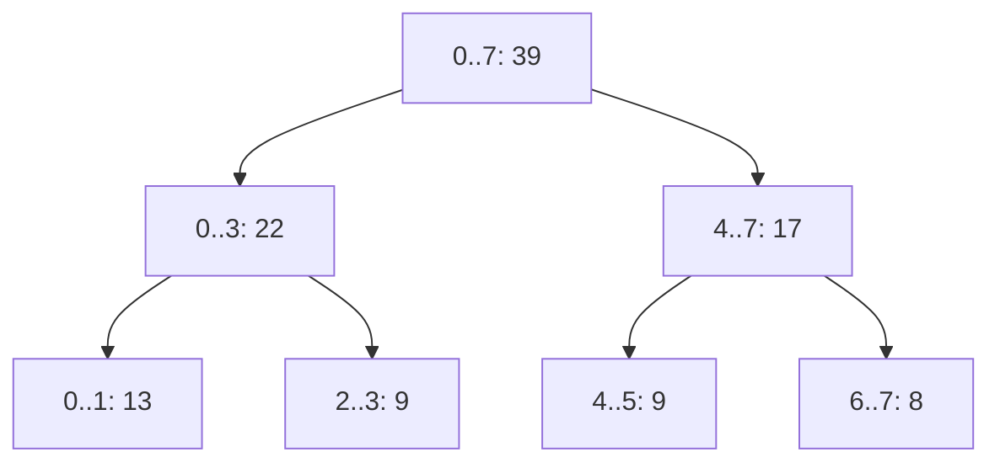
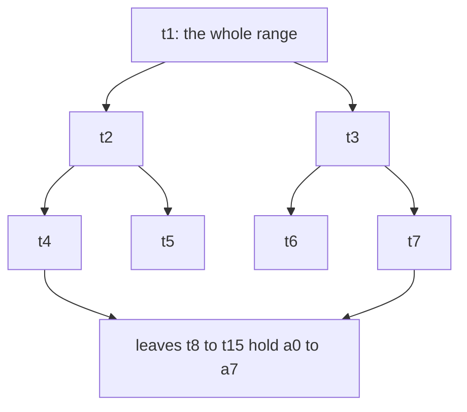
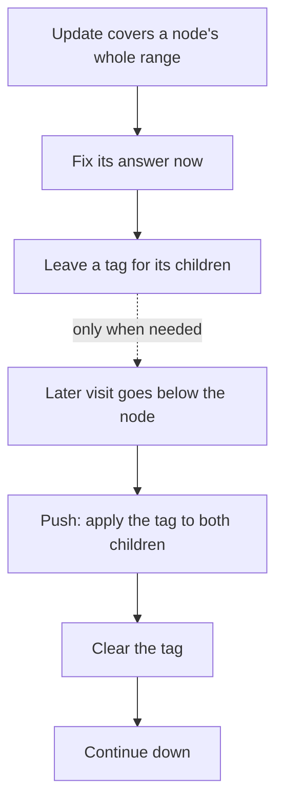

# new

## explanation

### Questions about ranges

"What's the sum of positions 2 to 5?" "What's the smallest value between 100 and 900?" When the array also keeps changing, a plain loop costs O(n) per question, and a prefix-sum array costs O(n) per change. A **segment tree** answers range questions and handles changes, each in **O(log n)**.

### The shape

It's a binary tree over the positions:

- the root covers the whole array, 0 to n − 1;
- each node covering lo..hi has two children, covering lo..mid and mid + 1..hi, where mid = (lo + hi) / 2;
- each leaf covers one position;
- every node stores the answer for its range, such as the sum.

Stored in an array, node v's children are 2v and 2v + 1, with the root at 1. An array of 4n entries is always enough.

### Answering a range

To get the sum of l..r, start at the root:

- if the node's range is outside l..r, it contributes 0;
- if it's entirely inside, use its stored sum and stop;
- otherwise, ask both children and add their answers.

At most a few nodes per level are visited, so a query is O(log n).

### Changing a value

Walk from the root to the leaf of that position, set it, and recompute each node on the way back up from its two children. That's one node per level: O(log n).

### Why not a Fenwick tree?

For sums, a Fenwick tree is shorter. A segment tree works for any way of combining two halves, such as minimum, maximum or gcd, and it can update whole ranges at once, as later levels show.

## diagram



## example

```cpp
#include <iostream>
#include <vector>

// A segment tree for range sums. Node 1 covers the whole array; node v's children are 2v and 2v+1,
// covering the two halves of v's range.
class SegTree {
public:
    explicit SegTree(const std::vector<int>& a) : n_((int)a.size()), sum_(4 * a.size()) { build(a, 1, 0, n_ - 1); }
    void set(int i, int x) { set(1, 0, n_ - 1, i, x); }
    long long query(int l, int r) const { return query(1, 0, n_ - 1, l, r); }
private:
    int n_;
    std::vector<long long> sum_;
    void build(const std::vector<int>& a, int v, int lo, int hi) {
        if (lo == hi) { sum_[v] = a[lo]; return; }
        int mid = (lo + hi) / 2;
        build(a, 2 * v, lo, mid);
        build(a, 2 * v + 1, mid + 1, hi);
        sum_[v] = sum_[2 * v] + sum_[2 * v + 1];
    }
    void set(int v, int lo, int hi, int i, int x) {
        if (lo == hi) { sum_[v] = x; return; }
        int mid = (lo + hi) / 2;
        if (i <= mid) set(2 * v, lo, mid, i, x); else set(2 * v + 1, mid + 1, hi, i, x);
        sum_[v] = sum_[2 * v] + sum_[2 * v + 1];  // recompute on the way back up
    }
    long long query(int v, int lo, int hi, int l, int r) const {
        if (r < lo || hi < l) return 0;          // no overlap
        if (l <= lo && hi <= r) return sum_[v];  // fully inside: the stored sum is the answer
        int mid = (lo + hi) / 2;
        return query(2 * v, lo, mid, l, r) + query(2 * v + 1, mid + 1, hi, l, r);
    }
};

int main() {
    SegTree t({5, 8, 6, 3, 2, 7, 2, 6});
    std::cout << "sum of 0..7: " << t.query(0, 7) << ", sum of 2..5: " << t.query(2, 5) << '\n';
    t.set(3, 10);
    std::cout << "after a[3] = 10, sum of 2..5: " << t.query(2, 5) << '\n';
}
```

```text
sum of 0..7: 39, sum of 2..5: 18
after a[3] = 10, sum of 2..5: 25
```

1. `build` fills the leaves, then each parent with the sum of its two children, as in the diagram.
2. The query for 2..5 uses the stored sums of 2..3 (9) and 4..5 (9) and never visits their leaves.
3. `set` changes a[3] from 3 to 10 and updates the nodes 3..3, 2..3, 0..3 and 0..7 on the way back up, so the next query sees 25.
4. Unlike a Fenwick tree's `add`, `set` replaces the value directly, because each node is recomputed from its children.

## mistakes

- **An array of 2n entries for the recursive tree.** When n isn't a power of two, node numbers can exceed 2n. Use 4n.
- **Forgetting to recompute the parents.** After changing a leaf, every node above it holds a stale sum until recomputed.
- **The wrong value for "no overlap".** It must be the identity of the combine: 0 for sums, a huge value for minimums, a tiny one for maximums.
- **Mixing up the midpoint.** The children are lo..mid and mid + 1..hi. Using mid − 1 or mid + 1 on the left loses or repeats a position.
- **Building an empty tree.** With n = 0 there is no root range; handle empty input before building.

## check

```cpp
#include <iostream>

int used = 0;
void visit(int lo, int hi, int l, int r) {
    if (r < lo || hi < l) return;
    if (l <= lo && hi <= r) { used++; std::cout << lo << '-' << hi << '\n'; return; }
    int mid = (lo + hi) / 2;
    visit(lo, mid, l, r);
    visit(mid + 1, hi, l, r);
}

int main() {
    visit(0, 7, 1, 6);
    std::cout << used << '\n';
}
```

```text
1-1
2-3
4-5
6-6
4
```

This is a range query on 8 positions that prints the nodes whose stored answers it uses. For 1..6 it needs only four: 1..1, 2..3, 4..5 and 6..6. The large nodes 0..3 and 4..7 stick out of the range, so the query splits them, but never further than needed.

# building

## explanation

### A quick recap

A segment tree stores an answer for each range in a binary tree of halves. A range query combines O(log n) stored answers, and a point update recomputes the O(log n) nodes above one leaf.

### Any combine that's associative

The tree only needs a way to combine two neighbouring answers, `combine(left, right)`, that is **associative**, so that grouping doesn't change the result, and an **identity** value for empty parts:

- sum, identity 0;
- minimum, identity +∞; maximum, identity −∞;
- gcd, identity 0;
- (value, position) pairs, to know *where* the minimum is.

### The bottom-up version

A shorter, faster form puts the leaves at t[n..2n − 1] and node i's children at 2i and 2i + 1, using only 2n entries:

- **build**: copy the values into the leaves, then fill t[n − 1] down to t[1] from their children;
- **update**: change the leaf, then walk up with `i /= 2`, recomputing each parent from i and its sibling `i ^ 1`;
- **query [l, r)**: start at both ends, l += n and r += n. While l < r: if l is a right child, take t[l] and step right; if r is a right child, step left and take t[r − 1]; then move both up a level.

For a combine where order matters, such as joining strings, keep separate left and right results. For min, max, sum and gcd the order doesn't matter.

### When the array never changes

With no updates, a **sparse table** answers range minimums in O(1) after O(n log n) preparation, and a prefix-sum array does sums. A segment tree is for when values change.

## diagram



## example

```cpp
#include <iostream>
#include <numeric>
#include <random>
#include <vector>

// Bottom-up gcd over ranges: leaves at node[size..2·size-1]; gcd's identity is 0, since gcd(0, x) = x.
struct GcdTree {
    int size;
    std::vector<long long> node;
    explicit GcdTree(const std::vector<long long>& a) : size((int)a.size()), node(2 * a.size(), 0) {
        for (int i = 0; i < size; i++) node[size + i] = a[i];
        for (int p = size - 1; p >= 1; p--) node[p] = std::gcd(node[2 * p], node[2 * p + 1]);
    }
    void change(int i, long long x) {
        node[size + i] = x;
        for (int p = (size + i) / 2; p >= 1; p /= 2) node[p] = std::gcd(node[2 * p], node[2 * p + 1]);
    }
    long long gcdOf(int from, int to) const {  // over [from, to)
        long long g = 0;
        for (from += size, to += size; from < to; from /= 2, to /= 2) {
            if (from % 2 == 1) g = std::gcd(g, node[from++]);
            if (to % 2 == 1) g = std::gcd(g, node[--to]);
        }
        return g;
    }
};

int main() {
    GcdTree t({12, 18, 24, 36, 9, 27, 30, 6});
    std::cout << "[0, 4): " << t.gcdOf(0, 4) << ", [2, 7): " << t.gcdOf(2, 7);
    t.change(4, 48), t.change(5, 72);
    std::cout << "; after a[4] = 48 and a[5] = 72: " << t.gcdOf(2, 7) << '\n';

    std::mt19937 rng(11);
    std::vector<long long> a(1000);
    for (auto& v : a) v = 6 * (1 + rng() % 1000);  // every value a multiple of 6, so gcds stay interesting
    GcdTree big(a);
    int wrong = 0;
    for (int op = 0; op < 3000; op++) {
        int i = int(rng() % 1000), from = int(rng() % 1000), to = from + 1 + int(rng() % (1000 - from));
        long long x = 6 * (1 + rng() % 1000);
        big.change(i, x), a[i] = x;
        long long slow = 0;
        for (int k = from; k < to; k++) slow = std::gcd(slow, a[k]);
        if (big.gcdOf(from, to) != slow) wrong++;
    }
    std::cout << "3000 random changes and queries on 1000 items: " << wrong << " wrong\n";
}
```

```text
[0, 4): 6, [2, 7): 3; after a[4] = 48 and a[5] = 72: 6
3000 random changes and queries on 1000 items: 0 wrong
```

1. The gcd of 12, 18, 24 and 36 is 6. Over positions 2 to 6 (24, 36, 9, 27, 30) the 9 and 27 bring it down to 3.
2. After a[4] becomes 48 and a[5] becomes 72, that range holds 24, 36, 48, 72 and 30, whose gcd is 6. Each `change` recomputed only the leaf's ancestors.
3. The identity is 0, because gcd(0, x) = x: an empty piece doesn't change the answer, just as 0 doesn't change a sum.
4. The random test changes one item and asks one range per round, then compares with a plain scan. All 3000 answers agree. The tree uses 2n entries and no recursion; each operation climbs about log₂ 1000 ≈ 10 levels.

## mistakes

- **Mixing half-open and closed ranges.** This `query` takes [l, r), so the range 2..6 is `query(2, 7)`.
- **The wrong identity.** Starting `best` at 0 makes every minimum of positive values come out as 0. Use the combine's identity.
- **An order-dependent combine in the bottom-up loop.** It takes pieces from both ends; for an operation where order matters, keep a left result and a right result and join them at the end.
- **Forgetting the parents in `set`.** Every node on the path to the root must be recomputed from its two children.
- **A segment tree for data that never changes.** A sparse table answers minimums in O(1), and prefix sums answer sums.

## check

```cpp
#include <iostream>

int main() {
    int n = 8;
    for (int at = n + 5; at >= 1; at /= 2) std::cout << at << (at > 1 ? ' ' : '\n');
    std::cout << (13 ^ 1) << ' ' << (6 ^ 1) << '\n';
}
```

```text
13 6 3 1
12 7
```

In the bottom-up tree of 8 items, position 5's leaf is t[8 + 5] = t[13], and halving gives its ancestors 6, 3 and the root 1, the nodes an update recomputes. `i ^ 1` flips the last bit to give the sibling: 13 pairs with 12, and 6 with 7.

# strong

## explanation

### Updating a whole range

"Add 5 to every position from 1,000 to 90,000" would touch every leaf in that range, O(n). **Lazy propagation** makes it O(log n). When an update covers a node's entire range:

1. fix the node's own answer at once, for example sum += d × (length of the range);
2. leave a **tag**, "d still to be added to my children", and stop.

Whenever a later update or query has to go below a tagged node, it first **pushes** the tag: apply it to both children, then clear it. The tags only move down as far as someone actually looks.

### Why it stays O(log n)

An update or query fully covers O(log n) nodes and passes through O(log n) partial ones, and each push is O(1). So both stay O(log n), however wide the range.

### Combining tags

Two pending adds simply add up. Other updates need a rule for composing tags. For example, with "set the range to x" plus "add d", a set wipes out earlier adds, and an add after a set changes the set value. Write down how a new tag combines with an old one before writing code.

### Richer nodes

A node can store several fields as long as two halves can be merged. To find the **largest-sum subarray** inside any range, store for each node the total, the best prefix, the best suffix and the best subarray. The best subarray of a merge is the better of the two halves' best, or the left suffix plus the right prefix.

### Walking the tree

A segment tree can also answer "the first position at or after l whose value is ≥ x". Descend into the left child if its maximum is big enough, otherwise the right. That's O(log n) instead of a binary search over queries, O(log² n).

## diagram



## example

```cpp
#include <iostream>
#include <random>
#include <vector>

// Range add, range sum: a fully covered node fixes its own total at once and leaves the rest pending for its children.
struct LazyTree {
    std::vector<long long> sums, pending;
    explicit LazyTree(int n) : sums(4 * n), pending(4 * n) {}
    void bump(int at, int b, int e, long long d) { sums[at] += d * (e - b + 1); pending[at] += d; }
    void handDown(int at, int b, int half, int e) {
        bump(2 * at, b, half, pending[at]), bump(2 * at + 1, half + 1, e, pending[at]), pending[at] = 0;
    }
    void raise(int at, int b, int e, int ql, int qr, long long d) {
        if (qr < b || e < ql) return;
        if (ql <= b && e <= qr) return bump(at, b, e, d);
        int half = (b + e) / 2;
        handDown(at, b, half, e);
        raise(2 * at, b, half, ql, qr, d), raise(2 * at + 1, half + 1, e, ql, qr, d);
        sums[at] = sums[2 * at] + sums[2 * at + 1];
    }
    long long ask(int at, int b, int e, int ql, int qr) {
        if (qr < b || e < ql) return 0;
        if (ql <= b && e <= qr) return sums[at];
        int half = (b + e) / 2;
        handDown(at, b, half, e);
        return ask(2 * at, b, half, ql, qr) + ask(2 * at + 1, half + 1, e, ql, qr);
    }
};
int main() {
    const int n = 2000;
    LazyTree t(n);
    std::vector<long long> plain(n);  // the same updates the slow way, to compare
    std::mt19937 rng(5);
    int wrong = 0;
    for (int op = 0; op < 3000; op++) {
        int ql = int(rng() % n), qr = ql + int(rng() % (n - ql)), d = int(rng() % 11) - 5;
        t.raise(1, 0, n - 1, ql, qr, d);
        long long expect = 0;
        for (int i = ql; i <= qr; i++) { plain[i] += d; expect += plain[i]; }
        if (t.ask(1, 0, n - 1, ql, qr) != expect) wrong++;
    }
    std::cout << "3000 range adds and range sums: " << wrong << " wrong, total " << t.ask(1, 0, n - 1, 0, n - 1) << '\n';
}
```

```text
3000 range adds and range sums: 0 wrong, total -120635
```

1. An add over a node's whole range costs O(1) there: its sum grows by d times its length, and the tag remembers d for the children.
2. Both `raise` (the add) and `ask` (the sum) hand a node's pending value down before going below it, so the children are up to date whenever they're read.
3. After each random add, the tree's sum over the same range matches a plain array. The plain loop visits every position in the range; the tree visits O(log n) nodes, however wide the range is.

## mistakes

- **Not pushing before descending.** The children's sums are then missing the pending adds, and queries come out too small.
- **Applying a tag without fixing the sum.** The node's own answer must change at once, by d × its length for sums, or its parent's recomputation goes wrong.
- **Forgetting to recompute after the children change.** The add must set the node's sum from its children after the recursive calls.
- **Composing different tags carelessly.** A "set" tag must clear pending adds below; an "add" after a "set" changes the set value. Write the rule down first.
- **`int` sums.** d × length over large ranges overflows quickly; keep sums and tags `long long`.

## check

```cpp
#include <algorithm>
#include <iostream>

struct Node { long long sums, pre, suf, best; };  // total, best prefix, best suffix, best subarray
Node leaf(long long x) { return {x, x, x, x}; }
Node join(const Node& a, const Node& b) {
    return {a.sums + b.sums, std::max(a.pre, a.sums + b.pre), std::max(b.suf, b.sums + a.suf),
            std::max({a.best, b.best, a.suf + b.pre})};
}

int main() {
    Node left = join(leaf(2), leaf(-5));
    Node right = join(leaf(4), leaf(3));
    Node all = join(left, right);  // the array 2 -5 4 3
    std::cout << all.sums << ' ' << all.pre << ' ' << all.suf << ' ' << all.best << '\n';
}
```

```text
4 4 7 7
```

These are the merge rules for a segment tree that finds the largest-sum subarray. For 2 −5 4 3, the total is 4. The best prefix is the whole array (4), and the best suffix and best subarray are both 4 3 = 7. The best subarray of a join is the better half's best, or the left's suffix plus the right's prefix.
