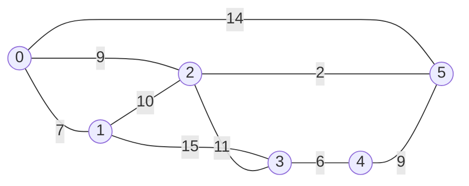
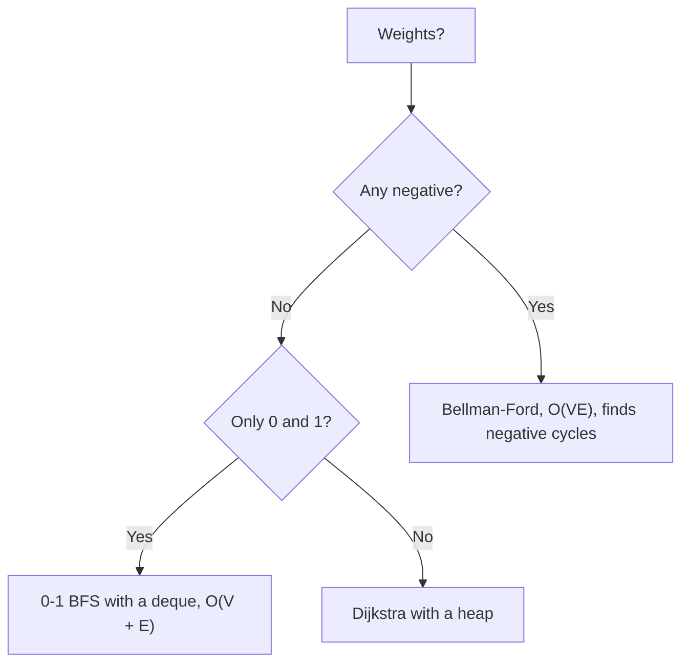
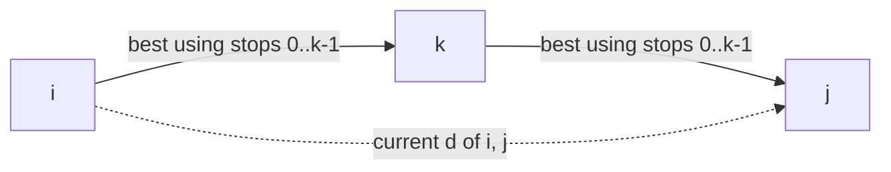

# new

## explanation

### When edges have costs

BFS finds the route with the **fewest edges**. But roads have lengths, flights have prices, and network links have delays. The route with the fewest edges isn't always the cheapest: three short roads can beat one long one. With weights, we want the path whose **total weight** is smallest.

### Dijkstra's algorithm

It works when no weight is negative. Keep `dist[v]`, the best distance found so far, starting at 0 for the source and ∞ for everything else. Then repeat:

1. take the unsettled vertex u with the **smallest** `dist`; its distance is now final;
2. **relax** each edge u → v: if `dist[u] + w < dist[v]`, a better route to v was found, so update `dist[v]`.

Why is the smallest one final? Any other route to u would leave the settled area through a vertex at least as far away, and with no negative weights it can't get cheaper after that.

### A heap finds the smallest

A min-heap (`std::priority_queue` with `std::greater`) of (distance, vertex) pairs gives the next vertex to settle in O(log V). When a distance improves, just push the new pair; the old one stays in the heap. When an entry pops with a distance larger than `dist[u]`, it's **stale**: skip it. The total cost is **O((V + E) log V)**.

### Getting the route

As with BFS, record `from[v] = u` whenever u improves v's distance, then walk back from the target.

### Negative weights

If some edge has a negative weight, a settled vertex might later get cheaper, and Dijkstra's assumption breaks. That case needs a different algorithm, which comes next.

## diagram



## example

```cpp
#include <functional>
#include <iostream>
#include <queue>
#include <utility>
#include <vector>

int main() {
    const int n = 6;
    const long long INF = 1e18;
    int roads[][3] = {{0, 1, 7}, {0, 2, 9}, {0, 5, 14}, {1, 2, 10}, {1, 3, 15}, {2, 3, 11}, {2, 5, 2}, {3, 4, 6}, {4, 5, 9}};
    std::vector<std::vector<std::pair<int, int>>> adj(n);  // (neighbour, travel time), both directions
    for (auto& r : roads) { adj[r[0]].push_back({r[1], r[2]}); adj[r[1]].push_back({r[0], r[2]}); }

    // Dijkstra: settle the closest unsettled vertex next, then relax its edges.
    std::vector<long long> best(n, INF);
    std::vector<int> from(n, -1);
    using Item = std::pair<long long, int>;  // (distance, vertex), smallest distance on top
    std::priority_queue<Item, std::vector<Item>, std::greater<Item>> todo;
    best[0] = 0;
    todo.push({0, 0});
    while (!todo.empty()) {
        auto [cost, here] = todo.top();
        todo.pop();
        if (cost > best[here]) continue;  // stale: here was settled earlier with a smaller distance
        for (auto [next, time] : adj[here])
            if (best[here] + time < best[next]) {
                best[next] = best[here] + time;
                from[next] = here;
                todo.push({best[next], next});
            }
    }
    std::cout << "times from 0:";
    for (long long t : best) std::cout << ' ' << t;
    std::vector<int> path;
    for (int v = 4; v != -1; v = from[v]) path.push_back(v);
    std::cout << "\nfastest route to 4:";
    for (auto it = path.rbegin(); it != path.rend(); ++it) std::cout << ' ' << *it;
    std::cout << '\n';
}
```

```text
times from 0: 0 7 9 20 20 11
fastest route to 4: 0 2 5 4
```

1. 0 is settled first. Its neighbours get 7, 9 and 14.
2. 1 is settled at 7. Its road to 2 would give 17, which is no better than 9.
3. 2 is settled at 9. It improves 5 from 14 to 11, through the short road 2–5, and 3 to 20.
4. 4 is reached at 20 through 5. The direct-looking roads from 0 aren't on the fastest route.

## mistakes

- **A max-heap by mistake.** `std::priority_queue` puts the largest on top. Pass `std::greater` so the smallest distance comes first.
- **Not skipping stale entries.** Without `if (cost > best[here]) continue`, old entries relax edges again, which wastes time and can blow up on large graphs.
- **Dijkstra with negative weights.** A settled vertex may later get cheaper, and the answer can be wrong. Use Bellman–Ford.
- **`int` distances.** Sums of large weights overflow. Use `long long`, and an ∞ that can't overflow when added to.
- **Settling the target and continuing anyway.** If you only need one target, you can stop when it's popped (not when it's pushed).

## check

```cpp
#include <functional>
#include <iostream>
#include <queue>
#include <utility>
#include <vector>

int main() {
    std::vector<std::vector<std::pair<int, int>>> adj = {{{1, 1}, {2, 5}}, {{2, 1}}, {{3, 1}}, {}};
    std::vector<int> best(4, 1000);
    std::priority_queue<std::pair<int, int>, std::vector<std::pair<int, int>>, std::greater<>> todo;
    best[0] = 0, todo.push({0, 0});
    int stale = 0;
    while (!todo.empty()) {
        auto [cost, here] = todo.top(); todo.pop();
        if (cost > best[here]) { stale++; continue; }
        for (auto [next, time] : adj[here]) if (best[here] + time < best[next]) { best[next] = best[here] + time; todo.push({best[next], next}); }
    }
    std::cout << best[2] << ' ' << best[3] << ' ' << stale << '\n';
}
```

```text
2 3 1
```

Vertex 2 first gets 5 from the direct edge. Then 1 is settled at distance 1 and improves 2 to 2 through the edge 1 → 2, pushing a second entry. 3 is reached at 3 through the cheaper route. The old (5, 2) entry pops last and is skipped as stale.

# building

## explanation

### A quick recap

Dijkstra's algorithm settles vertices in order of distance with a min-heap and relaxes their edges, in O((V + E) log V). It needs every weight to be non-negative.

### Negative edges

Refunds, energy gained going downhill, and exchange-rate arbitrage all give **negative** edges. A path can then get cheaper by adding more edges, so Dijkstra's "settled means final" no longer holds.

### Bellman–Ford

Relax **every** edge, over and over:

- a shortest path never repeats a vertex (if there's no negative cycle), so it has at most V − 1 edges;
- after round k, every shortest path that uses at most k edges has been found;
- so V − 1 rounds are enough. Stop early if a round changes nothing.

This costs **O(V · E)**, slower than Dijkstra, but it works with negative weights.

### Negative cycles

If going round some cycle costs less than 0, you could loop forever and make the path as cheap as you like, so "shortest" has no answer. Bellman–Ford detects this: if a V-th round **still** improves something, a negative cycle can be reached from the source.

### 0-1 BFS

When every weight is 0 or 1, a **deque** replaces the heap. Pop from the front. A weight-0 edge leads to a vertex just as far, so push it to the **front**; a weight-1 edge pushes to the **back**. The deque stays sorted by distance, as in BFS, giving O(V + E). It suits problems like "the fewest walls to break" or "the fewest direction changes", where most moves are free.

## diagram



## example

```cpp
#include <iostream>
#include <string>
#include <vector>

struct Edge { int from, to, w; };
const long long INF = 1e18;

// Bellman-Ford: relax every edge, round after round. A shortest path has at most n - 1 edges,
// so n - 1 rounds are enough; any improvement after that comes from a negative cycle.
bool bellmanFord(int n, const std::vector<Edge>& edges, int src, std::vector<long long>& dist) {
    dist.assign(n, INF);
    dist[src] = 0;
    for (int round = 0; round < n; round++) {
        bool changed = false;
        for (const Edge& e : edges)
            if (dist[e.from] != INF && dist[e.from] + e.w < dist[e.to]) {
                dist[e.to] = dist[e.from] + e.w;
                changed = true;
            }
        if (!changed) return true;         // nothing improved: all distances are final
        if (round == n - 1) return false;  // still improving after n - 1 rounds
    }
    return true;
}
void show(int n, const std::vector<Edge>& edges) {
    std::vector<long long> dist;
    if (!bellmanFord(n, edges, 0, dist)) { std::cout << "negative cycle reachable from 0\n"; return; }
    for (int v = 0; v < n; v++)
        std::cout << (dist[v] == INF ? std::string("unreachable") : std::to_string(dist[v])) << (v + 1 < n ? ' ' : '\n');
}

int main() {
    // The refund on 1 -> 2 makes the route 0 -> 1 -> 2 (4 - 2 = 2) cheaper than going straight to 2 (3).
    std::vector<Edge> edges = {{0, 1, 4}, {0, 2, 3}, {1, 2, -2}, {2, 3, 2}, {3, 4, 1}};
    show(5, edges);
    edges.push_back({4, 2, -4});  // 2 -> 3 -> 4 -> 2 now costs 2 + 1 - 4 = -1 per lap
    show(5, edges);
}
```

```text
0 4 2 4 5
negative cycle reachable from 0
```

1. The negative edge 1 → 2 makes a longer route cheaper: 2 is reached at 2, not 3, and 3 and 4 follow from it.
2. The rounds stop early as soon as one changes nothing, so a well-behaved graph finishes long before V rounds.
3. With 4 → 2 at −4, the loop 2 → 3 → 4 → 2 costs −1. Each lap lowers the distances again, the last round still improves them, and the function reports a negative cycle.

## mistakes

- **Relaxing from unreached vertices.** `INF + (−2)` looks like an improvement. Skip edges whose start is still ∞.
- **Only n − 2 rounds, or stopping at n − 1 without the extra check.** Run n − 1 rounds for the distances, and one more to detect negative cycles.
- **Reporting distances when a negative cycle exists.** They aren't meaningful; report the cycle instead, or mark the vertices it can reach.
- **0-1 BFS with a plain queue.** Weight-0 neighbours must go to the front of the deque, or distances come out wrong.
- **Dijkstra "fixed" for negative edges by allowing re-settling.** It may give the right answer on small cases but can take exponential time. Use Bellman–Ford.

## check

```cpp
#include <deque>
#include <iostream>
#include <utility>
#include <vector>

int main() {
    std::vector<std::vector<std::pair<int, int>>> adj = {{{1, 1}, {2, 0}}, {{3, 1}}, {{1, 0}, {3, 1}}, {{4, 0}}, {}};
    std::vector<int> dist(5, 1000);
    std::deque<int> dq = {0};  // free moves go to the front, paid moves to the back
    dist[0] = 0;
    while (!dq.empty()) {
        int u = dq.front();
        dq.pop_front();
        for (auto [v, w] : adj[u])
            if (dist[u] + w < dist[v]) { dist[v] = dist[u] + w; w == 0 ? dq.push_front(v) : dq.push_back(v); }
    }
    for (int v = 0; v < 5; v++) std::cout << dist[v] << (v < 4 ? ' ' : '\n');
}
```

```text
0 0 0 1 1
```

From 0, the free edge reaches 2 at cost 0, and from 2 another free edge reaches 1 at cost 0, beating the direct edge of cost 1. 3 costs one paid edge, and the free edge 3 → 4 brings 4 at the same cost: 1.

# strong

## explanation

### Every pair at once: Floyd–Warshall

To know the distance between **all** pairs of vertices, number the vertices 0 to n − 1 and keep a matrix `d`. Let round k allow vertex k as a stop in between:

`d[i][j] = min(d[i][j], d[i][k] + d[k][j])`

After round k, `d[i][j]` is the best path whose intermediate stops are all among 0..k. After the last round, it's the true distance. That's O(V³) time with three nested loops, **k outermost**, which is what the argument needs. It handles negative edges, and a negative cycle shows up as some `d[i][i] < 0`.

To rebuild paths, keep `next[i][j]`, the first step from i towards j, and update it with `next[i][k]` whenever k improves the pair.

### Choosing an algorithm

| Situation | Algorithm | Time |
|---|---|---|
| Unit weights | BFS | O(V + E) |
| Weights 0 or 1 | 0-1 BFS | O(V + E) |
| Non-negative weights | Dijkstra | O((V + E) log V) |
| Negative weights | Bellman–Ford | O(V · E) |
| A DAG, any weights | DP in topological order | O(V + E) |
| All pairs, small V | Floyd–Warshall | O(V³) |

### Dijkstra on states

When the cost depends on more than the vertex, such as "with up to k discount tickets" or "with this much fuel", run Dijkstra over (vertex, state) pairs. The graph grows by the number of states, but the algorithm doesn't change.

### The same loop, other questions

Floyd–Warshall's pattern works for any "combine along a path, choose the best" rule:

- **reachability**: `reach[i][j] |= reach[i][k] && reach[k][j]`;
- **widest path**, the route whose narrowest road carries the most: `max(d[i][j], min(d[i][k], d[k][j]))`.

## diagram



## example

```cpp
#include <iostream>
#include <string>
#include <vector>

const long long INF = 1e18;

int main() {
    const int towns = 4;
    std::vector<std::vector<long long>> d(towns, std::vector<long long>(towns, INF));
    std::vector<std::vector<int>> next(towns, std::vector<int>(towns, -1));  // first step on a best from -> to path
    for (int from = 0; from < towns; from++) d[from][from] = 0, next[from][from] = from;
    int edges[][3] = {{0, 1, 5}, {0, 3, 10}, {1, 2, 3}, {2, 3, 1}, {3, 1, -2}};
    for (auto& e : edges) d[e[0]][e[1]] = e[2], next[e[0]][e[1]] = e[1];
    // After round via, d[from][to] is the best path whose stops in between are all among 0..via.
    for (int via = 0; via < towns; via++)
        for (int from = 0; from < towns; from++)
            for (int to = 0; to < towns; to++)
                if (d[from][via] < INF && d[via][to] < INF && d[from][via] + d[via][to] < d[from][to]) {
                    d[from][to] = d[from][via] + d[via][to];
                    next[from][to] = next[from][via];
                }
    for (int from = 0; from < towns; from++)
        for (int to = 0; to < towns; to++)
            std::cout << (d[from][to] == INF ? std::string(".") : std::to_string(d[from][to])) << (to + 1 < towns ? ' ' : '\n');
    std::cout << "path 0 -> 3:";
    for (int at = 0; at != 3; at = next[at][3]) std::cout << ' ' << at;
    std::cout << " 3\n";
    bool negativeCycle = false;
    for (int from = 0; from < towns; from++) if (d[from][from] < 0) negativeCycle = true;
    std::cout << "negative cycle: " << negativeCycle << '\n';
}
```

```text
0 5 8 9
. 0 3 4
. -1 0 1
. -2 1 0
path 0 -> 3: 0 1 2 3
negative cycle: 0
```

1. Nothing leads back to 0, so the whole first column below it stays unreachable (`.`).
2. From 0, going 0 → 1 → 2 → 3 costs 5 + 3 + 1 = 9, beating the direct edge of 10. `next` records the first step of that route, and following it rebuilds the path.
3. The negative edge 3 → 1 makes 2 → 1 cost 1 − 2 = −1, through 3.
4. The cycle 1 → 2 → 3 → 1 costs 3 + 1 − 2 = 2, which isn't negative, so every diagonal entry stays 0.

## mistakes

- **k in the inner loop.** The argument needs "stops among 0..k" to be finished for every pair before round k + 1. The k loop must be outermost.
- **Adding ∞ to a negative weight.** INF − 2 looks smaller than INF. Check that both halves are reachable before adding.
- **Floyd–Warshall on large graphs.** For 10⁴ vertices, V³ is 10¹² steps. Run Dijkstra from each source, or only from the sources you need.
- **Forgetting `d[i][i] = 0`.** Without it, paths through i itself aren't counted, and negative cycles can't be detected on the diagonal.
- **Parallel edges overwriting each other.** When reading edges into the matrix, keep the smaller weight.

## check

```cpp
#include <algorithm>
#include <iostream>

int main() {
    // cap[from][to]: the heaviest load one road can carry (0 = no road). The best route has the widest bottleneck.
    int cap[4][4] = {{0, 5, 6, 0}, {5, 0, 0, 2}, {6, 0, 0, 4}, {0, 2, 4, 0}};
    for (int via = 0; via < 4; via++)
        for (int from = 0; from < 4; from++)
            for (int to = 0; to < 4; to++)
                cap[from][to] = std::max(cap[from][to], std::min(cap[from][via], cap[via][to]));
    std::cout << cap[0][3] << ' ' << cap[1][2] << ' ' << cap[1][3] << '\n';
}
```

```text
4 5 4
```

This is Floyd–Warshall with `max` and `min` in place of `min` and `+`. From 0 to 3, the route through 2 has the bottleneck min(6, 4) = 4, better than 2 through 1. From 1 to 2, the route through 0 carries min(5, 6) = 5. From 1 to 3, going 1 → 0 → 2 → 3 carries 4, double the direct road's 2.
