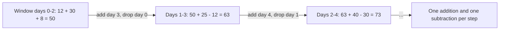
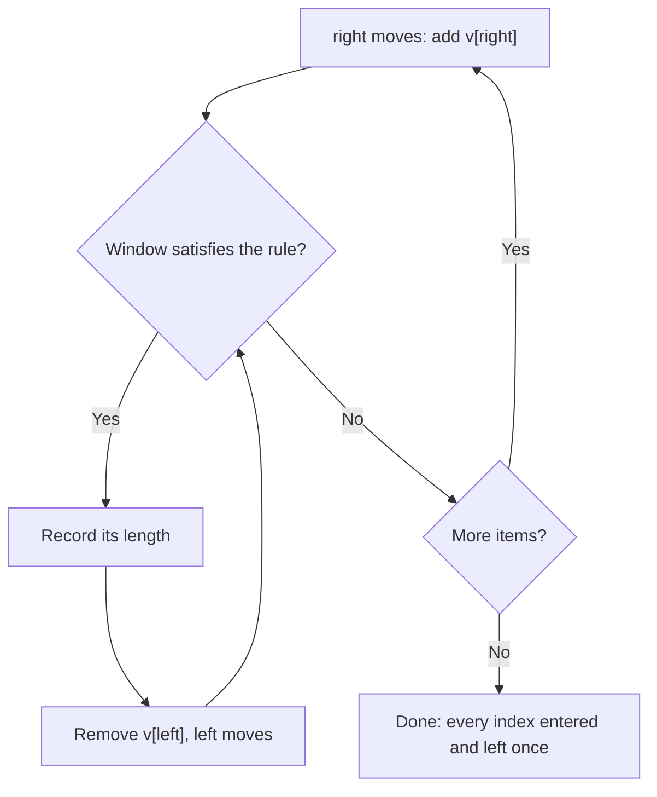
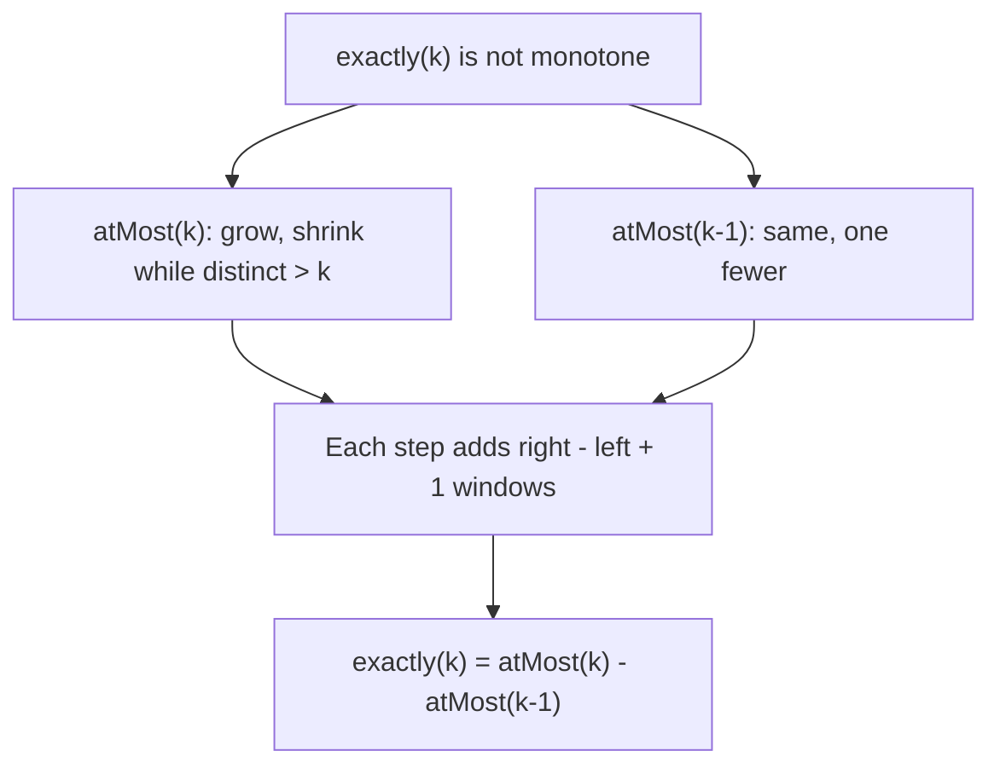

# new

## explanation

### A window over a list

Many questions are about **stretches of consecutive items**: the busiest 3 days in a row, the longest part of a word without a repeated letter, the shortest run of sales that reaches a target. Think of a window you slide along the list, looking at one stretch at a time.

### The slow way

For "the best 3 days in a row", you could add up days 0–2, then days 1–3, then days 2–4, and so on. Each sum costs k additions, so the whole thing costs O(n × k).

### The fast way: update, don't recompute

Two neighbouring windows share almost everything. Moving the window one step right **adds one new day** and **drops the oldest day**:

```cpp
window += v[i] - v[i - k];
```

Each step is now O(1), so the whole scan is O(n), whatever the window size.

### Fixed-size windows

When the size k is given:

1. Sum the first k items: that's the first window.
2. For each next position i, add `v[i]` and subtract `v[i - k]`.
3. After each update, compare with the best so far.

The same idea works for averages (divide by k), and for counts, such as how many vowels are in the window.

### Windows that grow and shrink

When the size isn't fixed, such as "the shortest stretch with sum at least 7", the window grows on the right and shrinks from the left as needed. That's the building level.

## diagram



## example

```cpp
#include <iostream>
#include <vector>

int main() {
    std::vector<int> visitors = {12, 30, 8, 25, 40, 5, 18, 33};
    int k = 3;  // the best 3 days in a row
    int window = 0;
    for (int i = 0; i < k; i++) window += visitors[i];  // first window: days 0 to 2
    int best = window, bestStart = 0;
    std::cout << window << ' ';
    for (int i = k; i < static_cast<int>(visitors.size()); i++) {
        window += visitors[i] - visitors[i - k];  // add the new day, drop the oldest
        std::cout << window << ' ';
        if (window > best) { best = window; bestStart = i - k + 1; }
    }
    std::cout << '\n' << "best " << k << " days start on day " << bestStart << " with " << best << " visitors\n";
}
```

```text
50 63 73 70 63 56
best 3 days start on day 2 with 73 visitors
```

1. The first window adds days 0, 1 and 2: 50.
2. Each step adds the day entering the window and subtracts the day leaving it, so every later window costs two operations, not three.
3. The window sums are 50, 63, 73, 70, 63 and 56: six windows for eight days.
4. The best is 73, the window that starts on day 2 (days 2, 3 and 4: 8 + 25 + 40).

## mistakes

- **Recomputing every window.** Re-adding k items for each position is O(n × k). Update the previous sum instead.
- **Dropping the wrong item.** The item leaving a window that ends at `i` is `v[i - k]`, not `v[i - k + 1]`. Check on a small example.
- **Forgetting the first window.** The loop that slides starts at `i = k`; the first window must be summed before it.
- **A window bigger than the list.** If k is larger than n, there is no window at all. Check that case first.
- **Overflow.** A window of many large values can pass the `int` limit. Use `long long` for the sum.

## check

```cpp
#include <iostream>
#include <vector>

int main() {
    std::vector<int> v = {4, 2, 7, 1, 6};
    int k = 2, sum = v[0] + v[1], low = sum;
    for (int i = k; i < 5; i++) {
        sum += v[i] - v[i - k];
        if (sum < low) low = sum;
    }
    std::cout << sum << ' ' << low << '\n';
}
```

```text
7 6
```

The windows of 2 are 4 + 2 = 6, 2 + 7 = 9, 7 + 1 = 8 and 1 + 6 = 7. After the loop, `sum` holds the last window, 7, and `low` the smallest seen, the very first one: 6.

# building

## explanation

### A quick recap

A sliding window looks at stretches of consecutive items and updates its answer as it moves, instead of recomputing. A fixed window of size k adds one item and drops one per step: O(n).

### Windows of changing size

When the question doesn't fix the size, use two indexes, `left` and `right`:

1. Move `right` one step, adding the new item to the window's state (a sum, or counts in a map).
2. While the window breaks the rule, or while it can still satisfy it after shrinking, move `left` forward, removing items from the state.
3. Record the answer at the point where the window is valid.

Every item enters the window once (when `right` passes it) and leaves at most once (when `left` passes it), so the whole scan is O(n), even with the inner `while`.

### Two flavours

- **Shortest window that satisfies a rule** (sum ≥ target): once the window is valid, record it, then shrink from the left to look for a shorter valid one.
- **Longest window that obeys a rule** (no repeated letter, at most k distinct values): grow, and when the rule breaks, shrink just until it holds again; then record.

### The state

The window needs whatever lets you check the rule in O(1): a running sum, a count per value in a map (removing a value when its count hits 0, so `size()` counts distinct values), or the last position of each letter, to jump `left` past a repeat in one step.

### When it works

Shrinking from the left must never make things worse in a way you'd miss. For sums, that holds only when all values are **non-negative**: adding an item never lowers the sum. With negative values, use prefix sums instead.

## diagram



## example

```cpp
#include <algorithm>
#include <iostream>
#include <string>
#include <unordered_map>
#include <vector>

int main() {
    // Grow on the right; shrink from the left while the window can afford it.
    // Shortest stretch of positive values whose sum is at least the target.
    std::vector<int> v = {2, 3, 1, 2, 4, 3};
    int target = 7, sum = 0, shortest = 1'000'000;
    std::size_t left = 0;
    for (std::size_t right = 0; right < v.size(); right++) {
        sum += v[right];
        while (sum >= target) {  // valid: record it, then try a shorter one
            shortest = std::min(shortest, static_cast<int>(right - left + 1));
            sum -= v[left++];
        }
    }
    std::cout << "shortest stretch: " << shortest << '\n';

    // Longest stretch of a word with no repeated letter: jump left past the previous copy.
    std::string s = "streetlight";
    std::unordered_map<char, std::size_t> lastSeen;
    std::size_t start = 0, longest = 0, bestStart = 0;
    for (std::size_t i = 0; i < s.size(); i++) {
        if (auto it = lastSeen.find(s[i]); it != lastSeen.end() && it->second >= start) start = it->second + 1;
        lastSeen[s[i]] = i;
        if (i - start + 1 > longest) { longest = i - start + 1; bestStart = start; }
    }
    std::cout << "longest without repeats: " << s.substr(bestStart, longest) << '\n';
}
```

```text
shortest stretch: 2
longest without repeats: etligh
```

1. The sum first reaches 7 at 2 3 1 2 (length 4). Shrinking from the left records it, and the window keeps sliding until 4 3 at the end, length 2.
2. For the word, `lastSeen` remembers where each letter last appeared. When a letter repeats inside the window, `start` jumps just past its previous copy: one step, not a loop.
3. The check `it->second >= start` ignores copies that are already outside the window, like the first t once the window has moved past it.
4. The longest stretch with no repeat is "etligh", 6 letters, starting at the second e.

## mistakes

- **Using `if` instead of `while` to shrink.** One step left may not be enough to restore the rule, or to find the shortest valid window. Keep shrinking while the condition holds.
- **Sliding windows over negative numbers.** With negatives, a longer window can have a smaller sum, so shrinking can skip the answer. Use prefix sums with a hash map.
- **Leaving zero counts in the map.** If a value's count drops to 0 but stays in the map, `size()` no longer counts distinct values. Erase it.
- **Jumping `start` backwards.** A letter's last position can be before the current window. Only jump when it's inside, as `it->second >= start` checks.
- **Recording at the wrong moment.** For "shortest valid", record inside the shrinking loop; for "longest valid", record after shrinking. Swapping them gives wrong lengths.

## check

```cpp
#include <algorithm>
#include <iostream>
#include <string>
#include <unordered_map>

int main() {
    std::string s = "aabacbebebe";
    std::unordered_map<char, int> inWindow;
    std::size_t left = 0, best = 0;
    for (std::size_t right = 0; right < s.size(); right++) {
        inWindow[s[right]]++;
        while (inWindow.size() > 3) {
            if (--inWindow[s[left]] == 0) inWindow.erase(s[left]);
            left++;
        }
        best = std::max(best, right - left + 1);
    }
    std::cout << best << '\n';
}
```

```text
7
```

The window may hold at most 3 different letters. Whenever a fourth appears, it shrinks from the left until one letter's count reaches 0 and is erased. The longest window that fits is "cbebebe": 7 letters using only c, b and e.

# strong

## explanation

### Why it's linear

The inner `while` looks like nested loops, but `left` only ever moves forward, and never past `right`. Across the whole scan it moves at most n times. So the total work is O(n) plus the cost of updating the window's state, which a hash map keeps at O(1) on average.

### The condition must be monotone

A variable window is correct when the rule is **monotone in the window**: if a window is valid, every window inside it is valid too (for "longest"), or every window containing it is (for "shortest"). "At most k distinct values" is monotone: removing items can't add values. "Sum ≥ target" with non-negative values is monotone. "Exactly k distinct values" is **not**: shrinking can go from 3 to 2 and back.

### Exactly k, from at most k

Count windows with **at most** k distinct values: each time the window ends at `right`, every start from `left` to `right` works, so add `right − left + 1`. Then

exactly(k) = atMost(k) − atMost(k − 1).

This turns a non-monotone count into two monotone ones, each O(n).

### Covering a pattern

"The smallest window of a text containing every letter of a pattern" keeps, for each letter, how many are still missing, plus one total. Growing decreases the counts; when nothing is missing, shrink from the left while the window still covers everything, recording the smallest. Letters not in the pattern go negative and are harmless. The whole search is O(text + pattern).

### When the window needs more than a sum

The maximum or minimum of each window can't be maintained by adding and subtracting. A deque of candidates kept in decreasing order solves it in O(n): that's the monotonic deque, a later skill.

## diagram



## example

```cpp
#include <iostream>
#include <string>
#include <unordered_map>
#include <vector>

// Stretches with AT MOST k distinct values. Every window ending at `right` that fits counts:
// there are right - left + 1 of them.
long long atMostDistinct(const std::vector<int>& v, int k) {
    std::unordered_map<int, int> inWindow;
    long long count = 0;
    std::size_t left = 0;
    for (std::size_t right = 0; right < v.size(); right++) {
        inWindow[v[right]]++;
        while (static_cast<int>(inWindow.size()) > k)
            if (--inWindow[v[left++]] == 0) inWindow.erase(v[left - 1]);
        count += right - left + 1;
    }
    return count;
}

// Smallest window of `text` containing every letter of `need` (with repeats).
std::string smallestCover(const std::string& text, const std::string& need) {
    std::unordered_map<char, int> missing;
    for (char c : need) missing[c]++;
    int stillMissing = static_cast<int>(need.size());
    std::size_t left = 0, bestLen = text.size() + 1, bestStart = 0;
    for (std::size_t right = 0; right < text.size(); right++) {
        if (missing[text[right]]-- > 0) stillMissing--;
        while (stillMissing == 0) {
            if (right - left + 1 < bestLen) { bestLen = right - left + 1; bestStart = left; }
            if (++missing[text[left++]] > 0) stillMissing++;
        }
    }
    return bestLen > text.size() ? "" : text.substr(bestStart, bestLen);
}

int main() {
    std::vector<int> v = {1, 2, 1, 2, 3};
    // Exactly k = at most k minus at most k - 1.
    std::cout << "exactly 2 distinct: " << atMostDistinct(v, 2) - atMostDistinct(v, 1) << '\n';
    std::cout << "smallest cover: " << smallestCover("ADOBECODEBANC", "ABC") << '\n';
}
```

```text
exactly 2 distinct: 7
smallest cover: BANC
```

1. `atMostDistinct` counts, for each right end, all the valid starts at once. With at most 2 distinct values there are 12 stretches, and with at most 1 there are 5, so exactly 2 gives 7.
2. In `smallestCover`, `missing` counts letters still needed. A letter whose count was positive reduces `stillMissing`; extra letters push counts below zero without effect.
3. When nothing is missing, the window shrinks from the left, recording each valid window, until removing a letter makes one missing again.
4. "BANC" is the shortest window containing an A, a B and a C.

## mistakes

- **A variable window for a non-monotone rule.** "Exactly k" can become valid again after shrinking, so the window skips answers. Rewrite it as a difference of two "at most" counts.
- **Counting one window per step.** For "how many stretches" questions, every start from `left` to `right` is valid at once: add `right − left + 1`, not 1.
- **Treating letters outside the pattern as needed.** Their counts go negative; only a count that was positive means a needed letter arrived.
- **Expecting max or min to slide with add and subtract.** They can't be undone that way. Use a monotonic deque.
- **Forgetting the "no answer" case.** If the pattern can't be covered, report it clearly, as with the empty string here, instead of returning a length past the end.

## check

```cpp
#include <iostream>
#include <vector>

int main() {
    std::vector<int> v = {1, 1, 2, 1};
    long long atMostOne = 0;
    std::size_t left = 0;
    for (std::size_t right = 0; right < v.size(); right++) {
        while (v[left] != v[right]) left++;  // all values in the window must equal v[right]
        atMostOne += right - left + 1;
    }
    std::cout << atMostOne << '\n';
}
```

```text
5
```

This counts the stretches made of one repeated value, using "every valid start counts". Ending at position 0 there is 1 stretch ([1]); ending at 1 there are 2 ([1] and [1 1]); at the 2 the window restarts, giving 1; at the last 1 it restarts again, giving 1. In total 1 + 2 + 1 + 1 = 5.
