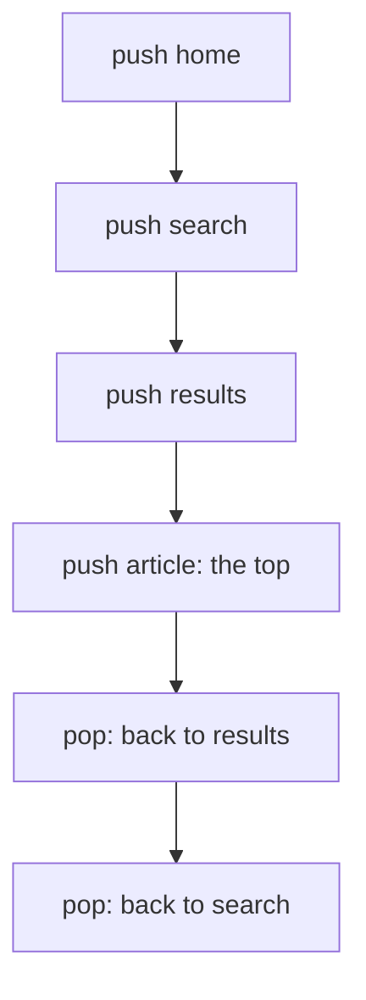
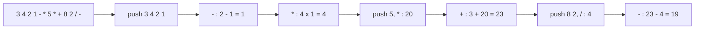
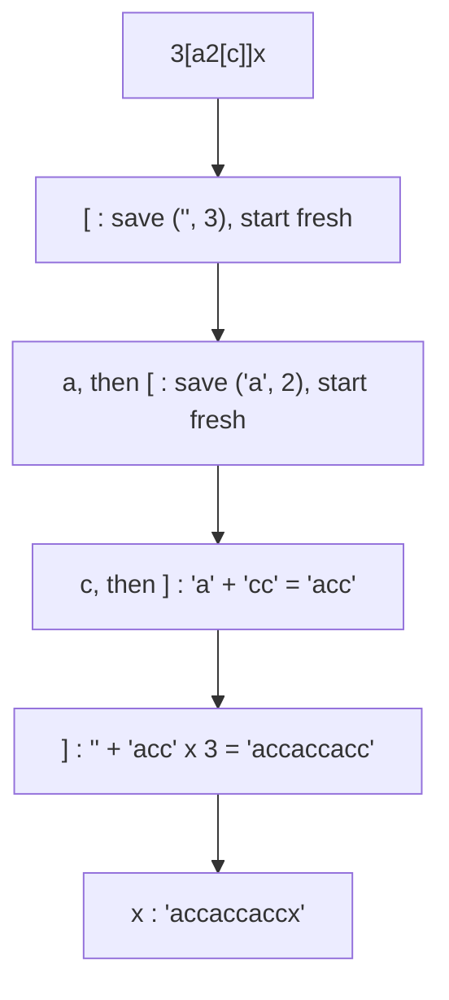

# new

## explanation

### Last in, first out

A **stack** lets you add and remove at one end only, the **top**. The last item added is the first one out (LIFO), like a pile of plates. Two operations do everything:

- **push**: put an item on top;
- **pop**: take the top item off.

Plus **top** to look at it without removing it, and **empty** to check whether anything is left.

### Building one

A vector already has an end where adding and removing are O(1): its back. So a stack is just a vector used only at the back: `push_back`, `pop_back` and `back`. Every operation is O(1). C++ also provides `std::stack`, which does exactly this.

### Where stacks appear

Whenever the most recent thing must be dealt with first:

- **Back and undo**: each page or action is pushed; going back pops it.
- **Reversing**: push everything, then pop: it comes out in reverse.
- **Matching**: every closing bracket must match the most recently opened one.
- **Function calls**: the computer's call stack holds the functions waiting for the ones they called.

### Rules to remember

- Never `pop` or read `top` of an empty stack: check `empty()` first.
- `pop` removes the item but returns nothing, so read `top` first if you need the value.
- Use the vector's **back** as the top. Using the front would make every push and pop shift all the other items: O(n).

## diagram



## example

```cpp
#include <iostream>
#include <string>
#include <vector>

// A stack built on a vector: the top is the vector's last element, so push and pop are O(1).
class Stack {
public:
    void push(const std::string& x) { items_.push_back(x); }
    void pop() { items_.pop_back(); }
    const std::string& top() const { return items_.back(); }
    bool empty() const { return items_.empty(); }
    std::size_t size() const { return items_.size(); }
private:
    std::vector<std::string> items_;
};

int main() {
    // A browser's back button: every visit is pushed; "back" pops to the previous page.
    Stack history;
    for (std::string page : {"home", "search", "results", "article"}) history.push(page);
    history.pop();  // back
    history.pop();  // back again
    std::cout << "now on " << history.top() << ", " << history.size() << " pages in history\n";

    // Reversing: what goes in first comes out last.
    Stack letters;
    for (char c : std::string("stack")) letters.push(std::string(1, c));
    std::string reversed;
    while (!letters.empty()) { reversed += letters.top(); letters.pop(); }
    std::cout << reversed << '\n';
}
```

```text
now on search, 2 pages in history
kcats
```

1. `Stack` wraps a vector and only touches its back, so every operation is O(1).
2. Four pages are pushed; two pops go back past "article" and "results", leaving "search" on top and two pages in the history.
3. Pushing the letters of "stack" and popping them all brings them out last-first: "kcats".
4. The loop checks `empty()` before every `top()` and `pop()`.

## mistakes

- **Popping an empty stack.** `pop_back` or `top` on an empty vector has no defined result and may crash. Check `empty()` first.
- **Expecting `pop` to return the value.** It doesn't. Read `top()` first, then `pop()`.
- **Using the front as the top.** Inserting and erasing at a vector's front shifts every item. Always work at the back.
- **Keeping a reference to the top across a pop.** After `pop`, the reference points at a removed item. Copy the value if you need it later.
- **Using a stack when order of arrival matters.** If the oldest item should come out first, you need a queue.

## check

```cpp
#include <iostream>
#include <vector>

int main() {
    std::vector<int> st;
    for (int x : {5, 1, 4}) st.push_back(x);
    st.pop_back();
    st.push_back(9);
    st.push_back(2);
    st.pop_back();
    std::cout << st.back() << ' ' << st.size() << ' ' << st.front() << '\n';
}
```

```text
9 3 5
```

After pushing 5, 1 and 4, the pop removes 4. Pushing 9 and 2 and popping again removes the 2, leaving 5, 1, 9: the top is 9, there are 3 items, and the bottom item, the vector's front, is 5.

# building

## explanation

### A quick recap

A stack adds and removes at the top only: push, pop, top, empty, all O(1) on a vector's back. It suits anything where the most recent item must be handled first.

### Postfix expressions

In **postfix** notation, each operator comes after its two operands: `3 4 +` means 3 + 4, and `2 1 - 5 *` means (2 − 1) × 5. No brackets or precedence rules are needed. A stack evaluates it in one pass:

- a number: push it;
- an operator: pop two numbers, apply the operator, push the result.

At the end, the stack holds the answer. Watch the order: the **first** number popped is the **right** operand, so `a − b` needs `b` popped first.

### Turning normal expressions into postfix

The **shunting-yard algorithm** reads an everyday expression left to right:

- a number goes straight to the output;
- `(` is pushed;
- `)` pops operators to the output until the matching `(`;
- an operator first pops every operator on top of the stack with **equal or higher** precedence (they must be done first), then pushes itself;
- at the end, everything left on the stack goes to the output.

"Equal" pops too because `-` and `/` work left to right: in `8 - 2 - 1`, the first minus must happen first.

### Undo and redo

Two stacks: every change pushes the old state onto **undo**. Undoing pushes the current state onto **redo** and restores the top of undo. Redoing does the reverse. Any new change clears redo, because the old future no longer applies.

## diagram



## example

```cpp
#include <cctype>
#include <iostream>
#include <sstream>
#include <stack>
#include <string>

int precedence(char op) { return op == '+' || op == '-' ? 1 : 2; }
// Shunting-yard: numbers go straight out; operators wait on a stack until a weaker one arrives.
std::string toPostfix(const std::string& infix) {
    std::string out;
    std::stack<char> ops;
    auto emit = [&](char c) { out += c; out += ' '; };
    for (char c : infix) {
        if (std::isdigit(static_cast<unsigned char>(c))) emit(c);
        else if (c == '(') ops.push(c);
        else if (c == ')') {
            while (ops.top() != '(') { emit(ops.top()); ops.pop(); }
            ops.pop();  // drop the '('
        } else if (c != ' ') {
            while (!ops.empty() && ops.top() != '(' && precedence(ops.top()) >= precedence(c)) { emit(ops.top()); ops.pop(); }
            ops.push(c);
        }
    }
    while (!ops.empty()) { emit(ops.top()); ops.pop(); }
    return out;
}
// Postfix evaluation: numbers are pushed; an operator pops two, applies itself, pushes the result.
long long evaluate(const std::string& postfix) {
    std::istringstream in(postfix);
    std::stack<long long> values;
    std::string token;
    while (in >> token) {
        if (std::isdigit(static_cast<unsigned char>(token[0]))) { values.push(std::stoll(token)); continue; }
        long long b = values.top(); values.pop();  // the right operand comes off first
        long long a = values.top(); values.pop();
        values.push(token == "+" ? a + b : token == "-" ? a - b : token == "*" ? a * b : a / b);
    }
    return values.top();
}

int main() {
    std::string post = toPostfix("3 + 4 * (2 - 1) * 5 - 8 / 2");
    std::cout << post << "\n= " << evaluate(post) << '\n';
}
```

```text
3 4 2 1 - * 5 * + 8 2 / -
= 19
```

1. Shunting-yard sends each digit straight out, and holds operators on the stack until a weaker operator or a `)` forces them out.
2. The `(2 - 1)` part comes out as `2 1 -` right after its `)`, so it's done before the multiplications.
3. The evaluator pushes numbers and applies each operator to the top two: 2 − 1 = 1, 4 × 1 = 4, 4 × 5 = 20, 3 + 20 = 23, 8 / 2 = 4, 23 − 4 = 19.
4. This version handles single-digit numbers; real parsers read whole numbers as one token.

## mistakes

- **Popping operands in the wrong order.** The first pop is the right operand. Swapping them gives `b − a` and `b / a`.
- **Popping only higher precedence.** Popping on `>` instead of `>=` makes `8 - 2 - 1` come out as 8 − (2 − 1). Equal-precedence, left-to-right operators must be popped too.
- **Forgetting to drop the `(`.** After popping operators down to `(`, the bracket itself must be popped, or it blocks later operators.
- **No checks on malformed input.** A missing `(` makes `ops.top()` read an empty stack. Real code must validate the brackets and operand counts.
- **Not clearing redo after a new change.** Redo would then restore states from a different history.

## check

```cpp
#include <iostream>
#include <stack>
#include <string>

int main() {
    std::stack<std::string> undo, redo;
    std::string text;
    for (std::string w : {"a", "b", "c"}) { undo.push(text); text += w; }
    for (int i = 0; i < 2; i++) { redo.push(text); text = undo.top(); undo.pop(); }  // undo twice
    undo.push(text); text = redo.top(); redo.pop();                                   // redo once
    std::cout << text << ' ' << undo.size() << ' ' << redo.size() << '\n';
}
```

```text
ab 2 1
```

Typing a, b and c pushes the states "", "a" and "ab" onto undo. Two undos save "abc" and then "ab" on redo and go back to "a". One redo saves "a" on undo and restores "ab". Undo now holds "" and "a", and redo holds "abc".

# strong

## explanation

### Stacks model nesting

Anything nested, such as brackets, nested repeat counts, tags in a document or function calls, is naturally processed with a stack: on entering a level, push what you need to remember about the outer level; on leaving, pop it and combine. The stack's size at any moment is the current nesting depth.

### Decoding nested repeats

For strings like `3[a2[c]]`: a `[` pushes the text built so far and the repeat count, then starts fresh; the matching `]` pops them, repeats the inner text, and appends it to the saved text. Each level is handled exactly when it closes, from the inside out.

### Positions on the stack

Pushing **indexes** instead of characters answers "how long" questions. For the longest well-formed run of brackets, keep a stack of positions with a base marker at its bottom (starting with −1). A `(` pushes its index. A `)` pops; if the stack is now empty, this `)` is unmatched and becomes the new base; otherwise the run ending here starts just after the index on top, so its length is `i − top`.

### Costs and limits

Each item is pushed and popped at most once, so these are O(n). The stack holds at most the nesting depth, which can be O(n) in the worst case (a string of n `(`s). When you replace recursion with an explicit stack, the depth moves from the limited call stack to the heap, where only memory limits it.

### Choosing the underlying container

`std::stack<T>` uses a `std::deque` by default, which never moves existing items when it grows. `std::stack<T, std::vector<T>>` is usually a bit faster for simple types, at the price of occasional reallocation. A plain vector used at the back is just as good, and easier to inspect while debugging.

## diagram



## example

```cpp
#include <algorithm>
#include <cctype>
#include <iostream>
#include <stack>
#include <string>
#include <utility>

// Decode strings like "3[a2[c]]": '[' saves the text so far and the count; ']' repeats the inner part.
std::string decode(const std::string& s) {
    std::stack<std::pair<std::string, int>> saved;
    std::string current;
    int count = 0;
    for (char c : s) {
        if (std::isdigit(static_cast<unsigned char>(c))) count = count * 10 + (c - '0');
        else if (c == '[') { saved.push({current, count}); current.clear(); count = 0; }
        else if (c == ']') {
            auto [before, times] = saved.top();
            saved.pop();
            std::string repeated;
            for (int i = 0; i < times; i++) repeated += current;
            current = before + repeated;
        } else current += c;
    }
    return current;
}

// Longest well-formed run of brackets: the stack holds positions; its bottom marks the last break.
int longestValid(const std::string& s) {
    std::stack<int> pos;
    pos.push(-1);
    int best = 0;
    for (int i = 0; i < static_cast<int>(s.size()); i++) {
        if (s[i] == '(') { pos.push(i); continue; }
        pos.pop();
        if (pos.empty()) pos.push(i);  // an unmatched ')': the new break point
        else best = std::max(best, i - pos.top());
    }
    return best;
}

int main() {
    std::cout << decode("3[a2[c]]x") << ' ' << decode("2[ab]3[z]") << '\n';
    std::cout << longestValid(")()())") << ' ' << longestValid("(()(()") << ' ' << longestValid("()(())") << '\n';
}
```

```text
accaccaccx ababzzz
4 2 6
```

1. In "3[a2[c]]x", the inner `2[c]` closes first, giving "acc"; then the outer `3[…]` repeats that three times, and the final x is appended.
2. Multi-digit counts work because each digit extends `count`; a `[` then saves and resets it.
3. In ")()())", the first `)` becomes the base; the next four characters form "()()", length 4, measured from that base.
4. In "(()(()", the unmatched `(`s stay on the stack and keep breaking the runs, so the best is 2; "()(())" is valid as a whole: 6.

## mistakes

- **Saving only the count at `[`.** The text built before the bracket must be saved too, or it's lost when the inner part starts fresh.
- **Forgetting the base marker.** Without the −1 at the bottom, a run starting at position 0 can't be measured, and the first `)` pops an empty stack.
- **Measuring from the popped index.** The run's start is just after the index **left on top** after popping, not the one popped.
- **Unbounded output.** Nested repeats multiply: `9[9[9[a]]]` already produces 729 characters. Check sizes before building huge strings.
- **Recursion where depth can be huge.** Deeply nested input can overflow the call stack in a recursive parser. An explicit stack only needs memory.

## check

```cpp
#include <algorithm>
#include <iostream>
#include <stack>
#include <string>

int main() {
    std::string s = "(a(b)(c(d)))";
    std::stack<int> open;
    int deepest = 0, pairs = 0;
    for (char c : s) {
        if (c == '(') { open.push(1); deepest = std::max<int>(deepest, open.size()); }
        else if (c == ')') { open.pop(); pairs++; }
    }
    std::cout << deepest << ' ' << pairs << '\n';
}
```

```text
3 4
```

The stack's size is the current nesting depth. It reaches 3 at `(d`, inside `(c` inside the outermost bracket. Each `)` closes one pair, and there are four.
