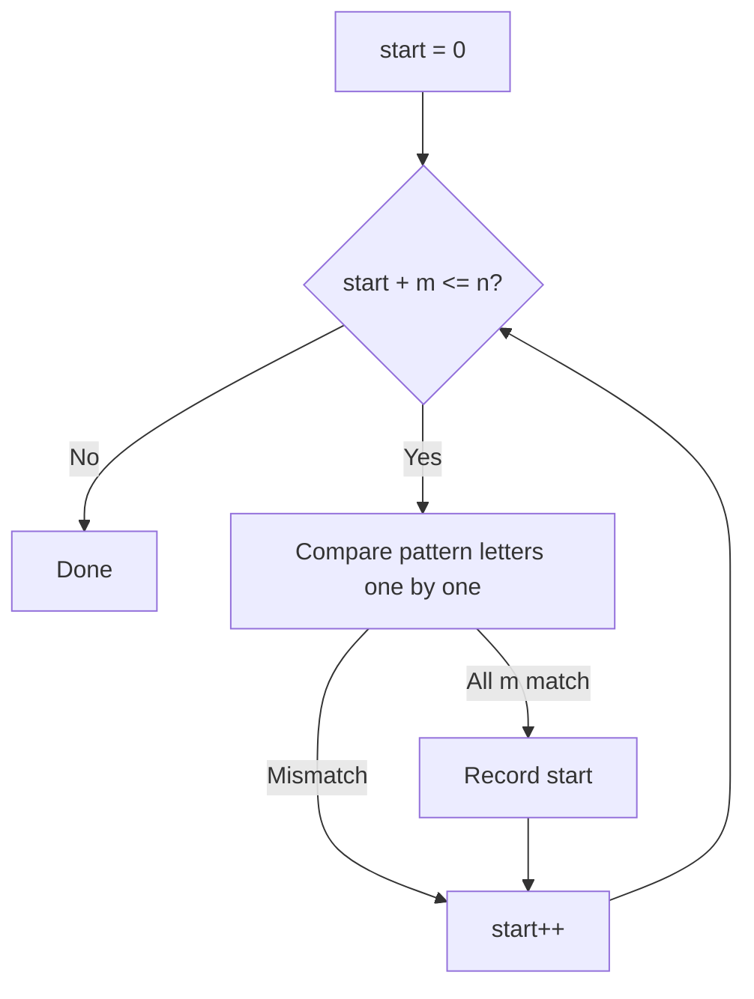
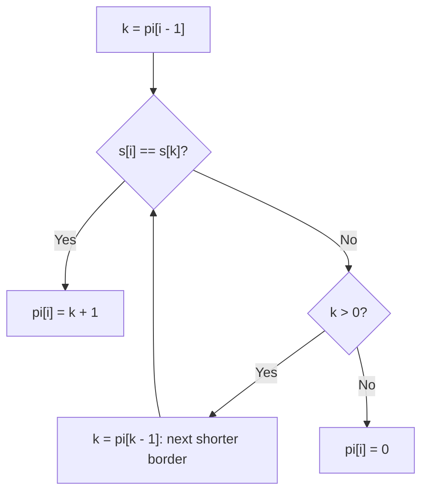

# new

## explanation

### Finding a pattern in a text

Searching a document for a word, a genome for a DNA sequence, a log file for an error code: all are **string matching**. Given a long text of length n and a pattern of length m, find every position where the pattern appears.

### The naive way

Try every starting position in the text. At each one, compare the pattern letter by letter, and stop at the first mismatch. If all m letters match, record the position.

There are about n starting positions and each can take up to m comparisons, so the worst case is **O(n × m)**. On ordinary text, mismatches come early and it's fast. But on text full of near-misses, like a pattern "aaaab" in a long run of a's, almost every start compares nearly the whole pattern.

### Overlapping matches

Matches can overlap: "ana" appears in "banana" at positions 1 and 3, sharing the middle 'a'. When counting with `find`, continue searching from `at + 1` to count overlaps, or from `at + pattern.size()` to count separate, non-overlapping copies.

### `std::string::find`

`text.find(pat)` returns the first position, or `std::string::npos` if there's none, and `text.find(pat, from)` starts looking at `from`. It's the right tool for everyday searches. The faster algorithms in the next levels matter when texts are huge, patterns are long, or the text is adversarial.

### What's coming

The building and strong levels avoid re-comparing letters already known to match. KMP and the Z-function do it by studying the pattern first; hashing does it by comparing numbers instead of letters. All of them reach O(n + m).

## diagram



## example

```cpp
#include <iostream>
#include <string>
#include <vector>

// Naive search: try every start, compare letter by letter. Worst case O(n * m).
std::vector<std::size_t> findAll(const std::string& text, const std::string& pat, long long& comparisons) {
    std::vector<std::size_t> hits;
    for (std::size_t start = 0; start + pat.size() <= text.size(); start++) {
        std::size_t k = 0;
        while (k < pat.size()) {
            comparisons++;
            if (text[start + k] != pat[k]) break;
            k++;
        }
        if (k == pat.size()) hits.push_back(start);
    }
    return hits;
}

int main() {
    long long c1 = 0;
    for (std::size_t at : findAll("bananarama", "ana", c1)) std::cout << at << ' ';
    std::cout << "| " << c1 << " comparisons\n";

    std::string text(30, 'a'), pat = "aaaab";  // the bad case: almost-matches everywhere
    long long c2 = 0;
    std::cout << findAll(text, pat, c2).size() << " hits, " << c2 << " comparisons\n";

    std::cout << "find: " << std::string("bananarama").find("rama") << '\n';
}
```

```text
1 3 | 14 comparisons
0 hits, 130 comparisons
find: 6
```

1. In "bananarama", "ana" starts at 1 and at 3; the two copies overlap. Most starts fail on their first or second letter, so 8 starts cost only 14 comparisons.
2. In 30 a's, every one of the 26 possible starts matches "aaaa" and fails only on the final "b": 26 × 5 = 130 comparisons, and no match at all.
3. `std::string::find` returns the first position of "rama": 6.

## mistakes

- **Counting overlaps by accident, or missing them.** Continue from `at + 1` to include overlapping matches, or from `at + pattern.size()` to skip them. Decide which the problem wants.
- **`start <= text.size() - pat.size()` with unsigned sizes.** If the pattern is longer than the text, the subtraction wraps to a huge number. Write `start + pat.size() <= text.size()`.
- **Forgetting `npos`.** `find` returns `std::string::npos` when nothing is found; using it as a position goes out of range.
- **Assuming the naive search is always slow.** On normal text it's usually fine. Reach for KMP or hashing when inputs are large or chosen to be hard.
- **Case and spacing differences.** "Rama" and "rama" don't match. Normalise both strings first if the search should ignore them.

## check

```cpp
#include <iostream>
#include <string>

int main() {
    std::string text = "aaaa", pat = "aa";
    int overlapping = 0, separate = 0;
    for (std::size_t at = text.find(pat); at != std::string::npos; at = text.find(pat, at + 1)) overlapping++;
    for (std::size_t at = text.find(pat); at != std::string::npos; at = text.find(pat, at + pat.size())) separate++;
    std::cout << overlapping << ' ' << separate << '\n';
}
```

```text
3 2
```

"aa" appears in "aaaa" starting at 0, 1 and 2: three overlapping matches, found by continuing one position after each hit. Jumping past each whole match instead finds the copies at 0 and 2 only: two separate matches.

# building

## explanation

### A quick recap

Naive matching tries every start and compares up to m letters: O(n × m) in the worst case. The goal is O(n + m) by never re-comparing text letters already known to match.

### The prefix function

For a string s, `pi[i]` is the length of the longest **proper** prefix of `s[0..i]` that's also a suffix of it. A prefix that's also a suffix is called a **border**. For "abacaba": the whole string ends with "aba", which is also how it starts, so `pi[6] = 3`.

It's built left to right in O(m). To extend the border at position i, try `k = pi[i − 1]`:

- if `s[i] == s[k]`, the border grows to `k + 1`;
- if not, fall back to the next shorter border, `k = pi[k − 1]`, and try again;
- if k reaches 0 and still no match, `pi[i] = 0`.

The fallbacks look like a nested loop, but k grows by at most one per step, so it can't fall back more than it grew: O(m) in total.

### KMP: matching with the prefix function

Run the prefix function over `pattern + '#' + text`. The `#` must not appear in either string; it stops borders from running across the join. Wherever `pi` equals the pattern's length, the pattern ends at that position. Converting back to a start position in the text: `i − 2 × m`. The whole search is O(n + m), whatever the text.

The fallback step is what saves the work: on a mismatch, instead of restarting the comparison one position later, KMP continues from the longest part already matched that could still be the start of a match.

### A bonus: the period

If a string is made by repeating a unit, the shortest unit has length `n − pi[n − 1]`, provided n is a multiple of it. "abcabcabc" has `pi` ending at 6, giving a unit of length 3, "abc".

## diagram



## example

```cpp
#include <iostream>
#include <string>
#include <vector>

// pi[i] = length of the longest proper prefix of s[0..i] that is also a suffix of it.
std::vector<int> prefixFunction(const std::string& s) {
    std::vector<int> pi(s.size(), 0);
    for (std::size_t i = 1; i < s.size(); i++) {
        int k = pi[i - 1];
        while (k > 0 && s[i] != s[k]) k = pi[k - 1];  // fall back to the next shorter border
        if (s[i] == s[k]) k++;
        pi[i] = k;
    }
    return pi;
}

// KMP: run the prefix function over pattern + '#' + text; a value equal to the pattern's length is a match.
std::vector<int> kmpFind(const std::string& text, const std::string& pat) {
    std::vector<int> pi = prefixFunction(pat + '#' + text), hits;
    for (std::size_t i = pat.size() + 1; i < pi.size(); i++)
        if (pi[i] == static_cast<int>(pat.size())) hits.push_back(static_cast<int>(i - 2 * pat.size()));
    return hits;
}

int main() {
    for (int x : prefixFunction("abacaba")) std::cout << x << ' ';
    std::cout << '\n';
    for (int at : kmpFind("abacabadaba", "aba")) std::cout << at << ' ';
    std::cout << '\n';
    std::string s = "abcabcabc";
    int period = static_cast<int>(s.size()) - prefixFunction(s).back();
    std::cout << "shortest repeating unit: " << s.substr(0, period) << '\n';
}
```

```text
0 0 1 0 1 2 3
0 4 8
shortest repeating unit: abc
```

1. In "abacaba", the borders grow as the string repeats its start: "a" at position 2, then "a", "ab" and "aba" at positions 4 to 6. The 'c' and the 'b' at position 1 have no border.
2. `kmpFind` joins "aba#abacabadaba" and finds `pi` equal to 3 at three places, which convert to text positions 0, 4 and 8.
3. For "abcabcabc", the last `pi` value is 6, so the shortest unit has length 9 − 6 = 3: "abc".

## mistakes

- **A separator that appears in the strings.** If '#' occurs in the pattern or text, borders can run across the join and report false matches. Pick a character that can't appear, or run KMP without joining.
- **Using `if` instead of `while` to fall back.** One fallback may not be enough; several shorter borders may need trying before one extends.
- **Off-by-one converting positions.** A match ending at combined index i starts at text position `i − 2m`. Check on a tiny example.
- **Comparing to `pi[i]` instead of `pi[i − 1]`.** The candidate border for position i comes from the previous position.
- **Reading the period wrongly.** `n − pi[n − 1]` is a true repeating unit only if it divides n; otherwise the string has a period but isn't a whole number of repeats.

## check

```cpp
#include <iostream>
#include <string>
#include <vector>

int main() {
    std::string s = "aabaaab";
    std::vector<int> pi(s.size(), 0);
    for (std::size_t i = 1; i < s.size(); i++) {
        int k = pi[i - 1];
        while (k > 0 && s[i] != s[k]) k = pi[k - 1];
        if (s[i] == s[k]) k++;
        pi[i] = k;
    }
    for (int x : pi) std::cout << x;
    std::cout << '\n';
}
```

```text
0101223
```

"aa" has border "a" (1). The 'b' breaks it (0). Then "a", "aa" restart the border (1, 2). The next 'a' can't extend "aa" with 'b', so it falls back to "a" and extends that to "aa" (2). The final 'b' extends "aa" to "aab" (3).

# strong

## explanation

### The Z-function

`z[i]` is the length of the longest common prefix of the whole string and the suffix starting at i. Run on `pattern + '#' + text`, any `z[i]` equal to the pattern's length marks a match. It's computed in O(n) by keeping the rightmost window `[l, r)` that's known to match a prefix: inside it, `z[i]` starts from the mirrored value `z[i − l]`, capped at the window's end, and only letters beyond r are compared afresh. Each comparison that succeeds moves r right, so the total is linear. Many people find the Z-function easier to reason about than KMP; they solve the same problems.

### Hashing and Rabin-Karp

Turn a string into a number with a **polynomial hash**: h = s₀·Bᵏ⁻¹ + s₁·Bᵏ⁻² + … + sₖ₋₁, modulo a large prime. Prefix hashes `h[i]` give the hash of any substring in O(1):

hash(from, len) = h[from + len] − h[from] · Bˡᵉⁿ (mod p).

Comparing two substrings is then one number comparison. Rabin-Karp compares the pattern's hash with every window's hash, and checks letters only when the hashes match.

Hashes can **collide**: different strings, same number. With a prime modulus around 10⁹, a single comparison collides with probability about 1 in 10⁹, but over millions of comparisons collisions become likely, and inputs can be designed to break a fixed, known hash. Use two independent moduli (or a 64-bit modulus) and a random base for anything that matters.

### Which to use

- One pattern, exact matches, guaranteed time: KMP or Z.
- Many substring comparisons (longest repeated substring, palindrome checks, counting distinct substrings): prefix hashes.
- Long patterns in ordinary text: `std::boyer_moore_searcher`, which skips ahead by whole stretches and is often faster than reading every letter.

## diagram


## example

```cpp
#include <algorithm>
#include <cstdint>
#include <iostream>
#include <string>
#include <unordered_set>
#include <vector>

// z[i] = length of the longest common prefix of s and s.substr(i). O(n) with the [l, r) window trick.
std::vector<int> zFunction(const std::string& s) {
    int n = s.size();
    std::vector<int> z(n, 0);
    for (int i = 1, l = 0, r = 0; i < n; i++) {
        if (i < r) z[i] = std::min(r - i, z[i - l]);
        while (i + z[i] < n && s[z[i]] == s[i + z[i]]) z[i]++;
        if (i + z[i] > r) { l = i; r = i + z[i]; }
    }
    return z;
}
// Polynomial prefix hashes: the hash of any substring in O(1).
struct Hasher {
    static constexpr std::uint64_t MOD = 1'000'000'007, BASE = 131;
    std::vector<std::uint64_t> h, pw;
    explicit Hasher(const std::string& s) : h(s.size() + 1, 0), pw(s.size() + 1, 1) {
        for (std::size_t i = 0; i < s.size(); i++) {
            h[i + 1] = (h[i] * BASE + static_cast<unsigned char>(s[i])) % MOD;
            pw[i + 1] = pw[i] * BASE % MOD;
        }
    }
    std::uint64_t get(std::size_t from, std::size_t len) const {  // hash of s.substr(from, len)
        return (h[from + len] + MOD * MOD - h[from] * pw[len] % MOD) % MOD;
    }
};
int main() {
    std::string pat = "aba", text = "abacabadaba";
    std::vector<int> z = zFunction(pat + '#' + text);
    for (std::size_t i = pat.size() + 1; i < z.size(); i++)
        if (z[i] == static_cast<int>(pat.size())) std::cout << i - pat.size() - 1 << ' ';
    std::cout << '\n';
    Hasher hs(text);
    std::cout << "text[0..3) == text[4..7)? " << (hs.get(0, 3) == hs.get(4, 3)) << '\n';
    std::unordered_set<std::uint64_t> distinct;
    for (std::size_t i = 0; i + 3 <= text.size(); i++) distinct.insert(hs.get(i, 3));
    std::cout << distinct.size() << " distinct substrings of length 3\n";
}
```

```text
0 4 8
text[0..3) == text[4..7)? 1
7 distinct substrings of length 3
```

1. The Z-function over "aba#abacabadaba" reaches 3 at three places, the matches at text positions 0, 4 and 8, the same as KMP found.
2. `Hasher` builds prefix hashes once in O(n). The two windows starting at 0 and 4 are both "aba", so their hashes are equal.
3. Collecting the hash of every window of length 3 in a set counts distinct substrings without building any of them: aba, bac, aca, cab, bad, ada and dab, 7 in all.
4. `MOD * MOD` is added before subtracting so the unsigned result never goes below zero; every product stays under 2⁶⁴.

## mistakes

- **Trusting a single hash blindly.** Equal hashes almost always mean equal strings, but not always, and fixed hashes can be attacked. Use two moduli, or verify the letters when it matters.
- **Negative results in modular subtraction.** With signed numbers, `h[a] − h[b] * p` can go negative and `%` keeps it negative. Add a multiple of the modulus first, as `get` does.
- **Overflow in hash products.** `h * BASE` must stay below 2⁶⁴: with a modulus near 10⁹ and 64-bit unsigned values, that holds. A modulus near 2⁶³ needs 128-bit multiplication.
- **Forgetting that Z ignores position 0.** `z[0]` is the whole length by definition and is left as 0 here; never treat it as a match.
- **Reaching for linear algorithms first.** For short texts or a single search, `std::string::find` is simpler and fast enough. Use KMP, Z or hashing when size or adversarial input demands it.

## check

```cpp
#include <iostream>
#include <string>
#include <vector>

int main() {
    std::string s = "aaabaab";
    int n = s.size();
    std::vector<int> z(n, 0);
    for (int i = 1; i < n; i++)
        while (i + z[i] < n && s[z[i]] == s[i + z[i]]) z[i]++;  // the simple O(n^2) version
    for (int x : z) std::cout << x;
    std::cout << '\n';
}
```

```text
0210210
```

From position 1, "aabaab" matches the start "aaa…" for 2 letters; from 2, "abaab" for 1; the 'b' at 3 matches nothing. From 4, "aab" matches 2 letters, from 5 "ab" matches 1, and the final 'b' 0. Position 0 is left at 0.
