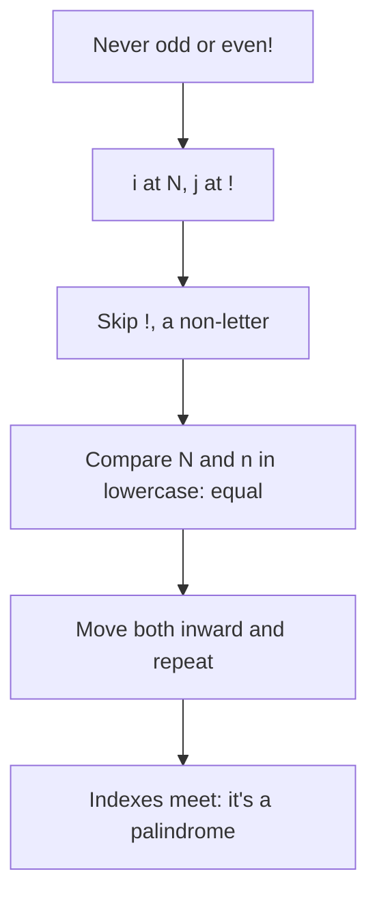
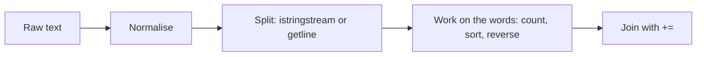
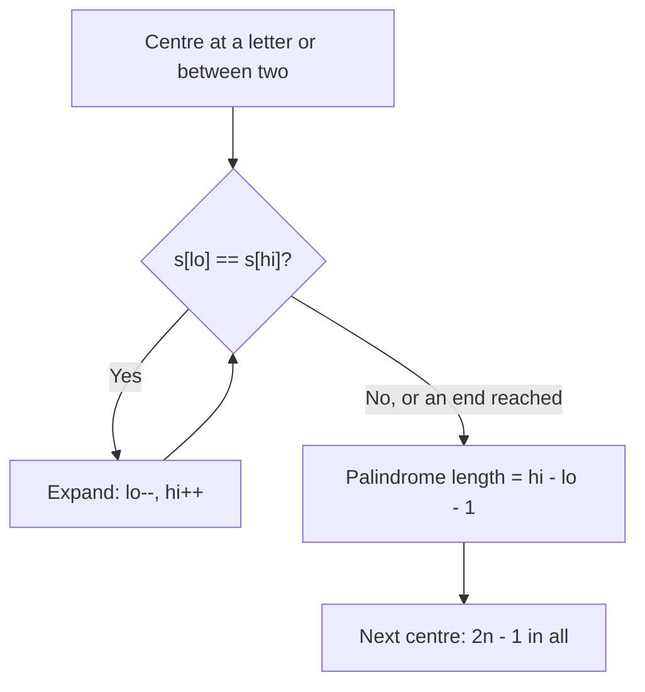

# new

## explanation

### Text problems are list problems

A string is a list of characters, so the techniques you know apply directly: counting with tables, two pointers, hash maps. A few string-specific habits make them work smoothly.

### Counting characters with a small table

For lowercase English letters, a table of 26 counters is simpler and faster than a map. A letter's position in the alphabet is `c - 'a'`: 'a' is 0, 'b' is 1, …, 'z' is 25.

```cpp
int count[26] = {};
for (char c : word) count[c - 'a']++;
```

### Palindromes: two pointers

A palindrome reads the same backwards: "level", "noon". Check it with one index at each end, moving inwards and comparing. To ignore spaces, punctuation and capital letters, skip characters that aren't letters or digits (`std::isalnum`) and compare lowercase versions (`std::tolower`).

### Anagrams: same counts

Two words are anagrams if they use exactly the same letters the same number of times: "night" and "thing". Count up for the first word and down for the second; they're anagrams if every counter ends at 0. That's O(length), no sorting needed.

### Building strings

Adding to the end with `s += c` is fast. But `s = s + c` builds a whole new string each time, so a loop of n additions becomes O(n²). Always use `+=` to build text step by step.

### Careful with characters

`c - 'a'` only makes sense for lowercase letters; a capital letter or a space gives an index outside the table. Check or convert first. And pass characters to `std::isalnum` and `std::tolower` as `unsigned char`, as the `<cctype>` functions require.

## diagram



## example

```cpp
#include <cctype>
#include <iostream>
#include <string>

// Palindrome check that ignores spaces, punctuation and case: two pointers from both ends.
bool isPalindrome(const std::string& s) {
    int i = 0, j = static_cast<int>(s.size()) - 1;
    while (i < j) {
        if (!std::isalnum(static_cast<unsigned char>(s[i]))) { i++; continue; }
        if (!std::isalnum(static_cast<unsigned char>(s[j]))) { j--; continue; }
        if (std::tolower(static_cast<unsigned char>(s[i])) != std::tolower(static_cast<unsigned char>(s[j]))) return false;
        i++;
        j--;
    }
    return true;
}

// Anagrams have the same count of every letter.
bool areAnagrams(const std::string& a, const std::string& b) {
    int count[26] = {};
    for (char c : a) count[c - 'a']++;
    for (char c : b) count[c - 'a']--;
    for (int x : count) if (x != 0) return false;
    return true;
}

int main() {
    std::cout << isPalindrome("Never odd or even!") << isPalindrome("Hello") << '\n';
    std::cout << areAnagrams("night", "thing") << areAnagrams("apple", "paper") << '\n';
    std::string word = "mississippi";
    int count[26] = {};
    for (char c : word) count[c - 'a']++;
    std::cout << "s:" << count['s' - 'a'] << " i:" << count['i' - 'a'] << " p:" << count['p' - 'a'] << '\n';
}
```

```text
10
10
s:4 i:4 p:2
```

1. `isPalindrome` skips the spaces and the "!", and compares letters in lowercase, so "Never odd or even!" passes while "Hello" fails at the first pair, H and o.
2. `areAnagrams` adds one for each letter of the first word and subtracts one for each of the second. "night" and "thing" cancel out exactly; "apple" has an l where "paper" has an r.
3. Counting "mississippi" in a 26-slot table gives four s's, four i's and two p's, all in one pass.

## mistakes

- **Indexing with `c - 'a'` for any character.** 'A' − 'a' is −32, and a space is far out of range. Convert to lowercase and skip non-letters first.
- **Building strings with `s = s + c`.** Each step copies the whole string: O(n²) overall. Use `s += c`.
- **Comparing without normalising.** "Level" and "level" differ in their first letter. Decide whether case and punctuation matter, and normalise before comparing.
- **`int j = s.size() - 1` on an empty string.** `s.size() - 1` wraps to a huge unsigned number before the conversion. Convert `size()` to `int` first, as in the code above.
- **Passing a plain `char` to `<cctype>` functions.** Non-English characters can be negative `char`s, which those functions don't accept. Cast to `unsigned char`.

## check

```cpp
#include <iostream>
#include <string>

int main() {
    std::string s = "level up";
    int vowels = 0;
    for (char c : s) if (std::string("aeiou").find(c) != std::string::npos) vowels++;
    std::string rev(s.rbegin(), s.rend());
    std::cout << vowels << ' ' << rev << ' ' << (s.substr(0, 5) == std::string(s.rbegin() + 3, s.rend())) << '\n';
}
```

```text
3 pu level 1
```

"level up" has the vowels e, e and u. Building a string from the reverse iterators gives "pu level". The last string is built from position 4 backwards to the start, which is "level" reversed, and since "level" is a palindrome it equals the first five characters: 1.

# building

## explanation

### A quick recap

Count letters in a 26-slot table, check palindromes with two pointers, compare anagrams by counts, and build strings with `+=`. Normalise case and punctuation when the problem says to ignore them.

### Splitting text

`std::istringstream` from `<sstream>` reads a string like input: `in >> w` reads the next word, skipping any amount of whitespace, so extra spaces need no special handling. To split on a specific character, such as a comma, use `std::getline(in, part, ',')`: it also keeps empty fields, which `>>` would skip.

### Joining text

To join parts with a separator, add the separator **before** every part except the first. Building with `+=` keeps it linear. `std::ostringstream` builds a string with `<<`, just like printing, which is handy for mixing numbers and text.

### Counting words

A map from word to count works exactly like a character table, for any words. `std::map` keeps the words sorted; `std::unordered_map` is faster when order doesn't matter. To find the most common, scan the map for the largest count.

### Working with words as units

Many text tasks work on words rather than characters: reversing the order of words, capitalising each word, finding the longest. Split first, work on the vector of words with the usual algorithms, then join.

### Converting

`std::stoi` and `std::stod` turn text into numbers, and throw an exception on text that isn't a number. `std::to_string` goes the other way.

### Step by step

1. Normalise: case, punctuation, extra spaces, if the problem says they don't matter.
2. Split into the units you need: characters or words.
3. Count, compare or transform the units.
4. Build the output with `+=` or an `ostringstream`.

## diagram



## example

```cpp
#include <algorithm>
#include <iostream>
#include <map>
#include <sstream>
#include <string>
#include <vector>

// Split on any whitespace with a string stream.
std::vector<std::string> words(const std::string& text) {
    std::istringstream in(text);
    std::vector<std::string> out;
    std::string w;
    while (in >> w) out.push_back(w);
    return out;
}

// Join with a separator, building the result with += (no repeated copying).
std::string join(const std::vector<std::string>& parts, const std::string& sep) {
    std::string out;
    for (std::size_t i = 0; i < parts.size(); i++) {
        if (i > 0) out += sep;
        out += parts[i];
    }
    return out;
}

int main() {
    std::string line = "  the quick  brown fox jumps over the lazy dog the end ";
    std::vector<std::string> w = words(line);
    std::cout << w.size() << " words\n";

    std::map<std::string, int> freq;
    for (const auto& x : w) freq[x]++;
    auto top = std::max_element(freq.begin(), freq.end(), [](const auto& a, const auto& b) { return a.second < b.second; });
    std::cout << "most common: " << top->first << " x" << top->second << '\n';

    std::reverse(w.begin(), w.end());
    std::cout << join(std::vector<std::string>(w.begin(), w.begin() + 4), "-") << '\n';
}
```

```text
11 words
most common: the x3
end-the-dog-lazy
```

1. `words` reads word by word from a string stream, so the leading, doubled and trailing spaces don't create empty words: 11 words.
2. The map counts each word; `std::max_element` with a comparator on the counts finds "the", which appears 3 times.
3. Reversing the vector of words reverses the sentence's word order, and `join` glues the first four with dashes.

## mistakes

- **Splitting on spaces by hand and getting empty words.** Searching for ' ' turns double spaces into empty strings. Use `>>`, or skip empty parts.
- **Using `>>` when empty fields matter.** For "a,,b", `getline` with ',' gives an empty middle field, which `>>` can't represent. Pick the tool by whether empty fields are meaningful.
- **Joining with a trailing separator.** Adding the separator after every part leaves an extra one at the end. Add it before every part except the first.
- **Converting without checking.** `std::stoi("12a")` returns 12 and ignores the rest, while `std::stoi("a12")` throws. Validate input you don't control.
- **Copying words when references would do.** `for (auto x : words)` copies every string. Use `const auto&`.

## check

```cpp
#include <iostream>
#include <sstream>
#include <string>

int main() {
    std::istringstream in("12,7,30,5");
    std::string part;
    int sum = 0, count = 0;
    while (std::getline(in, part, ',')) { sum += std::stoi(part); count++; }
    std::ostringstream out;
    out << count << " numbers, sum " << sum;
    std::cout << out.str() << '\n';
}
```

```text
4 numbers, sum 54
```

`getline` with a comma reads "12", "7", "30" and "5" in turn; each is converted with `std::stoi` and added: 54. The `ostringstream` builds the message with `<<` as if printing, and `str()` returns it as one string.

# strong

## explanation

### What strings cost

- `+=` of one character: amortised O(1), like `push_back`.
- `s + t`, `substr`, copying: a new string, O(length).
- `find` of a pattern: up to O(text × pattern) in the simple worst case; the string-matching skill has linear methods.
- Short strings may live inside the string object itself (small string optimisation), but don't rely on it.

For parsing, `std::string_view` lets you take slices without copying any characters: a view is just a position and a length into someone else's text.

### Canonical keys

Grouping by "is the same up to rearrangement" needs a key that's equal exactly for equivalent strings:

- Sorting the letters: O(L log L) per word, simple.
- The 26 letter counts written out as a string: O(L) per word, better for long words.

### Palindromic substrings: expand around centres

Every palindrome has a centre: either a letter (odd length) or the gap between two letters (even length). A string of length n has 2n − 1 centres. From each, expand outwards while the two ends match. That finds the longest palindromic substring, or counts all palindromic substrings, in O(n²) time and O(1) memory. Manacher's algorithm does it in O(n) by reusing the mirror images of palindromes already found.

### Comparing fast

Comparing two strings is O(length). Hashing turns a string into a number that can be compared in O(1), with a tiny chance of collision, and **rolling** hashes update in O(1) as a window slides. That's the basis of the next skill, string matching.

### Bytes versus letters

`std::string` holds bytes. The 26-slot tricks assume plain English letters. Text in other scripts is UTF-8, where one letter takes several bytes, and tasks like "reverse the letters" need a Unicode-aware approach.

## diagram



## example

```cpp
#include <iostream>
#include <string>
#include <string_view>
#include <vector>

// Longest palindromic substring: expand around each of the 2n - 1 centres. O(n^2), O(1) memory.
std::string_view longestPalindrome(std::string_view s) {
    std::size_t bestStart = 0, bestLen = s.empty() ? 0 : 1;
    for (std::size_t centre = 0; centre < 2 * s.size(); centre++) {
        long long lo = centre / 2, hi = lo + centre % 2;  // odd centres sit on a letter, even ones between two
        while (lo >= 0 && hi < static_cast<long long>(s.size()) && s[lo] == s[hi]) { lo--; hi++; }
        std::size_t len = hi - lo - 1;
        if (len > bestLen) { bestLen = len; bestStart = lo + 1; }
    }
    return s.substr(bestStart, bestLen);
}

// Split into views: no characters are copied, only positions and lengths.
std::vector<std::string_view> splitViews(std::string_view s, char sep) {
    std::vector<std::string_view> out;
    std::size_t start = 0;
    while (true) {
        std::size_t at = s.find(sep, start);
        out.push_back(s.substr(start, at - start));  // at == npos: substr stops at the end
        if (at == std::string_view::npos) return out;
        start = at + 1;
    }
}

// An anagram key in O(length): the 26 letter counts, stored as characters.
std::string countKey(std::string_view word) {
    std::string key(26, '0');
    for (char c : word) key[c - 'a']++;
    return key;
}

int main() {
    std::cout << longestPalindrome("bananas") << ' ' << longestPalindrome("noonday") << '\n';
    std::string csv = "id,name,,city";
    auto parts = splitViews(csv, ',');
    std::cout << parts.size() << " fields, third empty: " << parts[2].empty() << ", last " << parts[3] << '\n';
    std::cout << (countKey("listen") == countKey("silent")) << (countKey("aab") == countKey("abb")) << '\n';
}
```

```text
anana noon
4 fields, third empty: 1, last city
10
```

1. In "bananas", the centre at the middle 'a' expands to "anana" before b and s differ. In "noonday", the even centre between the two o's expands to "noon".
2. `splitViews` returns views into `csv`; the doubled comma gives an empty third field, which is kept. No characters were copied.
3. `countKey` writes each letter's count into a 26-character key. "listen" and "silent" produce the same key; "aab" and "abb" don't.

## mistakes

- **Only checking odd-length centres.** Palindromes like "noon" have their centre between two letters. Check all 2n − 1 centres.
- **Views that outlive their text.** A `string_view` of a temporary string, or of one that's changed, points at freed memory. Keep the text alive while the views are used.
- **`substr` in tight loops.** Each call allocates. Compare in place with indexes, or slice with `string_view`.
- **Sorting long words for anagram keys.** O(L log L) per word adds up. Count letters for an O(L) key.
- **Applying 26-slot tricks to arbitrary text.** Capitals, digits, punctuation and non-English letters need a bigger table, such as 256 slots for bytes, or a map.

## check

```cpp
#include <iostream>
#include <string>

int main() {
    std::string s = "abba";
    int count = 0;
    for (int c = 0; c < 2 * static_cast<int>(s.size()) - 1; c++) {
        int lo = c / 2, hi = lo + c % 2;
        while (lo >= 0 && hi < static_cast<int>(s.size()) && s[lo] == s[hi]) { count++; lo--; hi++; }
    }
    std::cout << count << '\n';
}
```

```text
6
```

Each successful expansion is one palindromic substring. The four letters count once each. The centre between the two b's gives "bb" and then expands to "abba". The other gaps, between a and b, fail at once. That's 4 + 2 = 6.
