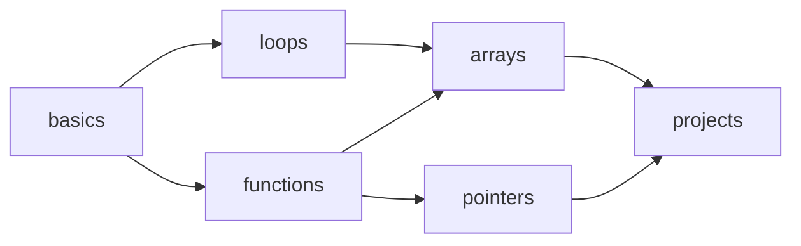
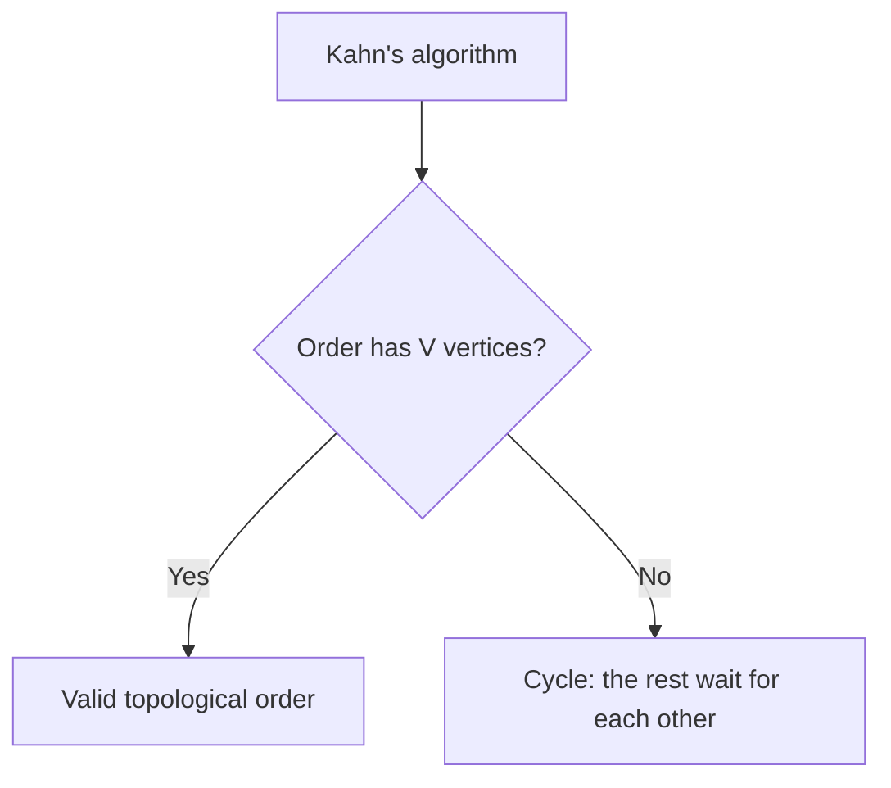
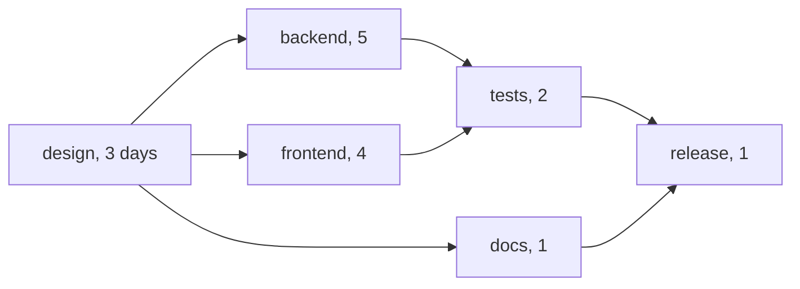

# new

## explanation

### Things that must come first

Before "arrays" you need "loops"; before "release" the tests must pass; before compiling a file, its headers must be built. These rules form a **directed graph**: an edge a → b means "a must come before b". A **topological order** lists every vertex so that all edges point forward, with each item after everything it depends on.

### Only without cycles

If a needs b and b needs a, no order works. A topological order exists exactly when the directed graph has **no cycle**. Such a graph is called a **DAG**, a directed acyclic graph.

### Kahn's algorithm

Count each vertex's **in-degree**: how many edges come into it, which is how many prerequisites it waits for.

1. Put every vertex with in-degree 0 in a queue: they're ready now.
2. Take a ready vertex u and append it to the order.
3. For each edge u → v, lower v's in-degree by one. If it reaches 0, v's last prerequisite is done, so push v.
4. Repeat until the queue is empty.

Each vertex and each edge is handled once: **O(V + E)**.

### Many correct answers

When several vertices are ready at once, any of them can go next, so a DAG usually has many topological orders. All are correct. If you need a particular one, such as the smallest number first, the choice of which ready vertex to take decides it.

## diagram



## example

```cpp
#include <iostream>
#include <queue>
#include <string>
#include <vector>

int main() {
    // Courses and prerequisites: an edge a -> b means "take a before b".
    std::vector<std::string> name = {"basics", "loops", "functions", "arrays", "pointers", "projects"};
    int edges[][2] = {{0, 1}, {0, 2}, {1, 3}, {2, 3}, {2, 4}, {3, 5}, {4, 5}};
    const int n = 6;
    std::vector<std::vector<int>> adj(n);
    std::vector<int> indegree(n, 0);  // how many prerequisites each course still waits for
    for (auto& e : edges) { adj[e[0]].push_back(e[1]); indegree[e[1]]++; }

    // Kahn's algorithm: start with courses that need nothing; finishing one may free others.
    std::queue<int> ready;
    for (int v = 0; v < n; v++) if (indegree[v] == 0) ready.push(v);
    std::vector<int> order;
    while (!ready.empty()) {
        int u = ready.front();
        ready.pop();
        order.push_back(u);
        for (int v : adj[u])
            if (--indegree[v] == 0) ready.push(v);  // its last prerequisite is done
    }
    for (std::size_t i = 0; i < order.size(); i++) std::cout << name[order[i]] << (i + 1 < order.size() ? " -> " : "\n");
}
```

```text
basics -> loops -> functions -> arrays -> pointers -> projects
```

1. Only "basics" has no prerequisites, so it starts the queue alone.
2. Taking "basics" drops "loops" and "functions" to in-degree 0, so both become ready.
3. "arrays" needs both "loops" and "functions", so it becomes ready only when the second of them is taken.
4. "projects" waits for "arrays" and "pointers", and comes last. Every edge in the graph points forward in this order.

## mistakes

- **Edges the wrong way round.** "a before b" must be a → b. Reversing them gives the order backwards.
- **Counting out-degree instead of in-degree.** Readiness depends on the edges coming *in*.
- **Pushing a vertex every time its in-degree drops.** Push it only when the count reaches exactly 0.
- **Assuming the answer is unique.** Several orders are usually valid; check that edges point forward, not that the order matches one expected list.
- **Forgetting vertices with no edges at all.** They have in-degree 0 and must still appear in the order.

## check

```cpp
#include <iostream>
#include <queue>
#include <vector>

int main() {
    std::vector<std::vector<int>> adj = {{3}, {0, 2}, {}, {2}, {1}};
    std::vector<int> indegree(5, 0);
    for (const auto& list : adj) for (int v : list) indegree[v]++;
    std::queue<int> ready;
    for (int v = 0; v < 5; v++) if (indegree[v] == 0) ready.push(v);
    int done = 0;
    while (!ready.empty()) {
        int u = ready.front();
        ready.pop();
        std::cout << u << (++done == 5 ? '\n' : ' ');
        for (int v : adj[u]) if (--indegree[v] == 0) ready.push(v);
    }
}
```

```text
4 1 0 3 2
```

Only 4 has no incoming edge, so it goes first. It frees 1, which frees 0; 2 still waits for 3. Then 0 frees 3, and 3 frees 2. Each vertex is printed only when everything pointing into it has been printed.

# building

## explanation

### A quick recap

A topological order lists a DAG's vertices so that every edge points forward. Kahn's algorithm repeatedly takes a vertex whose in-degree is 0 and lowers its successors' in-degrees, in O(V + E).

### Spotting an impossible order

If the graph has a cycle, the vertices on it each wait for another, so none of them ever reaches in-degree 0. Kahn's algorithm then stops early: the **order is shorter than V**. That one comparison is the cycle check, and the vertices left over are on or behind a cycle.

### Choosing among ready vertices

The queue picks ready vertices in the order they became ready. To get the **smallest-numbered** (or alphabetically first) valid order, use a min-heap instead. Each step takes the smallest ready vertex, which costs O((V + E) log V). This is how "the earliest valid order" questions are answered.

### The DFS way

Run DFS and add each vertex to a list when it **finishes**, after all the vertices it points to. A vertex therefore finishes after everything it leads to, so the **reversed** finish list is a topological order. This version doesn't need in-degrees, but it needs the three-state DFS to notice cycles, and it can't easily give the smallest order.

### Which to use

- Kahn's algorithm: an easy cycle check and a choice of order. It suits schedules and build systems.
- DFS finish order: short when DFS is already there, and it's the starting point for strongly connected components.

## diagram



## example

```cpp
#include <algorithm>
#include <functional>
#include <iostream>
#include <queue>
#include <vector>

using Graph = std::vector<std::vector<int>>;
// Kahn's algorithm with a min-heap: of all ready vertices, always take the smallest.
std::vector<int> smallestOrder(const Graph& g) {
    std::vector<int> indegree(g.size(), 0), order;
    for (const auto& list : g) for (int v : list) indegree[v]++;
    std::priority_queue<int, std::vector<int>, std::greater<int>> ready;
    for (std::size_t v = 0; v < g.size(); v++) if (indegree[v] == 0) ready.push((int)v);
    while (!ready.empty()) {
        int u = ready.top();
        ready.pop();
        order.push_back(u);
        for (int v : g[u]) if (--indegree[v] == 0) ready.push(v);
    }
    if (order.size() < g.size()) order.clear();  // some vertices never became ready: a cycle
    return order;
}
// A vertex is settled once everything it points to is settled; reading the settled list backwards is topological.
void settle(const Graph& g, std::vector<char>& done, std::vector<int>& settled, int v) {
    done[v] = 1;
    for (std::size_t i = 0; i < g[v].size(); i++)
        if (!done[g[v][i]]) settle(g, done, settled, g[v][i]);
    settled.push_back(v);
}
void print(const char* label, const std::vector<int>& order) {
    std::cout << label << (order.empty() ? " impossible" : "");
    for (int v : order) std::cout << ' ' << v;
    std::cout << '\n';
}
int main() {
    Graph g = {{}, {0}, {1}, {0}, {1, 3}, {2}};
    print("smallest first:", smallestOrder(g));
    std::vector<char> done(g.size(), 0);
    std::vector<int> settled;
    for (int v = 0; v < (int)g.size(); v++) if (!done[v]) settle(g, done, settled, v);
    print("by DFS finish:", std::vector<int>(settled.rbegin(), settled.rend()));
    g[0].push_back(4);
    print("with 0 -> 4:", smallestOrder(g));
}
```

```text
smallest first: 4 3 5 2 1 0
by DFS finish: 5 4 3 2 1 0
with 0 -> 4: impossible
```

1. 4 and 5 are ready at the start, and the heap takes 4. That frees 3, which is smaller than 5, so it goes next.
2. The DFS order is different but also valid: 5 → 2, 4 → 1, 4 → 3, 2 → 1, 1 → 0 and 3 → 0 all point forward.
3. Adding 0 → 4 closes the cycle 4 → 1 → 0 → 4. Only 5 and 2 ever become ready, the order is short of 6, and the function reports no order.

## mistakes

- **Returning a partial order as if it were complete.** Always compare the order's length with V; a shorter order means a cycle.
- **Not reversing the DFS finish list.** Unreversed, every edge points backwards.
- **A max-heap for "smallest first".** `std::priority_queue` is a max-heap by default; pass `std::greater<int>`.
- **Using the DFS order without cycle detection.** DFS finish order always produces *some* list, even for a cyclic graph. Check for cycles with the three states.
- **Expecting the min-heap order from a plain queue.** A queue gives *a* valid order, not the smallest one.

## check

```cpp
#include <iostream>
#include <queue>
#include <vector>

int main() {
    std::vector<std::vector<int>> adj = {{1, 4}, {2}, {3}, {1}, {}};
    std::vector<int> indegree(5, 0);
    for (const auto& list : adj) for (int v : list) indegree[v]++;
    std::queue<int> ready;
    for (int v = 0; v < 5; v++) if (indegree[v] == 0) ready.push(v);
    int done = 0;
    while (!ready.empty()) {
        int u = ready.front();
        ready.pop();
        done++;
        for (int v : adj[u]) if (--indegree[v] == 0) ready.push(v);
    }
    std::cout << done << ' ' << indegree[1] << ' ' << (done == 5) << '\n';
}
```

```text
2 1 0
```

1, 2 and 3 form the cycle 1 → 2 → 3 → 1. Kahn's algorithm takes 0, which frees 4, and then stops after 2 vertices. 1 still waits for the edge from 3, and the order is incomplete, so no topological order exists.

# strong

## explanation

### Dynamic programming on a DAG

In topological order, by the time you reach a vertex, every vertex with an edge into it has already been handled. So any value computed **from a vertex's predecessors** can be finished in one pass, O(V + E):

- **Longest path**: `best[v] = max(best[u] + w(u, v))` over edges u → v. In general graphs this is a famously hard problem, but on a DAG it's linear.
- **Counting paths**: `ways[v] = sum of ways[u]`. Counts grow exponentially, so they're often taken modulo a prime.
- **Shortest paths with negative edges**: the same pass with `min`, with no need for Bellman–Ford.

### Project scheduling: the critical path

Tasks take time, and edges say which must finish before others start. A task's **earliest start** is the latest finish among its prerequisites. That's the longest-path DP with task durations as weights. The project's length is the largest finish time, and the chain of tasks that sets it is the **critical path**. Delaying any task on it delays the whole project, while other tasks have slack. Record, for each task, which prerequisite decided its start, and walk back from the last task.

### Is the order unique?

If the ready queue ever holds two vertices at once, they could be swapped, so the order isn't unique. It's unique exactly when the queue holds one vertex at every step, meaning one path passes through every vertex.

### Numbered in order already

Some inputs number the vertices so that every edge goes from a smaller to a larger number. Then 0, 1, …, n − 1 is already a topological order, and the DP is a simple loop over the vertices.

## diagram



## example

```cpp
#include <iostream>
#include <string>
#include <vector>

// Tasks, their durations in days, and what each one waits for ("design must finish before backend starts").
std::vector<std::string> task = {"design", "backend", "frontend", "tests", "docs", "release"};
std::vector<int> days = {3, 5, 4, 2, 1, 1};
std::vector<std::vector<int>> needs = {{}, {0}, {0}, {1, 2}, {0}, {3, 4}};
std::vector<int> startDay(6, -1), decidedBy(6, -1);
std::vector<long long> chains(6, 0);  // how many dependency chains lead to each task

// Earliest start = the latest finish among the tasks it waits for. Memoised, so each task is worked out once;
// the recursion settles every prerequisite before the task itself, which is a topological order.
int earliest(int t) {
    if (startDay[t] != -1) return startDay[t];
    int day = 0;
    long long count = needs[t].empty() ? 1 : 0;
    for (int p : needs[t]) {
        int done = earliest(p) + days[p];
        if (done > day) { day = done; decidedBy[t] = p; }
        count += chains[p];
    }
    chains[t] = count;
    return startDay[t] = day;
}

int main() {
    const int last = 5;
    std::cout << "project takes " << earliest(last) + days[last] << " days; chains into release: " << chains[last] << '\n';
    std::vector<int> path;
    for (int t = last; t != -1; t = decidedBy[t]) path.push_back(t);
    std::cout << "critical path:";
    for (auto it = path.rbegin(); it != path.rend(); ++it) std::cout << ' ' << task[*it];
    std::cout << "\nstart days:";
    for (int t = 0; t < 6; t++) std::cout << ' ' << task[t] << '=' << earliest(t);
    std::cout << '\n';
}
```

```text
project takes 11 days; chains into release: 3
critical path: design backend tests release
start days: design=0 backend=3 frontend=3 tests=8 docs=3 release=10
```

1. Design takes days 0–3, so backend, frontend and docs can all start on day 3.
2. Tests wait for the later of backend (done on day 8) and frontend (day 7), so they start on day 8, and `decidedBy` records backend.
3. Release waits for tests (day 10) and docs (day 4), so it starts on day 10 and the project ends on day 11.
4. Walking back through `decidedBy` from release gives the critical path. Frontend has a day of slack, and docs has six.
5. Three chains lead to release: through backend, through frontend, and through docs.
6. Here each task *pulls* its start from what it waits for, instead of pushing finish times forward through a queue of ready tasks. Both compute the same longest-path DP.

## mistakes

- **Running the DP in input order.** A vertex's predecessors must all be final first; process in topological order.
- **Starting every vertex at 0 when the path must begin at one given vertex.** Then paths can "start" anywhere. Give unreached vertices −∞, and skip them when relaxing.
- **Path counts overflowing.** Counts double with each layer of a lattice-like DAG. Use modular arithmetic when asked.
- **Longest paths in a graph with cycles.** The DAG trick doesn't apply; going round a positive cycle makes paths arbitrarily long.
- **Forgetting durations in the critical path.** A task's start depends on its prerequisites' *finish* times: start + duration.

## check

```cpp
#include <algorithm>
#include <iostream>
#include <vector>

int main() {
    // Every edge goes from a smaller number to a larger one, so 0..5 is a topological order.
    std::vector<std::vector<int>> adj = {{1, 2}, {3, 4}, {3}, {5}, {5}, {}};
    std::vector<long long> ways(6, 0), longest(6, 0);
    ways[0] = 1;
    for (int u = 0; u < 6; u++)
        for (int v : adj[u]) {
            ways[v] += ways[u];
            longest[v] = std::max(longest[v], longest[u] + 1);
        }
    std::cout << ways[5] << ' ' << longest[5] << ' ' << ways[3] << '\n';
}
```

```text
3 3 2
```

The paths from 0 to 5 are 0-1-3-5, 0-2-3-5 and 0-1-4-5: 3 paths, each 3 edges long. Two of them pass through 3, which `ways[3] = 2` records: one through 1 and one through 2.
