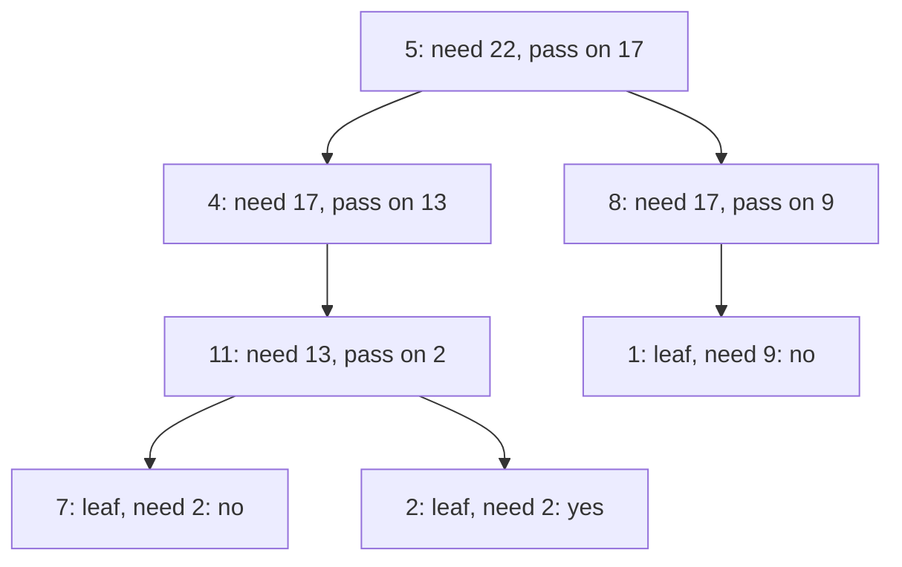
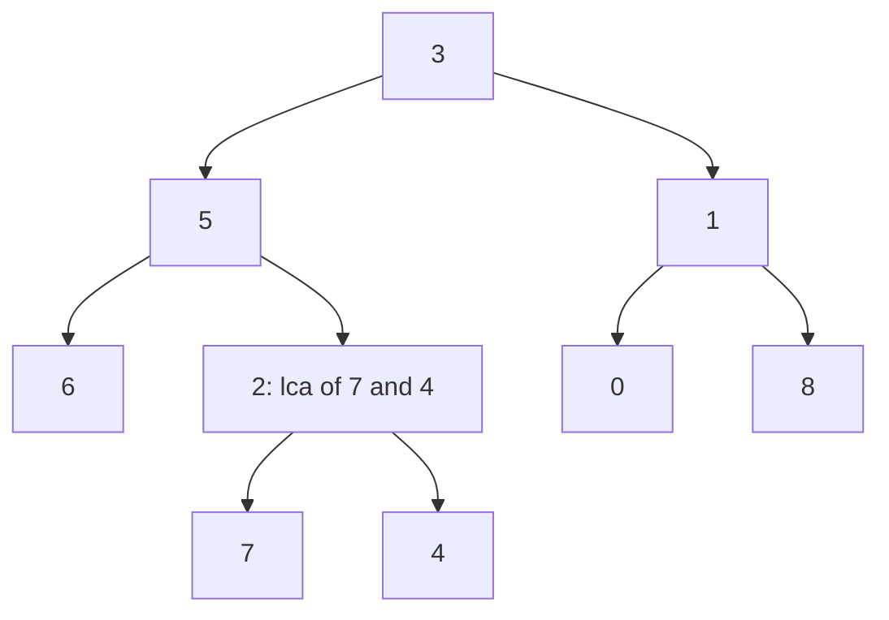
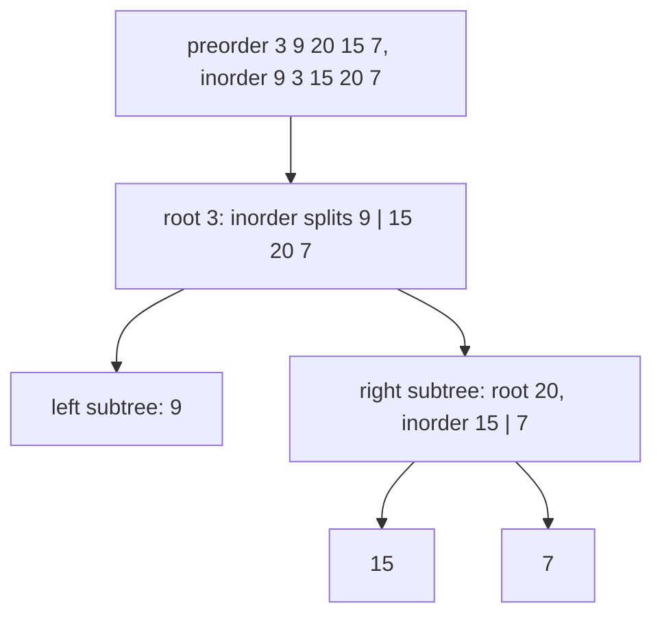

# new

## explanation

### Questions about a whole tree

Once you can walk a tree, many questions become a few lines of recursion: is there a root-to-leaf path with a given sum? Are two trees identical? What does the tree look like in a mirror? Each answers by asking the same question of the two subtrees and combining.

### Passing information down

Sometimes the subtrees need something from above. To check "is there a path from the root to a leaf adding up to 22?", subtract the current node's value and ask each subtree for a path adding up to **what's left**. At a leaf, the answer is whether what's left equals the leaf's value.

### Getting answers up

Other questions combine what the subtrees report: two trees are the same if their roots match **and** their left subtrees are the same **and** their right subtrees are the same. Return early with `&&` and `||` once the answer is known.

### Changing the tree

To mirror a tree, swap each node's left and right children, then mirror both subtrees. Every node is visited once: O(n).

### Getting the base cases right

- An empty tree (`nullptr`) is usually where recursion stops: what should it return?
- A **leaf** is a node with **no** children. A node with only one child is not a leaf, which matters for root-to-leaf questions.
- When comparing two trees, "both empty" means equal, and "only one empty" means different.

Every one of these runs in O(n), visiting each node once, with stack memory equal to the tree's height.

## diagram



## example

```cpp
#include <iostream>
#include <utility>

struct Node { int value; Node* left = nullptr; Node* right = nullptr; };

// Is there a path from the root down to a leaf whose values add up to target?
bool hasPathSum(const Node* n, int target) {
    if (!n) return false;
    if (!n->left && !n->right) return n->value == target;  // a leaf: is what's left exactly its value?
    return hasPathSum(n->left, target - n->value) || hasPathSum(n->right, target - n->value);
}

// Are two trees the same shape with the same values?
bool same(const Node* a, const Node* b) {
    if (!a || !b) return a == b;  // both empty: same; one empty: different
    return a->value == b->value && same(a->left, b->left) && same(a->right, b->right);
}

// Mirror image: swap every node's children.
void mirror(Node* n) {
    if (!n) return;
    std::swap(n->left, n->right);
    mirror(n->left);
    mirror(n->right);
}

int main() {
    Node l1{7}, l2{2}, l3{1};
    Node m{11, &l1, &l2}, k{4, &m}, r{8, nullptr, &l3};
    Node root{5, &k, &r};  // 5 -> 4 -> 11 -> {7, 2}; 5 -> 8 -> 1
    std::cout << hasPathSum(&root, 22) << hasPathSum(&root, 14) << hasPathSum(&root, 9) << '\n';
    std::cout << "same as itself: " << same(&root, &root);
    mirror(&root);
    std::cout << ", root's left is now " << root.left->value << ", 11's left is " << m.left->value << '\n';
}
```

```text
110
same as itself: 1, root's left is now 8, 11's left is 2
```

1. 5 + 4 + 11 + 2 = 22 and 5 + 8 + 1 = 14, so both sums exist. 9 is 5 + 4, but 4 isn't a leaf, so it doesn't count.
2. `same` compares values and recurses on both pairs of children; a tree is the same as itself.
3. `mirror` swaps children at every level, so the root's left child is now 8, and below 11 the 2 is now on the left.

## mistakes

- **Treating a one-child node as a leaf.** In root-to-leaf questions, a node with one child must continue down that child. Check that **both** children are null.
- **Returning true for an empty tree.** "Is there a path with sum 0 in an empty tree?" is no: there's no path at all. Decide this deliberately.
- **Comparing only values.** Two trees with the same values in different shapes aren't the same. Compare structure and values together.
- **Changing the target instead of passing it.** Subtracting from a shared variable without undoing it breaks the other branch. Pass the remaining target as a parameter.
- **Forgetting that mirroring changes the tree.** If you still need the original, mirror a copy.

## check

```cpp
#include <iostream>

struct Node { int value; Node* left = nullptr; Node* right = nullptr; };

int countAtDepth(const Node* n, int depth) {
    if (!n) return 0;
    if (depth == 0) return 1;
    return countAtDepth(n->left, depth - 1) + countAtDepth(n->right, depth - 1);
}

int main() {
    Node d{4}, e{5}, f{6}, b{2, &d, &e}, c{3, nullptr, &f}, a{1, &b, &c};
    std::cout << countAtDepth(&a, 1) << countAtDepth(&a, 2) << countAtDepth(&a, 3) << '\n';
}
```

```text
230
```

The depth passed down shrinks by one per level; a node counts when it reaches 0. One level below the root there are 2 nodes (2 and 3), two levels below there are 3 (4, 5 and 6), and there's nothing three levels down.

# building

## explanation

### A quick recap

Tree questions recurse: pass what the subtrees need down as parameters, and combine what they report on the way up. Handle the empty tree and leaves carefully.

### One pass, two answers

Some questions need two things from each subtree, such as its height **and** something about paths inside it. Computing height separately at every node repeats work: O(n²) on a skewed tree. Instead, have one function return the height while also updating the other answer:

- **Diameter** (the longest path between any two nodes): the longest path through a node uses the heights of both its subtrees, left height + right height edges. Record the best while returning the height.
- **Balanced** (every node's subtrees differ in height by at most 1): return the height, or −1 as a signal that some subtree below is already unbalanced, and pass the −1 straight up.

Both are O(n).

### Lowest common ancestor

The **lowest common ancestor** (LCA) of two nodes is the deepest node that has both below it, or is one of them. Recursively:

- If the current node is empty, or is one of the two, return it.
- Ask both subtrees.
- If **both** report something, the two nodes are on different sides, so this node is where their paths split: return it.
- Otherwise, return whichever side reported something.

This assumes both nodes are present in the tree.

### Maximum path sum

For "the largest sum on any path", each node returns the best path going **down** from it, but records the best path **through** it: its value plus the best non-negative downward paths of both children. Dropping negative branches (using 0 instead) lets a path stop early.

## diagram



## example

```cpp
#include <algorithm>
#include <cstdlib>
#include <iostream>

struct Node { int value; Node* left = nullptr; Node* right = nullptr; };

// Height (in nodes) that also updates the diameter: the longest path through n uses both sides' heights.
int heightAndDiameter(const Node* n, int& diameter) {
    if (!n) return 0;
    int l = heightAndDiameter(n->left, diameter), r = heightAndDiameter(n->right, diameter);
    diameter = std::max(diameter, l + r);  // edges on the path through n
    return 1 + std::max(l, r);
}

// Balanced: every node's subtrees differ in height by at most 1. Return -1 as soon as one doesn't.
int balancedHeight(const Node* n) {
    if (!n) return 0;
    int l = balancedHeight(n->left), r = balancedHeight(n->right);
    if (l < 0 || r < 0 || std::abs(l - r) > 1) return -1;
    return 1 + std::max(l, r);
}

// Lowest common ancestor: the deepest node with a and b in different subtrees (or being one of them).
const Node* lca(const Node* n, int a, int b) {
    if (!n || n->value == a || n->value == b) return n;
    const Node* l = lca(n->left, a, b);
    const Node* r = lca(n->right, a, b);
    if (l && r) return n;  // one on each side: n is where their paths split
    return l ? l : r;
}

int main() {
    Node n7{7}, n4{4}, n0{0}, n8{8};
    Node n2{2, &n7, &n4}, n6{6}, n5{5, &n6, &n2}, n1{1, &n0, &n8};
    Node root{3, &n5, &n1};
    int diameter = 0;
    heightAndDiameter(&root, diameter);
    std::cout << "diameter " << diameter << " edges, balanced " << (balancedHeight(&root) >= 0) << '\n';
    std::cout << "lca(7, 4) = " << lca(&root, 7, 4)->value << ", lca(6, 4) = " << lca(&root, 6, 4)->value
              << ", lca(5, 8) = " << lca(&root, 5, 8)->value << '\n';
}
```

```text
diameter 5 edges, balanced 1
lca(7, 4) = 2, lca(6, 4) = 5, lca(5, 8) = 3
```

1. The deepest paths below the root's left and right have 3 and 2 nodes, so the longest path through the root has 5 edges, from 7 up through 2, 5, 3 and 1 down to 0.
2. No node's two subtrees differ in height by more than 1, so the tree is balanced.
3. 7 and 4 are both children of 2, so their LCA is 2. 6 and 4 are on different sides of 5. 5 is itself one of the two nodes, and 8 is on the other side of the root, so their LCA is the root, 3.
4. All three functions visit each node once: O(n).

## mistakes

- **Calling a separate `height()` at every node.** Each call walks a whole subtree again, which is O(n²) on skewed trees. Return the height from the same pass.
- **Diameter in nodes versus edges.** `l + r` with heights counted in nodes gives edges on the path. Say which your answer counts.
- **LCA when a node might be missing.** The simple version returns the node it found even if the other isn't in the tree. Check that both exist when that's possible.
- **Letting negative branches into a maximum path.** A path doesn't have to reach a leaf; drop a branch whose best sum is negative.
- **Forgetting to pass the −1 up.** In the balance check, once any subtree is unbalanced, every ancestor must report −1 too.

## check

```cpp
#include <iostream>

struct Node { int value; Node* left = nullptr; Node* right = nullptr; };

// How many paths from the root down to a leaf add up to target?
int pathsTo(const Node* n, int target) {
    if (!n) return 0;
    target -= n->value;
    if (!n->left && !n->right) return target == 0;
    return pathsTo(n->left, target) + pathsTo(n->right, target);
}

int main() {
    Node a{0}, b{-2}, c{1}, g{11};
    Node d{3, &a, &b}, e{2, nullptr, &c}, h{3, nullptr, &g};
    Node f{5, &d, &e}, root{10, &f, &h};
    std::cout << pathsTo(&root, 18) << ' ' << pathsTo(&root, 24) << '\n';
}
```

```text
2 1
```

The root-to-leaf paths add up to 18 (10 → 5 → 3 → 0), 16 (10 → 5 → 3 → −2), 18 (10 → 5 → 2 → 1) and 24 (10 → 3 → 11), so two reach 18 and one reaches 24. 10 → 5 → 3 also adds up to 18, but it stops at a node with children, so it isn't counted: the check for zero happens only at leaves.

# strong

## explanation

### Many LCA queries: binary lifting

The recursive LCA costs O(n) per query. For many queries on a fixed tree, precompute **jumps**: `up[k][v]` is v's ancestor 2ᵏ levels above. `up[0]` is the parent, and `up[k][v] = up[k − 1][up[k − 1][v]]`: two jumps of 2ᵏ⁻¹. Building the table is O(n log n).

To answer LCA(a, b):

1. Lift the deeper node to the other's depth, jumping by the bits of the depth difference.
2. If they're now the same node, that's the answer.
3. Otherwise, for k from large to small, jump both up by 2ᵏ whenever that keeps them on **different** nodes. They end just below the LCA, so the answer is their parent.

Each query is O(log n). With depths, the **distance** between two nodes is depth(a) + depth(b) − 2 × depth(LCA).

### Rebuilding a tree from traversals

Preorder and inorder together determine a binary tree with distinct values. The first preorder value is the root; its position in the inorder sequence splits the rest into the left and right subtrees. Recurse on each part, taking roots from preorder in order. With a hash map from value to inorder position, the whole rebuild is O(n). (Preorder and postorder alone are not enough: a node with one child could have it on either side.)

### Other one-pass techniques

- **Rerooting**: compute a value for every node as if it were the root, in two passes instead of n.
- **Small-to-large merging**: when combining children's sets, add the smaller into the larger; each item moves O(log n) times.

## diagram



## example

```cpp
#include <iostream>
#include <utility>
#include <vector>

// Binary lifting: up[k][v] is v's ancestor 2^k levels up. Each LCA query then takes O(log n) jumps.
const int LOG = 4;
std::vector<std::vector<int>> children = {{1, 2}, {3, 4}, {5}, {6, 7}, {}, {8}, {}, {}, {9}, {}};
std::vector<int> depth(10);
std::vector<std::vector<int>> up(LOG, std::vector<int>(10));

void dfs(int v, int parent, int d) {
    depth[v] = d;
    up[0][v] = parent;
    for (int c : children[v]) dfs(c, v, d + 1);
}

int lca(int a, int b) {
    if (depth[a] < depth[b]) std::swap(a, b);
    for (int k = LOG - 1; k >= 0; k--)  // lift a to b's depth
        if (depth[a] - (1 << k) >= depth[b]) a = up[k][a];
    if (a == b) return a;
    for (int k = LOG - 1; k >= 0; k--)  // lift both while they stay apart
        if (up[k][a] != up[k][b]) { a = up[k][a]; b = up[k][b]; }
    return up[0][a];
}

int main() {
    dfs(0, 0, 0);  // the root is its own parent, so jumps past the top stay at the root
    for (int k = 1; k < LOG; k++)
        for (int v = 0; v < 10; v++) up[k][v] = up[k - 1][up[k - 1][v]];
    for (auto [a, b] : std::vector<std::pair<int, int>>{{6, 7}, {6, 4}, {9, 7}, {8, 2}}) {
        int c = lca(a, b);
        std::cout << "lca(" << a << "," << b << ")=" << c << " distance " << depth[a] + depth[b] - 2 * depth[c] << '\n';
    }
}
```

```text
lca(6,7)=3 distance 2
lca(6,4)=1 distance 3
lca(9,7)=0 distance 7
lca(8,2)=2 distance 2
```

1. One DFS records every node's depth and parent; the table then fills in jumps of 2, 4 and 8 levels from the parents.
2. For (9, 7), node 9 is first lifted from depth 4 to depth 3 (to node 8); then both jump while they differ, ending at 2 and 1, whose parent, 0, is the LCA. The path between them has 7 edges.
3. For (8, 2), lifting 8 two levels lands exactly on 2, so 2 is the LCA.
4. Each query takes a few jumps instead of walking the tree.

## mistakes

- **Making the root's parent −1 in the table.** Jumps past the top would then index with −1. Make the root its own parent.
- **Too few levels.** `LOG` must satisfy 2^LOG > the tree's height. For 10⁵ nodes, use 17 or more.
- **Lifting by the wrong amount.** Jump the deeper node by exactly the depth difference, using its binary digits from largest to smallest.
- **Rebuilding from traversals with duplicate values.** If values repeat, the inorder position of a root is ambiguous. Use distinct ids.
- **Using the O(n) recursive LCA for many queries.** Q queries cost O(nQ). Precompute jumps once instead.

## check

```cpp
#include <iostream>
#include <unordered_map>
#include <vector>

std::vector<int> pre = {3, 9, 20, 15, 7}, in = {9, 3, 15, 20, 7};
std::unordered_map<int, int> where;  // value -> its index in inorder
int nextRoot = 0;
void postorder(int lo, int hi) {  // the subtree whose inorder range is [lo, hi)
    if (lo >= hi) return;
    int root = pre[nextRoot++], mid = where[root];  // the next preorder value is this subtree's root
    postorder(lo, mid);
    postorder(mid + 1, hi);
    std::cout << root << ' ';
}
int main() {
    for (int i = 0; i < 5; i++) where[in[i]] = i;
    postorder(0, 5);
    std::cout << '\n';
}
```

```text
9 15 7 20 3
```

3 is the root, splitting inorder into 9 on the left and 15 20 7 on the right. The next preorder value, 9, is the left subtree's root; then 20 roots the right subtree, with 15 and 7 as its children. Printing each root after its two subtrees gives the postorder: 9 15 7 20 3.
