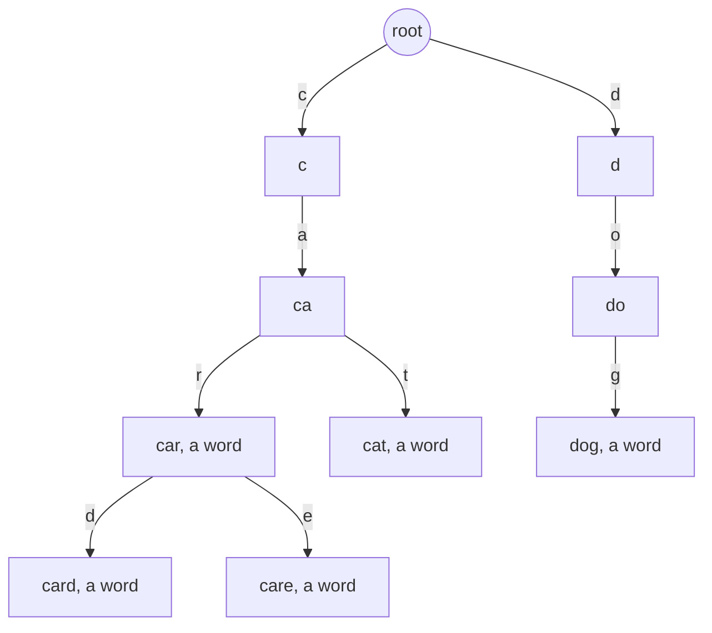
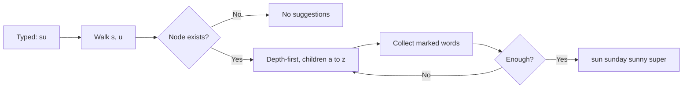
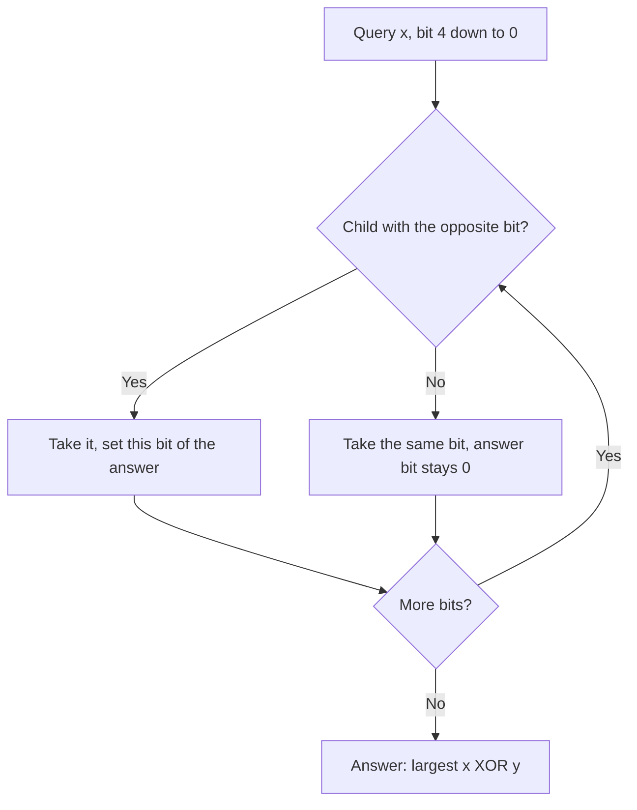

# new

## explanation

### Words that share a beginning

"car", "card", "care" and "cat" all start with "ca". A **trie** (also called a prefix tree) stores each shared beginning only once. It's a tree where each edge is a letter, and the path from the root to a node spells a **prefix**. A node is marked when the path to it is a complete word.

### Looking a word up

Start at the root and follow one edge per letter. If an edge is missing, the word isn't there. If you reach the end, check the mark: "ca" is a path in the trie but not a word, while "car" is both.

The cost is **O(L)** for a word of length L, no matter how many words are stored. A sorted list or a search tree compares whole strings, about log n times.

### Inserting

Walk the word letter by letter, creating any missing child along the way, and mark the last node. Inserting "card" after "car" adds just one node, for the "d".

### Asking about a prefix

"Is any stored word starting with 'ca'?" is the same walk without checking the mark: if the path exists, some word continues from it. This is what tries are best at, and what a hash set can't do.

### Storing the children

For lowercase English words, each node can keep an array of 26 child slots indexed by `letter - 'a'`. It's fast and simple, at the cost of memory for slots that stay empty. Keeping all nodes in one `std::vector` and linking them by index avoids raw pointers and manual `delete`.

## diagram



## example

```cpp
#include <array>
#include <iostream>
#include <string>
#include <vector>

// A trie for lowercase words. Node 0 is the root; next[c] is the child for letter c, 0 meaning none.
struct Trie {
    struct Node { std::array<int, 26> next{}; bool word = false; };
    std::vector<Node> nodes = {Node{}};

    void insert(const std::string& w) {
        int at = 0;
        for (char ch : w) {
            int c = ch - 'a';
            if (!nodes[at].next[c]) { nodes[at].next[c] = (int)nodes.size(); nodes.push_back({}); }
            at = nodes[at].next[c];
        }
        nodes[at].word = true;  // mark where a whole word ends
    }
    int walk(const std::string& s) const {  // the node spelled by s, or -1 if the path breaks off
        int at = 0;
        for (char ch : s)
            if (!(at = nodes[at].next[ch - 'a'])) return -1;
        return at;
    }
    bool contains(const std::string& w) const { int at = walk(w); return at >= 0 && nodes[at].word; }
    bool hasPrefix(const std::string& p) const { return walk(p) >= 0; }
};

int main() {
    Trie t;
    for (std::string w : {"car", "card", "care", "cat", "dog"}) t.insert(w);
    std::cout << std::boolalpha;
    for (std::string q : {"car", "ca", "cards", "dog"})
        std::cout << q << ": word " << t.contains(q) << ", prefix " << t.hasPrefix(q) << '\n';
    std::cout << "nodes: " << t.nodes.size() << '\n';
}
```

```text
car: word true, prefix true
ca: word false, prefix true
cards: word false, prefix false
dog: word true, prefix true
nodes: 10
```

1. "car", "card", "care" and "cat" share the nodes for "c" and "ca"; only the endings get new nodes.
2. "ca" is a path but not marked, so it's a prefix and not a word.
3. "cards" breaks off after "card" because there's no "s" child, so it's neither.
4. Five words with 18 letters in total need only 9 nodes plus the root.

## mistakes

- **Forgetting the end mark.** Without it, "ca" would count as a word just because "car" passes through it.
- **Treating a prefix check as a word check.** `hasPrefix` only needs the path; `contains` also needs the mark at the end.
- **Indexing with letters outside 'a' to 'z'.** Capitals, digits or spaces give an index outside the 26 slots. Convert or validate the input first, or use a larger alphabet.
- **Holding a reference to a node while adding nodes.** `push_back` can move the whole vector, so a `Node&` taken before it may dangle. Keep indexes, not references.
- **Using a trie for exact lookups only.** If you never ask about prefixes, a hash set is simpler.

## check

```cpp
#include <iostream>
#include <set>
#include <string>

int main() {
    std::set<std::string> prefixes;
    for (std::string w : {"tea", "ten", "to", "in", "inn"})
        for (std::size_t len = 1; len <= w.size(); len++) prefixes.insert(w.substr(0, len));
    std::cout << prefixes.size() + 1 << ' ' << prefixes.count("te") << ' ' << prefixes.count("tn") << '\n';
}
```

```text
9 1 0
```

Every trie node except the root stands for exactly one distinct prefix. The distinct prefixes are t, te, tea, ten, to, i, in and inn: 8, so a trie for these words has 9 nodes with the root. "te" is a prefix and "tn" isn't.

# building

## explanation

### A quick recap

A trie stores words as paths of letters from a root, sharing common beginnings. Lookups, inserts and prefix checks each walk one node per letter: O(L).

### Counting words with a prefix

Give every node a counter, `pass`, of how many inserted words go through it. When inserting, add one to each node on the path. Then "how many words start with 'sun'?" is just: walk to the node for "sun" and read its counter. That's O(L), however many words match.

### Autocomplete

To suggest completions for what a user has typed so far:

1. Walk to the node for the typed prefix. If it's missing, there are no suggestions.
2. From there, search depth-first, trying the children in letter order and adding each marked node's word to the list.
3. Stop as soon as you have enough suggestions.

Trying children from 'a' to 'z' produces the words in alphabetical order, with no sorting. A real system would rank suggestions by popularity instead, for example by storing at each node the best few words below it.

### When a sorted array is enough

If the word list never changes, sort it once. All words starting with a prefix p then sit next to each other, so two binary searches find the whole block. A trie earns its place when words keep arriving, or when you walk letter by letter as someone types.

## diagram



## example

```cpp
#include <array>
#include <iostream>
#include <string>
#include <vector>

struct Trie {
    struct Node { std::array<int, 26> next{}; int pass = 0; bool word = false; };
    std::vector<Node> nodes = {Node{}};
    void insert(const std::string& w) {
        int at = 0;
        for (char ch : w) {
            int c = ch - 'a';
            if (!nodes[at].next[c]) { nodes[at].next[c] = (int)nodes.size(); nodes.push_back({}); }
            at = nodes[at].next[c];
            nodes[at].pass++;  // one more word goes through this node
        }
        nodes[at].word = true;
    }
    int walk(const std::string& p, int at = 0) const {
        for (char ch : p) if (!(at = nodes[at].next[ch - 'a'])) return -1;
        return at;
    }
    int countPrefix(const std::string& p) const { int at = walk(p); return at < 0 ? 0 : nodes[at].pass; }
    // Depth-first in letter order, so the words come out alphabetically; stop at the limit.
    void collect(int at, std::string& w, std::vector<std::string>& out, std::size_t limit) const {
        if (out.size() == limit) return;
        if (nodes[at].word) out.push_back(w);
        for (int c = 0; c < 26; c++) if (nodes[at].next[c]) {
            w.push_back(char('a' + c));
            collect(nodes[at].next[c], w, out, limit);
            w.pop_back();
        }
    }
};
int main() {
    Trie t;
    for (std::string w : {"sun", "sunday", "sunny", "super", "sure", "sea"}) t.insert(w);
    std::cout << "su: " << t.countPrefix("su") << ", sun: " << t.countPrefix("sun") << ", x: " << t.countPrefix("x") << "\nsuggest:";
    std::string typed = "su";
    std::vector<std::string> out;
    if (int at = t.walk(typed); at >= 0) t.collect(at, typed, out, 4);
    for (const auto& w : out) std::cout << ' ' << w;
    std::cout << '\n';
}
```

```text
su: 5, sun: 3, x: 0
suggest: sun sunday sunny super
```

1. Five words pass through the "su" node and three through "sun", so the counters answer both questions after one short walk each.
2. "x" has no node at all, so the count is 0.
3. Autocomplete starts at "su" and visits the children n, p and r in that order. It finds "sun", then "sunday" and "sunny" below it, then "super", and stops at the limit of 4 before reaching "sure".

## mistakes

- **Counting a repeated word twice.** Inserting "sun" twice adds 2 to every counter on its path. If duplicates shouldn't count, check `contains` before inserting.
- **Updating only the last node's counter.** The prefix count needs every node on the path updated, not just the node where the word ends.
- **Collecting the whole subtree before trimming.** With a short prefix such as "a", that's most of the dictionary. Stop as soon as you have enough suggestions.
- **Forgetting to undo the letter on the way back.** In the depth-first search, every `push_back` needs a matching `pop_back`, or later words get stray letters.
- **A trie for a list that never changes.** A sorted array with two binary searches answers prefix questions with far less memory.

## check

```cpp
#include <algorithm>
#include <iostream>
#include <string>
#include <vector>

int main() {
    std::vector<std::string> words = {"bat", "ball", "band", "bandit", "can", "banana"};
    std::sort(words.begin(), words.end());
    std::string p = "ban";
    auto first = std::lower_bound(words.begin(), words.end(), p);
    auto last = std::lower_bound(words.begin(), words.end(), p + '{');  // '{' comes right after 'z'
    std::cout << last - first << ' ' << *first << '\n';
}
```

```text
3 banana
```

Sorted, the list is ball, banana, band, bandit, bat, can. Every word starting with "ban" sits in one block, from the first word not less than "ban" up to the first word not less than "ban{". That block is banana, band and bandit: 3 words, starting with banana.

# strong

## explanation

### Cost in time and memory

Every operation is O(L) in the length of the word, however many words are stored. The price is memory: with 26 slots per node, a trie of 100,000 random words can use far more than the words themselves. Ways to cut it down:

- **Map or sorted children.** Store only the children that exist, in a small sorted array or a `std::map`, trading some speed for memory.
- **Compressed (radix) tries.** Merge chains of single-child nodes into one edge labelled with a whole string. The node count becomes at most twice the number of words.
- **Arrays in one pool.** Keeping all nodes in one vector and linking them by index, as in these examples, is faster and safer than allocating each node with `new`.

### Deleting words

With the `pass` counters, deleting a word is: walk its path, subtract one from each counter, and clear the end mark. A node whose counter reaches 0 can be unlinked from its parent. Check first that the word is really there, or the counters go wrong.

### Binary tries for XOR problems

A trie can store numbers as strings of bits, highest bit first, with two children per node. To find the inserted y that makes x XOR y as large as possible, walk from the top bit down and, at each bit, take the child with the **opposite** bit to x's whenever it exists. A higher bit is worth more than all the lower bits together, so this greedy choice is right. Each query is O(bits). This answers "the largest XOR of any pair" in O(n · bits) instead of O(n²).

### Other uses

- Longest common prefix of a set of words: the path until the first node with more than one child or an end mark.
- Matching many patterns in one text: a trie of the patterns plus failure links (the Aho–Corasick automaton).
- Routing tables: the longest matching prefix of an address.

## diagram



## example

```cpp
#include <algorithm>
#include <array>
#include <iostream>
#include <random>
#include <vector>

// A binary trie over 30-bit numbers, highest bit first. To maximise x ^ y, take the opposite bit when you can.
struct XorTrie {
    static constexpr int BITS = 30;
    std::vector<std::array<int, 2>> next = {{0, 0}};
    void insert(int x) {
        int at = 0;
        for (int b = BITS - 1; b >= 0; b--) {
            int bit = x >> b & 1;
            if (!next[at][bit]) { next[at][bit] = (int)next.size(); next.push_back({0, 0}); }
            at = next[at][bit];
        }
    }
    int bestXor(int x) const {
        int at = 0, result = 0;
        for (int b = BITS - 1; b >= 0; b--) {
            int want = (x >> b & 1) ^ 1;
            if (next[at][want]) { result |= 1 << b; at = next[at][want]; }
            else at = next[at][want ^ 1];
        }
        return result;
    }
};
int maxPairXor(const std::vector<int>& a) {  // each number meets all the ones before it
    XorTrie t;
    int best = 0;
    for (int x : a) { best = std::max(best, t.bestXor(x)); t.insert(x); }
    return best;
}
int main() {
    std::cout << "3 10 5 25 2 8 -> " << maxPairXor({3, 10, 5, 25, 2, 8}) << '\n';
    std::vector<int> a(2000);
    std::mt19937 rng(7);
    for (int& x : a) x = rng() % 1000000000;
    int brute = 0;
    for (std::size_t i = 0; i < a.size(); i++)
        for (std::size_t j = i + 1; j < a.size(); j++) brute = std::max(brute, a[i] ^ a[j]);
    std::cout << "2000 random numbers: trie " << maxPairXor(a) << ", brute force " << brute << '\n';
}
```

```text
3 10 5 25 2 8 -> 28
2000 random numbers: trie 1073741664, brute force 1073741664
```

1. For each number, the trie already holds all the earlier ones, so every pair is checked once, from its later member. The first query meets an empty trie: every missing child is 0, the root, so it just returns 0.
2. 5 is 00101 and 25 is 11001; they differ in the bits worth 16, 8 and 4, so 5 XOR 25 = 28, the largest pair.
3. On 2000 random numbers, the trie does 2000 walks of 30 steps, while the brute force tries about 2 million pairs, and both give the same answer.

## mistakes

- **Walking from the lowest bit.** The greedy choice is only right from the top: a higher bit outweighs all lower ones together.
- **Too few bits.** If numbers can reach 2³⁰, 30 levels miss the top bit. Size the trie for the largest value.
- **Overflowing with 31 bits.** `1 << 31` overflows an `int`. For values that need the top bit, use `unsigned` or 64-bit numbers.
- **Deleting a word that isn't there.** Decrementing counters along a missing path corrupts them. Check `contains` first.
- **Ignoring memory.** 26 slots of 4 bytes per node add up fast; for large or sparse alphabets use map children or a compressed trie.

## check

```cpp
#include <iostream>
#include <set>
#include <vector>

int main() {
    std::vector<int> a = {6, 20, 9, 17};
    int best = 0;
    for (int b = 4; b >= 0; b--) {
        std::set<int> prefixes;
        for (int x : a) prefixes.insert(x >> b);
        int candidate = best << 1 | 1;  // try to also set this bit
        bool found = false;
        for (int p : prefixes) if (prefixes.count(p ^ candidate)) found = true;
        best = found ? candidate : best << 1;
    }
    std::cout << best << '\n';
}
```

```text
29
```

This is the same top-down greedy as the binary trie, done with sets of prefixes: at each bit it keeps the 1 if two numbers' prefixes XOR to the candidate. The best pair is 20 (10100) and 9 (01001), which differ in every bit except the one worth 2: 16 + 8 + 4 + 1 = 29.
