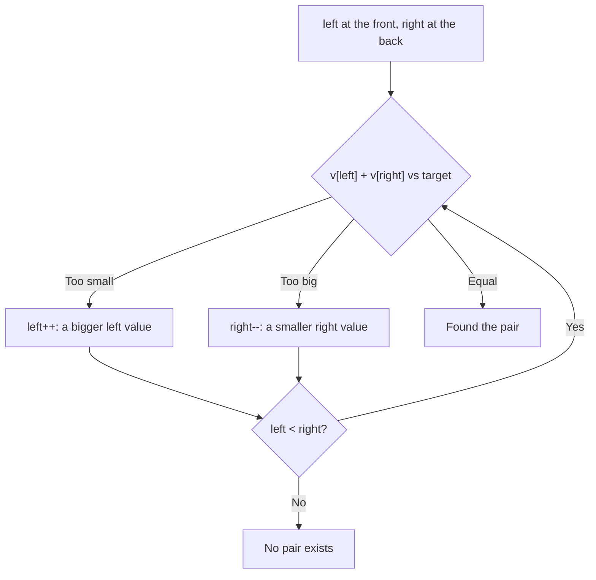
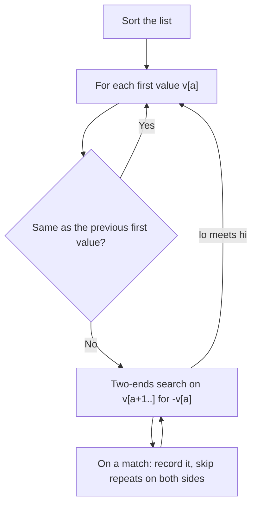
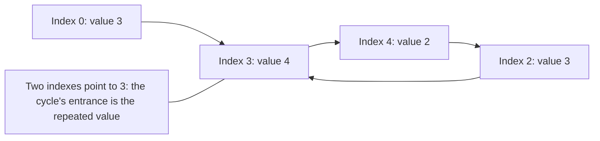

# new

## explanation

### Two positions instead of one

Many list problems become easy if you keep **two** indexes and move them cleverly, instead of trying every pair with nested loops. There are two common shapes.

### Shape 1: from both ends

In a **sorted** list, to find two items that add up to a target, start one index at the front (`left`) and one at the back (`right`):

- If the sum is too small, move `left` right: that's the only way to make it bigger.
- If the sum is too big, move `right` left: that's the only way to make it smaller.
- If it's just right, you've found the pair.

Each step moves one index, so it takes at most n steps: O(n), instead of O(n²) for checking every pair.

### Shape 2: same direction, different speeds

A **read** index visits every item, and a **write** index marks where the next kept item goes. To remove repeats from a sorted list in place, copy an item to `write` only when it differs from the last kept one. The list shrinks into its front part, with no second list needed: O(n) time, O(1) extra memory.

### Other everyday uses

- Reversing a list: swap `v[left]` and `v[right]`, then move both towards the middle.
- Merging two sorted lists: one index in each.
- Checking a palindrome: compare from both ends.

### What it needs

The "both ends" shape works because the list is **sorted**: moving `left` always increases the sum, and moving `right` always decreases it. On an unsorted list that reasoning fails, so sort first, or use a hash set instead.

## diagram



## example

```cpp
#include <iostream>
#include <vector>

int main() {
    // Two ends: does any pair in a sorted list add up to the target?
    std::vector<int> prices = {120, 250, 300, 410, 560, 680};
    int budget = 860;
    std::size_t left = 0, right = prices.size() - 1;
    while (left < right) {
        int total = prices[left] + prices[right];
        if (total == budget) break;
        if (total > budget) right--;  // too much: move the big end down
        else left++;                  // need more: move the small end up
    }
    if (left < right) std::cout << prices[left] << " + " << prices[right] << " = " << budget << '\n';

    // Same direction: remove repeats from a sorted list in place.
    std::vector<int> ids = {3, 3, 5, 8, 8, 8, 9};
    std::size_t write = 0;  // ids[0..write) holds the kept values
    for (std::size_t read = 0; read < ids.size(); read++)
        if (write == 0 || ids[read] != ids[write - 1]) ids[write++] = ids[read];
    ids.resize(write);
    for (int x : ids) std::cout << x << ' ';
    std::cout << '\n';
}
```

```text
300 + 560 = 860
3 5 8 9
```

1. 120 + 680 = 800 is too small, so `left` moves to 250. 250 + 680 = 930 is too big, so `right` moves to 560.
2. 250 + 560 = 810 is still too small, so `left` moves to 300, and 300 + 560 = 860. Four checks instead of up to 15 pairs.
3. The second loop reads every id. It writes one only if it differs from the last value written, so each run of repeats keeps one copy.
4. `resize(write)` cuts off the leftover tail, leaving 3 5 8 9.

## mistakes

- **Using both ends on unsorted data.** The rule "move `left` to increase the sum" only holds when the list is sorted. Sort first.
- **`left <= right` in a pair search.** When `left == right`, both indexes point at the same item, which would count it twice. Stop at `left < right`.
- **`size() - 1` on an empty vector.** It wraps around to a huge number with `std::size_t`. Check for an empty list first.
- **Forgetting to shrink.** After the write-index loop, everything from `write` on is leftover. Call `resize(write)`, or remember the new length.
- **Moving the wrong index.** If the sum is too big, moving `left` right makes it even bigger. Write down which move makes the sum smaller before coding.

## check

```cpp
#include <iostream>
#include <utility>
#include <vector>

int main() {
    std::vector<int> v = {1, 2, 3, 4, 5, 6};
    std::size_t i = 0, j = v.size() - 1;
    int steps = 0;
    while (i < j) {
        std::swap(v[i], v[j]);
        i++; j--; steps++;
    }
    std::cout << v[0] << v[1] << v[5] << ' ' << steps << '\n';
}
```

```text
651 3
```

The two indexes swap the outer pair, then step inward: (1, 6), then (2, 5), then (3, 4). After three swaps they cross, and the list is reversed: 6 5 4 3 2 1. Positions 0, 1 and 5 now hold 6, 5 and 1.

# building

## explanation

### A quick recap

Two indexes replace nested loops. From both ends on a sorted list, each step discards one item that can't be part of the answer. In the same direction, a read index scans while a write index builds the result in place.

### Why the two-ends search never misses a pair

When `v[lo] + v[hi]` is too big, every pair using `v[hi]` with any index from `lo` up is at least as big, because the list is sorted. So `v[hi]` can't be in any answer, and dropping it is safe. The same argument drops `v[lo]` when the sum is too small. Each step removes one item for good, which is why n steps are enough.

### Three values: fix one, two-pointer the rest

To find triplets that sum to zero, sort the list, then for each first value `v[a]`, run the two-ends search on the part after it, looking for `−v[a]`. That's n searches of O(n): O(n²) instead of O(n³).

To avoid printing the same triplet twice:

- skip a first value equal to the previous one;
- after a match, move `lo` past its repeats and `hi` past its repeats.

### Partitioning in place

With a read index and a write index, you can move every item that passes a test to the front, keeping their order, in one pass. Swapping instead of copying keeps the other items in the list too, so nothing is lost, for example moving every non-zero value to the front and every zero to the back.

### Merging

Merging two sorted lists is two indexes, one per list, taking the smaller front item each time, as in merge sort. When one list runs out, take the rest of the other.

### Step by step

1. Ask whether the list is, or can be, sorted. If so, the both-ends shape may apply.
2. Write down what moving each index does to the quantity you're tracking.
3. Make sure every move discards something that can't be in the answer.
4. Handle repeats explicitly if the answer must not contain duplicates.

## diagram



## example

```cpp
#include <algorithm>
#include <iostream>
#include <utility>
#include <vector>

// All distinct triplets summing to zero: fix one value, two-pointer the rest. O(n^2).
int zeroTriplets(std::vector<int> v) {
    std::sort(v.begin(), v.end());
    int found = 0;
    for (std::size_t a = 0; a + 2 < v.size(); a++) {
        if (a > 0 && v[a] == v[a - 1]) continue;  // same first value: same triplets
        std::size_t lo = a + 1, hi = v.size() - 1;
        while (lo < hi) {
            int sum = v[a] + v[lo] + v[hi];
            if (sum < 0) lo++;
            else if (sum > 0) hi--;
            else {
                std::cout << v[a] << ' ' << v[lo] << ' ' << v[hi] << '\n';
                found++;
                while (lo < hi && v[lo] == v[lo + 1]) lo++;  // skip repeats
                while (lo < hi && v[hi] == v[hi - 1]) hi--;
                lo++;
                hi--;
            }
        }
    }
    return found;
}

int main() {
    std::cout << zeroTriplets({-1, 0, 1, 2, -1, -4, 2, -2}) << " triplets\n";

    // Partition in place: non-zero values to the front in their order, zeros to the end.
    std::vector<int> v = {0, 7, 0, 3, 12, 0, 5};
    std::size_t write = 0;
    for (std::size_t read = 0; read < v.size(); read++)
        if (v[read] != 0) std::swap(v[write++], v[read]);
    for (int x : v) std::cout << x << ' ';
    std::cout << '\n';
}
```

```text
-4 2 2
-2 0 2
-1 -1 2
-1 0 1
4 triplets
7 3 12 5 0 0 0
```

1. Sorted, the list is −4 −2 −1 −1 0 1 2 2. With −4 fixed, the search finds 2 + 2.
2. With −2 fixed, it finds 0 + 2. With the first −1 fixed, it finds −1 + 2, skips the repeated 2, then finds 0 + 1.
3. The second −1 is skipped as a first value, so −1 −1 2 isn't printed twice.
4. In the partition, each non-zero value swaps forward to `write`. Their order is kept, and the zeros collect at the end.

## mistakes

- **Duplicate answers.** Without skipping repeated first values and repeated `lo`/`hi` values after a match, the same triplet is reported several times.
- **Forgetting to sort.** The triplet method relies on the two-ends search, which needs sorted data.
- **Moving only one index after a match.** If only `lo` moves, the search may find the same `hi` again with a repeated value. Move both after recording.
- **Overflow in the sum.** Three values near 2 × 10⁹ overflow an `int`. Use `long long` for the sum when values are large.
- **Copying instead of swapping in a partition.** Copying overwrites the items you skip. If they're needed afterwards, swap.

## check

```cpp
#include <iostream>
#include <vector>

int main() {
    std::vector<int> a = {1, 4, 9}, b = {2, 3, 10, 12};
    std::vector<int> out;
    std::size_t i = 0, j = 0;
    while (i < a.size() || j < b.size()) {
        if (j == b.size() || (i < a.size() && a[i] <= b[j])) out.push_back(a[i++]);
        else out.push_back(b[j++]);
    }
    std::cout << out[2] << ' ' << out[4] << ' ' << out.size() << '\n';
}
```

```text
3 9 7
```

One index per list, always taking the smaller front item; once `b` runs out or `a` is smaller, it takes from `a`. The merged list is 1 2 3 4 9 10 12: position 2 holds 3, position 4 holds 9, and all 7 items are there.

# strong

## explanation

### Counting pairs, not just finding one

In a sorted list, if `v[left] + v[right] < k`, then `v[left]` pairs with **every** index from `left + 1` to `right`, because those values are all at most `v[right]`. Add `right − left` at once and move `left`. Otherwise drop `right`. This counts all pairs with sum below k in O(n), even though there can be O(n²) of them.

### Moving the side that limits you

Two problems with the same shape:

- **Most water between two lines**: the area is width × the shorter height. Moving the taller line inward can only shrink the width without raising the limit, so always move the **shorter** one.
- **Trapped rainwater**: the water above a bar is set by the smaller of the tallest bars to its left and to its right. Walking inward from the lower side, that side's running maximum is already the limiting one, so its water can be added immediately. O(n) time, O(1) memory.

### Fast and slow pointers

Two indexes moving at different **speeds** detect cycles. Floyd's algorithm moves `slow` one step and `fast` two steps; if there's a cycle, they meet inside it. Resetting one to the start and moving both one step at a time makes them meet at the cycle's entrance.

That applies to more than linked lists: in a list of n + 1 values from 1 to n, treat each value as a pointer to an index. Some value appears twice, so two indexes point at the same place, which creates a cycle whose entrance is the repeated value. This finds the repeat in O(n) time and O(1) memory, without changing the list.

### When two pointers don't apply

The method needs a reason each move is safe: sorted order, or a monotone quantity like a window sum of non-negative values. With negative numbers, sums don't grow monotonically, and prefix sums with a hash map are the tool instead.

## diagram



## example

```cpp
#include <algorithm>
#include <iostream>
#include <vector>

// How many pairs i < j in a sorted list have v[i] + v[j] < k? Each step counts a whole block.
long long pairsBelow(const std::vector<int>& v, int k) {
    long long count = 0;
    std::size_t left = 0, right = v.size() - 1;
    while (left < right) {
        if (v[left] + v[right] < k) count += right - left++;  // v[left] pairs with every index left+1..right
        else right--;
    }
    return count;
}

// Water trapped between bars: move the lower side inward; its level is set by its own running max.
int trappedWater(const std::vector<int>& h) {
    std::size_t left = 0, right = h.size() - 1;
    int leftMax = 0, rightMax = 0, water = 0;
    while (left < right) {
        if (h[left] < h[right]) {
            leftMax = std::max(leftMax, h[left]);
            water += leftMax - h[left++];
        } else {
            rightMax = std::max(rightMax, h[right]);
            water += rightMax - h[right--];
        }
    }
    return water;
}

// n + 1 values in 1..n: each value points to an index; the repeat is where the cycle starts.
int findRepeat(const std::vector<int>& v) {
    int slow = v[0], fast = v[v[0]];
    while (slow != fast) { slow = v[slow]; fast = v[v[fast]]; }
    slow = 0;
    while (slow != fast) { slow = v[slow]; fast = v[fast]; }
    return slow;
}

int main() {
    std::cout << pairsBelow({1, 2, 3, 5, 8}, 7) << ' ' << trappedWater({0, 1, 0, 2, 1, 0, 1, 3, 2, 1, 2, 1}) << ' '
              << findRepeat({3, 1, 3, 4, 2}) << '\n';
}
```

```text
4 6 3
```

1. In `pairsBelow`, 1 + 8 is too big, so 8 is dropped. Then 1 + 5 < 7, so 1 pairs with 2, 3 and 5 at once. 2 + 5 isn't below 7, and finally 2 + 3 is: 4 pairs in all.
2. `trappedWater` always moves the lower side inward and adds the gap under that side's running maximum: 6 units of water for this classic shape.
3. In `findRepeat`, the indexes form a path 0 → 3 → 4 → 2 → 3 → …; slow and fast meet inside the loop, and restarting one from 0 makes them meet at its entrance, 3, the repeated value.

## mistakes

- **Adding 1 instead of the whole block.** When `v[left] + v[right] < k`, all `right − left` pairs with `v[left]` qualify. Counting them one by one turns O(n) back into O(n²).
- **Moving the taller side.** In max-area and water problems, the shorter side is the limit. Moving the taller one can never help.
- **Floyd's method on values out of range.** The "values as pointers" trick needs every value to be a valid index. With a 0 or a value above n, it reads out of bounds.
- **Using two pointers where sums aren't monotone.** With negative values, extending a window can lower the sum, so window and two-ends arguments break. Use prefix sums with a hash map.
- **Starting both Floyd pointers at the same place and checking first.** If the loop tests `slow != fast` before moving, it stops immediately. Move them first, as in the code above.

## check

```cpp
#include <algorithm>
#include <iostream>
#include <vector>

int main() {
    std::vector<int> h = {1, 8, 6, 2, 5, 4, 8, 3, 7};
    std::size_t left = 0, right = h.size() - 1;
    int best = 0, moves = 0;
    while (left < right) {
        best = std::max(best, static_cast<int>(right - left) * std::min(h[left], h[right]));
        if (h[left] < h[right]) left++; else right--;
        moves++;
    }
    std::cout << best << ' ' << moves << '\n';
}
```

```text
49 8
```

This finds the two lines that hold the most water: width times the shorter height. Always moving the shorter line, it meets the pair at indexes 1 and 8, heights 8 and 7, 7 apart: 7 × 7 = 49. Each step moves one index inward, so 9 lines take 8 steps.
