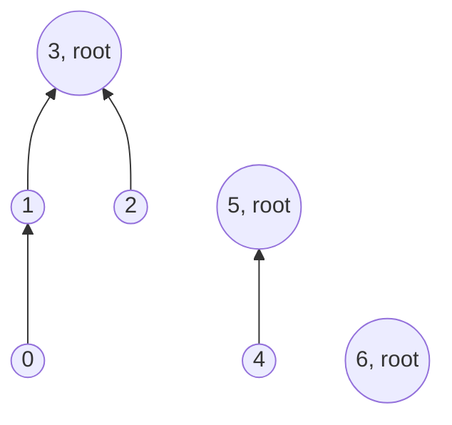
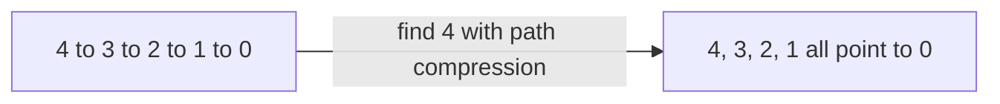
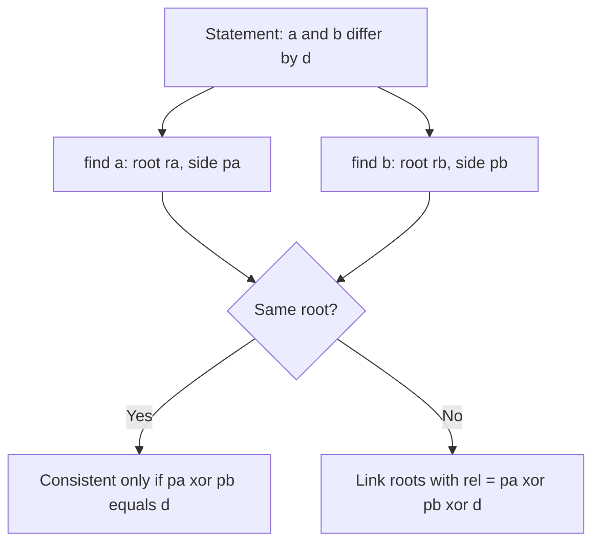

# new

## explanation

### Groups that keep merging

Picture people joining friend groups: "0 and 1 are friends", "2 and 3 are friends", "1 and 3 are friends", which merges two groups into one. At any moment you want to ask "are these two in the same group?". A **disjoint set union** (DSU), also called **union-find**, answers that quickly, however many merges happen.

### Each group is a tree

Every item stores a **parent**. Following parents from any item ends at the group's **root**, an item that is its own parent. The root names the group.

- At the start, every item is its own root: n groups of one.
- **find(x)**: climb from x through parents until reaching a root.
- **unite(a, b)**: find both roots. If they're the same, a and b are already together. Otherwise, make one root the parent of the other, and the two trees become one.

Two items are in the same group exactly when `find(a) == find(b)`.

### Counting groups

Start with n groups, and subtract one each time `unite` actually merges two different groups. Uniting two items that are already together changes nothing.

### Why not just BFS?

BFS or DFS can find components of a fixed graph. But if edges keep arriving and questions come in between, rerunning a search after every new edge costs O(V + E) each time. The DSU handles each new edge and each question directly, with no full search.

### One weakness, fixed later

In this simple version, an unlucky series of merges can build a long chain, and `find` then climbs the whole chain. Two small changes at the next level make every operation almost O(1).

## diagram



## example

```cpp
#include <iostream>
#include <vector>

// Each item points to a parent; an item that is its own parent is a root, and it names its group.
struct Groups {
    std::vector<int> parent;
    explicit Groups(int n) : parent(n) { for (int i = 0; i < n; i++) parent[i] = i; }
    int find(int x) const {
        while (parent[x] != x) x = parent[x];  // climb to the root
        return x;
    }
    bool unite(int a, int b) {  // merge the two groups; false if they were already one
        int ra = find(a), rb = find(b);
        if (ra == rb) return false;
        parent[ra] = rb;
        return true;
    }
};

int main() {
    Groups g(7);
    int groups = 7;
    int friendships[][2] = {{0, 1}, {2, 3}, {1, 3}, {4, 5}, {0, 2}};
    for (auto& f : friendships) {
        bool merged = g.unite(f[0], f[1]);
        if (merged) groups--;
        std::cout << f[0] << '-' << f[1] << (merged ? " merged" : " already together") << ", groups: " << groups << '\n';
    }
    std::cout << "0 and 3 together? " << (g.find(0) == g.find(3)) << ", 3 and 4? " << (g.find(3) == g.find(4)) << '\n';
}
```

```text
0-1 merged, groups: 6
2-3 merged, groups: 5
1-3 merged, groups: 4
4-5 merged, groups: 3
0-2 already together, groups: 3
0 and 3 together? 1, 3 and 4? 0
```

1. Seven people start as seven groups of one.
2. "1-3" joins the group {0, 1} with {2, 3}: the root of 1's tree is made to point at the root of 3's tree.
3. "0-2" finds the same root for both, so nothing changes and the count stays 3.
4. Person 6 never made a friend, so they're still a group of one, which is the third group.

## mistakes

- **Linking the items instead of their roots.** `parent[a] = b` without finding the roots can cut a out of its own tree and lose the rest of its group.
- **Forgetting to initialise the parents.** Every item must start as its own parent; a vector of zeros puts everyone under item 0.
- **Comparing parents instead of roots.** Two items can have different parents and still share a root. Compare `find(a)` with `find(b)`.
- **Decrementing the group count on every unite.** Only a real merge of two different groups lowers it.
- **Expecting to split groups.** A DSU can only merge. Removing a friendship needs a different approach.

## check

```cpp
#include <iostream>
#include <vector>

int main() {
    std::vector<int> parent = {0, 0, 1, 3, 3, 4};  // who points to whom
    auto find = [&](int x) { while (parent[x] != x) x = parent[x]; return x; };
    std::cout << find(2) << ' ' << find(5) << ' ' << (find(2) == find(5));
    parent[find(5)] = find(2);  // unite 5's group into 2's
    std::cout << ' ' << find(5) << '\n';
}
```

```text
0 3 0 0
```

From 2, the parents lead 2 → 1 → 0, and 0 is a root. From 5, they lead 5 → 4 → 3, also a root, so the two are in different groups. Making 3's root point at 0 joins them, and 5 then climbs to 0.

# building

## explanation

### A quick recap

A DSU stores a parent for each item. `find` climbs to the root that names the group, and `unite` links one root under the other. In the plain version, a tree can grow into a long chain, so `find` can cost O(n).

### Union by size

Keep the **size** of each group at its root, and always hang the **smaller** tree under the larger one. An item only gets one step deeper when its group at least doubles in size. A group can double at most log₂ n times, so no tree is deeper than log₂ n.

### Path compression

After `find(x)` climbs to the root, make every item on the way **point straight at the root**. The next `find` from any of them takes one step. Written recursively, this is one line:

`parent[x] = find(parent[x])`

### Together: almost constant

With both changes, any sequence of m operations on n items costs O(m · α(n)). α is the inverse Ackermann function, which grows so slowly that it's at most 4 for any n that fits in a computer. In practice, each operation is O(1).

### What else the root can store

Anything that merges simply can live at the root and be combined in `unite`:

- the group's size, used above;
- the group's smallest item or total value;
- the number of edges in the group, which tells whether it's a tree (edges = size − 1).

## diagram



## example

```cpp
#include <algorithm>
#include <iostream>
#include <vector>

// One array does both jobs: a leader holds minus its club's size, every other member holds who it reports to.
struct Clubs {
    std::vector<int> up;
    explicit Clubs(int n) : up(n, -1) {}  // n clubs of one member each
    int leader(int x) {
        int root = x;
        while (up[root] >= 0) root = up[root];
        while (up[x] >= 0) {  // second walk: everyone on the way now reports to the leader directly
            int next = up[x];
            up[x] = root;
            x = next;
        }
        return root;
    }
    bool join(int a, int b) {
        int la = leader(a), lb = leader(b);
        if (la == lb) return false;
        if (up[la] > up[lb]) std::swap(la, lb);  // la leads the bigger club: its value is more negative
        up[la] += up[lb];
        up[lb] = la;
        return true;
    }
};

int main() {
    const int n = 100000;
    std::vector<int> chain(n);  // without sizes: each merge hangs the old root under the next item
    for (int i = 0; i < n; i++) chain[i] = i + 1 < n ? i + 1 : i;
    int steps = 0;
    for (int x = 0; chain[x] != x; x = chain[x]) steps++;

    Clubs clubs(n);
    for (int i = 0; i + 1 < n; i++) clubs.join(i, i + 1);
    int deepest = 0;
    for (int x = 0; x < n; x++) {
        int d = 0;
        for (int y = x; clubs.up[y] >= 0; y = clubs.up[y]) d++;
        deepest = std::max(deepest, d);
    }
    std::cout << "without sizes: item 0 is " << steps << " steps from its root\n";
    std::cout << "by size: deepest item is " << deepest << " step from its leader, club size " << -clubs.up[clubs.leader(0)] << '\n';
}
```

```text
without sizes: item 0 is 99999 steps from its root
by size: deepest item is 1 step from its leader, club size 100000
```

1. Without sizes, merging 0 with 1, then that group with 2, and so on hangs each old root under the next item: one chain of 100,000 items. Climbing from item 0 takes 99,999 steps.
2. With union by size, the big club's leader always stays the leader, and each new item is hung directly under it. Every item ends up one step away.
3. The leader's entry is −100,000: minus the size of its club. One array holds both the links and the sizes, so a value of −1 means "a leader of a club of one".
4. `leader` makes two walks: the first finds the root, the second points everyone it passed straight at it. That's path compression without recursion.

## mistakes

- **Comparing the sizes the wrong way round.** Leaders hold negative sizes, so the bigger club has the *smaller* (more negative) value. Swap so the more negative one leads.
- **Reading a size from a member.** Only a leader's entry is a size; ask `leader(x)` first.
- **Merging without finding the leaders.** Compare and link the two **leaders**, never the items passed in.
- **Forgetting the second walk.** Finding the root alone gives the right answer but leaves the path long; repoint every member you passed.
- **Mixing up the two meanings of a value.** In this layout `up[x] >= 0` means "x reports to up[x]", and a negative value means "x leads a club of −up[x]". Every loop has to test for that.

## check

```cpp
#include <iostream>
#include <vector>

std::vector<int> up = {-5, 0, 1, 2, 3};  // a chain: 4 reports to 3, 3 to 2, 2 to 1, 1 to 0; 0 leads 5 members
int leader(int x) {
    int root = x;
    while (up[root] >= 0) root = up[root];
    while (x != root) { int next = up[x]; up[x] = root; x = next; }
    return root;
}

int main() {
    std::cout << leader(4) << ':';
    for (int v : up) std::cout << ' ' << v;
    std::cout << '\n';
}
```

```text
0: -5 0 0 0 0
```

`leader(4)` first walks the chain 4 → 3 → 2 → 1 → 0 and finds the leader 0, whose −5 says its club has five members. The second walk repoints 4, 3, 2 and 1 straight at 0, so after one call everyone is a single step from the leader.

# strong

## explanation

### Why both tricks are needed

Each trick alone gives O(log n) per operation; together they give O(α(n)) amortised. Union by size alone bounds the depth by log₂ n. Path compression alone can still leave an expensive first `find`, but it pays for itself over a sequence of operations. The combined bound, proved by Tarjan, is the inverse Ackermann function.

### Where DSU shows up

- **Kruskal's minimum spanning tree.** Edges in order of weight are kept if `unite` succeeds, meaning they join two different components.
- **Cycle detection while adding edges.** An undirected edge whose ends already share a root closes a cycle.
- **Offline deletions.** A DSU can't split, but if all queries are known in advance, process them **backwards**, so that deletions become insertions.
- **Grids and percolation.** Join neighbouring open cells as they open, and ask whether top and bottom are connected.

### Storing relations, not just membership

A **weighted DSU** stores, for each item, a value relative to its parent: a distance, a difference, or a parity. `find` combines the values along the path while compressing it.

With **parity**, each item records whether it's on the same side (0) or the opposite side (1) of its parent. That answers constraints like "a and b are on rival teams" or "a and b are on the same team". When a new statement connects two items already in one group, the stored parities tell whether it **contradicts** what's known. This also checks online whether a growing graph is still bipartite.

### Undoing merges

Some algorithms need to roll merges back. Drop path compression, keep union by size (depth stays log n), and push each merge onto a stack, so that the last one can be undone exactly.

## diagram



## example

```cpp
#include <iostream>
#include <utility>
#include <vector>

// A DSU with parity: flip[x] is 0 if x is on its boss's side, 1 if on the other side.
struct Teams {
    std::vector<int> boss, flip, members;
    explicit Teams(int n) : boss(n), flip(n, 0), members(n, 1) {
        for (int i = 0; i < n; i++) boss[i] = i;
    }
    std::pair<int, int> top(int x) {  // (root, side of x relative to the root)
        if (boss[x] == x) return {x, 0};
        auto [root, side] = top(boss[x]);
        flip[x] ^= side;  // compress: x now reports to the root, so its side is taken relative to it
        boss[x] = root;
        return {root, flip[x]};
    }
    // Record "a and b differ by d" (0 = same side, 1 = opposite sides); false if it contradicts the past.
    bool relate(int a, int b, int d) {
        auto [ra, pa] = top(a);
        auto [rb, pb] = top(b);
        if (ra == rb) return (pa ^ pb) == d;
        if (members[ra] < members[rb]) std::swap(ra, rb);
        boss[rb] = ra;
        flip[rb] = pa ^ pb ^ d;
        members[ra] += members[rb];
        return true;
    }
};

int main() {
    // Statements about 5 people: 0 means "same team", 1 means "rival teams".
    int facts[][3] = {{0, 1, 1}, {1, 2, 1}, {3, 4, 0}, {2, 3, 1}, {0, 2, 0}, {0, 4, 0}};
    Teams d(5);
    for (auto& f : facts) {
        bool ok = d.relate(f[0], f[1], f[2]);
        std::cout << f[0] << (f[2] ? " rival of " : " same team as ") << f[1] << (ok ? ": consistent\n" : ": contradiction\n");
        if (!ok) break;
    }
}
```

```text
0 rival of 1: consistent
1 rival of 2: consistent
3 same team as 4: consistent
2 rival of 3: consistent
0 same team as 2: consistent
0 same team as 4: contradiction
```

1. "0 rival of 1" and "1 rival of 2" put 0 and 2 on the same side, two opposite steps apart, without anyone saying so.
2. "2 rival of 3" links the groups {0, 1, 2} and {3, 4}, with a parity chosen so that 2 and 3 end up on opposite sides.
3. "0 same team as 2" finds 0 and 2 in one group with equal parities, which is consistent with what's already known.
4. "0 same team as 4" fails: 0 and 2 are on one side, and 3 and 4 on the other, so 0 and 4 must be rivals.
5. The formula `pa ^ pb ^ d` works whichever root ends up on top, because XOR is symmetric.

## mistakes

- **Compressing without updating the relation.** When x moves to point at the root, its stored value must become relative to the root: combine it with the parent's value first.
- **Using the parity before `top`.** `flip[x]` is relative to x's current boss, not to the root, until `top(x)` has run.
- **Deleting with a DSU.** It can't split groups. Reverse the order of operations offline, or use another structure.
- **Path compression with rollback.** Compression changes many parents, which can't be undone cheaply. Rollback DSUs use union by size only.
- **Forgetting the same-root case.** A new statement between items already in one group adds no link. It can only agree or contradict.

## check

```cpp
#include <iostream>
#include <vector>

std::vector<int> head = {0, 1, 2, 3, 4, 5};
int rootOf(int x) {
    while (head[x] != x) x = head[x];
    return x;
}

int main() {
    int edges[][2] = {{0, 1}, {1, 2}, {3, 4}, {2, 0}, {4, 5}, {5, 3}};
    int extra = 0;
    for (auto& e : edges) {
        int a = rootOf(e[0]), b = rootOf(e[1]);
        if (a == b) { extra++; std::cout << e[0] << '-' << e[1] << ' '; }
        else head[a] = b;
    }
    std::cout << extra << '\n';
}
```

```text
2-0 5-3 2
```

Each edge either joins two different groups or has both ends already in one group. Then it closes a cycle and isn't needed for connectivity. 2-0 closes the triangle 0-1-2, and 5-3 closes 3-4-5, so 2 of the 6 edges are extra.
